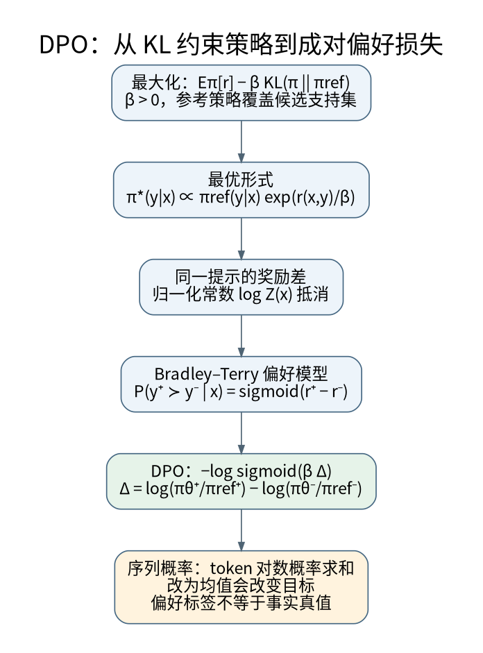

# 从KL约束到DPO的逐步推导

**先修与定位：** 需要[[AI/11-数学与统计桥梁/03-概率似然贝叶斯与信息论|KL与似然]]、[[AI/10-机器学习与深度学习基础/19-强化学习MDP价值函数与策略梯度|策略优化]]和[[AI/20-LLM/10-原理/07-语言模型目标分词粒度与评测可比性|序列概率]]。

## 先明确正在优化什么

固定提示 $x$，设策略 $\pi(y\mid x)$、参考策略 $\pi_0(y\mid x)$、标量奖励 $r(x,y)$。考虑

$$
\begin{aligned}
\max_\pi\;\Bigl[&\sum_y\pi(y\mid x)r(x,y)\\
&-\beta\sum_y\pi(y\mid x)\log\frac{\pi(y\mid x)}{\pi_0(y\mid x)}\Bigr],
\qquad\beta>0.
\end{aligned}
$$

第二项限制策略偏离参考分布，避免只追求奖励代理的极端解。这里假设参考在讨论的支持集上为正，配分函数有限，且先在不受神经网络参数化限制的分布空间推导。它不是对任意有限数据训练过程收敛性的保证。

## 用归一化约束得到最优分布

对约束 $\sum_y\pi(y\mid x)=1$ 引入乘子 $\lambda$，对每个 $\pi(y\mid x)$ 求导：

$$
r(x,y)-\beta\left(\log\frac{\pi(y\mid x)}{\pi_0(y\mid x)}+1\right)+\lambda=0.
$$

把与 $y$ 无关的项收进归一化常数，得到

$$
\begin{aligned}
\pi_*(y\mid x)&=\frac{\pi_0(y\mid x)e^{r(x,y)/\beta}}{Z(x)},\\
r(x,y)&=\beta\log\frac{\pi_*(y\mid x)}{\pi_0(y\mid x)}+\beta\log Z(x).
\end{aligned}
$$

奖励越高，参考概率被乘上越大的因子；$\beta$ 越大，在这个固定奖励问题中分布偏移越保守。这个关于最优分布的解释，不等于 DPO 中改变 $\beta$ 后每一步梯度一定更小。

把原目标记为 $J(\pi)$，代入 $\log\pi_*=\log\pi_0+r/\beta-\log Z$，还可写成

$$
J(\pi)=\beta\log Z(x)-\beta\,\mathrm{KL}(\pi\|\pi_*).
$$

这里仍固定同一个 $x$；$\pi$ 的支持须在 $\pi_0>0$ 的范围内，$Z(x)$ 有限，且上述期望和 KL 项有定义。在这些条件下，KL 非负说明 $\pi_*$ 是分布层面目标的最大化解；这不保证神经网络参数化、有限样本或实际优化过程达到该解。

## 偏好比较为什么消去了难算的常数

假设同一提示的成对偏好服从 Bradley–Terry 模型：$P(y_w\succ y_l\mid x)=\sigma(r(x,y_w)-r(x,y_l))$。代入上式，$\log Z(x)$ 相减消失。用可训练策略替代最优策略的参数化，得到

$$
\begin{aligned}
z_\theta&=\beta\left[\log\frac{\pi_\theta(y_w\mid x)}{\pi_0(y_w\mid x)}
-\log\frac{\pi_\theta(y_l\mid x)}{\pi_0(y_l\mid x)}\right],\\
L_{\rm DPO}&=-\log\sigma(z_\theta).
\end{aligned}
$$

这条推导是 DPO 的核心。[^S15] 它利用了 KL 正则问题和特定偏好模型的对应，不需要另行显式训练奖励网络；不代表参考分布、偏好假设和数据覆盖问题全部消失。

## 两个候选的解析例

固定提示 $x$，只考虑 $y_1,y_2$。沿用本页 Bradley–Terry 的单位尺度约定，奖励用无量纲自然对数刻度，取

$$
\pi_0=(1/2,1/2),\qquad r=(\ln3,0),\qquad\beta=1.
$$

先算未归一化权重，再计算分母：

$$
\begin{aligned}
(w_1,w_2)&=(\tfrac12 e^{\ln3},\tfrac12 e^0)
=(\tfrac32,\tfrac12),\\
Z&=w_1+w_2=2,\\
\pi_*&=(w_1/Z,w_2/Z)=(\tfrac34,\tfrac14).
\end{aligned}
$$

这个 $\pi_*$ 是所构造奖励、参考策略和温度下的解析最优分布，不是从人类数据直接观测到的频率。若偏好标签为 $y_1\succ y_2$，本例奖励差为 $\ln3$，Bradley–Terry 给出偏好概率 $\sigma(\ln3)=3/4$。把 $\pi_\theta=\pi_*$ 代入刚才的 DPO logit：

$$
\begin{aligned}
z_\theta
&=\ln\frac{3/4}{1/2}-\ln\frac{1/4}{1/2}=\ln3,\\
L_{\rm DPO}
&=-\ln\sigma(z_\theta)=-\ln\tfrac34
\approx0.287682.
\end{aligned}
$$

策略概率和成对偏好概率在这个特定构造中恰好同为 $3/4$，它们的对象不同；$0.287682$ 则是一个已标注偏好对的负对数似然。这些数不说明真实偏好已被正确识别，也不保证有限数据训练的效果。改变奖励刻度时须同时检查 $r/\beta$ 与偏好模型的尺度约定，不能只比较不同实现中同名的 $\beta$。

## 梯度给出最简单的单元测试

$\partial L/\partial z=\sigma(z)-1$。策略与参考相同时 $z=0$、损失为 $\log2$；把两个回答的对数概率暂作独立变量，对胜者梯度为 $-\beta/2$，对败者为 $+\beta/2$。梯度下降会提高胜者的相对倾向。共享网络参数和归一化约束会让实际各答案概率共同变化，因此不能推断每一步胜者绝对概率都必然上升。

序列对数概率是目标 token 对数概率的和。提示 token 不应混入回答比较；padding 必须屏蔽，EOS 约定要一致。把求和换成按长度平均，会改变推导中的概率对象，可能是有目的的变体，但不能继续称为原公式的等价实现。基础见[[AI/20-LLM/10-原理/07-语言模型目标分词粒度与评测可比性|语言模型目标]]。

## 何时这个解释不够用

人类偏好可能有噪声、多目标和不可传递性；相同回答在不同用户条件下可能获得相反偏好。离线数据只覆盖少部分回答区域，训练后策略访问的新区域缺少约束。奖励代理对长度、格式、礼貌程度的偏好可能掩盖事实正确性，评估必须加入独立任务指标。

参考策略通常固定，预计算参考 log-prob 时必须绑定 tokenizer、模板、权重版本和目标掩码。LoRA 关闭适配器能否代表目标参考模型，需要具体核验，不能假设所有库的默认行为一致。连接[[AI/20-LLM/30-训练/15-LoRA低秩几何QLoRA与蒸馏边界|低秩适配]]与[[AI/20-LLM/70-工程应用与工具链/10-LLM评测污染裁判偏差与统计检验|偏好评测]]。

自测：同一提示下给两个回答奖励都加 100，最优策略与成对偏好是否改变？不改变；前者被 $Z(x)$ 抵消，后者由奖励差决定。这也说明奖励的提示相关平移不由成对偏好辨识。

## 三个人都能排序，合在一起为什么没有共同标量

两个候选只给一项差分，三个候选会要求不同差分彼此一致。现在固定同一提示 $x$：“一个社区阅览室想减少丢书，同时顾及会员阅读隐私。请提出一项借阅管理方案并说明主要代价。”三份完整回答固定如下；它们是原创教学方案，不预设哪份在现实中更有效或更正当：

| 回答 | 固定文本 |
| --- | --- |
| A | 向全体会员公开每人的借阅书目，便于相互核对；代价是个人阅读可能暴露。 |
| B | 只让管理员保存个人借阅书目，核对归还后删除；代价是仍须信任管理员并承担记录管理工作。 |
| C | 不保存与个人关联的书目，采用统一归还提醒并增加值班；代价是增加人力，且追查遗失的能力可能受限。 |

固定评价说明为“比较哪份回答更适合作为这个阅览室的建议，同时考虑资源保护、阅读隐私与管理代价；不改变提示、文本和说明，不引入其他候选，无平局”。不同评价者可以对这些理由给不同权重。下面三名合成评价者就是本题**完整目标总体**，个人严格排序由题目定义；每次判指定的一对时，都等概率抽取其中一人，按其排序给出判断：

| 评价者 | 完整个人排序 | A 与 B | B 与 C | C 与 A |
| --- | --- | --- | --- | --- |
| 1 | A ≻ B ≻ C | A | B | A |
| 2 | B ≻ C ≻ A | B | B | C |
| 3 | C ≻ A ≻ B | A | C | C |

每个人的排序都传递，例如评价者3有 $C\succ A$、$A\succ B$，也有 $C\succ B$。逐列计数：评价者1、3选A胜B；1、2选B胜C；2、3选C胜A。因此

$$
P(A\succ B\mid x)=P(B\succ C\mid x)=P(C\succ A\mid x)=\frac23.
$$

循环产生于跨人聚合。这是按已定义总体和抽样规则算出的精确生成概率；表中九格展示所有人的判断，**不是九个现实标签组成的随机样本，也不是统计显著性检验**。真实有限数据估计的 $\hat p$ 还会有抽样误差，不能照搬本题的精确等号。

### 奖励差闭环，log-odds也必须闭环

沿用本页统一的单位尺度 $P(i\succ j\mid x)=\sigma(r_i-r_j)$，其中 $\sigma(t)=1/(1+e^{-t})$，$r_i=r(x,i)$ 为有限无量纲标量。若要精确表示某个 $0<p_{ij}<1$，反解得到

$$
r_i-r_j=\log\frac{p_{ij}}{1-p_{ij}}.
$$

上述三项都是 $2/3$，各自的赔率为2，所以同一组奖励必须满足

$$
r_A-r_B=\ln2,\qquad r_B-r_C=\ln2,\qquad r_C-r_A=\ln2.
$$

左边相加必为0，因为每个奖励恰好出现一次正号、一次负号；右边为 $3\ln2>0$，矛盾。任何三个有限标量的差分都这样闭合，换整体平移也不能修复。等价地，把三个差分指数化，模型要求沿环赔率积

$$
e^{r_A-r_B}e^{r_B-r_C}e^{r_C-r_A}=e^0=1,
\qquad\text{本题却有}\quad 2\cdot2\cdot2=8.
$$

这是同一个证明的赔率复核，不是另一项经验调查。**这组总体概率不可由同一条件、同一尺度的有限标量 BT 模型精确拟合。** 没有多数循环也不足以证明 BT 合适：它还要求概率的 log-odds 可加，约束比仅给答案排先后更强。

DPO 的隐式奖励仍是

$$
r_\theta(x,y)=\beta\log\frac{\pi_\theta(y\mid x)}{\pi_0(y\mid x)}+c(x).
$$

这里固定同一 $x$、同一 $\beta>0$ 与 BT 尺度，三份回答的参考概率和策略概率均为正，所以三个对数与奖励有限；$c(x)$ 与回答无关。令 $h_i=\log[\pi_\theta(i\mid x)/\pi_0(i\mid x)]$，则三项 DPO 比较 logit 相加为

$$
\beta[(h_A-h_B)+(h_B-h_C)+(h_C-h_A)]=0.
$$

省去显式奖励头没有消除单标量差分的闭合约束。论文的变量代换保留原有标量奖励类别；它并未使任意群体比较关系变成 BT 可表示关系。[^S15] 若每对使用不同提示、条件或尺度，就已改变模型，本证明不能直接套用。

**不能精确拟合不等于不能训练。** 只要前述概率为正，有限标注对的 $-\log\sigma(z_\theta)$ 仍有定义，循环标签可以进入优化，策略可取得折中；损失下降不说明三项总体概率都拟合正确，也不说明实际训练收敛。本例证明的是表示限制。

### 迁移题：只改变第三项概率

另给一组同条件下的目标总体概率：前两项仍为 $P(A\succ B\mid x)=P(B\succ C\mid x)=2/3$，第三项改为 $P(C\succ A\mid x)=1/5$。这是一道新的目标概率题，**不是原三人严格排序与等权规则还能生成的同一总体**。判断能否用同一组有限标量精确表示；若能，给一组奖励，逐项核对概率，并说明这个答案允许和不允许推出什么。

参考答案：奖励、概率和赔率都要核对

可取 $(r_A,r_B,r_C)=(\ln4,\ln2,0)$。差分是

$$
(r_A-r_B,r_B-r_C,r_C-r_A)=(\ln2,\ln2,-\ln4),
$$

和为0。三项 logistic 概率分别为

$$
\sigma(\ln2)=\frac23,\qquad
\sigma(\ln2)=\frac23,\qquad
\sigma(-\ln4)=\frac15.
$$

赔率相应为 $2,2,1/4$，积为 $2\cdot2\cdot(1/4)=1$。若只在这三回答上取 $\pi_0=(1/3,1/3,1/3)$、$\beta=1$，本页的归一化公式还给出 $\pi_*=(4/7,2/7,1/7)$；其 DPO 隐式奖励与这组 $r$ 只差一个共同常数，差分相同。因此本构造在不受网络参数化限制的三点分布中可表示；没有证明现实模型、真实人群、采样估计或实际训练已经验证。

奖励整体加同一常数也正确；若只给排序 $A\succ B\succ C$，尚未检验规定的三项概率。保持前两项时，差分已迫使 $P(C\succ A)=1/5$，因此不能仅以“第三项小于1/2，没有多数循环”就宣告精确可表示。

### 循环出现后，怎样决定下一步

现实数据先做下面的诊断。本例里的三人总体已经完整给定，第一行不能用来逃避其代数反例；实际样本则不能把点估计的非零环和当作精确总体矛盾。

| 要区分的问题 | 核对什么 | 什么会改变判断 |
| --- | --- | --- |
| 抽样误差或比较条件混杂 | 独立重复、同一提示/候选/评价说明记录、比较方向和抽样方式；检查顺序或语境是否变化 | 固定条件后重复比较，报告概率及环 log-odds 的区间不确定性；若数据仍与闭环相容，证据不足以排除 BT；若循环随条件固定而消失，先修数据定义 |
| 同条件下聚合总体真实非传递 | 对目标人群有充分覆盖的同条件比较；保留个体或条件差异，检查环约束 | 若各对真实概率如本例固定为2/3，已给反例；现实中若匹配抽样的不确定性分析持续排除闭环，增强共同 BT 失配证据。若改抽样总体或权重，需重算，不能沿用旧结论 |
| 谁应被代表、为何如此加权 | 谁进入评价总体、谁被排除，建议实施的收益/负担和替代规则 | 被排除者也受重大影响、退出不实质可行或少数承担严重损失，可以动摇等权总体的辩护；新增平等参与、必要性或较少侵入替代的理由，可改变规范选择，但不能由它直接判定模型似然 |

三类问题可以并存，不能一概把不同意见叫“脏标签”。第一、二行需要与设计匹配的统计证据；区间如何计算不在这个有限例里得到通用认证。第三行需要事实与规范理由共同支撑，去[[哲学与文化/20-论证知识与规范/02-伦理与政治正当性#偏好聚合：谁被代表，为什么等权|谁被代表与负担的辩护]]，带着“等权为何合理、哪条反对理由最强”阅读。回来可以修改目标总体或权重，也可能保留原规则并公开其代价；不能从循环代数直接指定投票或伦理准则。

| 后续路径 | 保留什么、得到什么 | 承担什么代价 |
| --- | --- | --- |
| 共同标量下折中拟合 | 在明确的抽样总体和比较权重下优化 BT/DPO，逐对公开目标、预测和残差 | 不能精确保留这组循环总体概率；多数汇总会掩盖局部差异，整体损失必须配合切片与任务评测，残差不能自动归因于标注错误 |
| 保留群体/条件差异，或使用更丰富比较模型 | 声明分层条件与部署选择方式；或让比较分数依赖候选对，容纳单标量差不能表达的关系 | 需要足够分层/候选对数据，解释与泛化更难；每个条件内若仍用 BT，仍受该条件的闭环约束，分层不保证消除循环；更丰富模型也需独立评估 |

选好路径后，返回[[AI/20-LLM/30-训练/04-偏好优化RLHF-DPO-ORPO与KTO#聚合之后，先改数据还是改模型|数据与模型决策]]写出要保留的条件、接受的拟合误差及下一项会改变决定的证据。个体分歧记录不是可比较的福利量尺；任何模型拟合表现也不能证明代表规则有权利或正当性。若进一步要把成对 log-odds 投影成最佳标量差，下面另用一组已固定读数说明**指定平方误差下的势差投影**，它回答残差怎样分解，与本节“循环怎样由完整排序聚合而来”分工。

## 把成对log-odds带到势差投影

固定同一提示x、三份回答 $v_0,v_1,v_2$、评价条件与单位尺度。沿边01、12、02，规定 $p_{ij}=P(v_j\succ v_i\mid x)$；箭头只规定比较方向，反向概率为 $1-p_{ij}$。给一组合成总体概率 $(\sigma(2),\sigma(1),1/2)$，其无量纲自然对数log-odds是 $y=(2,1,0)^T$。本页BT要求 $y_{ij}=r_j-r_i$，但沿0→1→2→0的和为 $2+1-0=3$，任何三个有限标量的差分和都为0，因此不能精确表示这组指定总体概率。这是有限模型反例，尚未声称现实采样拒绝BT。

若另选三边等权欧氏度量，带这组y到[[数学/36-拓扑学/20-同调与上同调/06-边读数势差与离散Hodge分解#同一组读数的完整势差投影|势差最小二乘]]，得到参考 $r_0=0$ 时 $r=(0,1,1)^T$、预测log-odds $(1,0,1)^T$、剩余 $(1,1,-1)^T$。回来核“指定log-odds平方误差最小”是什么目标；去[[数学/36-拓扑学/20-同调与上同调/06-边读数势差与离散Hodge分解#同一残差，填面改变身份|同一残差的面与调和身份]]时，添面是声明三元组的分析模型，并非实测已经发现一个空间的洞。

该LS结果一般不是BT极大似然解。即便按每边同等次数构造总体Bernoulli交叉熵 $\ell(\psi)=\sum_e[\log(1+e^{(D\psi)_e})-p_e(D\psi)_e]$，其导数是 $D^T(\sigma(D\psi)-p)$，而LS条件是 $D^T(D\psi-y)=0$。在 $\psi=(1,1)^T$，交叉熵导数第一分量 $2\sigma(1)-\sigma(2)-1/2\ne0$（约0.08132），第二分量为0，已足以说明不是同一最优点。实际计数似然还按各对次数加权；经验log-odds的0/1端点、平滑与精度权重都须声明，不能无条件投影。

本课DPO的隐式奖励 $r_\theta(x,v)=\beta\log(\pi_\theta(v\mid x)/\pi_0(v\mid x))+c(x)$ 在既定正概率/尺度条件下仍为每个回答一个标量，差分仍闭合；省去显式奖励网络不取消此表示约束。训练仍可做折中拟合，以上残差没有证明DPO训练失败。返回[[AI/20-LLM/30-训练/04-偏好优化RLHF-DPO-ORPO与KTO#数据合同与最小可观察练习|原判断与比较条件]]时，应核抽样不确定性、同条件/候选是否固定及个体分歧，而非自动把残差当作标注噪声或规范冲突。谁进入总体、怎样加权和谁承担聚合后果仍需相应规范理由；LS的代数最优性没有给它们作结。

## 来源与证据边界

本页的数值例与推导用于解释机制，不代表大型模型或真实业务上的实测效果。2026-10-12实际核读下列论文v3的§3、§4、§5.1及附录A.1、A.2：分别对应BT假设、KL最优策略与变量代换、奖励平移等价类、分布空间最优解及DPO比较概率。三人排序表、循环闭环证明、1/5变式和规范题是本课教学构造，论文不是这些例子、现实统计拒绝或伦理结论的实测来源。

[^S15]: [Rafailov等：Direct Preference Optimization，arXiv:2305.18290v3](https://arxiv.org/html/2305.18290v3)。§3式(1)–(3)、§4式(4)–(7)、§5.1、附录A.1与A.2。此处$\pi_0$为论文$\pi_{ref}$；本文用共同$c(x)$显式保留不影响比较的奖励平移。

**返回与迁移：** [[AI/20-LLM/30-训练/00-LLM训练-MOC|本主题课程地图]]；[[AI/00-开始/05-问题驱动知识图谱与难点导航|按问题跨主题继续]]。
