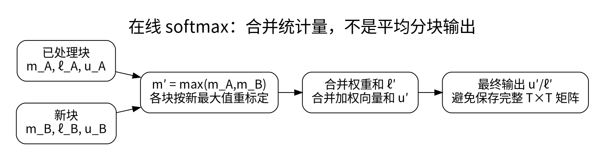
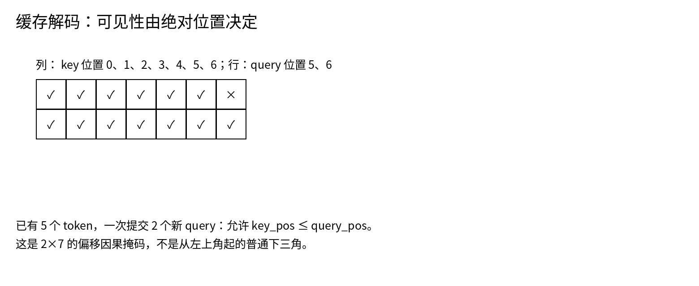

# FlashAttention、在线 Softmax 与 SDPA 掩码

<!-- deep-review-02 -->
> [!tip] 本轮深化：从当前概念继续追问
> 分块在线归一化改变执行顺序，不改变理想算术下的目标；浮点次序仍可能造成误差。非方形因果掩码必须检查缓存偏移，不能只打开 causal 开关。 深化与验证：[[AI/20-LLM/20-架构/10-注意力反向传播与Softmax竞争|注意力反向传播与Softmax竞争]]；[[AI/20-LLM/20-架构/11-RoPE相对位置缓存偏移与长度外推|RoPE相对位置缓存偏移与长度外推]]。


FlashAttention 的关键不在于“忽略部分注意力”，而是重新安排精确注意力的计算和内存访问，避免把完整位置两两矩阵反复写入显存。全注意力的算术复杂度仍然随长度平方增长；少搬数据不等于少比较位置。[1]



## 在线 softmax 为什么能分块

对一行分数 $s_j$ 和对应 value $v_j$，保存三个量：最大值 $m$、指数权重和 $\ell$、加权向量和 $u$。一块数据的统计量定义为：

$$
m=\max_j s_j,\quad \ell=\sum_j e^{s_j-m},\quad
u=\sum_j e^{s_j-m}v_j,\quad o=u/\ell.
$$

合并块 A、B 时用同一个新最大值 $m'=\max(m_A,m_B)$，并重标定旧统计量：

$$
\ell'=e^{m_A-m'}\ell_A+e^{m_B-m'}\ell_B,\qquad
u'=e^{m_A-m'}u_A+e^{m_B-m'}u_B.
$$

最终 $o=u'/\ell'$。分块输出 $o_A$ 和 $o_B$ 不能直接平均，因为它们的归一化分母不同。这个合并在实数运算中等价，浮点执行因运算次序不同会有小误差。

分数为 `[1,0]`、value 为 `[[2,0],[0,4]]` 时，权重约为 `[0.731059,0.268941]`，输出约 `[1.462117,1.075766]`。本地 CPU 实验同时检查朴素版与分块版，并用非常大的 logits 检查稳定性。

## 掩码不是一张万能下三角



已有 5 个 token，再提交 2 个新 query，当前 query 的绝对位置为 5 和 6，keys 的绝对位置为 0 到 6。合法条件是 $key\_pos\le query\_pos$，矩阵形状为 2×7。第一行可以看前六列，第二行可看全部七列。

直接对 2×7 矩阵使用从左上角起的下三角，会让第一行只看到第一列。这正是将训练时的方形因果 mask 生搬到 cached decode 的错误。

```python
import torch
import torch.nn.functional as F
past, q_len = 5, 2
q_pos = torch.arange(past, past + q_len)
k_pos = torch.arange(past + q_len)
allow = k_pos[None, :] <= q_pos[:, None]
# q: [B,H,2,D]；k/v: [B,H,7,D]，另行构造
# out = F.scaled_dot_product_attention(q, k, v,
#     attn_mask=allow, dropout_p=0.0, is_causal=False)
```

PyTorch SDPA 的布尔 mask 中 `True` 表示允许参与注意力；`nn.MultiheadAttention` 的相关布尔屏蔽参数采用不同语义，迁移代码时必须查接口。SDPA 的 dropout 由 `dropout_p` 控制，评估时显式传零，不能假设外围 `.eval()` 自动修改一个函数参数。[2]

必须保证每个有效 query 至少有一个可见 key，否则全为负无穷的 softmax 可能产生 NaN 或后端特定结果。Padding、文档 packing、滑窗和绝对位置要联合构造。

## 算法、接口、kernel 分开验证

调用 SDPA 不等于必然采用某个 FlashAttention kernel；后端会受设备、dtype、head 维度和 mask 形式影响。记录具体后端与版本，再比较输出、梯度和速度。[2]

截至本轮来源检索，2026 年已有 FlashAttention-4 研究，重点包括适配 Blackwell 的流水线和非矩阵运算瓶颈。该进展不意味着本包已安装它，也不意味着任意显卡都能得到相同加速；本页验证的是稳定的在线 softmax 原理和掩码合同。[3]

## 一手资料

1. [FlashAttention 原始论文](https://arxiv.org/abs/2205.14135)。
2. [PyTorch：scaled_dot_product_attention](https://docs.pytorch.org/docs/stable/generated/torch.nn.functional.scaled_dot_product_attention.html)。
3. [FlashAttention-4，2026-03](https://arxiv.org/abs/2603.05451)。

**课程入口：** [[AI/20-LLM/40-推理/00-LLM推理-MOC]]。
