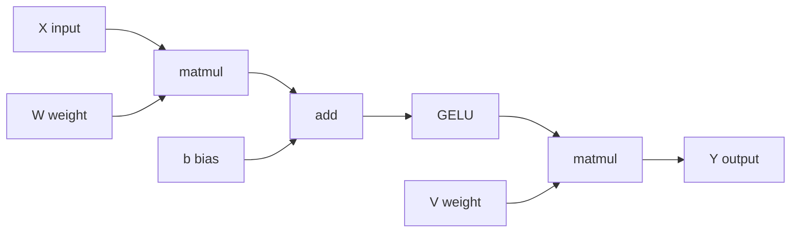
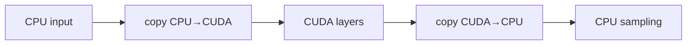

# GGML：张量、计算图、分配器与 Backend

<!-- deep-review-02 -->
> [!tip] 本轮深化：从当前概念继续追问
> 张量形状、存储布局、图依赖和执行后端是四层合同。性能瓶颈可能在内存搬运而非浮点运算数，应从资源账本定位。 深化与验证：[[AI/00-开始/06-统一符号形状与公式阅读方法|统一符号形状与公式阅读方法]]；[[AI/12-PyTorch/09-性能剖析编译动态形状与内存账本|性能剖析编译动态形状与内存账本]]。


## 本课目标

本课回答 `llama.cpp` 调用链中最容易被一句“交给 ggml 算”掩盖的问题：

1. 一个 `ggml_tensor` 描述了哪些东西，哪些东西不在它里面？
2. 算子为什么先组成计算图，之后才分配和执行？
3. graph allocator 怎样借助生命周期复用临时内存？
4. backend buffer、backend、device 与 scheduler 分别负责什么？
5. CPU/CUDA 混合 offload 时，权重、KV cache、中间张量和拷贝究竟在哪里？
6. 怎样从模型加载一路追到一次 decode 的计算图、分配和后端执行？

先修连接：[[计算机知识/10-编程语言/02-C++/00-C++-MOC|C++ MOC]]、[[计算机知识/30-计算机系统/00-计算机系统-MOC|计算机系统 MOC]]、[[计算机知识/40-并行与异构计算/01-CUDA/00-CUDA-MOC|CUDA MOC]]。GGUF 与量化布局分别连接 [[AI/20-LLM/60-模型格式与量化/03-GGUF结构转换与验证|GGUF 结构、转换与验证]]、[[AI/20-LLM/60-模型格式与量化/05-K-quants-IQ与Q4_K_M|K-quants、IQ 与 Q4_K_M]]。

> [!warning] 版本与验证边界
> 本轮构建基线已固定为官方 commit `8887a48f050554f0ee59f56753860c061836b02d`；主任务只完成 Darwin arm64 的 CPU-only target 构建与两个定向测试，证据见 [[AI/20-LLM/50-实现/04-llama.cpp构建后端与调用链#本轮临时验收记录|本轮临时验收记录]]。本页没有在该源码上执行 graph dump、allocator trace、模型 decode、CUDA 或混合 backend 测试。这里的结构字段、类型名、函数名、目录、调度策略与 CUDA 支持集合仍须在实施时核对；`ggml_gallocr`、`ggml_backend_sched` 等名称仅是源码检索线索，不是永久 API。快速变化事实以 [[AI/90-资源/05-官方资料与版本核验记录|官方资料与版本核验记录]] 为入口。
>
> 2026-09-02 对同一 commit 的官方 [`ggml-backend.h`](https://github.com/ggml-org/llama.cpp/blob/8887a48f050554f0ee59f56753860c061836b02d/ggml/include/ggml-backend.h) 与 [`ggml-alloc.h`](https://github.com/ggml-org/llama.cpp/blob/8887a48f050554f0ee59f56753860c061836b02d/ggml/include/ggml-alloc.h) 做了静态核对。头文件的官方注释确认：graph allocator 的 reserve/allocate 顺序，以及 backend scheduler 的切图、分配、compute、synchronize 与 reset 职责。这只提升了课程概念与该 commit 的对齐度，不是 graph/allocator/backend 运行验收。

## 四个经常被混为一谈的层

```text
ggml_tensor
  描述 dtype、shape、stride、op、依赖、view 与数据句柄
        │
        ▼
ggml_cgraph
  收集完成目标结果所需的张量/算子 DAG
        │
        ▼
graph allocator / backend scheduler
  决定临时内存何时可复用，图在哪里切分，何时插入跨后端传输
        │
        ▼
backend + backend buffer
  在 CPU RAM、CUDA device memory 等具体存储上执行 op
```

核心边界：**tensor 不是数组本身，graph 不是已经执行的程序，allocator 不决定模型数学，backend 可用也不代表张量实际放在那里。**

## 1. Tensor：描述、存储与计算语义

### 一张 tensor 身份卡

在固定 commit 中检查实际结构后，至少能解释这些概念字段：

|概念|回答的问题|常见误读|
|---|---|---|
|element/storage type|元素或量化块怎样存储？|把量化类型当作每元素固定 4 bit 的平坦数组|
|shape / extents|每个维度有多少逻辑元素？|只看总元素数，忽略矩阵轴语义|
|byte strides|各维索引怎样映射到字节偏移？|假设所有 tensor 都 contiguous|
|data / buffer relation|数据位于哪个后端 buffer、偏移在哪里？|把 device pointer 当 host pointer 解引用|
|op|该 tensor 是输入/常量，还是某个操作结果？|以为构造 op 时已经计算|
|source tensors|该 op 依赖哪些输入？|只沿一个 `src`，漏掉其他依赖/参数|
|view/backing|是否与另一个 tensor 共享存储？|释放/复用 backing 后继续使用 view|
|name/flags/extra|诊断、后端或版本特有信息|把调试字段当稳定 ABI|

### Shape 与 stride

概念上，对索引 `(i0, i1, i2, i3)`，字节地址类似：

```text
base + i0 * stride0 + i1 * stride1 + i2 * stride2 + i3 * stride3
```

但必须守住三条边界：

1. ggml 常把第 0 维作为最内层/最快变化维，但具体算子的“行、列、batch、head”解释要从该 op 和模型代码确认；
2. 转置、切片、reshape/view 可能只改元数据/stride，不复制为连续布局；
3. block-quantized 类型按**量化块**存储，逻辑元素数、块大小、类型存储字节和 stride 的关系必须通过当前 commit 的类型 helper 计算，不能写 `bits / 8 * nelements` 猜内存。

例如 `Q4_K` tensor type 不是“任意单个 4-bit 数可以独立寻址”的普通标量数组；它按量化块保存 code、scale/min 等元数据。`Q4_K_M` 则是整模型混合量化预设，负责按张量角色选择 `Q4_K`、`Q6_K` 等实际 type，本身不是单个 tensor 的存储类型。具体见 [[AI/20-LLM/60-模型格式与量化/05-K-quants-IQ与Q4_K_M|K-quants、IQ 与 Q4_K_M]]。

### Storage dtype、计算 dtype 与累加 dtype

权重以某种量化类型存储，并不意味着所有算术都以同样位宽完成。backend kernel 可能：

- 按块反量化或融合反量化与矩阵乘；
- 将输入转换到 kernel 支持的表示；
- 用更高精度累加；
- 把输出写成另一 dtype。

因此性能/误差报告要区分**文件存储类型、runtime tensor type、kernel 输入类型、累加精度和输出类型**。不能从 GGUF 文件后缀或量化名字单独推出执行精度。

### `data` 不等于 CPU 可直接读取的数组

一个 tensor 的 storage 可能来自：

- host heap/arena；
- memory-mapped 文件页；
- pinned/staging host memory；
- CUDA device buffer；
- backend 管理的 opaque buffer；
- 另一个 tensor 的 view。

调试输出真实数据时，应使用该 commit 的 backend tensor get/copy 接口或明确支持 host access 的 buffer 类型。未经验证直接 `memcpy(tensor->data, ...)` 可能读 device pointer、绕过异步依赖或破坏 view/stride 语义。

### Tensor 构造通常只建立表达式

假设写出概念表达式：

```text
H = X × W
Z = GELU(H + b)
Y = Z × V
```

构造 `H`、`Z`、`Y` 时，系统通常建立 shape、op 和依赖；真正的 buffer 分配与 kernel 执行稍后发生。把“创建输出 tensor”当成“计算完成”会导致错误计时和错误读取。

## 2. Computation graph：把需要计算的结果闭包起来

### Graph 是 DAG



若从 `Y` 向前展开，graph 收集到所有依赖，并按能执行的拓扑顺序保存节点/叶子。具体 graph 结构、leaf 定义、访问顺序与是否允许原地 op 由 commit 决定。

### Graph 构建时应验证什么

- 每个 op 的输入 shape、dtype、stride 是否满足约束；
- view 的 backing 和 offset 是否仍有效；
- position、mask、KV cache view 是否指向正确 sequence/token；
- 目标 tensor 是否真的被加入 forward graph；
- 输出 logits/embedding 对应哪一 batch row；
- graph 是否因 batch/context/sequence 变化而需要重建或重新规划；
- 自定义 op 或 backend 不支持的 op 如何报错，而不是静默得出垃圾结果。

### 静态图、动态 shape 与复用

LLM 的数学结构重复，但 prefill 与单 token decode 的 shape 不同；batch、micro-batch、sequence 数和 context 位置也会改变尺寸。实现可能复用部分 graph/allocator 计划，也可能每轮重建元数据。不要从“每层结构一样”推出“每步零 graph 构建开销”。trace 应分别测量 graph build、allocation/plan 和 compute（若当前 API 能安全分开）。

## 3. Graph allocator：用生命周期减少峰值临时内存

### 为什么不是每个中间 tensor 单独 `malloc`

若一个中间结果在最后一个 consumer 完成后死亡，而另一个结果之后才出现，二者就可能复用同一块足够大的 buffer。以本页的 `H → A → Z → Y` 链为例，graph allocator 会根据拓扑依赖和别名约束估算生命周期：

```text
节点             1:H    2:A    3:Z    4:Y
H 的值           █████████
A 的值                  █████████
Z 的值                         █████████
Y 的值                                ███████→ consumer

候选槽 α         [--- H ---]   [--- Z ---]
候选槽 β                [--- A ---]   [--- Y ---]
```

这是概念图，只在大小、对齐、backend、view/alias 和异步完成点都允许时才可如此复用。实际 allocator 还要处理原地 op、跨 graph 保留对象和设备执行尚未完成等约束。

### Persistent 与 transient 分开预算

|内存类别|典型生命周期|能否在 decode 步之间直接复用|
|---|---|---|
|模型权重|model 生命周期|保持，不作为普通临时槽覆盖|
|模型元数据/tensor descriptors|model 或 context 生命周期|保持|
|KV cache|context/sequence 生命周期并随 token 增长或复用|按 KV 策略管理，不能当普通 scratch|
|输入 token/position/mask tensor|一次 batch 或计划范围|看所有权与异步完成点|
|中间 activation/workspace|一次 graph 计算|graph allocator 的主要复用对象|
|logits/embedding output|至少活到 consumer 读取完成|读取/拷贝前不可复用|
|staging/copy buffer|跨 backend 传输范围|必须等 event/sync 完成|

峰值内存不是把图里所有 tensor 字节相加。更准确的近似是：

```text
peak ≈ persistent_weights
     + KV_cache
     + peak_live_intermediates_per_backend
     + outputs
     + staging/copy
     + allocator_alignment_and_fragmentation
     + runtime/backend_overhead
```

### Reserve、allocate 与 execute

当前实现可能区分：先用代表 graph 估算/预留 buffer，再为某次 graph 分配 tensor offset，最后执行。阅读时寻找类似 `reserve`、`alloc_graph`、`graph_compute` 的职责，不要绑定名字。要问：

- reserve 的 shape 与实际运行 shape 是否一致？
- 超过预留尺寸时是重分配、报错还是退化？
- 重分配是否让已有 view/pointer 失效？
- allocator 的对齐来自哪个 buffer type？
- 失败后 graph/context 能否安全重用？

固定 commit 的官方 scheduler 头文件还给出一个容易被忽略的生命周期边界：`reset` 会清掉旧 graph 的分配/后端关系，旧 tensor 的数据指针可成为 dangling pointer；正确方式是丢弃已解分配的 tensor 使用路径，重建新 graph，而不是 reset 后继续写旧 input tensor。这正是“描述符存在”不等于“backing storage 仍有效”的具体例子。

### View、alias 与原地复用是风险中心

两个 tensor 可共享 backing buffer。allocator 只有在所有 alias 都不再需要旧值时才能复用。调试时画出：

```text
base tensor ──owns/backend buffer──> [bytes................]
   ├── view A: offset + strides
   └── view B: offset + strides
```

不能只看 C++ 对象生命周期；即使一个 `ggml_tensor` 描述符还存在，其 backing 区也可能在约定的 graph 生命周期后被复用。反之，一个 view 仍活跃就可能阻止复用。

## 4. Backend 抽象：设备、存储与执行

### Device、backend、buffer type、buffer

不同 commit 的对象模型会演进，但职责通常可以这样区分：

|概念|职责|问题例子|
|---|---|---|
|device|枚举和描述物理/逻辑计算设备|有几块 GPU？能力和内存是什么？|
|backend|在某设备/执行域提交 graph/op、同步、event|这个 graph split 在哪里执行？|
|buffer type|某类可分配存储的能力、对齐和访问性质|host、device、pinned、mapped？|
|buffer|一次真实分配，持有若干 tensor 的 backing storage|多大、由谁释放、是否 host-accessible？|
|tensor allocation|tensor 在 buffer 中的 offset/绑定|这个权重/中间结果具体在哪里？|

“CUDA backend 已注册”只证明一种执行能力存在；还要证明 tensor 分配到 CUDA buffer、graph split 交给该 backend，并有 kernel/结果证据。

### Backend 接口常见职责

在固定 commit 中寻找并确认：

- buffer 分配、释放、对齐、大小与 base address；
- tensor set/get/copy，以及它们同步还是异步；
- graph compute/plan；
- event、stream/queue 与 synchronize；
- op 支持查询；
- device/backend 枚举和动态注册；
- backend 特有 extra/上下文的生命周期。

这些接口允许上层用同一 graph 表达数学，让 CPU、CUDA 等各自实现 kernel；但后端数值精度、支持 op、布局、异步语义和性能并不必然相同。

## 5. Scheduler：跨后端放置、切图、复制和同步

### 概念流程

```text
完整 ggml graph
  → 根据已固定 tensor backend、op 支持与调度规则分配节点
  → 切成 backend-homogeneous 或可执行的 graph splits
  → 为跨边界依赖准备 copy/staging tensor
  → 按依赖顺序在各 backend 提交
  → 用 event/sync 保证消费者看到生产者结果
```

一个混合图的概念例子：



真实 LLM 可能在更多边界切分，并不一定按“完整一层”切。placement 可能受模型加载参数、tensor 类型、设备能力、op 支持、KV cache 选择和显存预算共同影响。

### Scheduler 要保持的正确性不变量

1. producer 完成后 consumer 才能读取；
2. copy 使用正确 shape、dtype、stride 和字节范围；
3. source buffer 在异步 copy 完成前不能复用/释放；
4. view 与其 backing 在同一可解释的存储关系中；
5. 不支持的 op 明确选择可验证 fallback 或报错；
6. 多 sequence/batch 的输出回到正确请求；
7. backend 错误能传播到调用者，而不是只留一条日志继续执行。

### 混合 offload 的隐藏成本

- CPU↔GPU 传输和同步；
- graph split 数量过多导致 launch/queue 开销；
- 某个 CPU fallback op 迫使大 tensor 往返；
- 两侧 allocator 都需预留临时 buffer；
- host 线程仍负责调度、tokenization、sampling 和 server；
- GPU 放得下权重，不一定放得下 KV cache + compute buffer + 并发峰值。

因此“多 offload 一层”不是单调加速规律。每个配置都要采 placement、copy、内存和 prefill/decode 指标。

## 6. CPU Backend：线程、SIMD 与内存带宽

CPU backend 可能包含标量/向量化 kernel、线程池以及可选外部库路径。阅读时区分：

- op 调度线程与 server/request 线程；
- 每个 op 怎样切分工作；
- dtype/量化类型对应哪个 kernel；
- 编译时 ISA 与运行时 dispatch；
- NUMA/线程绑核是否由程序、库或系统决定；
- 小 batch decode 是否被线程同步开销主导；
- 量化减少权重带宽，但解码/反量化增加何种计算。

CPU 性能证据应包括线程数、CPU 型号/ISA、内存通道/NUMA、编译选项、prompt/decode 形状和 profiler 热点。连接 [[计算机知识/30-计算机系统/04-缓存局部性带宽与延迟|缓存、局部性、带宽与延迟]]、[[计算机知识/30-计算机系统/05-并发并行SIMD与加速器|并发、并行、SIMD 与加速器]]。

## 7. CUDA Backend：device buffer、kernel 与异步边界

CUDA backend 把支持的 op 映射到 CUDA kernel/库调用，并管理 device buffer、stream/event 与传输。验证一个 op 走 CUDA 至少需要：

1. tensor placement 在 CUDA buffer；
2. scheduler 把相应 graph split 交给 CUDA backend；
3. 当前 dtype/shape 的 op 支持查询为真；
4. profiler 或设备 trace 出现预期 kernel/库调用；
5. 结果在同步后通过 CPU 参考或已定义容差；
6. 没有意外 D2H/H2D 往返抵消收益。

### 异步的三种时间

```text
host enqueue time      提交工作所需 CPU 时间
device execution time  GPU stream 中 kernel/copy 时间
consumer-visible time  调用者真正可以安全读取结果的时间
```

只在 enqueue 前后读 host 时钟会低估计算。用后端 event、CUDA event 或在必要同步点闭合 span，并清楚说明计时包含哪些等待。CUDA 概念见 [[计算机知识/40-并行与异构计算/01-CUDA/01-CPU与GPU异构执行模型|CPU 与 GPU 异构执行模型]] 和 [[计算机知识/40-并行与异构计算/01-CUDA/09-Roofline与Nsight性能方法|Roofline 与 Nsight 性能方法]]。

## 8. 从 GGUF 加载到一次 decode：对象与内存全链路

### 模型加载

```text
GGUF bytes
  → parse metadata + tensor directory
  → create tensor descriptors for weights
  → choose buffer type/backend per tensor or tensor group
  → mmap/read/upload bytes
  → persistent model weights ready
```

GGUF 的 offset/shape/type 必须先通过范围、对齐和模型架构一致性检查；加载器再把文件中的量化块解释成 runtime tensor storage。格式验证见 [[AI/20-LLM/60-模型格式与量化/03-GGUF结构转换与验证|GGUF 结构、转换与验证]]。

### Context 初始化

```text
model + runtime parameters
  → KV cache shape/type/placement
  → graph metadata context
  → per-backend graph allocator / buffer reserve
  → scheduler and output buffers
```

context length、batch/micro-batch、sequence 数、KV dtype 和 offload 决定 persistent 与峰值内存。只计算权重大小会漏掉这些部分。

### Prefill / decode

```text
tokens + positions + sequence IDs
  → input tensors/views
  → per-layer ops reference persistent weights and KV
  → forward graph from requested logits/embedding outputs
  → scheduler places/splits graph
  → graph allocator binds transient tensors to buffers
  → CPU/CUDA backends execute, copy and synchronize
  → KV cache updated; selected logits become readable
  → sampler runs (通常在应用/llama 层，而非 graph 的概率采样 op)
```

采样是否在 CPU、logits 是否完整复制回 host、是否只保留所需 rows，必须从当前 commit 确认。不要把“模型 forward graph”与“完整生成循环”混为一个 graph。

## 9. 一张后端放置与内存证据表

实施 trace 可为每类对象记录：

|对象|shape/type|buffer type|backend/device|bytes（定义）|生命周期|producer → consumer|跨后端 copy|
|---|---|---|---|---|---|---|---|
|某权重张量|待填|待填|待填|storage bytes|model|loader → layer op|一次加载或无|
|KV K/V|待填|待填|待填|allocated/used 分开|context/sequence|attention write → read|依策略|
|layer activation|待填|待填|待填|allocation bytes|graph step|op A → op B|若 split|
|logits row|待填|待填|待填|logical/storage 分开|到 sampler 读取|output op → sampler|可能 D2H|
|copy staging|待填|待填|两端关系|allocated bytes|event 完成前|split A → split B|本身即 copy|

`bytes` 必须注明是逻辑未量化大小、实际 storage、allocator 预留、当前已用还是设备保留；否则不同日志数字无法比较。

## 10. 调试 Graph、Allocator 与 Backend

### 第一步：固定一个最小 shape

先用小 context、单 sequence、短 prompt、固定 batch 和 deterministic/固定 seed 路径。记录模型哈希和 token IDs。大模型 OOM 或并发抖动会把 shape/placement bug 淹没。

### 第二步：打印结构，不先打印全量数据

对关键 tensor 输出：name、op、shape、type、stride、view source/offset、buffer type、backend 和 allocation bytes。对 graph 输出节点数、依赖、split 和 copy 摘要。全量 tensor 数据既慢又可能含用户内容。

### 第三步：验证不变量

- shape/stride 是否满足 op；
- view 字节范围是否落在 backing allocation 内；
- quantized block 边界和对齐是否满足类型 helper；
- output 在 allocator 复用前是否已消费；
- async copy/compute 是否在 buffer 复用或 host 读取前完成；
- CPU/CUDA 的同一中间 checkpoint 在容差内；
- graph split 是否因一个不支持 op 产生意外往返。

### 第四步：分类 OOM

|现象|可能层|下一条证据|
|---|---|---|
|模型加载时 OOM|persistent weights/offload 计划|每 backend 权重字节、分片、映射/upload|
|context 初始化 OOM|KV cache/reserve|context、sequence、KV dtype 与 reserve 大小|
|首次 prefill OOM|peak graph/batch|batch/micro-batch、峰值 live tensor、workspace|
|长文本后 OOM|KV 增长/策略|used vs allocated、sequence 生命周期|
|并发才 OOM|per-slot/per-sequence buffer|slot 数、共享/独占对象|
|某 offload 配置才 OOM|双侧 buffer + staging|CPU/GPU 各自分配、copy/split 数|

不要把所有 OOM 都用“换更大量化”处理；量化权重可能减少 persistent weights，却不同比例减少 KV cache、activation 或 backend workspace。

### 第五步：再用 profiler

结构正确后再测：CPU cache/bandwidth/threading，CUDA kernel/copy/sync，scheduler gap。若 graph trace 已显示频繁 CPU↔GPU copy，先解决 placement/split，不要直接微调某个 kernel。

## 11. 一个手工 Graph + Allocator 实验

> [!note] 这是纸上模型，不是 llama.cpp 可编译代码

使用表达式：

```text
H = X × W
A = H + b
Z = GELU(A)
Y = Z × V
```

假设 `X/W/b/V` 为 persistent/输入，`H/A/Z/Y` 为中间或输出。完成：

1. 画 DAG 和拓扑顺序；
2. 为每个 tensor 写 shape、dtype、storage bytes 与 stride 假设；
3. 标出最后一次使用：`H` 在 `A` 完成后死亡，`A` 在 `Z` 完成后死亡；
4. 在不破坏 view/alias 的前提下设计两个临时槽；
5. 把 `matmul/GELU` 放 CUDA、最终 sampling 放 CPU，画出必须的 copy；
6. 再把某个 CUDA 不支持的 op 强制回 CPU，观察多出几次传输；
7. 说明 host enqueue、device execution 和 consumer-visible 三种计时为何不同。

成功不是得到一个唯一 buffer 大小，而是能列出所有假设，并指出量化块、对齐、workspace 与 backend 实现会改变真实数字。

## 12. 面向源码的检索清单

固定 commit 后，以存在性为准搜索：

```bash
rg -n 'struct ggml_tensor|enum ggml_op|struct ggml_cgraph' .
rg -n 'ggml_build_forward|graph.*expand|graph_compute' .
rg -n 'gallocr|alloc_graph|reserve' .
rg -n 'backend_buffer|buffer_type|tensor_(set|get|copy)' .
rg -n 'backend_sched|supports_op|synchronize|event' .
rg -n 'GGML_CUDA|backend.*cuda|cuda.*buffer' .
```

对每个命中，确认它是声明、实现、测试还是旧兼容层；从 CMake target 确认实际编入你的二进制。不要把未启用 backend 的源文件存在当作运行证据。

## 13. 小型扩展策略：只读 placement/allocator trace

最适合本课的扩展不是新 kernel，而是一个**默认关闭、只读、有限输出**的诊断层：

```text
graph_id / step
  backend splits: count + op range
  each selected tensor:
    name, op, shape, type, view?, buffer type, backend, allocation bytes
  each transfer:
    source backend, destination backend, bytes, dependency/event
  memory summary:
    persistent, KV, graph reserve, graph used, staging, output
```

约束：

- 优先独立 example 或已有 debug callback，不修改公共 ABI；
- 不打印 tensor 内容、prompt、绝对模型路径；
- tensor 数量、名称长度和 top-N 有上限；
- trace 不额外同步正常路径；需要同步的数据仅在明确的诊断模式读取；
- 对 view 记录 backing/offset，不重复计算为独立 storage；
- 对量化 tensor 使用官方 type/block helper 计算 storage；
- CPU-only、mixed 和不足显存失败分别测试；
- trace on/off 的输出 token 和 placement 决策保持一致。

由于本轮没有源码，上述只是 patch contract，不是可应用补丁；真实插入点必须在所选 commit 的 graph allocation、scheduler split 和 backend compute 边界定位。

## 14. 常见误读与校正

|误读|校正|
|---|---|
|tensor 有 `data`，就是连续 CPU 数组|还要看 stride、view、buffer type、backend 和同步状态。|
|graph 建好就已经算完|graph 先表达依赖；还需分配、调度和执行。|
|所有 tensor 大小相加就是峰值内存|临时 tensor 可复用；persistent/KV/staging/碎片又要额外计算。|
|allocator 只是 `malloc` 包装|graph allocator利用生命周期、别名与 backend 对齐规划复用。|
|CUDA backend 可用就代表全 GPU|placement、op 支持、split、copy 和 kernel 活动才是证据。|
|offload 越多一定越快|显存峰值、跨后端 copy、同步和 shape 会改变结果。|
|量化权重使所有内存都按比例下降|KV、activation、workspace、输出可能使用不同 dtype。|
|CPU/CUDA 输出不同一定是浮点误差|先核对 shape、position、stride、copy、sampler 与同步。|
|GPU enqueue 时间就是 kernel 时间|异步提交、设备执行和结果可见时间必须分开。|

## 练习

### 练习 1：Tensor 身份卡

在固定 commit 中选一个权重、一个 KV view、一个中间 activation 和一个 logits tensor，填出 type、shape、stride、view、buffer、backend、allocation bytes、所有者和最后一次使用。

### 练习 2：一次 decode 的 graph map

从 logits 输出反向追至少 10 个关键 op，记录依赖和 backend。目标不是抄完整图，而是找到一次跨 backend split、一次 view 和一次 allocator 可复用边界。

### 练习 3：解释两个内存数字

同时采集 GGUF 文件大小、进程 RSS/PSS、GPU 已用显存、allocator reserve/used 和 KV cache 大小。解释为何它们不能直接相等；标明冷/热 page cache 与加载/生成阶段。

### 练习 4：CPU/CUDA 对照

固定 commit、模型哈希、tokens、batch 和输出 row。CPU-only 与 CUDA/mixed 分别记录 graph split、placement 和 top-N raw logits。若结果不同，从第一个中间 checkpoint 开始二分，不直接比较最终文本。

## 成功标准

- [ ] 我能用 type、shape、stride、view、buffer 和 backend 完整描述 tensor。
- [ ] 我不会对 device/opaque buffer 直接做未验证的 host 解引用。
- [ ] 我能画出 graph DAG，并用最后一次使用解释临时 buffer 复用。
- [ ] 我能区分权重、KV cache、临时 activation、output 和 staging 的生命周期。
- [ ] 我能解释 scheduler 如何切图、插入 copy，并用 event/sync 保证依赖。
- [ ] 我能用 placement + split + copy + kernel 活动证明真实 offload。
- [ ] 我能把模型加载、context、decode graph、backend compute 和 sampler 串成完整路径。
- [ ] 即使 commit 已固定，没有 graph/allocator/backend 运行证据时，我也不会写具体结构偏移、性能数字或“已通过”。

## 恢复与安全边界

- graph/allocator 诊断应默认关闭；关闭后不得改变同步、placement、RNG 或输出。
- 独立示例和 build 目录可单独删除；删除前确认其中没有唯一日志、模型或补丁。
- 调整 offload/context/batch 只影响实验配置时，恢复到已保存 manifest；不要顺手修改系统 CUDA、驱动或全局编译器。
- 遇到 OOM 先停止新请求并释放 context/backend；不要用自动脚本删除未知模型缓存或工作目录。
- 若修改源码，用独立 branch/worktree 和小 commit 保存；恢复只 revert 自己的改动，不覆盖共享工作树。
- 本页在 Vault 内只新增教学 Markdown；主任务在 Vault 外完成了固定 commit 的 CPU-only target 构建，但未加载模型、未做 graph/allocator trace、未分配 GPU、未启动 server。恢复本文只需删除或用 Git 还原这一文件；外部临时 build 与本文的恢复边界分开。

---

**上一站**：[[AI/20-LLM/50-实现/05-llama.cpp源码阅读与小型扩展|llama.cpp 源码阅读与小型扩展]] · **完整调用链**：[[AI/20-LLM/50-实现/04-llama.cpp构建后端与调用链|llama.cpp 构建、后端与调用链]] · **系统基础**：[[计算机知识/30-计算机系统/00-计算机系统-MOC|计算机系统 MOC]] · **编译原理**：[[计算机知识/70-编译原理/18-AI编译栈图捕获融合Shape与张量Kernel|AI 编译栈中的图、融合与张量 Kernel]] · **返回**：[[AI/20-LLM/50-实现/00-LLM实现-MOC|LLM 实现 MOC]]
