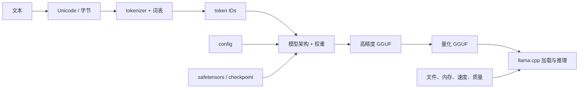

# 模型格式与量化 MOC

<!-- deep-review-02 -->
> [!tip] 本轮深化：从当前概念继续追问
> 已有课程保持原路径。完成入门后，按以下机制深化入口继续；箭头表示推荐阅读次序，不表示后一个概念与前一个等价：[[AI/11-数学与统计桥梁/01-向量空间投影SVD与低秩|向量空间投影SVD与低秩]] → [[AI/20-LLM/60-模型格式与量化/08-量化误差传播校准目标与端到端评测|量化误差传播校准目标与端到端评测]] → [[AI/90-资源/07-本轮研究来源与证据台账|本轮研究来源与证据台账]]。

这个模块解决一组很容易被同一个“编码”混在一起的问题：文本怎样变成 token，张量怎样装进文件，以及一个权重用多少位保存。学完后，你应能解释 `safetensors`、GGUF、FP16、NF4 和 `Q4_K_M` 各自在哪一层，并为一次转换建立可回滚、可比较的验证记录。

> [!important] 先记住三层边界
> 1. **文本表示层**：Unicode/字节、正规化、tokenizer、词表、token ID。
> 2. **序列化与容器层**：PyTorch checkpoint、safetensors、GGUF 如何把张量和元数据放进字节流。`state_dict` 是内存中的逻辑映射，不是第四种文件格式。
> 3. **数值表示层**：FP32/FP16/BF16/FP8、INT8、NF4、GPTQ/AWQ、K-quants/IQ 如何近似每个权重。
>
> 模型架构、张量名与 shape、tokenizer/chat template 是跨层的**配套契约**；它们必须相互对得上。`Q4_K_M` 是 GGUF/ggml 生态中的**整模型混合量化预设**，不是 Unicode 编码、tokenizer、容器版本或单一张量 type。

## 学习地图

箭头表示依赖，不表示文件必然一对一。一个 Hub 模型仓库常有多个 safetensors 分片、一个索引、`config.json`、tokenizer 文件和模型卡；转换后的 GGUF 可将运行时需要的很多元数据与权重同置，但这不意味着任意外部配置都会自动、无损地进入 GGUF。

## 七站路线

| 顺序 | 课程 | 完成后能回答 |
| --- | --- | --- |
| 1 | [[AI/20-LLM/60-模型格式与量化/01-编码序列化与数值表示的三层边界\|三层边界]] | tokenizer、safetensors 和 Q4 为何不是同类概念？ |
| 2 | [[AI/20-LLM/60-模型格式与量化/02-safetensors结构读取与安全边界\|safetensors 结构与安全]] | 为何它能避免 pickle 的任意代码执行，又为何仍不可盲信？ |
| 3 | [[AI/20-LLM/60-模型格式与量化/03-GGUF结构转换与验证\|GGUF 结构、转换与验证]] | header、metadata、tensor info、对齐和 tensor data 如何配合？ |
| 4 | [[AI/20-LLM/60-模型格式与量化/04-浮点精度INT8-NF4-GPTQ与AWQ\|浮点精度、INT8、NF4、GPTQ 与 AWQ]] | “4 bit”为何不能单独说明文件、运行时和质量？ |
| 5 | [[AI/20-LLM/60-模型格式与量化/05-K-quants-IQ与Q4_K_M\|K-quants、IQ 与 Q4_K_M]] | `Q4_0`、`Q4_K`、`Q4_K_M` 和 IQ 名称分别描述什么？ |
| 6 | [[AI/20-LLM/60-模型格式与量化/06-格式量化选择与质量评测\|格式、量化选择与质量评测]] | 如何用可比的基线检查文件大小、内存、速度和质量？ |
| 7 | [[AI/20-LLM/60-模型格式与量化/07-一手来源快照与现场复核清单\|一手来源快照与现场复核]] | 哪些结论被官方文档/源码支持，哪些仍必须在目标硬件实测？ |

第 3 站给出从 safetensors 到 GGUF、再量化并交给 `llama.cpp` 的完整流程蓝图；第 6 站把它收束为可接受/拒绝的验收门。真实实施时还要结合 [[AI/20-LLM/50-实现/04-llama.cpp构建后端与调用链|llama.cpp 构建、后端与调用链]]。

## 四种问题，四类证据

| 问题 | 最小证据 | 不能由它推出 |
| --- | --- | --- |
| 文件是否完整 | 来源 revision、文件清单、字节数、密码学哈希、格式结构检查 | 模型没有后门、许可允许使用 |
| 是否能加载 | 固定运行时 commit 的元数据读取和最小推理 | 长上下文、所有平台都可用 |
| 是否更快/更省内存 | 同机器、同后端、同参数的冷/热启动、prefill/decode、RAM/VRAM 峰值 | 另一台机器或另一个上下文配置也更快 |
| 质量是否可接受 | 高精度基线、配对样例、困惑度/任务分数、失败例与不确定性 | 安全、无偏见或适合所有任务 |

## 资料与版本边界

本模块的稳定概念依据 [[AI/90-资源/05-官方资料与版本核验记录|官方资料与版本核验记录]]。本次在 2026-09-02 重新核对了 safetensors `6eb4dc9a28ebce297606e0f4836bbf28839cacef`、ggml `d4716378882593333721eb33f153144b6885caf2`、`llama.cpp` `b96806d96061049a5b574269b049bf6241d63d46`以及 PyTorch/bitsandbytes/GPTQ/AWQ 的一手资料；精确链接和固定 ref 见 [[AI/20-LLM/60-模型格式与量化/07-一手来源快照与现场复核清单|一手来源快照与现场复核清单]]。这些是**文档/源码快照**，不是已构建或已实测的工具版本。任何转换参数、可执行文件名、架构支持、量化类型和元数据键都是易变信息；实施当天必须重新固定对应 commit/规范并重跑验证。

## 许可证与不可信文件边界

> [!warning] 后缀和“安全容器”都不是信任证明
> - 工具代码许可证、基础模型许可证、微调/适配器条款、转换后权重的分发权要分别核对。
> - safetensors 避免 pickle 式任意代码执行，GGUF 是明确的二进制结构；两者都可携带恶意或质量有问题的权重、异常值、伪造元数据或大到耗尽资源的内容。
> - 未审核模型与转换工具应在无密钥、无个人数据、有磁盘/内存限制、默认无网络的可恢复环境中处理。

## 纸上练习：归层，并找出跨层例外

不下载任何文件，尝试把下列标签分到“文本”“容器”“数值”三层：`tokenizer.json`、`state_dict`、UTF-8、`Q4_K_M`、GGUF、BF16。若某个标签不是单纯的“层内对象”，指出它的真正位置，不要强塞。再为每个标签写一句“它不能证明什么”。

### 成功标准

- [ ] 我把 UTF-8 和 tokenizer 归入文本表示层。
- [ ] 我没有强把 `state_dict` 塞进文件容器层：它是逻辑上的张量映射，可由不同序列化机制保存。
- [ ] 我把 GGUF 归入容器层，同时知道其张量可使用多种数值类型。
- [ ] 我把 BF16 视为数值类型，把 `Q4_K_M` 视为在数值量化流程上组织多种张量 type 的整模型预设。
- [ ] 我没有由后缀、哈希或一次可加载推出许可、安全或任务质量。

---

**上一站**：[[AI/20-LLM/00-LLM-MOC|LLM MOC]] · **下一站**：[[AI/20-LLM/60-模型格式与量化/01-编码序列化与数值表示的三层边界|编码、序列化与数值表示的三层边界]] · **实践**：[[AI/80-实践/03-safetensors到GGUF与量化/00-safetensors到GGUF与量化|safetensors 到 GGUF 与量化]]
