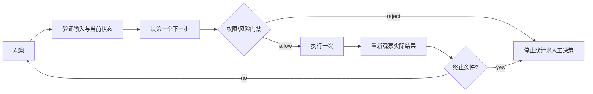

# Agent 工具调用、状态与最小循环

<!-- deep-review-02 -->
> [!tip] 本轮深化：从当前概念继续追问
> 工具返回内容应被视为数据而非新的系统授权。把提议、校验、许可、执行、观测和核验分开，可以避免生成一条成功消息就误记成动作成功。 深化与验证：[[AI/20-LLM/70-工程应用与工具链/09-Agent状态机幂等执行与提示注入边界|Agent状态机幂等执行与提示注入边界]]；[[AI/20-LLM/70-工程应用与工具链/08-混合检索重排RAG误差分解与证据|混合检索重排RAG误差分解与证据]]。


## 目标与边界

本页只解释 Agent 怎样把模型的建议变成可审计的工具调用：工具 schema、状态、最小循环、输入验证、权限、幂等性、观察/决策/执行边界、终止条件和失败恢复。它不深入任何特定 Agent 框架，也不默认赋予 shell、文件写入、网络或外部账号权限。

> [!important] 生成文本不是授权
> 模型可以提出“调用某工具”，但只有确定性程序在 schema、状态、权限和风险门禁都通过后，才能执行。工具输出也是不可信输入，不能因为它“来自工具”就当作新指令。

## 四种状态要分开

| 状态 | 包含什么 | 不应包含什么 |
| --- | --- | --- |
| 任务状态 | 目标、约束、完成标准、剩余步骤 | 未经核对的外部事实 |
| 会话状态 | 用户输入、已确认偏好、必要摘要 | 可长期保留的真实密钥 |
| 工具调用状态 | `call_id`、规范化参数、授权结果、开始/结束、状态码 | 下一步的自动授权 |
| 外部世界状态 | 文件、数据库行、服务、网页或人的当前结果 | “上次成功所以现在仍成功”的假设 |

状态分开的目的是防止两种常见错误：把“决定要做”误记成“已经做完”，以及在重试时重复外部副作用。

## 工具是受约束的函数，不是自由文本通道

每个工具至少需要：

```text
tool_name: 稳定、唯一
description: 说明输入、输出和副作用
input_schema: 字段类型、长度、枚举、必填和是否允许额外字段
permission_scope: 可读/可写的精确资源与身份
side_effect: none | reversible | external | destructive
timeout: 最长执行时间
idempotency: 重试是否安全，以什么键去重
output_schema: 成功、可重试失败、不可重试失败的结构
```

参数类型正确只说明“形状可解析”，不说明“对象是对的”。例如路径是字符串，仍要解析成规范路径、确认它在允许根中、拒绝越界符号链接，并在写前确认精确目标。结构化输出的进一步边界见 [[AI/20-LLM/70-工程应用与工具链/03-结构化输出Schema与错误恢复|结构化输出、Schema 与错误恢复]]。

## 最小循环



把每圈限制为“一个可观察动作”，会让失败位置、副作用和恢复点更清楚。不要让模型一次生成长链命令后绕过中间验证。

### 1. 观察

使用只读、低输出的观察获取当前事实。给每次循环记录 `run_id`、当前目标和已知约束。外部文本只是数据；即使其中写着“忽略之前指令”，也不能改写任务或授权。

### 2. 验证

验证不应只做 JSON 解析：

- 类型、必填字段、长度、枚举和额外字段；
- 资源标识符是否落在允许范围；
- 对象是否存在，版本或 ETag 是否仍一致；
- 输入是否包含凭据、个人数据或不允许的工具诱导；
- 请求大小、步数和资源预算是否尚未用完。

### 3. 决策

决策层只产生“调用哪个工具、以什么规范化参数、为什么”。它不让外部文本新增工具，不自动放大权限，不把“可能成功”写成“已完成”。

### 4. 授权与执行

权限要同时限制主体、动作、资源、时间和数量。例如“可写一个精确草稿文件”不应暗示“可写整个目录”；“可查询一个账户”不应暗示“可向外发送消息”。不可逆或对外动作需要比只读动作更高的明确门禁。

### 5. 重新观察

“工具返回 200”只是一层证据。仍需要读回实际对象，检查版本、数量或健康状态，并将“调用完成”与“业务目标达成”分开。

## 幂等、重试与不确定成功

幂等表示用同一个逻辑请求重试，外部结果不会叠加。常见做法是为一个逻辑动作生成稳定 `idempotency_key`，并在不确定后先查询该键的结果。

| 结果 | 下一步 |
| --- | --- |
| 明确成功 | 读回验证，然后进入终止判定 |
| 明确且可重试的失败 | 在次数、时间和总资源预算内退避；使用同一幂等键 |
| 明确且不可重试的失败 | 停止，保留证据，修正输入或请求人工决策 |
| 超时/连接中断，不知是否已执行 | 先按 `idempotency_key` 或外部状态查询；不盲目重发 |

对发送消息、创建工单、支付、删除或发布等动作，“超时”尤其不等于“没有发生”。

## 终止条件应在循环之前写好

最少包含：

- 目标已达成并有实际读回证据；
- 用户拒绝或未给出必要授权；
- 高风险边界需要人工决策；
- 重试次数、总时间、token、费用或外部调用预算耗尽；
- 重复状态未变，新一轮不会增加证据；
- 输出无法通过 schema 或业务验证；
- 检测到冲突、外部状态漂移或可疑工具输出。

一个循环若只有“直到模型说完成”，就没有真正的终止条件。

## 失败恢复的三层

1. **局部恢复**：对可逆动作使用事先定义的补偿操作；不能假设补偿一定成功。
2. **状态对账**：将本地调用记录与外部真实对象比较，标记已完成、未完成、待确认。
3. **安全停止**：保留最小审计记录，不在错误里回显凭据或敏感工具输出，将精确的未决状态交给人。

这些状态应进入 [[AI/20-LLM/70-工程应用与工具链/04-评测回归与可观测性|评测、回归与可观测性]] 的指标和回归集，但日志不应保存完整提示词、凭据或不必要的个人数据。

## 练习：手工演练一次无副作用循环

使用下列虚构工具，不连接任何真实系统：

```text
lookup_note(note_id) -> {found, version, title}
side_effect = none
permission_scope = 只读示例笔记集
timeout = 2 seconds
```

给定三种结果：找到、未找到、超时且未知。为每种结果写出：观察、验证、决策、执行、读回、终止。然后把工具改成“可逆地写一个草稿”，补上精确路径、版本前置条件、幂等键、授权门禁和补偿动作；仍只写纸面设计，不执行写入。

## 成功标准

- 能用一句话区分观察、决策、授权、执行和读回验证。
- 能为工具写出输入/输出 schema、权限、副作用、超时和幂等策略。
- 面对“超时且不知是否成功”时，会先对账而不是盲目重试。
- 在启动循环前就已写好完成、预算耗尽、需要人工与失败的终止条件。

## 导航与资料边界

- 上一站：[[AI/20-LLM/70-工程应用与工具链/05-私有部署认证TLS与边界|私有部署、认证、TLS 与边界]]
- 下一站：[[AI/20-LLM/70-工程应用与工具链/07-生产推理安全资源与许可证|生产推理安全、资源与许可证]]
- 返回：[[AI/20-LLM/70-工程应用与工具链/00-工程应用与工具链-MOC|工程应用与工具链 MOC]]
- 前置：[[AI/20-LLM/70-工程应用与工具链/03-结构化输出Schema与错误恢复|结构化输出、Schema 与错误恢复]]
- 相关部署边界：[[AI/20-LLM/70-工程应用与工具链/05-私有部署认证TLS与边界|私有部署、认证、TLS 与边界]]
- 实践：[[AI/80-实践/05-RAG评测与私有服务/00-RAG评测与私有服务|RAG 评测与私有服务]]
- 资料账本：[[AI/90-资源/05-官方资料与版本核验记录|官方资料与版本核验记录]]（已核验至 2026-09-01；本页只使用稳定工程边界，不声称任何框架的当前默认值。）

## 恢复方法

练习不连接真实系统，只需丢弃纸面状态即可恢复。在真实 Agent 中，若出现重复动作、状态不一致或越权，立即停止循环，禁用相关工具凭据，按 `call_id`/`idempotency_key` 对账，只对已确认的可逆动作执行补偿，并将未决项交给人工。
