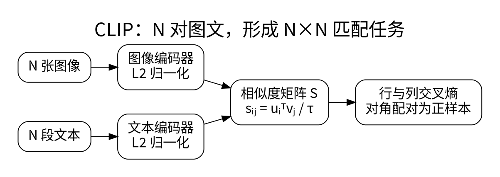
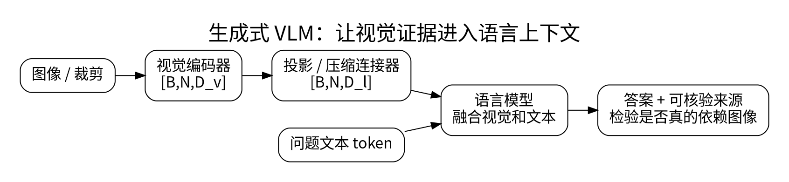

# CLIP、图文对齐、连接器与 VLM 训练

<!-- deep-review-02 -->
> [!tip] 本轮深化：从当前概念继续追问
> 对比学习的负样本是训练构造，不保证语义互斥。共享描述、重复图片和局部信息丢失会改变损失含义，应从表示瓶颈与评测控制来判断。 深化与验证：[[AI/30-VLM/03-视觉语言对齐信息瓶颈与反事实评测|视觉语言对齐信息瓶颈与反事实评测]]；[[AI/10-机器学习与深度学习基础/16-PCA聚类EM与表示学习|PCA聚类EM与表示学习]]。

“图文能互相检索”和“模型能根据图像生成正确回答”是两种能力，训练目标也不同。CLIP 类双塔学可比较的表示；生成式 VLM 把视觉证据接入语言生成过程。

## 对比学习怎样对齐两种模态

设一个 batch 中有 $N$ 对图文，图像向量 $u_i$ 与文本向量 $v_j$ 已做 L2 归一化。相似度 logits 为 $s_{ij}=u_i^Tv_j/\tau$，图到文损失为：

$$
L_{I\to T}=-\frac1N\sum_i\log\frac{\exp(s_{ii})}{\sum_j\exp(s_{ij})}.
$$

再加文本到图像的对称项。每行问“这张图最匹配哪段文字”，每列问“这段文字最匹配哪张图”。$\tau$ 控制分布锐度；归一化防止只靠放大向量长度提高相似度。[1]

但 batch 中的非配对样本不一定真的不相关。两张相同内容的图片可能形成假负样本，近重复与粗糙 caption 会污染对齐。CLIP 分数是相对匹配分数，不是世界命题为真的概率。

## 生成式 VLM 怎么连接

视觉编码器输出 `[B,N,D_v]`，线性层或 MLP projector 将其变为 `[B,N,D_l]`，然后作为视觉前缀/插入 token，或供 cross-attention 读取。若压缩器把很多 patch 变成少量 token，就在用细节换上下文预算。

一种常见训练路线先对齐连接器，再以图像与指令/回答数据进行监督微调。哪些模块冻结、哪些可训练、loss 是否只覆盖回答 token，都要显式说明。LLaVA 的视觉指令微调提供了代表性范式，不代表所有 VLM 共享相同架构和配方。[2]

## 可靠性的关键对照

相同问题分别输入正确图片、无关图片、空白图片和遮挡图片；若回答几乎不变，可能主要依赖语言先验。再测 OCR、计数、定位、空间关系和跨图对比，避免用一个平均分掩盖失败。

数据切分按文档、视频、网页或实体，而不是按切出来的小图随机切。生成回答中的引用应能回到实际区域或页码。低质量图文对齐、语言答案泄漏和重复图片是不同故障，不能都用更多 SFT 样本解决。

**练习：** 把 `[B,576,1024]` 的视觉特征投影到语言宽度 4096，线性 projector 不含偏置时有 4,194,304 个参数。输出仍为 576 个 token，并没有因维度变宽自动获得更多图像信息。

## 一手资料

1. [CLIP 原始论文](https://arxiv.org/abs/2103.00020)。
2. [Visual Instruction Tuning](https://arxiv.org/abs/2304.08485)。

**课程入口：** [[AI/30-VLM/00-VLM-MOC]]。
