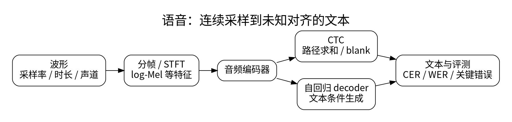

# 波形、频谱、CTC 与语音识别

<!-- deep-review-02 -->
> [!tip] 本轮深化：从当前概念继续追问
> CTC 对多条潜在对齐路径求和；合并相邻重复与删除 blank 的次序不可交换。理解三条路径如何合成一个标签，比只记接口名称更关键。 深化与验证：[[AI/40-语音与音频模型/03-CTC路径求和流式延迟与语音评测|CTC路径求和流式延迟与语音评测]]；[[AI/11-数学与统计桥梁/03-概率似然贝叶斯与信息论|概率似然贝叶斯与信息论]]。

语音首先是随时间变化的采样值。16 kHz 意味着每秒 16000 个采样，不是 16000 个音节。采样率、声道、时长、幅值范围与转写规则共同决定模型输入和评测。

## 从波形到帧

短时傅里叶变换在滑动窗口中观察频率：

$$
X(m,k)=\sum_{n=0}^{N-1}x[n+mH]w[n]e^{-2\pi i kn/N}.
$$

$N$ 是窗口/变换长度，$H$ 是帧移，$w$ 是窗函数。窗口越长，频率分辨能力通常越高而时间定位越粗；两种分辨率不能无限同时提高。实信号的一侧频谱通常有 $N/2+1$ 个频点（偶数 $N$）。不居中、不补边时，长为 $L$ 的音频帧数为 $1+\lfloor(L-N)/H\rfloor$，条件是 $L\ge N$。

Mel 特征把功率谱按非线性频带聚合，再常用对数压缩动态范围。它不保留全部相位信息，不能直接等价还原原始波形。重采样必须使用滤波，不能只修改文件中的采样率字段。

## CTC 如何处理未知对齐

音频帧数通常大于文本标签数。CTC 给每帧一个包含 blank 的类别分布，把许多帧路径映射到同一文本，再对路径概率求和：

$$
p(y\mid x)=\sum_{\pi:\mathcal B(\pi)=y}\prod_t p(\pi_t\mid x),\qquad
L_{CTC}=-\log p(y\mid x).
$$

$\mathcal B$ 先合并连续重复标签，再移除 blank。例如 `[a,a,blank,a]` 变成 `aa`，不是 `a`。如果目标有连续相同字符，路径需要 blank 等方式将其分开。最短可行帧数不只是目标长度，还与相邻重复数有关。[1]

动态规划用前缀状态高效求和，避免枚举所有路径。CTC 的帧级条件独立假设简化了训练，但也限制对标签依赖的直接表达。Encoder-decoder ASR 则自回归输出 token，更容易结合语言上下文，也可能在静音、噪音或弱证据中生成貌似合理的文字。[2]

## 评测不能忽略数字和否定词

WER 为 $(S+D+I)/N$，分别计替换、删除、插入和参考词数；CER 对字符计算。插入很多时 WER 可以超过 100%。中文如何分词、标点是否保留、数字是否规范化会改变结果，必须同时报告规则。

按说话人、录音环境和时间拆分。除平均 WER 外，应单独检查专名、金额、否定词和静音幻觉。实时系数小于 1 只说明平均处理速度可能跟上音频，不等于首字延迟低或可稳定流式处理。

## 一手资料

1. [PyTorch：CTCLoss](https://docs.pytorch.org/docs/stable/generated/torch.nn.CTCLoss.html)。
2. [Whisper：Robust Speech Recognition](https://arxiv.org/abs/2212.04356)。

**课程入口：** [[AI/40-语音与音频模型/00-语音与音频模型-MOC]]。
