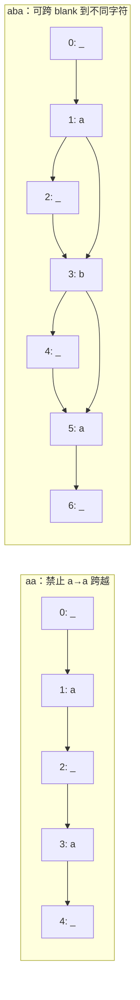

# CTC路径求和、流式延迟与语音评测

**先修与定位：** 连接[[AI/11-数学与统计桥梁/03-概率似然贝叶斯与信息论|隐藏变量求和]]、[[AI/12-PyTorch/05-变长批处理Packing与有效Token归一化|变长序列]]和 [[AI/40-语音与音频模型/01-波形频谱CTC与语音识别#CTC 如何处理未知对齐|音频基础中的三帧路径求和]]。先在基础页核对目标 `a` 的六条路径与贪心结果，再在本页用同一分布展开动态规划；若已能解释折叠与求和，可直接从“动态规划如何避免枚举指数多路径”继续。

## 为什么逐帧分类不能直接对应文字

音频有大量时间帧，文本标签更短且没有逐帧对齐。一段发音可以持续不同长度，静音也没有对应汉字。CTC 引入 blank，并把多个帧级路径映射到同一标签序列：先合并连续重复符号，再删除 blank。

例如 `a a blank a` 合并后是 `a blank a`，删除 blank 后为 `aa`。若先删除 blank 再合并，会错误得到 `a`。同一个字符连续出现两次，需要路径中有分隔；标签长度不超过帧数只是必要条件，对重复标签还可能不够。

## 损失不是选一条最漂亮的对齐

令 $\mathcal B$ 为折叠映射，CTC 定义

$$
p(y\mid x)=\sum_{\pi:\mathcal B(\pi)=y}\prod_{t=1}^{T}p_t(\pi_t\mid x),\qquad L=-\log p(y\mid x).
$$

给定编码器输出后，这个路径概率使用逐帧乘积分解；编码器本身可以看到宽上下文，因此不能把它误说成原始音频帧互相独立。CTC 训练将所有合法对齐的质量相加，梯度由路径后验共同决定，PyTorch 接口也按这一原则计算。[^S63]

一个两帧、词表只有 blank 与 `a` 的例子：两帧各以 0.5 概率输出 `a`。标签 `a` 的合法路径为 `(a,a)`、`(a,blank)`、`(blank,a)`，总概率为 0.75，损失约 0.28768；标签 `aa` 在两帧内无法对齐，概率为零。三帧时 `(a,blank,a)` 就成为合法路径。

## 动态规划如何避免枚举指数多路径

在标签间及两端插入 blank，得到扩展状态序列。到达某状态的概率来自上一帧停留、前进一格，以及在合法时跨过一个 blank 前进两格。若目标字符与两格前相同，则不能跨越，否则会把重复字符合并掉。

这个递推与隐马尔可夫模型前向算法共享“对隐藏对齐求和”的思想。长序列用 log-space 和 log-sum-exp 避免概率乘积下溢。不能把对所有路径求和替换为最大路径而仍称完全同一损失。

### 三帧 aa 与 aba：初始化、跨越和终值完整展开

取同一个逐帧概率表，词表为 blank（记作 `_`）、`a`、`b`。行是时间帧，每行和为 1；下表不是音频实测。

| $t$ | $p_t(\_)$ | $p_t(a)$ | $p_t(b)$ |
| --- | ---: | ---: | ---: |
| 1 | .2 | .6 | .2 |
| 2 | .5 | .2 | .3 |
| 3 | .2 | .5 | .3 |

使用从 0 开始的状态索引：目标 `aa` 扩展为 $z=(\_,a,\_,a,\_)$，`aba` 扩展为 $z=(\_,a,\_,b,\_,a,\_)$。$\alpha_t(s)$ 表示读完 $t$ 帧、停在扩展状态 $s$ 的合法前缀概率质量。初始化 $\alpha_1(0)=p_1(\_)$、$\alpha_1(1)=p_1(a)$，其余为 0。递推为

$$
\alpha_t(s)=p_t(z_s)\left[\alpha_{t-1}(s)+\alpha_{t-1}(s-1)
+\mathbf1_{\{s\ge2,\ z_s\ne\_,\ z_s\ne z_{s-2}\}}\alpha_{t-1}(s-2)\right],
$$

越界索引为 0。每帧转移后都乘**到达状态**的当前帧概率；停留和前进一格总是合法，跨两格必须到达非 blank 且与两格前的字符不同。下面画的是扩展状态图，箭头每次消耗一帧；各状态还都有未画出的自环。

`aa` 的完整前向表如下，列标题包含状态索引，避免把两个 `a` 混成同一状态。

| $t$ | 0: `_` | 1: `a` | 2: `_` | 3: `a` | 4: `_` |
| --- | ---: | ---: | ---: | ---: | ---: |
| 1 | .2 | .6 | 0 | 0 | 0 |
| 2 | .1 | .16 | .3 | 0 | 0 |
| 3 | .02 | .13 | .092 | .15 | 0 |

例如 $\alpha_3(3)=.5(0+.3)=.15$，不加 $\alpha_2(1)=.16$，因为两个 `a` 相同。最终概率须加最后字符和尾 blank 两个状态：$p(aa)=\alpha_3(3)+\alpha_3(4)=.15$。27 条三帧路径中唯一折叠为 `aa` 的是 `(a,_,a)`，概率 $.6\times.5\times.5=.15$；它给出独立对照。若错误允许跨越，会多算本应折叠为单个 `a` 的路径。

`aba` 则在 1→3、3→5 允许跨越：

| $t$ | 0: `_` | 1: `a` | 2: `_` | 3: `b` | 4: `_` | 5: `a` | 6: `_` |
| --- | ---: | ---: | ---: | ---: | ---: | ---: | ---: |
| 1 | .2 | .6 | 0 | 0 | 0 | 0 | 0 |
| 2 | .1 | .16 | .3 | .18 | 0 | 0 | 0 |
| 3 | .02 | .13 | .092 | .192 | .036 | .09 | 0 |

$\alpha_2(3)=.3\times.6=.18$、$\alpha_3(5)=.5\times.18=.09$，因此 $p(aba)=.09$，与唯一合法路径 `(a,b,a)` 的乘积一致；$.192$ 留在 `b` 状态，尚未完成目标，不能计入终值。对空目标只取唯一 blank 状态；零帧下空目标概率 1、非空目标概率 0。[^CTCworked]

本表兑现了 [[AI/40-语音与音频模型/01-波形频谱CTC与语音识别#CTC 如何处理未知对齐|基础页三帧例]] 的续读：`aa` 的唯一路径总概率 .15、`aba` 的唯一路径总概率 .09，已经通过状态递推得到相同结果。此后再读接口与流式约束，勿把有限路径验证当成真实识别或延迟实测。

复算全部状态表并在 0–4 帧上枚举所有目标，请读 [[AI/90-资源/实验/ai_worked_examples_20260917/README|五个可跟算实验]] 的 CTC 部分，运行 `ctc_forward` 与 `ctc_enumerate`。实现使用精确有理数教学概率；真实长序列仍需前文的 log-space/缩放。迁移题：同表只取前两帧，`aa` 和 `ab` 哪个可对齐？`aa` 概率为 0，`ab` 为 $.6\times.3=.18$；重复标签需额外分隔帧。

[^CTCworked]: [Graves 等，CTC 原论文，第 4.1 节，公式 5–8](https://www.cs.toronto.edu/~graves/icml_2006.pdf)：初始化、跨越条件与两个终态求和；本文改用 0 起始状态索引，数值表为教学构造，2026-09-17 核对。

## PyTorch最容易错的三个约定

`CTCLoss` 接收 log-probabilities，而不是未归一化 logits 或原始概率；常用形状为 `[T,N,C]`，与很多 batch-first 网络输出不同。`input_lengths` 必须是经过编码器时间下采样后的有效长度，而不是原始音频采样点数。

`reduction='mean'` 会先按目标长度处理每个样本，再对 batch 平均，不等于所有帧损失的全局平均。`zero_infinity=True` 能将不可对齐的无限损失置零，却可能掩盖下采样过强或标签错误，应同时统计被屏蔽样本。[^S63] 这与[[AI/12-PyTorch/05-变长批处理Packing与有效Token归一化|损失分母与无效样本]]是同类问题。

## 流式处理的延迟来自多个部分

音频采集窗口、未来 look-ahead、编码器下采样、分块等待、解码搜索、语音活动检测和端点判断都贡献延迟。平均处理速度快于实时不等于首字或句末延迟低。流式模型不能偷偷读取未来整段音频后再声称低延迟。

WER/CER 需明确文本规范化、标点、数字与分词规则；用外部语言模型重打分也要记录，否则不再是相同系统。语言模型可能改善流畅性，也可能在噪声中补出并不存在的内容。按噪声、口音、时长、说话者和领域分层，避免平均分掩盖重要失败。

自测：[[AI/80-实践/08-深层机制数值实验/00-数值实验导航与验收|数值实验]]枚举小词表所有路径并与 CTCLoss 比较。该测试验证损失语义，不包含真实声学建模或流式部署性能。

## 来源与证据边界

本页的数值例与推导用于解释机制，不代表大型模型或真实业务上的实测效果。方法与接口依据如下，来源核验日期为 2026-09-06。

[^S63]: [PyTorch 2.10：CTCLoss](https://docs.pytorch.org/docs/2.10/generated/torch.nn.CTCLoss.html)。固定版本；路径求和、shape、reduction与不可能对齐。

**返回与迁移：** [[AI/40-语音与音频模型/00-语音与音频模型-MOC|本主题课程地图]]；[[AI/00-开始/05-问题驱动知识图谱与难点导航|按问题跨主题继续]]。
