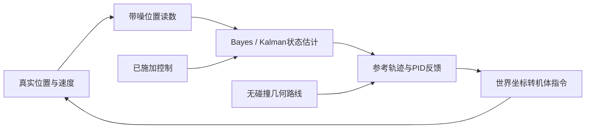

# 机器人与具身智能：从读数到纠偏行动

传感器只给读数，行动却需要知道“我在哪里、以多快运动、下一步怎样改变”。这组四课用一个**平面全向加速度机器人**贯穿坐标、Bayes/Kalman估计、几何路线、PID反馈和扰动恢复。机器人外形是半径0.2 m的圆盘，平移动力学按点质量近似；朝向已知且固定为π/2 rad，不估计旋转。它是具身智能的一个基础闭环，这四课本身不展开视觉感知、接触、机械臂、SLAM或学习策略。机械臂扩展从下方二连杆单元开始，另立关节到末端的几何映射，不能复用圆盘的点质量动力学冒充机械臂模型。

箭头表示本课的模拟依赖。真实状态只用于模拟器生成观测和事后评估，控制器只能读取估计；否则会把不可获得的“真值”偷带进行动。

| 读者卡点 | 主解释与阅读收益 | 可检查任务 |
| --- | --- | --- |
| 向前0.2 m到底沿哪根轴？ | [[AI/45-机器人与具身智能/01-坐标变换与平面运动学\|坐标与运动学]]：点、速度和加速度的变换及模型契约 | 手算SE(2)点变换、恒加速度一步 |
| 位置有噪声，速度又没直接测到，怎么办？ | [[AI/45-机器人与具身智能/02-Bayes滤波与Kalman状态估计\|状态估计]]：预测、观测归一、均值/协方差、可观测性 | 两状态Bayes表、标量Gaussian乘积 |
| 找到路线之后为何还要反馈？ | [[AI/45-机器人与具身智能/03-配置空间轨迹与反馈控制\|轨迹与反馈]]：障碍膨胀、时间参数、PID及采样稳定条件 | 算连续线段间隙、离散PD条件 |
| 为什么仿真看着成功却可能真实偏离？ | [[AI/45-机器人与具身智能/04-闭环仿真扰动恢复与模型边界\|闭环与边界]]：本体/滤波/控制模型关系与传感偏置反例 | 比较真值、观测、估计和误差 |
| 如何从代价推导反馈，又让输入约束进入求解？ | [[AI/45-机器人与具身智能/10-LQR与约束控制/00-LQR与约束控制-MOC\|LQR与约束控制]]：Bellman配方、Riccati、稳定化解、剪裁反例与受约束QP | 复算有限时域最优性、KKT和终端移位条件；不外推真实机器人 |
| 位置有噪声、速度不可直接观测，怎样估计后再控制？ | [[AI/45-机器人与具身智能/20-状态估计与LQG/00-状态估计与LQG-MOC\|状态估计与LQG]]：Gaussian条件化、Kalman稳定条件、分离原理及偏置/饱和/硬安全边界 | 复算三步滤波、批量条件化、增广闭环极点和固定种子失败诊断 |
| 关节动了，手为何这样走？什么时候不能照着目标速度动？ | [[AI/45-机器人与具身智能/30-刚体与机械臂/01-二连杆正逆运动学与Jacobian\|二连杆运动学与Jacobian]]：SE(2)串联、位置IK两支与连续族、任务相关奇异、近奇异限速和功率对偶 | 手算直臂rank1与τ=JᵀF，核同数据源码/图；不认证完整机械臂动力学与物理闭环 |
| 我要亲自复算 | [[AI/45-机器人与具身智能/80-机器人估计控制复现实验\|实验与完整源码]]：命令、预期值、12项独立检查 | 不联网、不安装，在现有NumPy环境运行 |

先修按卡点读取：条件概率与似然的区别由[[AI/11-数学与统计桥梁/03-概率似然贝叶斯与信息论|概率桥梁]]承担；状态空间图模型可回到[[AI/10-机器学习与深度学习基础/20-贝叶斯学习概率图模型与近似推断#图模型是一种联合分布的因子分解|概率分解]]。这里把旧Bayes语言用于随时间变化的状态，不再复制硬币证明。

基础估计与LQR分别由02课和10子课承担；把两者接成部分观测最优反馈、并检查硬约束失效边界，进入[[AI/45-机器人与具身智能/20-状态估计与LQG/00-状态估计与LQG-MOC|状态估计与LQG]]。

高层“去哪个房间”和前提效果验证由[[AI/13-搜索推理与规划/06-规划前提效果与计划验证#规划的边界：模型、观测与重规划|离散规划边界]]说明；[[AI/13-搜索推理与规划/01-状态空间图搜索与最优性|图搜索]]可在已建安全路网中选路线。它们不会给出执行器每0.05 s需要的加速度。想比较从数据学行动可读[[AI/10-机器学习与深度学习基础/19-强化学习MDP价值函数与策略梯度#和监督学习相比，多出来的困难是什么|RL的行动反馈与Markov状态]]；本组控制器直接按模型与误差计算，没有训练RL。

完成本组自检应能从读数写出状态后验、把估计接到动作、解释扰动后为何恢复以及偏置下为何失败。12项单测和有限仿真只支持各自测试场景；来源阅读、独立内容审阅、真实Obsidian显示、真人理解及真实机器人实验是不同证据层。历史独立审阅与客户端验证的具体范围见 [[Logs/2026-09-17_第二批课程建设与阅读验收|机器人首组结果]]、[[Logs/2026-09-20_第五批机制证明与政策账本|LQR 结果]] 与 [[Logs/2026-09-20_第六批证明实验与覆盖复审|LQG 结果]]；当前扩展从 [任务总入口 #224](https://github.com/EunsonZ/WWL/issues/224) 进入 [机器人主线 #164](https://github.com/EunsonZ/WWL/issues/164) 或 [控制论课程 #246](https://github.com/EunsonZ/WWL/issues/246)。不记录用户掌握度。
