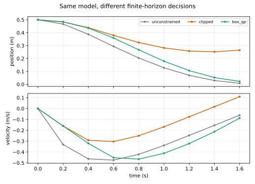

# 从 Bellman 配方到 Riccati 递推

**读者问题：** 给定 $x_{k+1}=Ax_k+Bu_k$ 和一串二次代价，反馈矩阵 $K_k$ 是怎样推出来的，而不是“调”出来的？

## 先把优化对象和单位写全

在已知初态 $x_0$ 下，有限时域问题是

$$
\min_{u_0,\ldots,u_{N-1}}J_N
=\sum_{k=0}^{N-1}(x_k^TQx_k+u_k^TRu_k)+x_N^TQ_fx_N,
\quad x_{k+1}=Ax_k+Bu_k.
$$

$x_k\in\mathbb R^n$、$u_k\in\mathbb R^m$、$Q,Q_f\succeq0$、$R\succ0$。本例 $n=2,m=1$。因为位置、速度和加速度单位不同，不能直接说“$Q$ 的第一个数比第二个大十倍，所以位置重要十倍”。更稳妥的写法是

$$
x^TQx=q_p\left(\frac p{p_s}\right)^2+q_v\left(\frac v{v_s}\right)^2,
\qquad u^TRu=r_u\left(\frac u{u_s}\right)^2,
$$

再用 $p_s=1\ \mathrm m,v_s=1\ \mathrm{m/s},u_s=1\ \mathrm{m/s^2}$。数值上才简写为 $Q=\operatorname{diag}(1,0.1)$、$R=0.05$。代价无量纲；换成 cm 而不改尺度，会改变问题本身。

## Bellman 方程只需配一次平方

定义从时刻 $k$ 开始的最优余下代价 $V_k(x)$。终点是

$$
V_N(x)=x^TQ_fx.
$$

假设下一步 $V_{k+1}(x)=x^TS_{k+1}x$，Bellman 最优性给

$$
V_k(x)=x^TQx+\min_u\left[u^TRu+(Ax+Bu)^TS_{k+1}(Ax+Bu)\right].
$$

展开所有含 $u$ 的项，记

$$
G_k=R+B^TS_{k+1}B\succ0,
\qquad K_k=G_k^{-1}B^TS_{k+1}A.
$$

由于 $R\succ0$ 且 $S_{k+1}\succeq0$，$G_k$ 正定。利用[[数学/20-线性代数与几何/18-分块矩阵Schur补与矩阵指数#正定性的消元解释|Schur 补与配方]]可写成

$$
u^TG_ku+2u^TB^TS_{k+1}Ax
=(u+K_kx)^TG_k(u+K_kx)-x^TK_k^TG_kK_kx.
$$

第一项唯一在 $u_k^*=-K_kx_k$ 取零。因此

$$
S_k=Q+A^TS_{k+1}A-A^TS_{k+1}B
(R+B^TS_{k+1}B)^{-1}B^TS_{k+1}A,
\qquad S_N=Q_f.
$$

上式中换行前后的乘法应连读；尺寸依次为 $n\times n$。计算时用线性方程求 $K_k$，无需显式求逆。该动态规划推导与 [Stanford EE363 离散有限时域 LQR 讲义](https://ee363.stanford.edu/archive/lectures/dlqr.pdf) 的平方完成、以及 [MIT Underactuated 的离散 Riccati 小节](https://underactuated.mit.edu/lqr.html) 相互对照。

## 两步手算把索引钉牢

沿用 MOC 的 $A,B,Q,R,Q_f$，先取 $N=2$。从 $S_2=Q_f$ 倒推：

$$
G_1=0.1332,\qquad K_1=\begin{bmatrix}1.201201&3.243243\end{bmatrix},
$$

$$
S_1=\begin{bmatrix}8.807808&1.081081\\1.081081&1.018919\end{bmatrix}.
$$

再退一步：

$$
G_0=0.1029285,\qquad K_0=\begin{bmatrix}3.812086&2.952339\end{bmatrix},
$$

$$
S_0=\begin{bmatrix}8.312051&1.684226\\1.684226&1.006507\end{bmatrix}.
$$

若 $x_0=(0.5,0)^T$，无约束第一步是 $u_0=-1.9060\ \mathrm{m/s^2}$，已经超过后续例的 $0.8$ 限幅。这不是递推错误，而是本问题尚未把执行器约束写进去。

## 独立最优性对照：把所有状态消掉

令 $U=(u_0,\ldots,u_{N-1})^T$，把预测状态堆为 $X=(x_1^T,\ldots,x_N^T)^T$。逐次代入动力学得到

$$
X=\Gamma x_0+\Theta U.
$$

于是同一代价化为严格凸二次型

$$
J(U)=c+U^THU+2f^TU,\qquad
H=\Theta^T\bar Q\Theta+\bar R\succ0,
$$

其唯一极小点满足 $HU+f=0$，即 $U^*=-H^{-1}f$。实验对 $N=2$ 和 $N=8$ 分别比较“从 $-K_kx_k$ 向前滚动”与这个一次性线性方程；两者在浮点误差内一致。这个对照没有复用 Riccati 递推，因而能抓住索引、终端权重或符号写错。

图中三条曲线都用同一动力学、初态和代价；本页的无约束轨迹是灰线。橙、绿约束解留到[[AI/45-机器人与具身智能/10-LQR与约束控制/03-从LQR剪裁反例到约束QP|剪裁与 QP]]解释。

## 能推出什么，不能推出什么

在这里给出的线性动力学、有限 $N$、$Q,Q_f\succeq0,R\succ0$ 下，配方给出该有限问题的唯一最优控制序列。它没有使用执行器限幅、状态约束、估计误差或模型误差，也没有证明把 $N$ 拉到无穷时一定收敛。下一课专门检查无限时域需要的稳定化分支。
