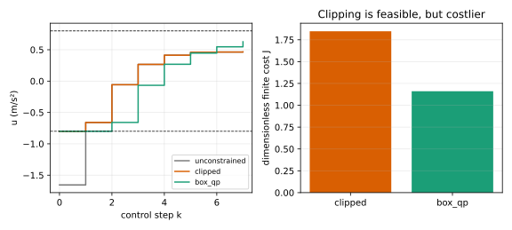

# 从 LQR 剪裁反例到约束 QP

**读者问题：** 无约束 LQR 要求 $u_0=-1.655$，执行器只能给 $-0.8$。把每个超限动作剪到边界，为什么不就是“最接近”的最优可行动作？

## 剪裁只改坏掉的分量，没有重新安排未来

八步堆叠问题仍是

$$
J(U)=c+U^THU+2f^TU,\qquad H\succ0,
$$

现在加入逐步盒约束 $-0.8\le u_k\le0.8$。无约束序列是

$$
U_{LQR}\approx
\begin{bmatrix}
-1.655\\
-0.659\\
-0.058\\
 0.266\\
 0.413\\
 0.459\\
 0.463\\
 0.465
\end{bmatrix}
\in\mathbb R^8.
$$

逐分量剪裁只把第一项改为 $-0.8$：

$$
U_{clip}\approx
\begin{bmatrix}
-0.800\\
-0.659\\
-0.058\\
 0.266\\
 0.413\\
 0.459\\
 0.463\\
 0.465
\end{bmatrix}
\in\mathbb R^8.
$$

它确实满足输入界，却保留了后七步原本为“第一步能打到 $-1.655$”而设计的计划。动力学把早期动作传到所有未来状态；矩阵 $H$ 因而通常有非零的非对角项。除非目标在各 $u_k$ 上恰好可分，欧氏逐项投影不会等于 $H$ 度量下的约束极小点。

## 同一个有限问题的精确约束解

把每个变量列为下界、自由或上界，八个标量输入最多有 $3^8=6561$ 个活动集。对每个活动集固定边界变量，并对自由变量解线性方程；再排除越界候选。这里得到唯一盒约束最优序列

$$
U_{QP}\approx
\begin{bmatrix}
-0.800\\
-0.800\\
-0.659\\
-0.067\\
 0.268\\
 0.447\\
 0.547\\
 0.627
\end{bmatrix}
\in\mathbb R^8.
$$

它比剪裁多刹车数步，再更有计划地回正。按同一无量纲代价计算：

$$
J(U_{LQR})=1.071920\quad(\text{不可行}),
$$

$$
J(U_{clip})=1.847166,
\qquad J(U_{QP})=1.160850.
$$

因此反例不是靠离散动作穷举近似连续最优。每个活动集内部都解连续严格凸二次型，最后比较有限个 KKT 候选，得到这个八维盒 QP 的精确浮点解。

## 用 KKT 独立核对

令缩去常数和因子 2 的梯度为 $g=HU+f$。盒约束最优点逐坐标应满足：

$$
\begin{cases}
g_i=0,&-0.8<u_i<0.8,\\
g_i\ge0,&u_i=-0.8,\\
g_i\le0,&u_i=0.8.
\end{cases}
$$

这是[[数学/80-跨学科专题与综合练习/09-多元优化与变分法补充#不等式约束：KKT 条件和它的许可证|KKT]]在上下界上的具体形式。目标严格凸、约束仿射，所以满足这些条件的可行点就是唯一全局最优。本例活动集求解器之外的检查函数给 $U_{QP}$ 最大 KKT 违约约 $5.6\times10^{-17}$；$U_{clip}$ 的违约大于 0.1。两条独立证据分别检查“搜索找到了谁”和“这个点为何最优”。

## 从输入界到一般线性 MPC QP

若还要求预测状态满足 $C_xx_k\le d_x$，利用 $X=\Gamma x_0+\Theta U$ 可改写为对 $U$ 的线性不等式。于是线性动力学、凸二次代价、线性等式/不等式构成凸 QP。[MIT Underactuated 的 constrained LQR 小节](https://underactuated.mit.edu/lqr.html)说明输入/状态约束通常令闭式策略消失，但可针对当前初态求有限时域最优轨迹；[trajectory optimization 的线性系统小节](https://underactuated.mit.edu/trajopt.html)给出直接射击/转录的矩阵结构。

本实验只实现标量输入、最多十步、盒约束与可选终端等式的教学活动集枚举。当前实现要求非空等式矩阵在 NumPy 数值秩测试下满行秩；冗余等式须先由调用者妥善消去并检查一致性，否则抛“不支持”异常，而不是返回一份次优解或将合法冗余说成无解。空 `(0,n)` 等式等同无等式；支持域、解析边界测试和返回语义见 [[AI/45-机器人与具身智能/10-LQR与约束控制/80-LQR与约束控制复现实验|复现实验]]。它不承诺任意病态约束的精确算术认证。它没有实现一般稀疏 QP、软约束、碰撞约束或实时求解器，也不以此声称可部署性能。即使每次有限 QP 可行且最优，“下一次仍可行”仍需终端设计；下一课给出移位证明。
