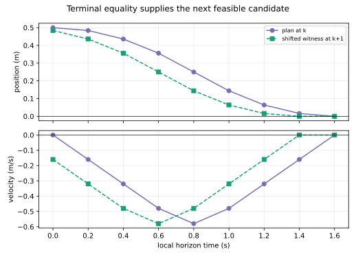

# MPC 何时兑现约束与递归可行性

**读者问题：** MPC 每次都解一个“未来八步满足约束”的问题，为什么系统走一步后不会突然无解？

## 滚动求解本身不是保证

MPC 在时刻 $k$ 测得/估计 $x_k$，求长度 $N$ 的可行最优序列，只执行第一项，再于 $k+1$ 重算。有限窗口能把当前输入和预测状态约束写进同一问题；它也会在每次测量后反馈修正。但若只是加终端软代价 $x_N^TQ_fx_N$，旧计划向前移一格后，新出现的最后一步没有保证，下一次问题可能不可行。

[MIT Underactuated 的 MPC 与 recursive feasibility 小节](https://underactuated.mit.edu/trajopt.html)给出的核心方法是让终端条件提供一个可继续的“尾巴”。最简单的定点调节版本要求

$$
x_N=x^*=0,\qquad u^*=0\in[-0.8,0.8].
$$

## 本例的移位证明

对 $x_0=(0.5,0)^T$、$N=8$，终端等式盒 QP 得

$$
U^*=(-0.8,-0.8,-0.8,-0.5,0.5,0.8,0.8,0.8)^T,
$$

并在浮点误差内到达 $x_8=0$。执行第一项后，若实际系统**精确等于预测模型**，新状态就是旧预测的 $x_1^*$。此时把剩余序列向左移并补平衡输入 0：

$$
\tilde U=(-0.8,-0.8,-0.5,0.5,0.8,0.8,0.8,0)^T.
$$

它仍满足所有输入界，并从 $x_1^*$ 在八步后回到 0。因此 $k+1$ 的优化至少有这个候选，必然可行；新优化器可以找到更低代价的候选。实验把旧终端残差与移位终端残差都核到约 $10^{-16}$。

这证明的是递归**可行性**，不是旧移位序列仍然最优。本例 $x_0=(0.6,0)^T$ 在相同八步、相同限幅和精确终端等式下已经不可行；终端条件不会凭空增加可达能力。

## 一般终端集合与终端代价

严格终端等式常过于保守。更一般地选择终端集合 $\mathcal X_f$、终端控制律 $\kappa_f(x)$ 与终端代价 $V_f(x)$，并检查：

1. 当前有限时域问题初始可行；
2. 对所有 $x\in\mathcal X_f$，$\kappa_f(x)$ 满足输入/状态约束，且 $Ax+B\kappa_f(x)\in\mathcal X_f$，即 $\mathcal X_f$ 在终端控制下正不变；
3. 若还要用最优代价作 Lyapunov 函数，终端区内满足

$$
V_f(Ax+B\kappa_f(x))-V_f(x)\le-\ell(x,\kappa_f(x)).
$$

把旧最优尾部接上 $\kappa_f$ 便重复上述移位论证；第三条再给“加入的新尾部代价不超过移除的首步代价”，从而得到相应稳定性论证。只有终端软权重而没有不变集合/下降条件，不能直接复用这套证明。

## “兑现约束”还依赖四件现实条件

| 条件 | 若缺失会怎样 |
| --- | --- |
| 约束被正确写入离散预测模型 | 没写的电流、温度、关节或碰撞限制不会被优化器自动尊重 |
| 当前问题可行且求解器按时返回可信可行解 | “infeasible”、超时或数值容差过松都不能当合法动作 |
| 实际一步与预测一致，或已做鲁棒设计 | 扰动、状态估计误差、延迟和模型偏差会破坏移位候选 |
| 采样间安全也被覆盖 | 只约束离散采样点不证明两点之间无碰撞或不超限 |

带有界扰动时，可用约束收紧、tube MPC、鲁棒正不变集合等另建保证；本课没有实现或证明它们。非线性碰撞约束还可能使有限问题非凸，此时局部求解器返回一个候选不等于全局最优或安全证书。原课程的圆障碍连续线段检查见[[AI/45-机器人与具身智能/03-配置空间轨迹与反馈控制#配置空间先把身体尺寸算进去|配置空间页]]，不能被这里的一维采样点输入 QP 取代。

所以，本例能兑现的精确表述是：在确定性精确双积分器、精确当前状态、八步问题初始可行、盒约束和终端等式被完整编码、活动集求解得到可行解并按模型施加第一项时，输入约束和递归可行性由上述构造保证。真实机器人、未知扰动、连续碰撞与饱和闭环的全局稳定均未证。
