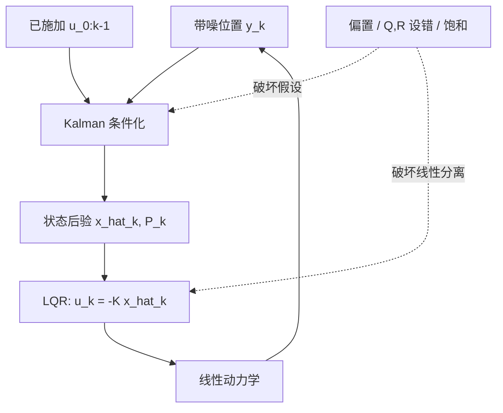

# 状态估计与 LQG：只看位置，怎样估速度再控制

**读者问题：** 位置传感器有噪声，速度又不能直接测量时，怎样从历史读数形成状态估计，再把它交给反馈控制？这种“先估计、再控制”何时真是最优，何时连硬约束和安全都保证不了？

这组课沿用[[AI/45-机器人与具身智能/10-LQR与约束控制/00-LQR与约束控制-MOC|LQR课程]]的一维双积分器。状态、输入和位置观测为

$$
x_k=\begin{bmatrix}p_k\\v_k\end{bmatrix},\qquad
x_{k+1}=Ax_k+Bu_k+w_k,\qquad y_k=Hx_k+r_k,
$$

$$
A=\begin{bmatrix}1&0.2\\0&1\end{bmatrix},\quad
B=\begin{bmatrix}0.02\\0.2\end{bmatrix},\quad
H=\begin{bmatrix}1&0\end{bmatrix}.
$$

$p$ 用 m，$v$ 用 m/s，$u$ 用 m/s²，采样时间是 $0.2$ s。只有 $p$ 被直接读取；速度信息来自跨时刻动力学形成的位置—速度交叉协方差。

## 按卡点阅读

| 卡点 | 主解释 | 可复算结果 |
| --- | --- | --- |
| 为什么更新式是那个矩阵形式？ | [[AI/45-机器人与具身智能/20-状态估计与LQG/01-线性Gaussian条件化到Kalman递推\|Gaussian条件化到Kalman]] | 从联合Gaussian的Schur补推出创新、增益与Joseph协方差；三次位置读数手算 |
| 位置能否长期恢复速度？ | [[AI/45-机器人与具身智能/20-状态估计与LQG/02-可检测性稳态滤波与误差诊断\|可检测性与稳态滤波]] | 区分可观测、可检测、Riccati残差与滤波误差稳定；读创新和NIS |
| 为什么可以先估计再控制？ | [[AI/45-机器人与具身智能/20-状态估计与LQG/03-LQG分离原理与闭环极点\|LQG分离原理]] | 用条件期望的动态规划解释最优性，再用块三角矩阵核对闭环极点 |
| 为什么仿真稳定仍不能保证安全？ | [[AI/45-机器人与具身智能/20-状态估计与LQG/04-偏置噪声设错饱和与安全边界\|失败边界]] | 固定种子比较传感偏置、噪声设错和执行器饱和；区分概率椭球与硬约束 |
| 怎样独立重算？ | [[AI/45-机器人与具身智能/20-状态估计与LQG/80-状态估计与LQG复现实验\|复现实验]] | 递推Kalman与一次性联合Gaussian条件化一致；8项单测和3张诊断图 |

## 本组复用什么

- 一般 Bayes 预测、似然归一与 Kalman 基础直觉由[[AI/45-机器人与具身智能/02-Bayes滤波与Kalman状态估计|原状态估计课]]承担。
- 协方差、正定和 Schur 补的线性代数背景分别回到[[数学/30-概率与统计/02-期望方差协方差与抽样|协方差]]、[[数学/20-线性代数与几何/15-谱定理二次型与正定矩阵|正定矩阵]]和[[数学/20-线性代数与几何/18-分块矩阵Schur补与矩阵指数|Schur补]]。
- LQR 的 Bellman 配方、Riccati 递推、稳定化解和输入约束反例由[[AI/45-机器人与具身智能/10-LQR与约束控制/00-LQR与约束控制-MOC|LQR与约束控制]]承担。本组只说明估计怎样接入这一控制器。

## 结论先行

在线性模型、已知输入、Gaussian 初态与独立零均值白噪声、二次期望代价且输入无硬约束时，条件分布仍是 Gaussian；Kalman 给出条件均值，LQR 对该均值施加反馈，有限时域动态规划得到分离原理。稳态实现还需控制端取得稳定化 LQR 解、估计端取得稳定化滤波解；常用充分条件是相关对可稳定、可检测，并满足 Riccati 方程的协方差条件。

这项最优性不覆盖输入饱和、状态硬边界、传感器偏置、相关或重尾噪声、错误模型、非线性接触、采样间碰撞和实时求解失败。Gaussian 噪声有无界支撑时，有限状态盒通常无法得到“概率恰为零”的越界保证。这里的固定种子曲线只是可复算诊断，不是蒙特卡洛覆盖证明，更不是真实机器人安全认证。

返回[[AI/45-机器人与具身智能/00-机器人与具身智能-MOC|机器人课程地图]]。
