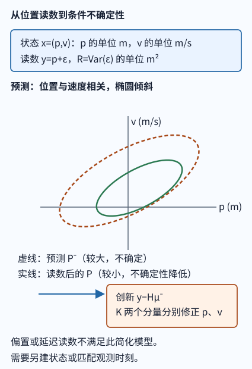
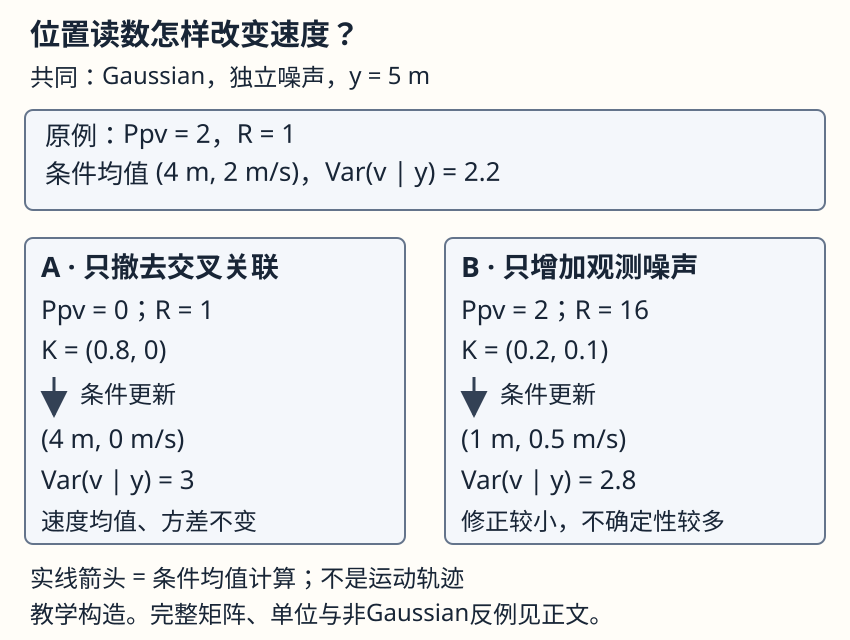

# 从不完整读数到条件不确定性

**读者问题：** 传感器只报告位置，为什么报告还会改变速度的估计和不确定性？答案是“位置读数直接看到了速度”的说法是错的。它们在给定过去后若有**交叉协方差**，位置证据才会条件化速度。推导主解释和完整三步数值例在[[AI/45-机器人与具身智能/20-状态估计与LQG/01-线性Gaussian条件化到Kalman递推|Gaussian 条件化到 Kalman 递推]]；本页用同一件事作高中桥、程序桥与本科快进。



图的替代文字：左边状态由位置和速度两个格组成，位置传感器只连到位置；中间的预测动力学把位置和速度的不确定性连成倾斜椭圆；右边显示位置创新经 Kalman 增益的两个分量分别修正位置和速度。图中文字说明偏置与延迟不会被该模型自动消除。

## 高中与编程新手桥：先把“不知道”当作一团云

设 $x=(p,v)^\mathsf T$，其中 $p$ 单位为 m、$v$ 单位为 m/s。读数是 $y=p+r$，$r$ 是测量误差。在下文的联合 Gaussian 模型中，若协方差 $P_{pv}=0$，位置读数只改位置均值，速度均值与方差保持不变。这里靠的是 Gaussian 条件；一般分布中的零协方差不等于独立。

经过一小段时间，模型 $p_{k+1}=p_k+\Delta t v_k+\cdots$ 把“速度可能偏高”与“下一次位置可能偏高”关联起来，$P^-_{pv}$ 可以非零。读数 $y$ 偏大时，合理的条件估计因此也会提高速度；不是因为 GPS 测了速度，而是因为模型说明两者一起变化。

```text
输入：上一步 mean、cov，当前位置 y
预测：用运动模型得到 mean_minus、cov_minus
创新：innovation = y - H @ mean_minus
更新：mean = mean_minus + gain @ innovation
检查：读数只能修正有关联的状态；保留 cov 的不确定性
```

若写程序，矩阵逆不必显式计算；解线性方程 $S K^\mathsf T=(PH^\mathsf T)^\mathsf T$。这个选择是数值实现细节，不改变下面的概率含义。

## 本科快进：Schur 补就是“看见 y 后还剩多少不确定性”

给定过去，令联合分布为

$$
\begin{bmatrix}x\\y\end{bmatrix}\sim\mathcal N\left(
\begin{bmatrix}\mu_x\\\mu_y\end{bmatrix},
\begin{bmatrix}P^-&P^-H^\mathsf T\\HP^-&HP^-H^\mathsf T+R\end{bmatrix}\right),\quad R\succ0.
$$

记 $S=HP^-H^\mathsf T+R$。配方或分块消元（见[[数学/20-线性代数与几何/18-分块矩阵Schur补与矩阵指数|Schur 补]]）给出

$$
\mathbb E[x\mid y]=\mu_x+P^-H^\mathsf TS^{-1}(y-H\mu_x),\qquad
\operatorname{Cov}(x\mid y)=P^--P^-H^\mathsf TS^{-1}HP^-.
$$

第二式是 $P^-$ 对观测块 $S$ 的 Schur 补。它只在这些条件下是本页所说的精确条件 Gaussian：线性观测、给定过去的 Gaussian 状态、与状态条件独立的 Gaussian 测量噪声，以及可解的 $S$。实际机器人不满足时，矩阵仍可计算，却不自动成为校准的不确定性陈述。

### 一次可手算、独立复算的更新

取 $\mu^-=(0,0)^\mathsf T$，$P^-=\begin{bmatrix}4&2\\2&3\end{bmatrix}$，$H=[1\ 0]$，$R=1\ \mathrm{m^2}$，读数 $y=5\ \mathrm m$。于是 $S=5\ \mathrm{m^2}$，
$$K=P^-H^\mathsf TS^{-1}=(0.8,0.4)^\mathsf T,$$
其中位置增益无量纲、速度增益单位为 $\mathrm{s^{-1}}$。创新是 $5\ \mathrm m$，故后验均值为 $(4\ \mathrm m,2\ \mathrm{m/s})^\mathsf T$，Schur 补为
$$P=\begin{bmatrix}0.8&0.4\\0.4&2.2\end{bmatrix}.$$
这不是“直接读出速度 2 m/s”；速度变化来自 $P^-_{vp}=2\ \mathrm{m^2/s}$。`state_conditioning_toy.py` 以独立的二维标量 $S$ 计算同一条件化式并断言这三组数；它没有调用 01 页的滤波实现。

## 并排失败面板只改变一个条件



图是手算教学构造；左右面板共享 $\mu^-=(0,0)^\mathsf T$、$H=[1\ 0]$、$y=5\ \mathrm m$ 及 Gaussian/独立噪声条件。左边只把原例的交叉协方差从 $2$ 改为 $0$，右边只把 $R$ 从 $1$ 改为 $16\ \mathrm{m^2}$。图中实线箭头表示条件均值计算，不是运动轨迹。两个面板分别推翻“位置读数总会改速度”和“同一个读数总该给同样修正量”；它们是错误外推的失败例，不是滤波器故障。

对于 $P^-=\begin{bmatrix}a&c\\c&b\end{bmatrix}$，本例可直接代入
$$
S=a+R,\quad K=\begin{bmatrix}a/(a+R)\\c/(a+R)\end{bmatrix},\quad
\mu=5K,\quad
P=\begin{bmatrix}a-a^2/(a+R)&c-ac/(a+R)\\c-ac/(a+R)&b-c^2/(a+R)\end{bmatrix}.
$$
$a,R$ 单位为 $\mathrm{m^2}$，$c$ 为 $\mathrm{m^2/s}$，$b$ 为 $\mathrm{m^2/s^2}$；每项相减的单位相同。三行的矩阵都对称正定，且 $S>0$：

| 唯一改变 | $S$ 与 $K$ | 后验均值 $(p,v)$ | 后验协方差 $P$（单位按上式） |
| --- | --- | --- | --- |
| 原例：$a=4,c=2,b=3,R=1$ | $5$；$(0.8,0.4)^\mathsf T$ | $(4\ \mathrm m,2\ \mathrm{m/s})$ | $\begin{bmatrix}0.8&0.4\\0.4&2.2\end{bmatrix}$ |
| 只令 $c=0$；$a,b,R$ 不变 | $5$；$(0.8,0)^\mathsf T$ | $(4\ \mathrm m,0\ \mathrm{m/s})$ | $\operatorname{diag}(0.8,3)$ |
| 只令 $R=16$；$a,c,b$ 不变 | $20$；$(0.2,0.1)^\mathsf T$ | $(1\ \mathrm m,0.5\ \mathrm{m/s})$ | $\begin{bmatrix}3.2&1.6\\1.6&2.8\end{bmatrix}$ |

较大的**正确建模噪声**让本例增益变小、后验保留更多不确定性；它不同于下节的偏置或错时点，后两者不能靠调大/调小 $R$ 自动修复。核对 Gaussian 条件式与一般 MMSE 的区别，可读 [Stanford EE363 Estimation 第18–24页](https://ee363.stanford.edu/archive/lectures/estim.pdf)，回来解释哪一步需要联合 Gaussian。

### 零协方差不能代替一般独立性

另构造非 Gaussian 的无噪声读数：$Z$ 等概率取 $-1,0,1$，$p=Z\ \mathrm m$，$v=Z^2\ \mathrm{m/s}$，$y=p$。则 $\mathbb E[p]=0$、$\mathbb E[v]=2/3\ \mathrm{m/s}$、$\operatorname{Cov}(p,v)=\mathbb E[Z^3]\ \mathrm{m^2/s}=0\ \mathrm{m^2/s}$，但 $y=0$ 时 $v=0$，$y=\pm1\ \mathrm m$ 时 $v=1\ \mathrm{m/s}$。位置信息仍改变速度条件均值。这不是把上述 Gaussian 表的 $R$ 再调一次，而是撤去分布假设的反例；不能使用 Gaussian 更新来得到该精确条件分布。若 $v$ 真与 $(p,r)$ 独立，位置读数 $y=p+r$ 才不会改变它的条件分布。

## 不给方法提示的联合条件迁移

传感器改成 $y_k=p_k+b_k+r_k$，其中 $b_k$ 是缓慢漂移的未知偏置；另一次实验传感器实际交付的是 $p_{k-1}$，但程序当作 $p_k$。请判断：只减小 $R$ 是否能修复？应扩充什么状态或调整什么观测时间？哪一项假设已坏？

<details><summary>答案</summary>

不能。偏置会使创新长期有方向，减小 $R$ 只会让滤波器更自信地追逐错误读数。若偏置可建模，可把 $b$ 纳入增广状态并给它合适的随机游走模型；延迟应把观测关联到正确时间，或采用延迟测量处理。两者都破坏了“已知的无偏当前线性观测加独立白噪声”的简化合同，参数和诊断必须重新验证。

</details>

## 观测属于哪个时点控制又在哪一刻执行

估计 $x_k$、读取 $y_k$、发布动作 $u_k$ 不是同一事件。去[[AI/10-机器学习与深度学习基础/23-从数据到评测与行动#把采样到达预测和动作放回时间|时间表与时间轴]]，先带回采样、到达、状态预测和动作生效四个时点，再回答“到达晚了的 $p_{k-1}$ 能否当作 $p_k$”。若时间戳或外参不可信，应保留未知、缓存重处理或进入已经定义的回退；单纯增减 $R$ 不会把过去读数变成当前观测。

## 与扩散中的条件期望：可比之处和不能借用之处

扩散的去噪平方误差也以条件期望为最优预测，[[AI/50-扩散模型/03-Score去噪FlowMatching与CFG的联系|相关页]]用 $\mathbb E[\epsilon\mid x_t,t]$ 说明这一点。共同点是“已观测量缩小未知量的均方误差”，不是它们拥有同一个动力学：这里的 $x_k$ 是时间递推的物理状态、$A,W,H,R$ 明确规定生成过程；扩散的 $x_t=a_tx_0+\sigma_t\epsilon$ 是人为设计的加噪路径。不能把 Kalman 的线性、Gaussian、白噪声或控制输入假设借给扩散模型，也不能把扩散的 score 直接当机器人速度。

**反例边界：** 偏置、延迟、饱和、非线性接触和错误的过程噪声都可能让创新有结构。Joseph 协方差式可减少浮点误差，不能修复这些建模错误。

**局部核验与证据范围：** 本组实际复查了 01 页的联合分块 Gaussian、$S=HP^-H^\mathsf T+R$、均值更新和 Schur 补式，并以本页二维例独立计算；未重新认证其三步机器人参数、批量历史条件化或 LQG 分离原理。图和迁移题是教学构造。本页的二维条件公式、教学合同与迁移题已完成独立内容和运行审阅；未运行真实传感器或 LQG 闭环，实际范围见 [[Logs/2026-10-04_跨层理解方案实施|本轮实际结果]]。

本轮新增的零交叉/大噪声并排面板、非Gaussian反例和时间桥已由作者局部复算；新增部分的独立内容验收尚待进行，不由前一批的签收自动覆盖。
