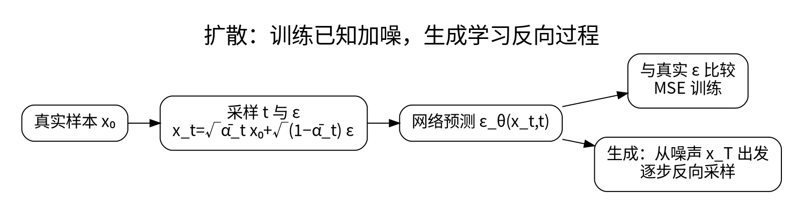

# DDPM：加噪、去噪与训练目标

<!-- deep-review-02 -->
> [!tip] 本轮深化：从当前概念继续追问
> 条件噪声预测与边际 score 的联系经过条件期望，不能把一次采样噪声当作给定 noisy 输入的唯一真值。明确时间和噪声约定后再对照推导。 深化与验证：[[AI/50-扩散模型/03-Score去噪FlowMatching与CFG的联系|Score去噪FlowMatching与CFG的联系]]；[[AI/11-数学与统计桥梁/03-概率似然贝叶斯与信息论|概率似然贝叶斯与信息论]]。

扩散把困难的“直接生成数据”转成多噪声级别的去噪学习。训练时我们知道干净样本和添加的噪声，因此可以构造监督信号；生成时则从噪声开始逐步恢复结构。

## 一次得到任意噪声级别

定义 $\beta_t\in(0,1)$、$\alpha_t=1-\beta_t$、$\overline\alpha_t=\prod_{s=1}^t\alpha_s$。前向过程为：

$$
q(x_t\mid x_{t-1})=\mathcal N(\sqrt{\alpha_t}x_{t-1},\beta_tI),
\quad x_t=\sqrt{\overline\alpha_t}x_0+\sqrt{1-\overline\alpha_t}\epsilon,
\quad \epsilon\sim\mathcal N(0,I).
$$

后一个式子是前一个线性高斯递推的边缘分布，因此训练不需要每次真的走完前面所有加噪步。[1]

为与下一课的一般插值记号对齐，可在这里局部记 $a_t=\sqrt{\overline\alpha_t}$、$\sigma_t=\sqrt{1-\overline\alpha_t}$，于是 $x_t=a_tx_0+\sigma_t\epsilon$。这里的 $a_t$ 是累积信号系数，不是本页定义的单步 $\alpha_t=1-\beta_t$。

如果 $\overline\alpha_t=0.64$、$x_0=2$、$\epsilon=-1$，则 $x_t=0.8\times2+0.6\times(-1)=1$。这是固定 $x_0$ 与 $\epsilon$ 后构造出的一次样本；构造时知道 $\epsilon=-1$，不表示只给去噪器 $x_t=1$ 就能唯一找回它。系数平方之和为 1，但单个样本数值并不保持长度，也不保证数据本身单位方差。

## 网络学习什么

常见简化噪声目标为：

$$
L_{simple}=\mathbb E_{x_0,t,\epsilon}
\left[\lVert\epsilon-\epsilon_\theta(x_t,t)\rVert^2\right].
$$

给定 $x_t,t$，平方损失的最优解是条件噪声均值，不是“认出本次随机抽到的唯一噪声”。不同噪声实现可能得到相近的 $x_t$。预测 $x_0$、噪声或 velocity 是不同参数化，转换系数和损失权重不能随意混用。

噪声估计对应的干净样本估计为：

$$
\widehat x_0=\frac{x_t-\sqrt{1-\overline\alpha_t}\epsilon_\theta(x_t,t)}{\sqrt{\overline\alpha_t}}.
$$

高噪声时分母很小，微小误差可能被放大，因此不能把这个公式当成“单步完美还原”。

## 从预测到采样

DDPM 的反向均值常写成：

$$
\mu_\theta(x_t,t)=\frac1{\sqrt{\alpha_t}}
\left(x_t-\frac{\beta_t}{\sqrt{1-\overline\alpha_t}}\epsilon_\theta(x_t,t)\right).
$$

再按选定方差加噪，逐步得到 $x_{t-1}$。方差选取、末步处理和噪声日程必须与算法一致。简化 MSE 与精确变分目标的加权形式有关，但不能无条件宣称二者逐项相等。

DDIM 等采样方法可以在相关训练目标下改变生成轨迹与随机性，减少步骤但引入质量/速度取舍。步数、随机种子、模型、调度器和精度都要一起记录。[2]

**自检：** 本包用已知真实噪声代入反解验证公式，只是代数检查，不是训练出了一个去噪网络。学到的预测噪声带误差，这才是建模与评测的难点。

## 一手资料

1. [Ho 等：DDPM](https://arxiv.org/abs/2006.11239)。
2. [Song 等：DDIM](https://arxiv.org/abs/2010.02502)。

**课程入口：** [[AI/50-扩散模型/00-扩散模型-MOC]]。
