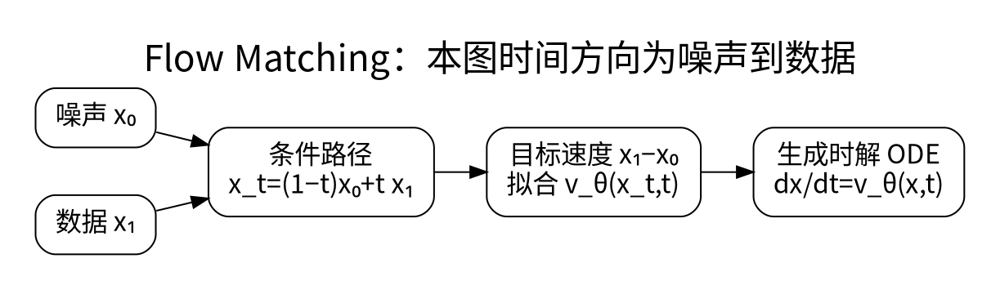

# Latent、条件控制、CFG 与 Flow Matching

<!-- deep-review-02 -->
> [!tip] 本轮深化：从当前概念继续追问
> CFG 的系数约定、连续流的条件路径和离散 token 去噪分别有自己的定义。条件插值线性不意味着学习到的边际生成轨迹处处为直线。 深化与验证：[[AI/50-扩散模型/03-Score去噪FlowMatching与CFG的联系|Score去噪FlowMatching与CFG的联系]]；[[AI/20-LLM/80-研究拓展/02-离散扩散语言模型与自回归对照|离散扩散语言模型与自回归对照]]。

像素空间很大，生成模型可以先用编码器将图像压成 latent，在较小空间进行生成，再解码回像素。压缩降低空间成本，却引入重建误差；生成质量同时受编码器、主干、条件和解码器影响。

## U-Net、DiT 与条件接口

U-Net 用多尺度下采样、上采样和跳跃连接保留细节；DiT 把 latent patch 作为 token，用 Transformer 建模。时间/噪声级别告诉主干当前需要去掉多少噪声，文本编码、类别或空间控制告诉它生成什么。Cross-attention 与条件归一化是不同注入方式，不能因都读了文本就认为等效。

训练条件模型时，以一定概率丢弃条件，便可同时学习有条件和无条件预测。Classifier-free guidance 常用如下约定：

$$
\widehat\epsilon=\epsilon_{uncond}+s(\epsilon_{cond}-\epsilon_{uncond}).
$$

这里 $s=0$ 是无条件，$s=1$ 是普通条件预测。也有资料使用从条件预测再加权的另一种记号，所以比较 guidance scale 前先对齐定义。提高 $s$ 会增强某些条件差异，但可能损伤多样性、产生过饱和或结构伪影，不是“越大越听话”的单调保证。[1]

## Flow Matching：学习速度而不是背采样轨迹

本页明确使用噪声 $x_0$ 到数据 $x_1$ 的时间方向，和 DDPM 页的下标语义不同。取一个简单线性条件路径：

$$
x_t=(1-t)x_0+tx_1,\qquad u_t=x_1-x_0,\quad t\in[0,1].
$$

训练 $v_\theta(x_t,t)$ 拟合 $u_t$：

$$
L=\mathbb E\lVert v_\theta(x_t,t)-(x_1-x_0)\rVert^2.
$$

给定位置和时间的最佳预测是条件速度的平均，不是知道每个点原来配对的终点。生成时解 ODE $dx/dt=v_\theta(x,t)$，从噪声积分到数据区域。训练目标不必数值积分整个 ODE，采样却仍需要求解器。[2]

即使每对训练样本的条件路径是直线，学习到的边缘速度场轨迹也不一定全是直线。Euler 的一步更新 $x_{t+\Delta t}\approx x_t+\Delta t\,v_\theta(x_t,t)$ 有离散误差；较少步数是否可用需要实际评估。Flow matching 与扩散可以在某些路径和参数化下联系起来，但不能把所有同名实现直接互换。

## 控制与评测

Inpainting 需要明确哪些区域必须保留，空间控制需要保持控制图与输出坐标一致。文本遵循、对象关系、文字正确性、编辑区域一致性、分布多样性和记忆风险应分别评估。固定少量精心挑选图片只能展示样例，不能证明平均质量。

**练习：** 将噪声 $x_0=0$、数据 $x_1=2$ 代入线性路径，$t=0.25$ 得 $x_t=0.5$、目标速度为 2。这个简单数值帮助检查时间方向，防止把“噪声到数据”和“数据到噪声”的下标混写。

## 一手资料

1. [Classifier-Free Diffusion Guidance](https://arxiv.org/abs/2207.12598)。
2. [Flow Matching for Generative Modeling](https://arxiv.org/abs/2210.02747)。

**课程入口：** [[AI/50-扩散模型/00-扩散模型-MOC]]。
