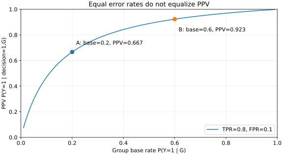

# 公平指标：同一模型为何可以同时被夸赞和质疑

**读者问题：** 两群体有相同真阳性率和假阳性率，是否就有相同的选择率、预测阳性可信度和概率校准？

先在[[AI/11-数学与统计桥梁/03-概率似然贝叶斯与信息论|概率桥梁]]确认条件概率。这里所有计数都来自合成数据，不指称真实人口。群体变量 $G\in\{A,B\}$，观察标签 $Y\in\{0,1\}$，行动或分类决策 $D\in\{0,1\}$，概率分数 $S\in[0,1]$。$D=1$ 可以表示给机会，也可以表示发出警报；社会意义随任务改变。下面先固定“给出阳性决策”，不在推导中偷换正类。

## 分母先回答评价了谁

每群体矩阵为 $2\times2$ 非负整数表：行依次是 $Y=1,Y=0$，列依次是 $D=1,D=0$。总数 $n=TP+FN+FP+TN>0$，计数单位是记录。定义

$$
\pi=P(Y=1\mid G)=\frac{TP+FN}{n},\quad
r=P(D=1\mid G)=\frac{TP+FP}{n},
$$
$$
t=TPR=P(D=1\mid Y=1,G)=\frac{TP}{TP+FN},\qquad
f=FPR=P(D=1\mid Y=0,G)=\frac{FP}{FP+TN},
$$
$$
PPV=P(Y=1\mid D=1,G)=\frac{TP}{TP+FP}.
$$

选择率 $r$ 的分母是全群体，TPR 的分母是有正标签的记录，FPR 是负标签记录，PPV 是获得阳性决策的记录。没有正标签时TPR无定义，没有负标签时FPR无定义，没有阳性决策时PPV无定义；实验返回 `None`，不能把它们自动记作0或1。

选择率相等常称 demographic parity（人口统计均等）；TPR、FPR都相等称 equalized odds（均等化机会率），只有TPR相等称 equal opportunity（机会均等）。名称易混，使用时写出条件事件最可靠。Hardt、Price与Srebro原文第2节定义2.1/2.2给出的是这些统计条件，不是一条可以替代社会论证的最终裁决。[原论文v1，第2节](https://arxiv.org/html/1610.02413v1)

## 第一组：相同错误率，不同选择率与PPV

下表把每个单元和边际都写全，方便直接检查1000条记录是否守恒。

| A组，基率0.2 | D=1 | D=0 | 行合计 |
| --- | ---: | ---: | ---: |
| Y=1 | TP=160 | FN=40 | 200 |
| Y=0 | FP=80 | TN=720 | 800 |
| 列合计 | 240 | 760 | 1000 |

| B组，基率0.6 | D=1 | D=0 | 行合计 |
| --- | ---: | ---: | ---: |
| Y=1 | TP=480 | FN=120 | 600 |
| Y=0 | FP=40 | TN=360 | 400 |
| 列合计 | 520 | 480 | 1000 |

A的 $t=160/200=0.8,f=80/800=0.1$；B的 $t=480/600=0.8,f=40/400=0.1$。但选择率为0.24与0.52，PPV为 $160/240=2/3$ 与 $480/520=12/13$。若关心“无正标签者承担误报的机会”，FPR相同；若关心“被选中的记录有多可靠”，PPV不同。不能把这两个不同问题压成一个“模型公平”的词。

## 第二组：相同选择率，也不决定错误率

保留两组标签边际，改成每组都选400条：

| A组，基率0.2 | D=1 | D=0 | 行合计 |
| --- | ---: | ---: | ---: |
| Y=1 | TP=160 | FN=40 | 200 |
| Y=0 | FP=240 | TN=560 | 800 |
| 列合计 | 400 | 600 | 1000 |

| B组，基率0.6 | D=1 | D=0 | 行合计 |
| --- | ---: | ---: | ---: |
| Y=1 | TP=360 | FN=240 | 600 |
| Y=0 | FP=40 | TN=360 | 400 |
| 列合计 | 400 | 600 | 1000 |

选择率同为0.4，但A的TPR/FPR/PPV是0.8/0.3/0.4，B是0.6/0.1/0.9。配额相同并不推出标签条件下待遇相同，也不推出行动后果相同。这个例子是反证“不经条件解释就把准则当同义词”，不是反证某个具体配额政策的正当性。

## Bayes冲突到底用了哪些前提

在同一群体内按 $Y$ 分解决策事件：

$$
P(D=1\mid G)=\pi t+(1-\pi)f.
$$

再把PPV的联合分子展开，得到

$$
PPV(\pi)=\frac{\pi t}{\pi t+(1-\pi)f}.
$$

对两个群体要求相同的 $t,f$，且 $t>0,f>0,0<\pi<1$，则

$$
\frac{d\,PPV}{d\pi}=\frac{tf}{[\pi t+(1-\pi)f]^2}>0.
$$

所以不同基率必然带来不同PPV。代入第一组的 $(t,f)=(0.8,0.1)$ 就得到图中两点；曲線上的其他点是假设保持条件错误率的解析变化，不是真实人口的测量。

边界不能从导数结论中省略。$f=0,t>0$ 时，有阳性决策的群体PPV都为1，即使还有漏选；$t=0,f>0$ 时PPV都为0，这是完全不命中正类的退化决策；$t=f=0$ 时无人被选，PPV无定义。$\pi=0$ 或1又使一类条件率缺乏分母。完美预测 $t=1,f=0$ 的PPV相同，但选择率仍等于不同基率。因此“所有公平准则永远不可兼容”也是错误的无条件陈述。

还有一条不同的冲突：相同 $t,f$ 给 $r=f+(t-f)\pi$。不同基率而 $t\ne f$ 时选择率不同；$t=f$ 的无区分决策可让选择率相等，但PPV等于各组自己的基率，仍不同。

## 校准需要分数，混淆矩阵不够

群体内理想校准是 $E[Y\mid S=s,G=g]=s$，只要求有概率质量的分数位置。它问“报0.8的同组记录，正标签比例是否0.8”。PPV问阈值后所有阳性决策的合并结果；单个混淆矩阵不保留完整分数分布，无法判定完整校准。

可以构造一个明确校准而阈值错误率不同的例子。每组700条，只用两个分数0.8和0.1：

| 群体/分数 | 记录数 | Y=1 | Y=0 | 正例比例 |
| --- | ---: | ---: | ---: | ---: |
| A / 0.8 | 100 | 80 | 20 | 0.8 |
| A / 0.1 | 600 | 60 | 540 | 0.1 |
| B / 0.8 | 500 | 400 | 100 | 0.8 |
| B / 0.1 | 200 | 20 | 180 | 0.1 |

每个分数都在每群体校准，基率分别140/700=0.2与420/700=0.6。取 $D=\mathbf1\{S\ge0.5\}$，PPV均为0.8，但TPR为 $80/140=4/7$ 与 $400/420=20/21$，FPR为 $20/560=1/28$ 与 $100/280=5/14$。这清楚展示校准和错误率均等的不同条件。

更强的分数定理须单独说明。若两组基率在(0,1)且不同，同时有群体校准和两类的平均分数相同，记公共值 $m_1=E[S\mid Y=1,G],m_0=E[S\mid Y=0,G]$。校准先由迭代期望给 $E[S\mid G]=\pi$，再按标签展开：

$$
\pi=\pi m_1+(1-\pi)m_0.
$$

两组相减，得到 $1-m_1+m_0=0$。由于 $0\le m_0,m_1\le1$，必有 $m_1=1,m_0=0$，即分数几乎处处完美预测。相同基率则不触发这一步，可以令全体分数等于公共基率，但这没有区分能力。Kleinberg等v2的条件(A)/(B)/(C)、定理1.1和第2节讨论的是群体校准加正/负类分数平衡；不要把它直接改写成“只要PPV相等就满足全部校准”。完整分数的 equalized odds 会推出类内均值平衡，单一阈值的相同TPR/FPR则没有这么强。[原论文v2，1.1–1.2与第2节](https://arxiv.org/html/1609.05807v2)

## 练习与答案

1. 第一组B改为基率0.4，但保持 $t=0.8,f=0.1$，1000条需要什么计数？**答案：** TP320、FN80、FP60、TN540；选择率0.38，PPV320/380=16/19。它落在解析曲线上，无需训练任何模型。
2. 两群体 $f=0,t=0.5$、基率0.2/0.6，是否反驳Bayes冲突？**答案：** PPV确实都为1，选择率0.1/0.3。它不满足导数推导的 $f>0$，且只在阳性决策上考察可信度；不能推出完整群体校准与分数平衡。
3. 给第二组被选记录统统报分数0.99，未选报0.01，是否校准？**答案：** 被选的真实比例0.4/0.9都不等于0.99，所以不校准。决策和混淆计数不变，说明计数没有唯一决定分数质量。

数值复算见[[AI/65-可信AI与真实数据实践/80-公平与真实数据复现实验|实验的synthetic_cases、ppv_from_rates与独立记录oracle]]。下一课[[AI/65-可信AI与真实数据实践/02-标签选择偏差与社会目标|标签和观察机制]]追问这里被条件化的 $Y$ 是否可靠；它是上述统计推导的应用边界，不是靠更换指标就能解决的问题。一般概率校准方法由[[AI/10-机器学习与深度学习基础/17-概率校准保形预测与分布偏移|已有校准主解释]]承担。
