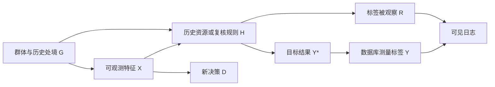

# 标签、观察机制与社会目标：矩阵之外还有谁

**读者问题：** 若模型满足了一个公平指标，为什么仍可能对人不公？若历史数据已有偏差，是否删除群体字段就足够？

上一课[[AI/65-可信AI与真实数据实践/01-公平指标分母与基率冲突|公平分母]]把 $Y$ 当作给定观察标签来推导；本课追问它怎样产生。社会目标、测量代理、抽样和行动后果不会因为一个概率公式算对而自动一致。关于选择偏差的一般机制直接复用[[AI/10-机器学习与深度学习基础/21-因果机器学习选择偏差与反事实评估|因果机器学习主解释]]，这里把它放回公平判断的责任链。

## 目标对象和数据字段不是同一个东西

设目标性质 $Y^*$ 是我们真正关心的结果，数据库标签 $Y$ 是一个测量代理，$R=1$ 表示标签被观察。它们可以不同：想评价学习支持需求，却只有过去的考试分数；想评价某项资源是否帮助求职，却只有历史录用决定；想估计可偿付性，却只看到过去获批者的还款。它们都是说明测量的假设例子，不是任何现实群体的事实断言。

历史决策如果直接成为“合格”标签，模型复制旧决定可以获得很高准确率，甚至 $
D=Y$ 带来TPR=1/FPR=0。统计上它对 **历史标签** 完美；这没有证明标签对应资源分配的正当目标。第1课的完美预测边界仍然成立，问题在于“完美预测了什么”。

把代理标签当真值，至少隐含一条测量关系：例如要求 $P(Y\mid Y^*,X,G)$ 在相关组之间足够可信，或直接有代表性的测量验证。仅凭观察到的 $(Y,D,G)$ 联合表无法恢复未观测的 $Y^*$。两种社会生成过程可能产生相同矩阵，而公平含义完全不同；Hardt等v1第2.3节与第6节说明仅依赖联合统计的 oblivious 判断边界。[原论文v1](https://arxiv.org/html/1610.02413v1)

## 一个能跟算的选择标签反例

假设A、B各100人，都真实有50个 $Y^*=1$ 与50个 $Y^*=0$。历史系统在A中只复核40个真阳性与10个真阴性，在B中只复核10个真阳性与40个真阴性；这是人为构造的选择机制，暂假设被复核后标签完全准确 $Y=Y^*$。

| 群体 | 总体真阳性/总数 | 观察到的阳性 | 观察到的阴性 | 观察标签基率 |
| --- | ---: | ---: | ---: | ---: |
| A | 50/100 | 40 | 10 | 40/50=0.8 |
| B | 50/100 | 10 | 40 | 10/50=0.2 |

总体基率相同，观察集基率相反。只在观察日志随机拆分，得到的估计是 $P(Y\mid X,G,R=1)$，不是全体人的 $P(Y^*\mid X,G)$。若把没复核者自动标负，A数据库变成40%阳性，B变成10%；这仍不是50%/50%，还混入了不对称缺失。

可以从“选择概率已知且严格为正”的新假设恢复这个合成总体：A阳性的观察概率0.8、阴性0.2，所以加权计数 $40/0.8=50$、$10/0.2=50$；B对应 $10/0.2=50$、$40/0.8=50$。这条修正依赖我们有可靠选择概率与正确的条件测量关系；现实缺失概率未知时不能从表中臆造权重。如果某类人的观察概率为0，加权甚至无定义，要新增受控测量、限制目标总体或报告不可识别。证明与更多例子去读[[AI/10-机器学习与深度学习基础/21-因果机器学习选择偏差与反事实评估|支持集和日志选择]]，本页不复制整个反事实评估课程。

图把行动、结果和是否被观察分开，避免把所有缺失当负类；箭头表达本例的假设依赖，现实因果图要用具体时间顺序与领域证据核对。历史行动也可能改变 $Y^*$，所以修改新策略后，旧标签机制可能随之变化。

## 删除字段并不会删除信息与后果

若 $G$ 没有输入模型，但居住地、历史资源或语言特征与它相关，预测仍可在各组不同。群体字段能否用于训练、审计或不同阈值，必须依据具体任务、授权和适用约束判断；不能靠“看不到字段”证明没有差异。反过来，只知道群体平均差异，也不能证明某个个体遭到了何种因果影响。

从平均指标再回到行动：误拒一次支持、误发一次告警、错配一次资源，承担者和后果不同。给机会的场景可能关注漏选合格者，风险提示的场景可能关注无风险者的误报。先明确正类、受益者、误差代价、争议与申诉途径，才能解释指标取舍。取舍的价值判断应来自真实目标与受影响者的意见，不能由模型自选一个分数代替。关于数据把问题框定成单一目标、测量与数据可改进边界，参见作者教材的 *Beyond datasets / Lessons from measurement / Problem framing: focusing on a single optimization objective*。[Barocas、Hardt与Narayanan，在线2023版Datasets章节](https://fairmlbook.org/datasets.html)

| 决策前必须写清的具体问题 | 为什么统计表不能替你决定 |
| --- | --- |
| 资源要改善什么，谁属于目标总体？ | 总体被筛窄后，指标不评价被排除者 |
| Y如何测量，R如何产生，标签延迟多久？ | 准确率只对已得到且被接受的标签计算 |
| 阳性决策带来机会还是负担，谁承担误差？ | 同一个D=1与同一FPR在不同情境含义不同 |
| 群体是自报、行政编码还是不可得？ | 编码有效性、交叉群体与遗漏需要独立判断 |
| 审计如何回应异议，能否撤回行动？ | 预测质量不能证明程序、沟通和救济已满足 |

这不是替所有任务开出同一份政策清单；它要求某个实际模型卡对这些对象给出可核对的答案。匿名、公开、小误差也不能自动等同于用途正当。

如果读者卡在“差别究竟怎样产生”，直接进入[[社会科学/40-公共政策与社会学/06-规范身份歧视与自我实现#四种机制不要互相冒名|四种机制]]与[[社会科学/40-公共政策与社会学/06-规范身份歧视与自我实现#规范判断与事实判断分开|四种判断]]：带去实际使用的标签、群体信号和规则，带回可检验的竞争解释，不能只带回“歧视”一词。如果卡在“即使预测准确，凭什么要求人接受限制”，去[[哲学与文化/20-论证知识与规范/02-伦理与政治正当性#从道德评价走向强制权力：还缺一层理由|强制权力的理由]]，带回目的、必要性、个人负担与替代方案的论证；准确率只能补其中的经验前提。

## 沿同一案例核对标签与后续行动

继续[[AI/65-可信AI与真实数据实践/01-公平指标分母与基率冲突#同一矩阵，提供机会与触发警报|工坊2000人的第一组矩阵]]：$Y$ 是行动前独立评估记录，目标 $Y^*$ 是下一次操作真正需要的支持。两者若不等价，TPR/FPR只是对评估标签的表现。应另核评估任务是否覆盖实际操作、辅助条件是否一致、语言或熟悉度是否干扰记录；不能从A/B的0.2/0.6基率反推某组能力的先天差异。本例题设全体标签可见，故本页前面的选择标签反例**尚未发生**，不能为了讲偏差把这里的800/400负类换成未观察者。

机会方案中，决策后的量至少有“收到邀请”“实际参加”“后续操作能力”；警报方案中则有“暂停时长”“人工复核”“实际危险与损失”。这些新量不会自动写回为原 $Y$。例如培训后需求减少，属于未来 $Y^*_{t+1}$ 的变化；固定的行动前 $Y_t$ 仍保留。用新标签重训时，应另报测量窗口与观察规则，否则安全措施减少危险可能被误读为原警报没有依据。

若后续只记录受邀参加者的成果，比较的是被选择参加者，不能得到所有漏邀者的结果；只追踪被警报者，也不评价漏报者的危险。邀请随机化在分配、测量、无干扰等条件清楚时可估邀请的平均效果，不能凭这一名称得到实际参加的效果或跨群体福利比较。没有随机化时，需要能辩护的混杂控制、支持覆盖与一致测量；比较前后均值不足以排除同期改善设备的作用。一般识别条件由[[AI/10-机器学习与深度学习基础/21-因果机器学习选择偏差与反事实评估#预测问题和干预问题的下标不同|潜在结果与日志]]承担。

要区分“资源造成需求差异”和“决策者用群体信号省下信息成本”，去[[社会科学/40-公共政策与社会学/06-规范身份歧视与自我实现#同一支持需求矩阵怎样区分社会机制|同一案例的竞争解释]]，带回哪个观察或干预能区分它们。要决定邀请、暂停与申诉应如何设计，去[[哲学与文化/20-论证知识与规范/02-伦理与政治正当性#同一标记的机会与警报怎样辩护|同一标记的规范理由]]，带回支持理由与最强反方。最后返回[[AI/65-可信AI与真实数据实践/01-公平指标分母与基率冲突#往返后，回到这2000人的决定|原决定的三句回答]]，检查你是否仍在评价同一 $Y_t$，并把“未识别”写具体。

## 观察规则和行动规则一起变化时

[[AI/10-机器学习与深度学习基础/23-从数据到评测与行动#同一份八行数据先拆分再找分母|八行工单表]]把“标签未审计”留为 `?`，不会把用户是否进入测试集当作观察标签的原因。即使复核规则只用创建时字段，它仍可能选择不同难度的工单；按用户拆分只能修复同源信息穿越，不能恢复被排除者的标签。

把人工复核变成自动分流后，要分别问：新规则是否改变实际升级结果、是否改变被审计概率、是否让某类人无法申诉？历史标签预测和新行动效果是不同对象。不能把减少日志中的升级数直接当成需求下降；它也可能是记录流程改变。去[[AI/10-机器学习与深度学习基础/23-从数据到评测与行动#陌生迁移题观察和行动环境一起变|联合迁移题]]同时重写目标、标签窗口和行动后果，带回一条可说结论和一条仍不可识别的结论；不以删掉群体字段代替这一步。

## 与真实租车项目怎样相接

下一课[[AI/65-可信AI与真实数据实践/03-真实小时数据时间拆分与基线|公开小时项目]]只含城市总体小时租车计数、日历与天气，没有个人或站点标识、没有人口受保护群体。$Y$ 是已记录租车次数，可能不同于想租车的人数：无车、未覆盖地区或服务障碍不会必然进入已实现租车计数。数据没有这些标签，我们不能从预测误差识别其原因。

按时段、season代码报告性能，是为了定位预测流程在哪些输入条件失败；它不估计不同人口获得服务的公平性。真正人口公平研究还需要匹配的总体、合法且有效的群体测量、需求与获得服务的结果、选择机制和真实参与。当前项目可以演练审计习惯，不能把“数据里没有protected字段”写成“没有公平风险”。

## 练习与答案

1. 上表把全部未观察者记负，各组数据库基率是多少？为什么不是总体真值？**答案：** A40/100，B10/100；阴性标签混进了缺失，真实两组都50/100。
2. A所有阴性的复核概率改为0，是否直接设置一个很大权重？**答案：** 不行。零概率没有观察证据，大权重不能生成标签。需要新增测量或限制问题。
3. 若租车模型在season_code=4误差更高，能否断言某人口组受到歧视？**答案：** 不能。season代码是环境切片，没有人口映射、目标需求或干预证据；分组误差值得调查，却不是该因果或社会判断。

## 陌生迁移：数字档案服务的两种标记用途

一家合成成人社区档案馆真正希望改善居民独立查找资料的能力，同时保证有限终端可被共同使用。两组各50人，行动前均完成同一独立查询评估；$Y=1$ 表示评估记录有辅导需求。模型标记为 $D$：A的(TP,FN,FP,TN)=(8,2,4,36)，B=(24,6,2,18)。这些评估标签对全体可见，不是实际事故或违规记录。

馆方拟将同一 $D=1$ 分别用于方案甲“私下发送可拒绝的辅导邀请”和方案乙“公开标记并暂停独立终端使用至复核”。馆方目前只有参加辅导者的半年后成绩，没有漏邀者成绩，也没有公开/暂停方案的效果材料。请给馆方写一段可争辩的建议：说明实际要评价的能力或机会与记录是否对应，以数字支持一个可说结论，解释至少两个竞争机制为什么尚不能由这些数字裁定，重建支持者与反方最有力的理由，并写出一种会改变你建议的新证据或规范反驳。结论可以支持甲、乙、其他方案或暂缓，但须交代未解决的问题。

> [!answer]- 一份可检查而非唯一立场的答案
> 真正目标是居民的查询能力和共同使用机会，$Y$ 只是一次评估的代理；半年后成绩只来自参加者。A/B的TPR均为8/10=24/30=0.8，FPR均为4/40=2/20=0.1；选择率12/50=0.24与26/50=0.52，PPV为8/12=2/3与24/26=12/13。甲漏邀2/6个记录有需求者；乙误暂停4/2个未记录需求者，被标记者中误报份额1/3与1/13。不能据此说甲改善了全体能力、乙保障了终端使用或任一方案违法。
>
> 一种机制是个体信息粗糙，工作人员用群体先验估需求；另一种是过去终端/辅导机会不同，实际技能差异因此形成。需要随机改变个体信息的可得性、或在安全可行条件下改变机会并统一随访，才可能区分相应路径；仅见差距或删字段均不足。若发现配对资料只有身份信号不同却使决定变化，也只先识别该信号的作用，未必已识别厌恶动机。评估的测量偏差仍是另一可能，需外部任务验证。
>
> 支持甲可说私下帮助需求者、保留选择且无须剥夺使用资格；反方会问漏邀者和不便参加者为何仍被遗漏、邀请成本是否挤出更有效服务。支持乙可说共同终端被无效操作长期占用会损害他人的机会，但这一经验前提本题尚缺证据；强反方是支持需求不等于危险或违规，公开负担与暂停缺少必要性证明。采用较少侵入且同等有效的标准，可先倾向甲或陪同操作，并补漏邀者入口；不能把这个选择宣称为唯一伦理答案。
>
> 若可信比较显示陪同与暂停同样有效、成本相当，较少限制的理由增强；若真正相关且严重的他人损害、替代无效和及时复核获证，有限暂停的理由会增强。即使效果明确，认为人格或分配要求不能被净收益抵消的反驳仍需回应。后续仅参加者成绩不识别总体或参加的因果效果，要补选择机制及相应比较。判断建议是否完成看：对象不偷换、分母可复算、机制可区分、回应强反方、改变条件会改理由；不按所选立场评分。返回[[AI/65-可信AI与真实数据实践/01-公平指标分母与基率冲突#往返后，回到这2000人的决定|工坊原案例]]，说清这次迁移保留了什么、哪些行动证据必须重新收集。

返回[[AI/65-可信AI与真实数据实践/00-可信AI与真实数据实践-MOC|路线图]]；继续真实项目可练习把“目标、代理、选择”写成明确限制，把统计检验放回合适的问题中。
