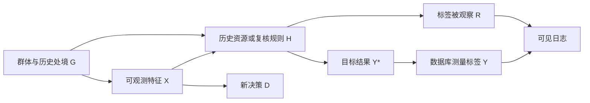

# 标签、观察机制与社会目标：矩阵之外还有谁

**读者问题：** 若模型满足了一个公平指标，为什么仍可能对人不公？若历史数据已有偏差，是否删除群体字段就足够？

上一课[[AI/65-可信AI与真实数据实践/01-公平指标分母与基率冲突|公平分母]]把 $Y$ 当作给定观察标签来推导；本课追问它怎样产生。社会目标、测量代理、抽样和行动后果不会因为一个概率公式算对而自动一致。关于选择偏差的一般机制直接复用[[AI/10-机器学习与深度学习基础/21-因果机器学习选择偏差与反事实评估|因果机器学习主解释]]，这里把它放回公平判断的责任链。

## 目标对象和数据字段不是同一个东西

设目标性质 $Y^*$ 是我们真正关心的结果，数据库标签 $Y$ 是一个测量代理，$R=1$ 表示标签被观察。它们可以不同：想评价学习支持需求，却只有过去的考试分数；想评价某项资源是否帮助求职，却只有历史录用决定；想估计可偿付性，却只看到过去获批者的还款。它们都是说明测量的假设例子，不是任何现实群体的事实断言。

历史决策如果直接成为“合格”标签，模型复制旧决定可以获得很高准确率，甚至 $
D=Y$ 带来TPR=1/FPR=0。统计上它对 **历史标签** 完美；这没有证明标签对应资源分配的正当目标。第1课的完美预测边界仍然成立，问题在于“完美预测了什么”。

把代理标签当真值，至少隐含一条测量关系：例如要求 $P(Y\mid Y^*,X,G)$ 在相关组之间足够可信，或直接有代表性的测量验证。仅凭观察到的 $(Y,D,G)$ 联合表无法恢复未观测的 $Y^*$。两种社会生成过程可能产生相同矩阵，而公平含义完全不同；Hardt等v1第2.3节与第6节说明仅依赖联合统计的 oblivious 判断边界。[原论文v1](https://arxiv.org/html/1610.02413v1)

## 一个能跟算的选择标签反例

假设A、B各100人，都真实有50个 $Y^*=1$ 与50个 $Y^*=0$。历史系统在A中只复核40个真阳性与10个真阴性，在B中只复核10个真阳性与40个真阴性；这是人为构造的选择机制，暂假设被复核后标签完全准确 $Y=Y^*$。

| 群体 | 总体真阳性/总数 | 观察到的阳性 | 观察到的阴性 | 观察标签基率 |
| --- | ---: | ---: | ---: | ---: |
| A | 50/100 | 40 | 10 | 40/50=0.8 |
| B | 50/100 | 10 | 40 | 10/50=0.2 |

总体基率相同，观察集基率相反。只在观察日志随机拆分，得到的估计是 $P(Y\mid X,G,R=1)$，不是全体人的 $P(Y^*\mid X,G)$。若把没复核者自动标负，A数据库变成40%阳性，B变成10%；这仍不是50%/50%，还混入了不对称缺失。

可以从“选择概率已知且严格为正”的新假设恢复这个合成总体：A阳性的观察概率0.8、阴性0.2，所以加权计数 $40/0.8=50$、$10/0.2=50$；B对应 $10/0.2=50$、$40/0.8=50$。这条修正依赖我们有可靠选择概率与正确的条件测量关系；现实缺失概率未知时不能从表中臆造权重。如果某类人的观察概率为0，加权甚至无定义，要新增受控测量、限制目标总体或报告不可识别。证明与更多例子去读[[AI/10-机器学习与深度学习基础/21-因果机器学习选择偏差与反事实评估|支持集和日志选择]]，本页不复制整个反事实评估课程。

图把行动、结果和是否被观察分开，避免把所有缺失当负类；箭头表达本例的假设依赖，现实因果图要用具体时间顺序与领域证据核对。历史行动也可能改变 $Y^*$，所以修改新策略后，旧标签机制可能随之变化。

## 删除字段并不会删除信息与后果

若 $G$ 没有输入模型，但居住地、历史资源或语言特征与它相关，预测仍可在各组不同。群体字段能否用于训练、审计或不同阈值，必须依据具体任务、授权和适用约束判断；不能靠“看不到字段”证明没有差异。反过来，只知道群体平均差异，也不能证明某个个体遭到了何种因果影响。

从平均指标再回到行动：误拒一次支持、误发一次告警、错配一次资源，承担者和后果不同。给机会的场景可能关注漏选合格者，风险提示的场景可能关注无风险者的误报。先明确正类、受益者、误差代价、争议与申诉途径，才能解释指标取舍。取舍的价值判断应来自真实目标与受影响者的意见，不能由模型自选一个分数代替。关于数据把问题框定成单一目标、测量与数据可改进边界，参见作者教材的 *Beyond datasets / Lessons from measurement / Problem framing: focusing on a single optimization objective*。[Barocas、Hardt与Narayanan，在线2023版Datasets章节](https://fairmlbook.org/datasets.html)

| 决策前必须写清的具体问题 | 为什么统计表不能替你决定 |
| --- | --- |
| 资源要改善什么，谁属于目标总体？ | 总体被筛窄后，指标不评价被排除者 |
| Y如何测量，R如何产生，标签延迟多久？ | 准确率只对已得到且被接受的标签计算 |
| 阳性决策带来机会还是负担，谁承担误差？ | 同一个D=1与同一FPR在不同情境含义不同 |
| 群体是自报、行政编码还是不可得？ | 编码有效性、交叉群体与遗漏需要独立判断 |
| 审计如何回应异议，能否撤回行动？ | 预测质量不能证明程序、沟通和救济已满足 |

这不是替所有任务开出同一份政策清单；它要求某个实际模型卡对这些对象给出可核对的答案。匿名、公开、小误差也不能自动等同于用途正当。

## 观察规则和行动规则一起变化时

[[AI/10-机器学习与深度学习基础/23-从数据到评测与行动#同一份八行数据先拆分再找分母|八行工单表]]把“标签未审计”留为 `?`，不会把用户是否进入测试集当作观察标签的原因。即使复核规则只用创建时字段，它仍可能选择不同难度的工单；按用户拆分只能修复同源信息穿越，不能恢复被排除者的标签。

把人工复核变成自动分流后，要分别问：新规则是否改变实际升级结果、是否改变被审计概率、是否让某类人无法申诉？历史标签预测和新行动效果是不同对象。不能把减少日志中的升级数直接当成需求下降；它也可能是记录流程改变。去[[AI/10-机器学习与深度学习基础/23-从数据到评测与行动#陌生迁移题观察和行动环境一起变|联合迁移题]]同时重写目标、标签窗口和行动后果，带回一条可说结论和一条仍不可识别的结论；不以删掉群体字段代替这一步。

## 与真实租车项目怎样相接

下一课[[AI/65-可信AI与真实数据实践/03-真实小时数据时间拆分与基线|公开小时项目]]只含城市总体小时租车计数、日历与天气，没有个人或站点标识、没有人口受保护群体。$Y$ 是已记录租车次数，可能不同于想租车的人数：无车、未覆盖地区或服务障碍不会必然进入已实现租车计数。数据没有这些标签，我们不能从预测误差识别其原因。

按时段、season代码报告性能，是为了定位预测流程在哪些输入条件失败；它不估计不同人口获得服务的公平性。真正人口公平研究还需要匹配的总体、合法且有效的群体测量、需求与获得服务的结果、选择机制和真实参与。当前项目可以演练审计习惯，不能把“数据里没有protected字段”写成“没有公平风险”。

## 练习与答案

1. 上表把全部未观察者记负，各组数据库基率是多少？为什么不是总体真值？**答案：** A40/100，B10/100；阴性标签混进了缺失，真实两组都50/100。
2. A所有阴性的复核概率改为0，是否直接设置一个很大权重？**答案：** 不行。零概率没有观察证据，大权重不能生成标签。需要新增测量或限制问题。
3. 若租车模型在season_code=4误差更高，能否断言某人口组受到歧视？**答案：** 不能。season代码是环境切片，没有人口映射、目标需求或干预证据；分组误差值得调查，却不是该因果或社会判断。

返回[[AI/65-可信AI与真实数据实践/00-可信AI与真实数据实践-MOC|路线图]]；继续真实项目可练习把“目标、代理、选择”写成明确限制，把统计检验放回合适的问题中。
