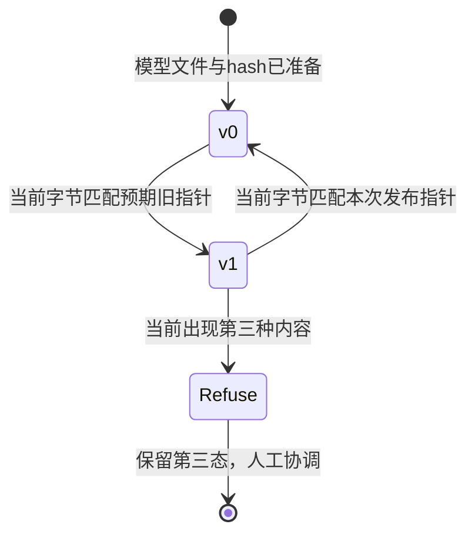
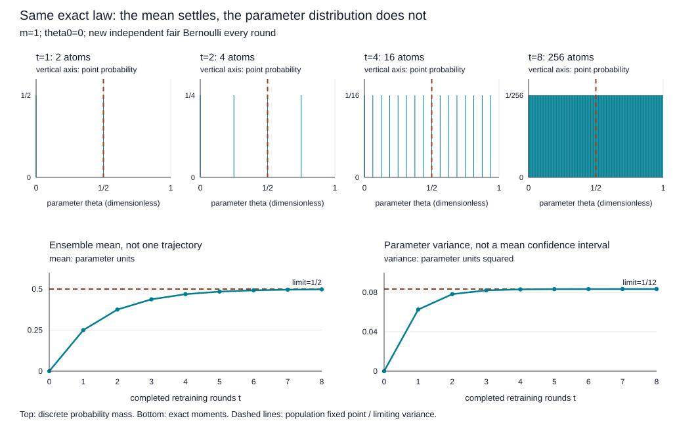

# 区间、代价和失败切片：怎样把结果送到可撤回的发布

**读者问题：** 整体误差下降与90%预测区间，能否保证每个时段可用？模型版本切换后发现问题，怎样保留证据并撤回？

本课消费[[AI/65-可信AI与真实数据实践/03-真实小时数据时间拆分与基线|固定真实数据项目]]的冻结模型与拆分，不另外选择更好看的模型。目标是非负小时租车计数的回归，不把实数预测当分类概率。校准环节选择 **预测区间覆盖**；分类概率校准的一般解释与保形秩证明见[[AI/10-机器学习与深度学习基础/17-概率校准保形预测与分布偏移|校准与保形主解释]]。

## 半径如何从独立残差产生

在2208条校准记录上计算 $a_i=|y_i-\hat y_i|\ge0$，单位是每条小时记录的租车计数。取 $\alpha=0.1$，排序统计量的索引 $k=\lceil(n_{cal}+1)(1-\alpha)\rceil=1989$，1为最小值的索引。实验求第1989小的残差，得到 $q=299.3882$，然后输出

$$
C(x)=[\max(0,\hat y(x)-q),\hat y(x)+q].
$$

下界截到0不会损失对非负真值的覆盖；这与把半径随意变小不同。如果一般情况下 $k>n_{cal}$，必须返回无限半径，不能冒充“取最大残差仍满足有限样本目标”。例：3个校准点、99%目标，$k=4>3$，信息不足以由该构造给有限区间。

通常的split conformal保证需要校准与新测试点的分数可交换，且模型、评分规则和α事先固定。本项目的相邻小时相关、季度分布不同，未验证可交换性。因此我们只借用明确的残差秩构造并报告 **经验区间覆盖**，不宣称时间序列已有分布无关90%保证。理论前提、附录D定理D.1和时序限制的不同方法在原教程v6中明确说明。[Angelopoulos与Bates，v6，第2节、4.6节、附录D](https://arxiv.org/html/2107.07511v6)

实际2168条test的覆盖是2053/2168=0.9469557，平均区间宽436.8307。宽度因非负下界截断而不是处处等于 $2q=598.7764$。覆盖高也可能来自宽区间，并不自动说明预测精细或决策有用。

## 分组失败必须把样本量和分母一起交出

下面是冻结模型按记录本地小时分组的描述性结果。分组在任务中预先固定；分析后如果另挑“最差”组并优化，需独立未来检验。当前表没有独立同分布置信区间；小时相关使简单逐行bootstrap的标准误解释也需谨慎。

| 时段 | 记录数 | MAE | 均值y−预测 | 区间覆盖 |
| --- | ---: | ---: | ---: | ---: |
| 00–05 | 537 | 17.9154 | 0.1255 | 1.0000 |
| 06–09 | 360 | 121.9855 | 108.9585 | 0.8889 |
| 10–15 | 543 | 118.1995 | 108.6062 | 0.9576 |
| 16–19 | 364 | 173.8840 | 140.7752 | 0.8571 |
| 20–23 | 364 | 49.6544 | 36.2739 | 1.0000 |

图左说明晚高峰误差更大，图右说明整体0.947掩盖了16–19点仅312/364=0.8571的覆盖。它不证明“时段造成模型错误”或需要哪种干预；时段同时关联工作日、天气、季节与需求水平。MAE是绝对误差，较高需求组容易有更大的计数误差，因此也不能直接比较哪组“受到更大不公”。

season_code在test仅出现1与4：代码1有262条，MAE46.7604、覆盖1；代码4有1906条，MAE98.0244、覆盖0.9397。代码2/3没有本测试季记录，应写 **没有证据**，不能填0错误或通过。weather_code=1/2/3的记录数分别1224/784/160，MAE98.4338/86.0178/69.7796；代码4没有test记录。完整机器结果与每组宽度在[report.json](./results/report.json)。这些是环境与日历性能切片，不是人口公平实证；前课[[AI/65-可信AI与真实数据实践/02-标签选择偏差与社会目标|标签选择和社会目标]]解释了缺少哪些对象。

## 预测中心和行动代价要分开

用模型估计平均租车次数，与预留多少资源，是不同决策。本实验人为声明低配1次的损失为3、高配1次的损失为1：

$$
L(y,a)=3\max(y-a,0)+\max(a-y,0),\qquad a\ge0.
$$

权重是教学假设，单位为任意损失单位/一次租车计数，不是实际货币成本。城市总小时租车次数也不是站点库存，`capacity`只是演练用的实数行动量，没做车辆守恒、位置调度和库存执行；不能将它投入真实运营。

若有完整条件分布，最小化这一不对称绝对损失的行动是75%条件分位数。因为连续情形中导数是 $-3P(Y>a)+P(Y<a)$，零点给 $F(a)=3/(3+1)=0.75$；离散分布则用分位数左右条件，可能有多个最优解。我们没有完整条件分布，所以采用较弱的开发集 **公共残差偏移**：$b$取开发残差 $(y-\hat y)$ 的75%样本分位数，函数明确使用 `method='higher'` 的有限样本约定，得到 $b=122.0828$。冻结行动 $a(x)=\max(0,\hat y(x)+b)$。它不声称逐个输入都是条件75%分位数，也不重新声称这个行动量是均值预测。

| 同一test上的量 | 原预测中心 | 开发残差偏移后的行动 |
| --- | ---: | ---: |
| MAE | 91.8292 | 100.7124 |
| RMSE | 133.5035 | 120.0100 |
| 均值y−量 | 75.0514 | −47.0314 |
| 平均3:1代价 | 258.7098 | 154.3935 |

代价下降而MAE上升不是矛盾，优化对象不同。偏移由dev确定，q只由cal确定；区间仍以原冻结预测中心构造，不能把行动偏移后沿用原区间却假称重新校准。本实验未对每个组单独拟合偏移，不把群体阈值技术当成社会目标的自动答案。

## 版本血缘是复算需要的输入

模型文件保存契约名 `bike-local-hour-v1`、数据hash、固定feature schema对应的85维均值与scale、86维权重、λ、区间半径、α与决策偏移。报告保存候选开发分数、选择规则、split计数、性能、失败切片、漂移与NumPy版本；逐行CSV保存记录日期、小时、原season/weather代码、y、预测、区间和行动量。原始数据、模型、报告、逐行预测各自有hash，不能拿文件名相同替代字节相同。

当前冻结结果在[model.json](./results/model.json)、[test_predictions.csv](./results/test_predictions.csv)与[版本说明](./results/VERSIONS.md)。实际运行使用Python3.14.7/NumPy2.5.3。不同线性代数库、平台或软件版本可能产生末位差异；数值结论应在明确容差下复核，不以跨平台字节不同直接判定模型错误。测试从保存的逐行CSV独立复算MAE与覆盖，并验证重新加载模型的预测与导出值一致。

## 一次受控发布与回滚演练

演练只使用临时目录，没有启动服务或改真实线上系统。v0是训练小时均值基线，v1是冻结模型连同区间/行动参数。先序列化两个模型，各自写文件并计算hash，建立指向版本与hash的指针；核对模型可加载与hash相符后，将当前指针从v0切到v1。预先保存的旧指针字节供回滚使用，再从v1切回v0，并确认读回版本。

回滚只在当前指针仍等于这次发布字节时执行；测试模拟他人写入 `human-new-version`，旧回滚请求被拒绝，第三态保持原字节。代码用先检查字节再 `os.replace` 切换单个指针，这是 **单写者本地演练**。检查与替换之间存在时间窗口，不是真正多写者compare-and-swap；真实多写者需要锁、事务或版本条件请求。模型文件、预测、报告与指针不是整体原子事务，hash也不能证明授权或生产可靠性。

演练中的发布对象是模型版本控制的行为示例，并非宣称所有上线门槛通过。真实上线还需匹配用途、特征可得性、可接受失败与人工责任；模型没有这些证据时，局部实验的有效结果仍可保留。

## 漂移报警不能自动给因果结论

用训练temp原归一化值作参照，固定边界0、0.2、0.4、0.6、0.8、1。前四箱左闭右开，最后箱含1。各窗口归一化成概率向量 $p,q\in\mathbb R^5$，总和1，总变差

$$
TV(p,q)=\frac12\sum_{j=1}^{5}|p_j-q_j|\in[0,1].
$$

事先规定教学报警阈值0.10；真实train全年对test第四季TV为0.345650，达到阈值。再人为将test的temp加0.20并截到1，TV为0.344614，也报警。这个注入测试检验计算链与报警条件；它不是实际天气变化，且TV没有随“升温”单调增大，因为全年参照本就包含暖季质量。应优先与相同季节/时段的历史参照比较，阈值也需从真实报警成本与稳定性验证；本实验没优化阈值。

无标签的输入报警只说明边际分布不同，不能自动推出 $P(Y\mid X)$ 改变、预测性能下降或模型导致社会伤害。标签到达后，才能在相同时间窗口复算误差与覆盖；这里训练/测试标签均值143.7944/219.1965也不同，但不能据此断言城市增长、季节、缺车或事件各自的因果贡献。相关、协变量漂移、标签漂移和概念漂移的假设边界由[[AI/10-机器学习与深度学习基础/17-概率校准保形预测与分布偏移|分布偏移主解释]]说明。

## 部署改变分布时的重训与风险

这是选读的合成模型，用来问：**每次都正确拟合新数据，最后不再变化，是否就已经选对部署？** 它与上面的真实租车数据实验是两个对象；本节的参数、结果和损失都无量纲，不沿用租车计数或前节报警阈值。

### 先分清哪个参数正在改变分布

把部署参数记为 $\theta$，它诱导结果分布 $\mathcal D(\theta)$。用 $a$ 表示暂时评估的预测参数，两者都在 $[0,1/2]$。为看清机制，损失只取平方预测误差，不包含资源费用或福利。三种问题是：

| 问题 | 正在优化什么 | 哪个分布保持固定 |
| --- | --- | --- |
| 普通固定分布风险 | $\min_a E_{Z\sim\mathcal D_*}[(a-Z)^2]$ | 给定的 $\mathcal D_*$ |
| 冻结当前部署，再训练 | $\min_a E_{Z\sim\mathcal D(\theta_t)}[(a-Z)^2]$ | 当前 $\theta_t$ 诱导的分布 |
| 部署风险 | $\min_\theta R(\theta)$，$R(\theta)=E_{Z\sim\mathcal D(\theta)}[(\theta-Z)^2]$ | 候选 $\theta$ 改变，结果分布也随之改变 |

后两行的区别不是求解器精度，而是换参数时允不允许结果分布随部署改变。[Perdomo等（2020）](https://proceedings.mlr.press/v119/perdomo20a.html)提出模型影响结果分布与稳定性的框架；[Miller等（2021）](https://proceedings.mlr.press/v139/miller21a.html)明确指出稳定解可以远离部署风险最优。下面的两点分布是独立教学构造，不复现其论文实验。

若改变数据的是另一个正在学习的参与者，比较[[AI/13-搜索推理与规划/07-多智能体随机博弈与协作学习#有效转移与策略版本|固定本体、改变对手策略的有效核]]：同一 LL/RR 奖励表下，只把对手选 L 的概率从4/5改成1/5，最优回应会由 L 转 R，旧轨迹要保留对手版本。本页给定的部署响应函数没有提供对手效用与行动，重训固定点因此不能代替那里的 Nash 偏离检查或共同学习收敛证明。

### 同一合成机制先重训十次

令

$$Z_\theta=\tfrac12\theta+\tfrac14+\theta U,\qquad P(U=1)=P(U=-1)=\tfrac12.$$

每次产生结果时抽取独立外生 $U$。因为 $0\le\theta\le1/2$，两个可能结果 $1/4-\theta/2$ 与 $1/4+3\theta/2$ 都在 $[0,1]$；这是实值响应，不是预先固定的二元标签，$\theta$ 也不是事件概率。其均值为 $\mu(\theta)=\theta/2+1/4$，方差为 $\theta^2$。

固定当前 $\theta$ 时，平方损失可以直接分解：

$$F(a;\theta)=E[(a-Z_\theta)^2]=(a-\mu(\theta))^2+\theta^2.$$

$\mu(\theta)\in[1/4,1/2]$，在允许参数区间内，因此总体最优 $a=\mu(\theta)$。这使用[[数学/30-概率与统计/11-条件期望与最小均方估计#最优性不是口号：一行勾股分解|均方最优的条件均值]]思想；这里没有额外观测，就是对当前分布取均值。忽略有限样本、估计和求解误差的理想重复重训给

$$\theta_{t+1}=\tfrac12\theta_t+\tfrac14,\qquad
\theta_t-\tfrac12=2^{-t}(\theta_0-\tfrac12).$$

从 $\theta_0=0$ 出发：

| 重训次数 $t$ | 0 | 1 | 2 | 5 | 10 |
| --- | ---: | ---: | ---: | ---: | ---: |
| 参数 $\theta_t$ | $0$ | $1/4$ | $3/8$ | $31/64$ | $1023/2048$ |

误差每次减半，对任意允许初值都收敛到 $\theta_{\rm stable}=1/2$；此点诱导的结果是0或1，各半概率，再拟合其均值仍是1/2。稳定表示在自己诱导的数据上重训不会换模型，不是已经证明所有未来环境稳定。

### 把部署也算进去，最优点变了

现在令分布跟随待选参数。把 $a=\theta$ 代入同一有限模型：

$$
R(\theta)=F(\theta;\theta)
=(\tfrac12\theta-\tfrac14)^2+\theta^2
=\tfrac54\theta^2-\tfrac14\theta+\tfrac1{16}.
$$

故 $R'(\theta)=5\theta/2-1/4$、$R''(\theta)=5/2>0$，唯一最优 $\theta_{\rm opt}=1/10$ 位于区间内。等价地，配方给全区间证明

$$R(\theta)=\tfrac54(\theta-\tfrac1{10})^2+\tfrac1{20}.$$

| 部署选择 | 可能结果，各概率1/2 | 该部署的最优重新拟合值 | 实际部署风险 |
| --- | --- | ---: | ---: |
| 稳定点 $\theta=1/2$ | $0,1$ | $1/2$ | $1/4$ |
| 风险最优 $\theta=1/10$ | $1/5,2/5$ | $3/10$ | $1/20$ |

风险最优点并不是自己分布上的最佳常数预测：若只在它生成的数据上拟合，会改到3/10，却又改变接下来数据的方差。冻结分布求 $\partial F/\partial a$ 时把方差 $\theta^2$ 当常数；评价部署则必须让这个方差也随参数变化。这正是稳定与风险最优分离的原因。两风险比值为5，只属于这个给定机制，不能当现实推荐系统的收益倍数。

### 关掉分布反应，两个目标重新重合

改为每次部署都产生 $Z_*=1/4+(1/10)U$，不再含 $\theta$。结果固定为 $3/20,7/20$，均值1/4、方差1/100。无论旧参数如何，下一次理想重训都得到1/4；部署风险也为

$$R_*(\theta)=(\theta-1/4)^2+1/100,$$

故最优同为1/4，风险1/100。不能把“稳定不等于最优”写成所有任务的必然结论；应先看分布是否反应，以及选择的损失。

### 同一部署下，观察选择与结果反应分开算

先固定 $\theta=1/10$，保留上表的同一总体：$Z$ 为 $1/5$ 或 $2/5$，各概率 $1/2$，总体均值 $3/10$。再加一个**教学给定的标签观察机制**：$R=1$ 表示结果被记录，$P(R=1\mid Z=1/5)=1/2$，$P(R=1\mid Z=2/5)=1$。结果本身没有变，只是高结果更容易被看见。联合质量与记录分布可直接复算：

| 结果 $z$ | 总体质量 $P(Z=z)$ | 观察概率 $r(z)$ | 联合质量 $P(Z=z,R=1)$ | 日志质量 $P(Z=z\mid R=1)$ |
| --- | ---: | ---: | ---: | ---: |
| $1/5$ | $1/2$ | $1/2$ | $1/4$ | $1/3$ |
| $2/5$ | $1/2$ | $1$ | $1/2$ | $2/3$ |

因此日志均值是 $(1/5)/3+2(2/5)/3=1/3$。若直接拿日志均值做平方损失重训，这一步会选 $a=1/3$；它不再是前面完整总体下的 $a=3/10$。在本例**观察概率已知且两个结果都有正观察概率**时，可以用 $w(z)=1/r(z)$ 对日志质量逆加权再归一化：

$$\frac{E[w(Z)Z\mid R=1]}{E[w(Z)\mid R=1]}
=\frac{(1/3)\,2\,(1/5)+(2/3)\,1\,(2/5)}{(1/3)\,2+(2/3)\,1}=\frac3{10}.$$

这仅恢复固定 $\mathcal D(1/10)$ 的均值。若低结果的观察概率改成0，日志中只剩 $2/5$，逆权重无定义；无法从这份日志自行补出低结果的总体质量。真实机制中观察概率是否可知、是否还依赖未记录变量，须回到[[AI/10-机器学习与深度学习基础/21-因果机器学习选择偏差与反事实评估#选择机制决定我们能看到哪些标签|选择与支持合同]]；本例不声称从现实日志识别了选择机制。[Hernán与Robins《What If》](https://miguelhernan.org/whatifbook) 第8章讨论选择偏差，第12章讨论逆概率加权；这里的两行表和权重结果来自教学给定的有限联合分布。

**改变部署是另一层变化。** 从 $\theta=1/10$ 改到 $1/2$，完整结果支持从 $\{1/5,2/5\}$ 变成 $\{0,1\}$。对旧日志重加权只能改旧支持上的质量，不能产生从未在该部署下出现的0和1；仅修正观察选择也不能代替给出新部署的反应函数。前面的理想重训闭式因此一直假定能取得当前部署的完整总体分布；加入选择后要另验恢复条件，不能悄悄沿用原迭代。

返回[[AI/10-机器学习与深度学习基础/17-概率校准保形预测与分布偏移#从二元标签转到实值响应，先重新检查对象|二元标签漂移的选择对照]]时，检查结果类型、标签定义、固定观测和类条件不变。本例没有给 $Y\in\{0,1\}$ 或 $P_t(X\mid Y)=P_s(X\mid Y)$，两点响应随 $\theta$ 移动也不等于两个固定类别换占比。若另定义 $Y=\mathbf1\{Z>3/10\}$，还须给固定观测 $X$ 并逐类检验其条件分布；换一个名称不会自动补齐这些条件。

### 回到工单、标签选择与社会机制

- 回到[[AI/10-机器学习与深度学习基础/02-模型特征参数目标与泛化#同一张工单怎样从预测走到行动|工单分流]]：模型改了人工处理策略后，历史升级标签仍代表原策略下的结果。要把这里的 $\mathcal D(\theta)$ 用于工单，必须明确部署怎样改变处理及后续升级，不可把教学反应函数直接填上去。
- 回到[[AI/10-机器学习与深度学习基础/21-因果机器学习选择偏差与反事实评估#部署让数据生成机制发生反馈|日志选择与支持集]]：某种结果被策略改变，与本来存在的结果不再被记录是不同机制。记录策略、propensity、缺失标签和支持，不能独自识别结果对新部署的反应。
- 回到[[AI/18-推荐与排序/01-反馈矩阵缺失与预测目标#评分、候选、曝光和部署各回答哪一问|推荐评分与曝光的同一对象]]：固定用户、物品、候选和评分窗口时，改变E/O是观察选择；若展示历史改变未来评分或留下来的用户，则反应函数/总体也变。小评分日志没有识别后一机制，不能把本节实值θ响应或IPS修正直接改称推荐收益；基率赔率修正还要另验固定二元标签/观测与类条件不变。
- 回到[[社会科学/40-公共政策与社会学/06-规范身份歧视与自我实现#自我实现是可追踪反馈，不是神秘标签|培训机会与自我实现]]：原68/59例要求逐边检查信念→分配、分配→结果及测量选择。这里没有设定群体、歧视或最初错误信念，不能把一般部署反馈直接改称 Merton 的自我实现。

观察分布改变还可能来自外部环境或共同原因；本节给定 $\mathcal D(\theta)$，没有从观察数据识别它。返回[[社会科学/10-共同工具/03-因果图反事实与识别#识别、估计与外推是三道门|识别边界]]检查需要什么结构或实验依据，不能以预测误差小反推某个机制已证实。推荐曝光、对手适应、制度反馈分别还需自己的行动与状态模型。

本例是实值响应且未给纯标签偏移条件，不直接套[[AI/10-机器学习与深度学习基础/17-概率校准保形预测与分布偏移#纯标签偏移下的赔率修正|先验赔率修正]]；但“存在部署反馈”也不排除另一个二分类模型恰好满足类条件分布不变。稳定、预测风险最小、权利与福利是不同判断：即使找到了1/10，也只最小化本文指定的平方预测误差，没有替受影响者选择福利目标。

> [!question]- 迁移：看到模型不再变化，能关闭哪一个问题？
> 从 $\theta_0=1/10$ 出发再训练一次得什么？它为何不证明原部署风险最优点算错了？若只观察参数趋于1/2，能否声称社会反馈机制已识别或受影响者福利最大？
>
> 一次重训得 $3/10$，因为这一步最小化的是冻结 $\mathcal D(1/10)$ 的 $F(a;1/10)$；原最优点最小化 $F(\theta;\theta)$，对象不同。收敛只说明给定理想迭代的稳定性；因果识别需额外证据，福利需另定目标。固定分布对照中两问题重合，是检查这种区分没有被夸大为普遍矛盾的方法。

完整十步序列、两风险及固定分布对照的源码接口见[[AI/80-实践/基率赔率与部署反馈/DEPLOYMENT|部署反馈复算]]。脚本核有限模型，不能替代真实部署、社会机制识别、Obsidian显示或真人学习验证。

## 有限批次重训为何留下平稳波动

前面[[AI/65-可信AI与真实数据实践/04-区间代价分组失败与发布漂移#同一合成机制先重训十次|十次总体重训]]每轮拿到的是完整分布。现在问另一个问题：**总体更新已经选对目标，每次也精确拟合，为什么参数仍不肯停下来？** 这里切换为一个新的加性采样模型；原来的异方差模型及其稳定点不等于风险最优的结论保留，不用下面的方差替换它。

这一选读段需要能区分条件均值与无条件均值，并读懂方差。条件期望从[[数学/30-概率与统计/11-条件期望与最小均方估计#一个可停下的有限情形：按你看得到的格子平均|按已有信息分格平均]]进入；“均方、依概率、分布”之间的区别见[[数学/30-概率与统计/07-概率不等式大数定律与收敛方式#4. 四种收敛回答四个问题|收敛方式]]。下面先在一个有限批模型内推导，再回到 Markov 与学习理论比较。

### 先给这一轮的数据，再给下一轮参数

新参数与候选常数预测值都在 $[0,1]$，取无量纲响应

$$Z_\theta=\tfrac12\theta+\tfrac12B,\qquad B\sim\operatorname{Bernoulli}(1/2).$$

第 $t$ 轮（从 $t=0$ 开始）部署 $\theta_t$，收集 $m_t$ 个新结果 $Z_{t,j}=\theta_t/2+B_{t,j}/2$。所有 $B_{t,j}$ 是相互独立的公平 Bernoulli，独立于过去历史；$m_t$ 是事前给定的正整数。令 $\mathcal H_t$ 包含初值与第 $t$ 轮之前的抽样，此时 $\theta_t$ 已知。**给定 $\mathcal H_t$ 后**，这一批是当前 $\mathcal D(\theta_t)$ 下的 iid 数据。我们不加入观察选择，也不把求解误差藏进采样误差。

精确最小化这一批的平均平方损失，得到样本均值：

$$\begin{aligned}
\frac1{m_t}\sum_j(a-Z_{t,j})^2
&=(a-\overline Z_t)^2+\frac1{m_t}\sum_j(Z_{t,j}-\overline Z_t)^2,\\
\theta_{t+1}&=\overline Z_t=\tfrac12\theta_t+\tfrac12 C_t,
\qquad C_t=\frac1{m_t}\sum_j B_{t,j}.
\end{aligned}$$

由于 $\theta_t,C_t\in[0,1]$，下一参数也在区间内，无需裁剪。这是**每轮完整替换为经验最小者**的更新，未另设梯度步长或减小学习率；下面的 $1/2$ 来自给定的分布反应。若改成阻尼、SGD或近似求解，更新核与噪声权重都要重算。[Perdomo等，§2–3](https://proceedings.mlr.press/v119/perdomo20a/perdomo20a.pdf)提供部署风险、稳定性和重复风险最小化的定义；以下 Bernoulli 分布与数字来自本页模型的直接推导。

### 总体收缩怎样进入均值与方差

固定部署 $\theta$ 后，总体最优重新拟合值为

$$T(\theta)=E Z_\theta=\theta/2+1/4.$$

$|T(x)-T(y)|=|x-y|/2$，唯一固定点为 $1/2$。但经验过程是

$$\theta_{t+1}=T(\theta_t)+\xi_t,
\qquad \xi_t=\tfrac12(C_t-1/2).$$

独立新批次给 $E[\xi_t\mid\mathcal H_t]=0$ 与 $\operatorname{Var}(\xi_t\mid\mathcal H_t)=1/(16m_t)$。所以

$$E[\theta_{t+1}\mid\mathcal H_t]=T(\theta_t),\qquad
\operatorname{Var}(\theta_{t+1}\mid\mathcal H_t)=\frac1{16m_t}.$$

令 $\mu_t=E\theta_t,v_t=\operatorname{Var}(\theta_t)$。由取期望和全方差公式，

$$\mu_{t+1}=\mu_t/2+1/4,\qquad
v_{t+1}=\operatorname{Var}(T(\theta_t))+E\operatorname{Var}(\theta_{t+1}\mid\mathcal H_t)
=\frac{v_t}{4}+\frac1{16m_t}.$$

均值能照着总体曲线走，是因为本例的 $T$ 为仿射函数；一般非线性映射下 $E T(\theta_t)$ 未必等于 $T(E\theta_t)$。这里的方差递推也依赖新噪声与过去的独立性，不能只从“系数小于1”推出。

固定 $m_t=m$、固定初值时，

$$\mu_t=\frac12+2^{-t}(\theta_0-1/2),\qquad
v_t=\frac{1-4^{-t}}{12m}.$$

旧误差每轮被缩小，新批次每轮又注入 $1/(16m)$ 的条件方差；两者平衡留下 $v_\infty=1/(12m)>0$。总体固定点描述确定性映射 $T$，它不是经验过程每次都会到达并停住的状态。

### 一位二进制，就能解出整条逐时分布

先只取 $m=1,\theta_0=0$，把 $B_{t,1}$ 简记为 $B_t$。展开真实更新：

$$\theta_t=\frac{B_{t-1}}2+\frac{B_{t-2}}{2^2}+\cdots+\frac{B_0}{2^t}.
$$

每次新位成为最前面的二进制位，旧位整体向右移。长度 $t$ 的全部 $2^t$ 种位串等概率；它们与 $k=0,\ldots,2^t-1$ 一一对应。因此

$$P(\theta_t=k/2^t)=2^{-t},\qquad k=0,\ldots,2^t-1.$$

也可逐步检查：原 $k/2^t$ 在下一轮变为 $k/2^{t+1}$ 或 $(k+2^t)/2^{t+1}$，两支各分到原质量的一半，刚好填完新的网格。这里每个有限时刻都是**有限原子分布**，不是连续密度。

对等权整数 $K\in\{0,\ldots,n-1\}$，求和给 $EK=(n-1)/2$、$\operatorname{Var}(K)=(n^2-1)/12$；代 $n=2^t$，得到

$$E\theta_t=\frac{1-2^{-t}}2,\qquad
\operatorname{Var}(\theta_t)=\frac{1-4^{-t}}{12}.$$

| 已完成重训次数 $t$ | 原子数 | 每个原子质量 | 精确均值 | 精确方差 | $P(|\theta_t-1/2|>1/10)$ |
| --- | ---: | ---: | ---: | ---: | ---: |
| 1 | 2 | $1/2$ | $1/4$ | $1/16$ | $1/2$ |
| 2 | 4 | $1/4$ | $3/8$ | $5/64$ | $3/4$ |
| 4 | 16 | $1/16$ | $15/32$ | $85/1024$ | $13/16$ |
| 8 | 256 | $1/256$ | $255/512$ | $21845/262144$ | $205/256$ |

图上排的竖线表示单点概率，纵轴为概率质量；没有把网格直方图冒称均匀密度。下排的均值点与方差点来自同一份精确分布；均值线是跨重复抽样的期望，图中没有将它画成某条随机轨迹。参数、均值与方差分别以无量纲参数、无量纲参数和参数平方计量。

### 弱收敛到平稳分布，不等于停在固定点

对任意 $[0,1]$ 上的连续函数 $f$，

$$E f(\theta_t)=2^{-t}\sum_{k=0}^{2^t-1}f(k/2^t)
\longrightarrow\int_0^1 f(x)\,dx.$$

这是黎曼和，证明 $\theta_t$ 的**逐时分布弱收敛**至 $\operatorname{Unif}[0,1]$。再取 $V\sim\operatorname{Unif}[0,1]$，与新 $B$ 独立。给定 $B=0$，$(V+B)/2$ 均匀落在左半区间；给定 $B=1$ 则均匀落在右半区间。每支密度2、权重1/2，合起来密度1。因此均匀分布在更新核下不变，是真正的平稳分布。它在参数上有方差 $1/12$，而不是固定点 $1/2$ 的点质量。

对 $A_t=\{k/2^t:0\le k<2^t\}$，有限时刻分布给 $A_t$ 质量1，连续均匀分布给它质量0。采用 $TV(P,Q)=\sup_A|P(A)-Q(A)|$，立即得

$$TV(\mathcal L(\theta_t),\operatorname{Unif}[0,1])=1\quad\text{对每个有限 }t.$$

网格变细支持弱收敛，但不支持总变差收敛。[[数学/30-概率与统计/20-随机过程/03-Markov链与长期平均#什么时候当前分布也收敛|有限状态链的TV定理]]有自己的共同有限状态集与正转移条件；此过程状态空间为 $[0,1]$，不能凭每轮只有有限多个可达值就搬来该定理。

网格上直接数落在 $[2/5,3/5]$ 外的原子，或用边界质量为0的弱极限，得到

$$P(|\theta_t-1/2|>1/10)\longrightarrow 4/5.$$

故参数没有依概率收敛到总体固定点，尽管 $E\theta_t\to1/2$。单条路径也没有几乎处处的极限：独立公平 $B_t$ 几乎必然出现无穷多个0和1（永远不再出现某一位的概率为0）；若 $\theta_t\to L$，则 $B_t=2\theta_{t+1}-\theta_t\to L$，矛盾。

然而参数的**时间平均**可以趋于 $1/2$。从 $B_t=2\theta_{t+1}-\theta_t$ 求和，

$$\frac1n\sum_{t=0}^{n-1}\theta_t
=\frac1n\sum_{t=0}^{n-1}B_t-\frac{2(\theta_n-\theta_0)}n.$$

右边第二项绝对值至多 $2/n$，第一项由 iid Bernoulli 的方差 $1/(4n)$ 和 Chebyshev 不等式依概率趋于 $1/2$。这单独证明时间平均依概率收敛；没有把有限状态链的 a.s. 遍历定理移植过来。“均值、逐时分布、单条参数极限、时间平均”各自有不同证明。

### 波动怎样接回部署损失

评价时部署的是当前 $\theta$，再取该部署分布下的**独立新样本** $Z_\theta$，不是拿上一批的训练误差当风险。直接枚举 $B=0,1$ 得

$$\begin{aligned}
R_{\rm dep}(\theta)&=E[(\theta-Z_\theta)^2]
=\tfrac18[\theta^2+(\theta-1)^2]\\
&=\tfrac14(\theta-1/2)^2+\tfrac1{16}.
\end{aligned}$$

这一新模型的总体固定点恰是部署风险唯一最优点。它没有重现原异方差模型的“稳定但次优”；这里总体已正确，有限批次仍留下代价。固定 $m$ 时

$$E R_{\rm dep}(\theta_t)=\frac1{16}+\frac14\left[v_t+(\mu_t-1/2)^2\right]
\longrightarrow\frac1{16}+\frac1{48m}.$$

$\theta_0=0,m=1$ 的极限是 $1/12$，总体最优风险是 $1/16$，额外 $1/48$ 来自参数的重复抽样方差。这些量是合成模型内的平均预测损失，不是现实发布收益、福利或平台收敛证据。

### 每轮批量翻倍，哪一种收敛才恢复

保持所有新位独立，只改 $m_t=2^t$，$t=0,1,\ldots$，仍从 $\theta_0=0$ 出发。第0轮用1个新样本，第1轮用2个，第2轮用4个；下标是**采样轮次**，不是更新后的参数编号。由相同全方差递推，

$$\begin{aligned}
v_t&=\sum_{r=0}^{t-1}4^{-(t-1-r)}\frac1{16\,2^r}
=\frac{2^t-1}{4^{t+1}},\\
E(\theta_t-1/2)^2&=v_t+4^{-(t+1)}=2^{-(t+2)}\longrightarrow0.
\end{aligned}$$

这证明均方收敛，并由 Markov 不等式给
$P(|\theta_t-1/2|>\epsilon)\le2^{-(t+2)}/\epsilon^2\to0$。
均值式没有变，但现在新注入方差随轮次下降，参数才依概率集中到固定点。第 $t$ 轮开始前累计用了 $2^t-1$ 个新样本，而非一直重用同一份数据；这种样本成本是条件的一部分。平均部署风险此时是 $1/16+2^{-(t+4)}$。

### 重复用同一批，先写清重复的究竟是什么

第一个反例**固定一批随机位** $B_1,\ldots,B_m$，记 $C=m^{-1}\sum_jB_j$；每轮按新部署重新生成 $Z_{t,j}=\theta_t/2+B_j/2$，但不再抽新位。仍精确最小化，真实递推是

$$\theta_{t+1}=\theta_t/2+C/2,
\qquad\theta_t=2^{-t}\theta_0+(1-2^{-t})C.$$

从0出发，均值依然为 $(1-2^{-t})/2$，但

$$v_t=\frac{(1-2^{-t})^2}{4m}\longrightarrow\frac1{4m},\qquad
\theta_t\longrightarrow C\quad\text{逐条路径}.$$

它停在首次抽样决定的随机批均值，未普遍停在 $1/2$；$m=1$ 时只会停向0或1。对新鲜部署评估样本的平均风险趋于 $1/16+1/(16m)$。从第一次更新后，历史中的 $\theta_1=C/2$ 已揭示 $C$；后续条件方差为0，却有条件均值 $\theta_t/2+C/2$，不再是 $T(\theta_t)$。原先的“零条件均值新噪声”与方差式都失效；旧随机误差在跨轮更新中相关，不能靠收缩系数把它当新独立噪声。

若“重用同一批”指的是**冻结最初观测值** $Z_{0,j}=B_j/2$，每轮不随部署重生成响应，那又是另一过程：第1次以后总是 $\theta_t=C/2$，均值 $1/4$、方差 $1/(16m)$，平均新鲜部署风险 $5/64+1/(64m)$。它一直拟合最初的 $\mathcal D(0)$，不是当前部署分布。重复的行数和重复的更新次数都没有增加独立抽样信息。

### 带着条件返回已有主解释

- 返回[[AI/65-可信AI与真实数据实践/04-区间代价分组失败与发布漂移#把部署也算进去，最优点变了|原异方差部署例]]：那里证明的是完整总体映射的稳定点与部署风险最优的分离，尚未给该原模型有限批次的分布。这里的 $1/(16m)$ 来自新加性模型，原模型的单次响应方差是 $\theta^2$，不能换成同一常数。
- 返回[[数学/30-概率与统计/20-随机过程/03-Markov链与长期平均#三条二状态链，三个不同答案|三个长期命题]]：带回本例的状态空间 $[0,1]$、核 $K(x,\cdot)=\tfrac12\delta_{x/2}+\tfrac12\delta_{(x+1)/2}$、平稳均匀分布与弱收敛/TV恒1。参数不收敛与时间平均可收敛并不冲突；有限链定理的范围仍是有限链。
- 返回[[AI/10-机器学习与深度学习基础/30-统计学习理论/03-正则化稳定性与范数复杂度#替换一个样本，输出能变多少|replace-one稳定性]]与[[AI/10-机器学习与深度学习基础/30-统计学习理论/01-PAC一致收敛与近似ERM#对哪个样本、哪个假设类同时成立|固定总体的学习界]]：给定本轮部署，替换一行 $Z$ 使样本均值最多改变 $1/(2m)$；这份确定性敏感度、固定分布的泛化差距、跨轮动态波动是不同问题。本例未加原页的 $\lambda\|w\|^2/2$ 正则，不能直接抄其常数。逐轮给定历史的 iid 不意味着合并全部轮次就得到同一固定 $P$ 的 iid 样本，失败概率跨轮也需重新安排。
- 比较[[数学/70-信号处理与多模态数学/03-高斯噪声扩散Score与ODE-SDE直觉#同边缘为什么不保证同路径关系|热流的跨时协方差]]：那里的共同 Gaussian 边缘仍能配出不同路径关系；这里均值收缩遗漏整个网格分布。分别拿显式分布说明究竟证明了哪种对象，不能把连续热流的转移机制换成 Bernoulli 重训。
- 比较[[信号与系统/40-状态控制与辨识/03-动态回归持续激励与LMS-RLS#相邻模型的比较接口|RLS遗忘的参数模型]]：本例 $v_t$ 是重训输出的重复抽样方差，$1/(16m)$ 是实际新批条件方差；遗忘模型的 $\Sigma_n$ 是后验协方差，$Q_n=(\lambda^{-1}-1)\Sigma_{n-1}$ 是为匹配遗忘选定的参数过程模型。各自无量纲参数的平方单位相容，不使噪声机制或未知对象相同。静态参数 $Q_n=0$、新批独立与设计历史条件分别携回原页。

### 撤去步骤提示的迁移

先遮住答案，独立判断下列过程该报告哪一种长期结论，并给出一个可核数值或事件。完成后回到上面的模型条件，定位自己使用了哪个前提。

1. 固定 $m=4,\theta_0=0$，每轮新独立抽样。部署团队只展示趋向 $1/2$ 的均值线，主张参数已收敛到最优点。你如何检查这句话，并算平均部署风险的极限？
2. 批量日程写成“第 $t$ 轮 $m_t=2^{t+1}$”，初值仍为0。是否可原样使用前一节的有限 $t$ 方差？计算 $t=1$ 的均值、方差、均方误差，并给长期结论。
3. $m=1$，重复使用同一个随机位，但观测响应仍随当前部署重生成。某次第一次更新为 $\theta_1=1/2$。这条轨迹后面会趋于哪里？这个观察足以认证总体风险最优吗？
4. 合并20轮各100行，得到2000行记录，直接套固定 $P$ 的 iid 学习界；或把热流两过程的同边缘性质用于证明本例参数路径相同。分别指出缺少什么条件。

> [!note]- 答案与准确回程
> 1. 方差极限为 $1/48$，平均风险为 $1/16+1/192=13/192$。参数有界，若依概率趋于 $1/2$，则其均方误差也须趋零：对任意 $\epsilon>0$，$E|\theta_t-1/2|^2\le\epsilon^2+\tfrac14P(|\theta_t-1/2|>\epsilon)$。实际均方误差趋 $1/48>0$，故主张失败。回“总体收缩怎样进入均值与方差”，别拿均值线替代它。
>
> 2. 新批方差是旧日程的一半，$v_t=(2^t-1)/(2\,4^{t+1})$。$t=1$ 时 $\mu_1=1/4,v_1=1/32$、均方误差 $3/32$；一般均方误差 $(2^t+1)/(2\,4^{t+1})\to0$。仍均方与依概率收敛，但有限轮次数值不同。回“每轮批量翻倍”确认采样轮的起点，而不是只看指数符号。
>
> 3. $\theta_1=1/2$ 揭示 $B=1$，以后 $\theta_t=1-2^{-t}\to1$，新鲜部署风险趋 $1/8$，大于最优 $1/16$。回“重复用同一批”重写给定历史的更新；一条停下来的轨迹不等于停在正确总体固定点。
>
> 4. 前者给定历史后每批各有当前部署分布，跨轮相关且分布随随机参数改变；原学习界需要的同一个固定 $P$ 与全部独立因子未提供。后者只约束每个时刻边缘，缺联合跨时分布和共同噪声/初值的路径关系。分别回学习理论01的样本对象与热流跨时协方差，不能互相代替。

源码、固定输入、精确原子表与图共用一套数据，见[[AI/80-实践/基率赔率与部署反馈/有限批次重训/README|有限批次复算入口]]。有限模型的证明与执行、Obsidian显示、真实训练或部署、真人理解各自需要自己的证据。

## 练习与答案

1. 整体覆盖0.947为何不证明晚高峰达90%？**答案：** 总体加权平均可以被夜间和其他时段的高覆盖抬高，16–19组实测312/364=0.8571；这里连可交换性保证也未验证。
2. 一次test预测为 $\hat y=100$，区间和行动量是什么？**答案：** $[0,399.3882]$，行动约222.0828；区间中心和行动有不同用途，不能把行动量直接叫概率。
3. 第三态出现后用v0整个目录覆盖是否能安全恢复？**答案：** 不行。会覆盖他人更新；演练只拒绝覆盖并保留第三态，真实协作需要协调后对当前版本形成新请求。
4. 注入temp增大，TV反而从0.34565降到0.34461，是否实现错了？**答案：** 未必。TV衡量相对参照的质量差异，全年训练有暖季，方向性增温不保证离全年参照更远。独立两箱质量例与边界测试检查实现，实际参照必须匹配问题。

完整实现、有限秩oracle和第三态测试见[[AI/65-可信AI与真实数据实践/80-公平与真实数据复现实验|复现实验]]。若要从切片迁移到人口公平，回到[[AI/65-可信AI与真实数据实践/01-公平指标分母与基率冲突|指标条件]]与[[AI/65-可信AI与真实数据实践/02-标签选择偏差与社会目标|测量机制]]重新定义对象，不能借此表绕过所缺证据。
