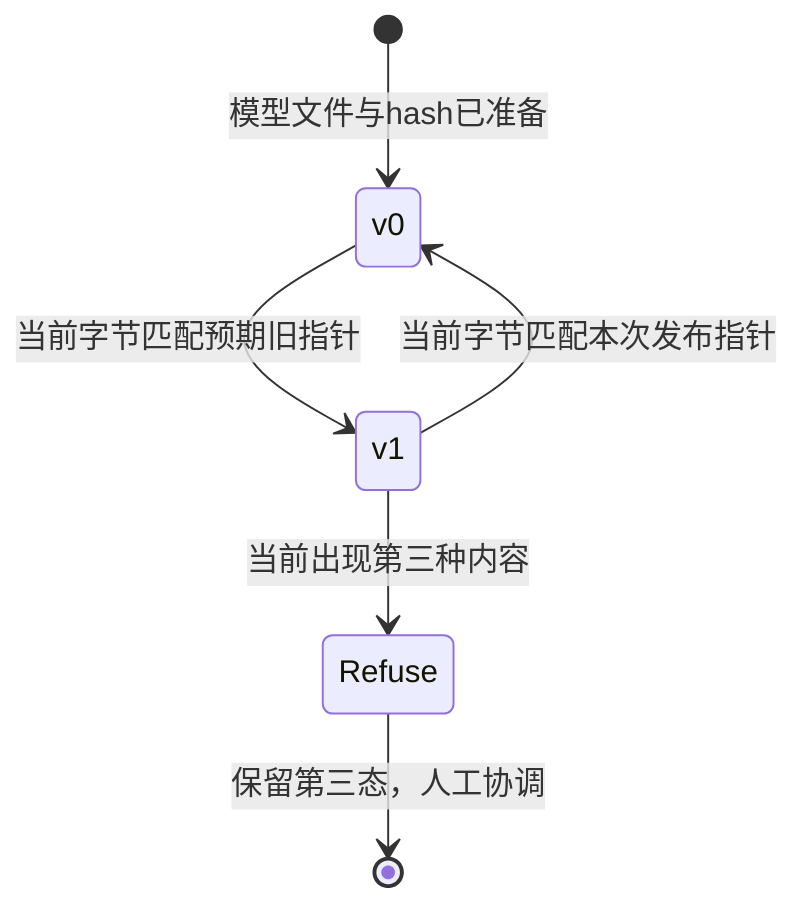

# 区间、代价和失败切片：怎样把结果送到可撤回的发布

**读者问题：** 整体误差下降与90%预测区间，能否保证每个时段可用？模型版本切换后发现问题，怎样保留证据并撤回？

本课消费[[AI/65-可信AI与真实数据实践/03-真实小时数据时间拆分与基线|固定真实数据项目]]的冻结模型与拆分，不另外选择更好看的模型。目标是非负小时租车计数的回归，不把实数预测当分类概率。校准环节选择 **预测区间覆盖**；分类概率校准的一般解释与保形秩证明见[[AI/10-机器学习与深度学习基础/17-概率校准保形预测与分布偏移|校准与保形主解释]]。

## 半径如何从独立残差产生

在2208条校准记录上计算 $a_i=|y_i-\hat y_i|\ge0$，单位是每条小时记录的租车计数。取 $\alpha=0.1$，排序统计量的索引 $k=\lceil(n_{cal}+1)(1-\alpha)\rceil=1989$，1为最小值的索引。实验求第1989小的残差，得到 $q=299.3882$，然后输出

$$
C(x)=[\max(0,\hat y(x)-q),\hat y(x)+q].
$$

下界截到0不会损失对非负真值的覆盖；这与把半径随意变小不同。如果一般情况下 $k>n_{cal}$，必须返回无限半径，不能冒充“取最大残差仍满足有限样本目标”。例：3个校准点、99%目标，$k=4>3$，信息不足以由该构造给有限区间。

通常的split conformal保证需要校准与新测试点的分数可交换，且模型、评分规则和α事先固定。本项目的相邻小时相关、季度分布不同，未验证可交换性。因此我们只借用明确的残差秩构造并报告 **经验区间覆盖**，不宣称时间序列已有分布无关90%保证。理论前提、附录D定理D.1和时序限制的不同方法在原教程v6中明确说明。[Angelopoulos与Bates，v6，第2节、4.6节、附录D](https://arxiv.org/html/2107.07511v6)

实际2168条test的覆盖是2053/2168=0.9469557，平均区间宽436.8307。宽度因非负下界截断而不是处处等于 $2q=598.7764$。覆盖高也可能来自宽区间，并不自动说明预测精细或决策有用。

## 分组失败必须把样本量和分母一起交出

下面是冻结模型按记录本地小时分组的描述性结果。分组在任务中预先固定；分析后如果另挑“最差”组并优化，需独立未来检验。当前表没有独立同分布置信区间；小时相关使简单逐行bootstrap的标准误解释也需谨慎。

| 时段 | 记录数 | MAE | 均值y−预测 | 区间覆盖 |
| --- | ---: | ---: | ---: | ---: |
| 00–05 | 537 | 17.9154 | 0.1255 | 1.0000 |
| 06–09 | 360 | 121.9855 | 108.9585 | 0.8889 |
| 10–15 | 543 | 118.1995 | 108.6062 | 0.9576 |
| 16–19 | 364 | 173.8840 | 140.7752 | 0.8571 |
| 20–23 | 364 | 49.6544 | 36.2739 | 1.0000 |

图左说明晚高峰误差更大，图右说明整体0.947掩盖了16–19点仅312/364=0.8571的覆盖。它不证明“时段造成模型错误”或需要哪种干预；时段同时关联工作日、天气、季节与需求水平。MAE是绝对误差，较高需求组容易有更大的计数误差，因此也不能直接比较哪组“受到更大不公”。

season_code在test仅出现1与4：代码1有262条，MAE46.7604、覆盖1；代码4有1906条，MAE98.0244、覆盖0.9397。代码2/3没有本测试季记录，应写 **没有证据**，不能填0错误或通过。weather_code=1/2/3的记录数分别1224/784/160，MAE98.4338/86.0178/69.7796；代码4没有test记录。完整机器结果与每组宽度在[report.json](./results/report.json)。这些是环境与日历性能切片，不是人口公平实证；前课[[AI/65-可信AI与真实数据实践/02-标签选择偏差与社会目标|标签选择和社会目标]]解释了缺少哪些对象。

## 预测中心和行动代价要分开

用模型估计平均租车次数，与预留多少资源，是不同决策。本实验人为声明低配1次的损失为3、高配1次的损失为1：

$$
L(y,a)=3\max(y-a,0)+\max(a-y,0),\qquad a\ge0.
$$

权重是教学假设，单位为任意损失单位/一次租车计数，不是实际货币成本。城市总小时租车次数也不是站点库存，`capacity`只是演练用的实数行动量，没做车辆守恒、位置调度和库存执行；不能将它投入真实运营。

若有完整条件分布，最小化这一不对称绝对损失的行动是75%条件分位数。因为连续情形中导数是 $-3P(Y>a)+P(Y<a)$，零点给 $F(a)=3/(3+1)=0.75$；离散分布则用分位数左右条件，可能有多个最优解。我们没有完整条件分布，所以采用较弱的开发集 **公共残差偏移**：$b$取开发残差 $(y-\hat y)$ 的75%样本分位数，函数明确使用 `method='higher'` 的有限样本约定，得到 $b=122.0828$。冻结行动 $a(x)=\max(0,\hat y(x)+b)$。它不声称逐个输入都是条件75%分位数，也不重新声称这个行动量是均值预测。

| 同一test上的量 | 原预测中心 | 开发残差偏移后的行动 |
| --- | ---: | ---: |
| MAE | 91.8292 | 100.7124 |
| RMSE | 133.5035 | 120.0100 |
| 均值y−量 | 75.0514 | −47.0314 |
| 平均3:1代价 | 258.7098 | 154.3935 |

代价下降而MAE上升不是矛盾，优化对象不同。偏移由dev确定，q只由cal确定；区间仍以原冻结预测中心构造，不能把行动偏移后沿用原区间却假称重新校准。本实验未对每个组单独拟合偏移，不把群体阈值技术当成社会目标的自动答案。

## 版本血缘是复算需要的输入

模型文件保存契约名 `bike-local-hour-v1`、数据hash、固定feature schema对应的85维均值与scale、86维权重、λ、区间半径、α与决策偏移。报告保存候选开发分数、选择规则、split计数、性能、失败切片、漂移与NumPy版本；逐行CSV保存记录日期、小时、原season/weather代码、y、预测、区间和行动量。原始数据、模型、报告、逐行预测各自有hash，不能拿文件名相同替代字节相同。

当前冻结结果在[model.json](./results/model.json)、[test_predictions.csv](./results/test_predictions.csv)与[版本说明](./results/VERSIONS.md)。实际运行使用Python3.14.7/NumPy2.5.3。不同线性代数库、平台或软件版本可能产生末位差异；数值结论应在明确容差下复核，不以跨平台字节不同直接判定模型错误。测试从保存的逐行CSV独立复算MAE与覆盖，并验证重新加载模型的预测与导出值一致。

## 一次受控发布与回滚演练

演练只使用临时目录，没有启动服务或改真实线上系统。v0是训练小时均值基线，v1是冻结模型连同区间/行动参数。先序列化两个模型，各自写文件并计算hash，建立指向版本与hash的指针；核对模型可加载与hash相符后，将当前指针从v0切到v1。预先保存的旧指针字节供回滚使用，再从v1切回v0，并确认读回版本。

回滚只在当前指针仍等于这次发布字节时执行；测试模拟他人写入 `human-new-version`，旧回滚请求被拒绝，第三态保持原字节。代码用先检查字节再 `os.replace` 切换单个指针，这是 **单写者本地演练**。检查与替换之间存在时间窗口，不是真正多写者compare-and-swap；真实多写者需要锁、事务或版本条件请求。模型文件、预测、报告与指针不是整体原子事务，hash也不能证明授权或生产可靠性。

演练中的发布对象是模型版本控制的行为示例，并非宣称所有上线门槛通过。真实上线还需匹配用途、特征可得性、可接受失败与人工责任；模型没有这些证据时，局部实验的有效结果仍可保留。

## 漂移报警不能自动给因果结论

用训练temp原归一化值作参照，固定边界0、0.2、0.4、0.6、0.8、1。前四箱左闭右开，最后箱含1。各窗口归一化成概率向量 $p,q\in\mathbb R^5$，总和1，总变差

$$
TV(p,q)=\frac12\sum_{j=1}^{5}|p_j-q_j|\in[0,1].
$$

事先规定教学报警阈值0.10；真实train全年对test第四季TV为0.345650，达到阈值。再人为将test的temp加0.20并截到1，TV为0.344614，也报警。这个注入测试检验计算链与报警条件；它不是实际天气变化，且TV没有随“升温”单调增大，因为全年参照本就包含暖季质量。应优先与相同季节/时段的历史参照比较，阈值也需从真实报警成本与稳定性验证；本实验没优化阈值。

无标签的输入报警只说明边际分布不同，不能自动推出 $P(Y\mid X)$ 改变、预测性能下降或模型导致社会伤害。标签到达后，才能在相同时间窗口复算误差与覆盖；这里训练/测试标签均值143.7944/219.1965也不同，但不能据此断言城市增长、季节、缺车或事件各自的因果贡献。相关、协变量漂移、标签漂移和概念漂移的假设边界由[[AI/10-机器学习与深度学习基础/17-概率校准保形预测与分布偏移|分布偏移主解释]]说明。

## 练习与答案

1. 整体覆盖0.947为何不证明晚高峰达90%？**答案：** 总体加权平均可以被夜间和其他时段的高覆盖抬高，16–19组实测312/364=0.8571；这里连可交换性保证也未验证。
2. 一次test预测为 $\hat y=100$，区间和行动量是什么？**答案：** $[0,399.3882]$，行动约222.0828；区间中心和行动有不同用途，不能把行动量直接叫概率。
3. 第三态出现后用v0整个目录覆盖是否能安全恢复？**答案：** 不行。会覆盖他人更新；演练只拒绝覆盖并保留第三态，真实协作需要协调后对当前版本形成新请求。
4. 注入temp增大，TV反而从0.34565降到0.34461，是否实现错了？**答案：** 未必。TV衡量相对参照的质量差异，全年训练有暖季，方向性增温不保证离全年参照更远。独立两箱质量例与边界测试检查实现，实际参照必须匹配问题。

完整实现、有限秩oracle和第三态测试见[[AI/65-可信AI与真实数据实践/80-公平与真实数据复现实验|复现实验]]。若要从切片迁移到人口公平，回到[[AI/65-可信AI与真实数据实践/01-公平指标分母与基率冲突|指标条件]]与[[AI/65-可信AI与真实数据实践/02-标签选择偏差与社会目标|测量机制]]重新定义对象，不能借此表绕过所缺证据。
