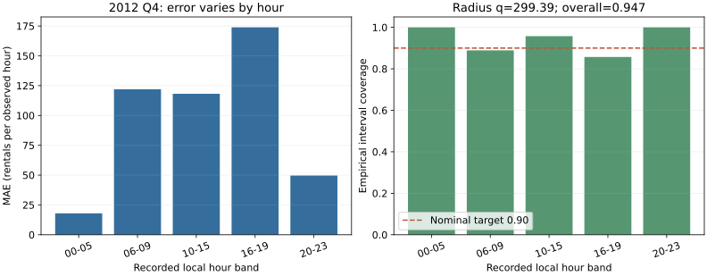
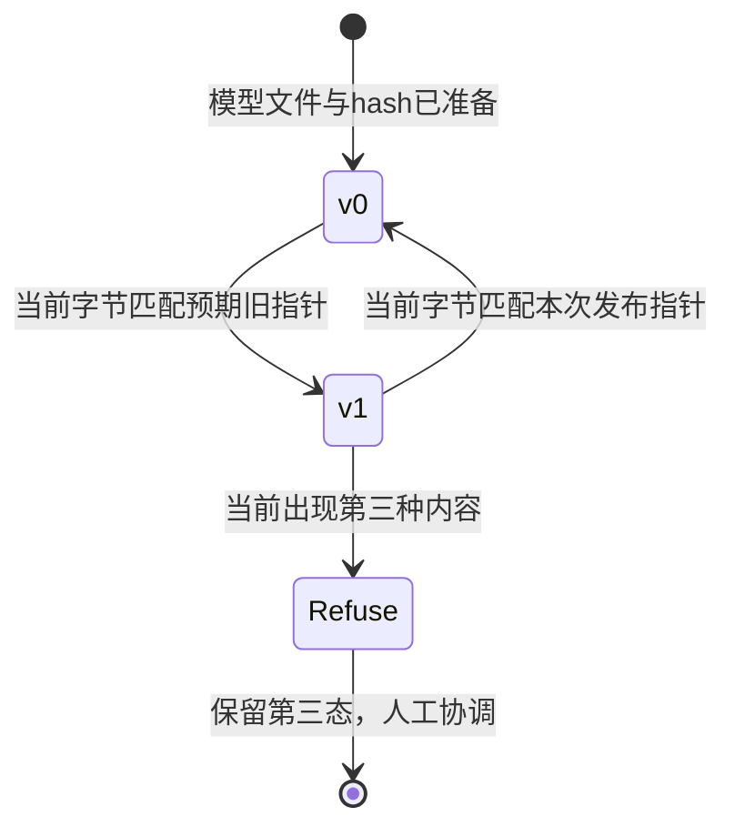

# 区间、代价和失败切片：怎样把结果送到可撤回的发布

**读者问题：** 整体误差下降与90%预测区间，能否保证每个时段可用？模型版本切换后发现问题，怎样保留证据并撤回？

本课消费[[AI/65-可信AI与真实数据实践/03-真实小时数据时间拆分与基线|固定真实数据项目]]的冻结模型与拆分，不另外选择更好看的模型。目标是非负小时租车计数的回归，不把实数预测当分类概率。校准环节选择 **预测区间覆盖**；分类概率校准的一般解释与保形秩证明见[[AI/10-机器学习与深度学习基础/17-概率校准保形预测与分布偏移|校准与保形主解释]]。

## 半径如何从独立残差产生

在2208条校准记录上计算 $a_i=|y_i-\hat y_i|\ge0$，单位是每条小时记录的租车计数。取 $\alpha=0.1$，排序统计量的索引 $k=\lceil(n_{cal}+1)(1-\alpha)\rceil=1989$，1为最小值的索引。实验求第1989小的残差，得到 $q=299.3882$，然后输出

$$
C(x)=[\max(0,\hat y(x)-q),\hat y(x)+q].
$$

下界截到0不会损失对非负真值的覆盖；这与把半径随意变小不同。如果一般情况下 $k>n_{cal}$，必须返回无限半径，不能冒充“取最大残差仍满足有限样本目标”。例：3个校准点、99%目标，$k=4>3$，信息不足以由该构造给有限区间。

通常的split conformal保证需要校准与新测试点的分数可交换，且模型、评分规则和α事先固定。本项目的相邻小时相关、季度分布不同，未验证可交换性。因此我们只借用明确的残差秩构造并报告 **经验区间覆盖**，不宣称时间序列已有分布无关90%保证。理论前提、附录D定理D.1和时序限制的不同方法在原教程v6中明确说明。[Angelopoulos与Bates，v6，第2节、4.6节、附录D](https://arxiv.org/html/2107.07511v6)

实际2168条test的覆盖是2053/2168=0.9469557，平均区间宽436.8307。宽度因非负下界截断而不是处处等于 $2q=598.7764$。覆盖高也可能来自宽区间，并不自动说明预测精细或决策有用。

## 分组失败必须把样本量和分母一起交出

下面是冻结模型按记录本地小时分组的描述性结果。分组在任务中预先固定；分析后如果另挑“最差”组并优化，需独立未来检验。当前表没有独立同分布置信区间；小时相关使简单逐行bootstrap的标准误解释也需谨慎。

| 时段 | 记录数 | MAE | 均值y−预测 | 区间覆盖 |
| --- | ---: | ---: | ---: | ---: |
| 00–05 | 537 | 17.9154 | 0.1255 | 1.0000 |
| 06–09 | 360 | 121.9855 | 108.9585 | 0.8889 |
| 10–15 | 543 | 118.1995 | 108.6062 | 0.9576 |
| 16–19 | 364 | 173.8840 | 140.7752 | 0.8571 |
| 20–23 | 364 | 49.6544 | 36.2739 | 1.0000 |

图左说明晚高峰误差更大，图右说明整体0.947掩盖了16–19点仅312/364=0.8571的覆盖。它不证明“时段造成模型错误”或需要哪种干预；时段同时关联工作日、天气、季节与需求水平。MAE是绝对误差，较高需求组容易有更大的计数误差，因此也不能直接比较哪组“受到更大不公”。

season_code在test仅出现1与4：代码1有262条，MAE46.7604、覆盖1；代码4有1906条，MAE98.0244、覆盖0.9397。代码2/3没有本测试季记录，应写 **没有证据**，不能填0错误或通过。weather_code=1/2/3的记录数分别1224/784/160，MAE98.4338/86.0178/69.7796；代码4没有test记录。完整机器结果与每组宽度在[report.json](./results/report.json)。这些是环境与日历性能切片，不是人口公平实证；前课[[AI/65-可信AI与真实数据实践/02-标签选择偏差与社会目标|标签选择和社会目标]]解释了缺少哪些对象。

## 预测中心和行动代价要分开

用模型估计平均租车次数，与预留多少资源，是不同决策。本实验人为声明低配1次的损失为3、高配1次的损失为1：

$$
L(y,a)=3\max(y-a,0)+\max(a-y,0),\qquad a\ge0.
$$

权重是教学假设，单位为任意损失单位/一次租车计数，不是实际货币成本。城市总小时租车次数也不是站点库存，`capacity`只是演练用的实数行动量，没做车辆守恒、位置调度和库存执行；不能将它投入真实运营。

若有完整条件分布，最小化这一不对称绝对损失的行动是75%条件分位数。因为连续情形中导数是 $-3P(Y>a)+P(Y<a)$，零点给 $F(a)=3/(3+1)=0.75$；离散分布则用分位数左右条件，可能有多个最优解。我们没有完整条件分布，所以采用较弱的开发集 **公共残差偏移**：$b$取开发残差 $(y-\hat y)$ 的75%样本分位数，函数明确使用 `method='higher'` 的有限样本约定，得到 $b=122.0828$。冻结行动 $a(x)=\max(0,\hat y(x)+b)$。它不声称逐个输入都是条件75%分位数，也不重新声称这个行动量是均值预测。

| 同一test上的量 | 原预测中心 | 开发残差偏移后的行动 |
| --- | ---: | ---: |
| MAE | 91.8292 | 100.7124 |
| RMSE | 133.5035 | 120.0100 |
| 均值y−量 | 75.0514 | −47.0314 |
| 平均3:1代价 | 258.7098 | 154.3935 |

代价下降而MAE上升不是矛盾，优化对象不同。偏移由dev确定，q只由cal确定；区间仍以原冻结预测中心构造，不能把行动偏移后沿用原区间却假称重新校准。本实验未对每个组单独拟合偏移，不把群体阈值技术当成社会目标的自动答案。

## 版本血缘是复算需要的输入

模型文件保存契约名 `bike-local-hour-v1`、数据hash、固定feature schema对应的85维均值与scale、86维权重、λ、区间半径、α与决策偏移。报告保存候选开发分数、选择规则、split计数、性能、失败切片、漂移与NumPy版本；逐行CSV保存记录日期、小时、原season/weather代码、y、预测、区间和行动量。原始数据、模型、报告、逐行预测各自有hash，不能拿文件名相同替代字节相同。

当前冻结结果在[model.json](./results/model.json)、[test_predictions.csv](./results/test_predictions.csv)与[版本说明](./results/VERSIONS.md)。实际运行使用Python3.14.7/NumPy2.5.3。不同线性代数库、平台或软件版本可能产生末位差异；数值结论应在明确容差下复核，不以跨平台字节不同直接判定模型错误。测试从保存的逐行CSV独立复算MAE与覆盖，并验证重新加载模型的预测与导出值一致。

## 一次受控发布与回滚演练

演练只使用临时目录，没有启动服务或改真实线上系统。v0是训练小时均值基线，v1是冻结模型连同区间/行动参数。先序列化两个模型，各自写文件并计算hash，建立指向版本与hash的指针；核对模型可加载与hash相符后，将当前指针从v0切到v1。预先保存的旧指针字节供回滚使用，再从v1切回v0，并确认读回版本。

回滚只在当前指针仍等于这次发布字节时执行；测试模拟他人写入 `human-new-version`，旧回滚请求被拒绝，第三态保持原字节。代码用先检查字节再 `os.replace` 切换单个指针，这是 **单写者本地演练**。检查与替换之间存在时间窗口，不是真正多写者compare-and-swap；真实多写者需要锁、事务或版本条件请求。模型文件、预测、报告与指针不是整体原子事务，hash也不能证明授权或生产可靠性。

演练中的发布对象是模型版本控制的行为示例，并非宣称所有上线门槛通过。真实上线还需匹配用途、特征可得性、可接受失败与人工责任；模型没有这些证据时，局部实验的有效结果仍可保留。

## 漂移报警不能自动给因果结论

用训练temp原归一化值作参照，固定边界0、0.2、0.4、0.6、0.8、1。前四箱左闭右开，最后箱含1。各窗口归一化成概率向量 $p,q\in\mathbb R^5$，总和1，总变差

$$
TV(p,q)=\frac12\sum_{j=1}^{5}|p_j-q_j|\in[0,1].
$$

事先规定教学报警阈值0.10；真实train全年对test第四季TV为0.345650，达到阈值。再人为将test的temp加0.20并截到1，TV为0.344614，也报警。这个注入测试检验计算链与报警条件；它不是实际天气变化，且TV没有随“升温”单调增大，因为全年参照本就包含暖季质量。应优先与相同季节/时段的历史参照比较，阈值也需从真实报警成本与稳定性验证；本实验没优化阈值。

无标签的输入报警只说明边际分布不同，不能自动推出 $P(Y\mid X)$ 改变、预测性能下降或模型导致社会伤害。标签到达后，才能在相同时间窗口复算误差与覆盖；这里训练/测试标签均值143.7944/219.1965也不同，但不能据此断言城市增长、季节、缺车或事件各自的因果贡献。相关、协变量漂移、标签漂移和概念漂移的假设边界由[[AI/10-机器学习与深度学习基础/17-概率校准保形预测与分布偏移|分布偏移主解释]]说明。

## 部署改变分布时的重训与风险

这是选读的合成模型，用来问：**每次都正确拟合新数据，最后不再变化，是否就已经选对部署？** 它与上面的真实租车数据实验是两个对象；本节的参数、结果和损失都无量纲，不沿用租车计数或前节报警阈值。

### 先分清哪个参数正在改变分布

把部署参数记为 $\theta$，它诱导结果分布 $\mathcal D(\theta)$。用 $a$ 表示暂时评估的预测参数，两者都在 $[0,1/2]$。为看清机制，损失只取平方预测误差，不包含资源费用或福利。三种问题是：

| 问题 | 正在优化什么 | 哪个分布保持固定 |
| --- | --- | --- |
| 普通固定分布风险 | $\min_a E_{Z\sim\mathcal D_*}[(a-Z)^2]$ | 给定的 $\mathcal D_*$ |
| 冻结当前部署，再训练 | $\min_a E_{Z\sim\mathcal D(\theta_t)}[(a-Z)^2]$ | 当前 $\theta_t$ 诱导的分布 |
| 部署风险 | $\min_\theta R(\theta)$，$R(\theta)=E_{Z\sim\mathcal D(\theta)}[(\theta-Z)^2]$ | 候选 $\theta$ 改变，结果分布也随之改变 |

后两行的区别不是求解器精度，而是换参数时允不允许结果分布随部署改变。[Perdomo等（2020）](https://proceedings.mlr.press/v119/perdomo20a.html)提出模型影响结果分布与稳定性的框架；[Miller等（2021）](https://proceedings.mlr.press/v139/miller21a.html)明确指出稳定解可以远离部署风险最优。下面的两点分布是独立教学构造，不复现其论文实验。

### 同一合成机制先重训十次

令

$$Z_\theta=\tfrac12\theta+\tfrac14+\theta U,\qquad P(U=1)=P(U=-1)=\tfrac12.$$

每次产生结果时抽取独立外生 $U$。因为 $0\le\theta\le1/2$，两个可能结果 $1/4-\theta/2$ 与 $1/4+3\theta/2$ 都在 $[0,1]$；这是实值响应，不是预先固定的二元标签，$\theta$ 也不是事件概率。其均值为 $\mu(\theta)=\theta/2+1/4$，方差为 $\theta^2$。

固定当前 $\theta$ 时，平方损失可以直接分解：

$$F(a;\theta)=E[(a-Z_\theta)^2]=(a-\mu(\theta))^2+\theta^2.$$

$\mu(\theta)\in[1/4,1/2]$，在允许参数区间内，因此总体最优 $a=\mu(\theta)$。这使用[[数学/30-概率与统计/11-条件期望与最小均方估计#最优性不是口号：一行勾股分解|均方最优的条件均值]]思想；这里没有额外观测，就是对当前分布取均值。忽略有限样本、估计和求解误差的理想重复重训给

$$\theta_{t+1}=\tfrac12\theta_t+\tfrac14,\qquad
\theta_t-\tfrac12=2^{-t}(\theta_0-\tfrac12).$$

从 $\theta_0=0$ 出发：

| 重训次数 $t$ | 0 | 1 | 2 | 5 | 10 |
| --- | ---: | ---: | ---: | ---: | ---: |
| 参数 $\theta_t$ | $0$ | $1/4$ | $3/8$ | $31/64$ | $1023/2048$ |

误差每次减半，对任意允许初值都收敛到 $\theta_{\rm stable}=1/2$；此点诱导的结果是0或1，各半概率，再拟合其均值仍是1/2。稳定表示在自己诱导的数据上重训不会换模型，不是已经证明所有未来环境稳定。

### 把部署也算进去，最优点变了

现在令分布跟随待选参数。把 $a=\theta$ 代入同一有限模型：

$$
R(\theta)=F(\theta;\theta)
=(\tfrac12\theta-\tfrac14)^2+\theta^2
=\tfrac54\theta^2-\tfrac14\theta+\tfrac1{16}.
$$

故 $R'(\theta)=5\theta/2-1/4$、$R''(\theta)=5/2>0$，唯一最优 $\theta_{\rm opt}=1/10$ 位于区间内。等价地，配方给全区间证明

$$R(\theta)=\tfrac54(\theta-\tfrac1{10})^2+\tfrac1{20}.$$

| 部署选择 | 可能结果，各概率1/2 | 该部署的最优重新拟合值 | 实际部署风险 |
| --- | --- | ---: | ---: |
| 稳定点 $\theta=1/2$ | $0,1$ | $1/2$ | $1/4$ |
| 风险最优 $\theta=1/10$ | $1/5,2/5$ | $3/10$ | $1/20$ |

风险最优点并不是自己分布上的最佳常数预测：若只在它生成的数据上拟合，会改到3/10，却又改变接下来数据的方差。冻结分布求 $\partial F/\partial a$ 时把方差 $\theta^2$ 当常数；评价部署则必须让这个方差也随参数变化。这正是稳定与风险最优分离的原因。两风险比值为5，只属于这个给定机制，不能当现实推荐系统的收益倍数。

### 关掉分布反应，两个目标重新重合

改为每次部署都产生 $Z_*=1/4+(1/10)U$，不再含 $\theta$。结果固定为 $3/20,7/20$，均值1/4、方差1/100。无论旧参数如何，下一次理想重训都得到1/4；部署风险也为

$$R_*(\theta)=(\theta-1/4)^2+1/100,$$

故最优同为1/4，风险1/100。不能把“稳定不等于最优”写成所有任务的必然结论；应先看分布是否反应，以及选择的损失。

### 回到工单、标签选择与社会机制

- 回到[[AI/10-机器学习与深度学习基础/02-模型特征参数目标与泛化#同一张工单怎样从预测走到行动|工单分流]]：模型改了人工处理策略后，历史升级标签仍代表原策略下的结果。要把这里的 $\mathcal D(\theta)$ 用于工单，必须明确部署怎样改变处理及后续升级，不可把教学反应函数直接填上去。
- 回到[[AI/10-机器学习与深度学习基础/21-因果机器学习选择偏差与反事实评估#部署让数据生成机制发生反馈|日志选择与支持集]]：某种结果被策略改变，与本来存在的结果不再被记录是不同机制。记录策略、propensity、缺失标签和支持，不能独自识别结果对新部署的反应。
- 回到[[社会科学/40-公共政策与社会学/06-规范身份歧视与自我实现#自我实现是可追踪反馈，不是神秘标签|培训机会与自我实现]]：原68/59例要求逐边检查信念→分配、分配→结果及测量选择。这里没有设定群体、歧视或最初错误信念，不能把一般部署反馈直接改称 Merton 的自我实现。

观察分布改变还可能来自外部环境或共同原因；本节给定 $\mathcal D(\theta)$，没有从观察数据识别它。返回[[社会科学/10-共同工具/03-因果图反事实与识别#识别、估计与外推是三道门|识别边界]]检查需要什么结构或实验依据，不能以预测误差小反推某个机制已证实。推荐曝光、对手适应、制度反馈分别还需自己的行动与状态模型。

本例是实值响应且未给纯标签偏移条件，不直接套[[AI/10-机器学习与深度学习基础/17-概率校准保形预测与分布偏移#纯标签偏移下的赔率修正|先验赔率修正]]；但“存在部署反馈”也不排除另一个二分类模型恰好满足类条件分布不变。稳定、预测风险最小、权利与福利是不同判断：即使找到了1/10，也只最小化本文指定的平方预测误差，没有替受影响者选择福利目标。

> [!question]- 迁移：看到模型不再变化，能关闭哪一个问题？
> 从 $\theta_0=1/10$ 出发再训练一次得什么？它为何不证明原部署风险最优点算错了？若只观察参数趋于1/2，能否声称社会反馈机制已识别或受影响者福利最大？
>
> 一次重训得 $3/10$，因为这一步最小化的是冻结 $\mathcal D(1/10)$ 的 $F(a;1/10)$；原最优点最小化 $F(\theta;\theta)$，对象不同。收敛只说明给定理想迭代的稳定性；因果识别需额外证据，福利需另定目标。固定分布对照中两问题重合，是检查这种区分没有被夸大为普遍矛盾的方法。

完整十步序列、两风险及固定分布对照的源码接口见[[AI/80-实践/基率赔率与部署反馈/DEPLOYMENT|部署反馈复算]]。脚本核有限模型，不能替代真实部署、社会机制识别、Obsidian显示或真人学习验证。

## 练习与答案

1. 整体覆盖0.947为何不证明晚高峰达90%？**答案：** 总体加权平均可以被夜间和其他时段的高覆盖抬高，16–19组实测312/364=0.8571；这里连可交换性保证也未验证。
2. 一次test预测为 $\hat y=100$，区间和行动量是什么？**答案：** $[0,399.3882]$，行动约222.0828；区间中心和行动有不同用途，不能把行动量直接叫概率。
3. 第三态出现后用v0整个目录覆盖是否能安全恢复？**答案：** 不行。会覆盖他人更新；演练只拒绝覆盖并保留第三态，真实协作需要协调后对当前版本形成新请求。
4. 注入temp增大，TV反而从0.34565降到0.34461，是否实现错了？**答案：** 未必。TV衡量相对参照的质量差异，全年训练有暖季，方向性增温不保证离全年参照更远。独立两箱质量例与边界测试检查实现，实际参照必须匹配问题。

完整实现、有限秩oracle和第三态测试见[[AI/65-可信AI与真实数据实践/80-公平与真实数据复现实验|复现实验]]。若要从切片迁移到人口公平，回到[[AI/65-可信AI与真实数据实践/01-公平指标分母与基率冲突|指标条件]]与[[AI/65-可信AI与真实数据实践/02-标签选择偏差与社会目标|测量机制]]重新定义对象，不能借此表绕过所缺证据。
