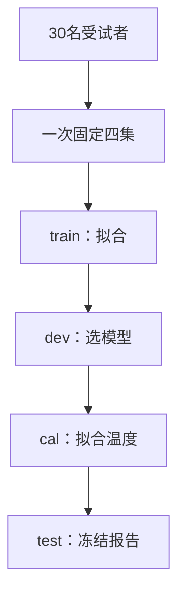

# 实体拆分与概率校准：从同一个人到真正的新受试者

**读者问题：** 测试行虽然训练时没见过，却来自训练中的同一个人，这能说明模型会泛化到新人吗？模型报 90% 置信度时，怎样检查这个数字是否可靠？

不能只看“行是否重复”。本组用 UCI *Human Activity Recognition Using Smartphones* 的 30 名受试者、10,299 个滑动窗口和全部 561 个发布特征，把**预测单位**与**独立实体**分开：一个窗口是一行，受试者才是本问题的拆分单位。每名受试者的所有窗口只能进入 train、dev、cal、test 中的一集。

已有主解释继续承担一般理论：[[AI/10-机器学习与深度学习基础/18-嵌套验证配对实验与指标陷阱|数据隔离]]解释为何标准化、超参数与校准都属于会适应数据的流程；[[AI/10-机器学习与深度学习基础/17-概率校准保形预测与分布偏移|概率校准]]解释温度缩放、可靠性图以及保证的边界。本组只把这些原则落实到真实的多实体、多类数据，不复制保形预测或通用交叉验证。

| 卡点 | 主解释 | 可检查结果 |
| --- | --- | --- |
| 为什么随机分行回答不了“新人”问题？ | [[AI/65-可信AI与真实数据实践/10-实体拆分与概率校准/01-窗口实体与四集隔离协议\|窗口、实体与四集协议]] | 30 人严格互斥；2.56 s 窗和 50% 重叠随人归组 |
| NLL、Brier、可靠性图和 ECE 各算什么？ | [[AI/65-可信AI与真实数据实践/10-实体拆分与概率校准/02-多类概率指标与温度缩放\|多类概率指标与温度缩放]] | 手算 NLL/Brier/ECE；证明 $T>0$ 不改 argmax；构造校准不迁移反例 |
| 真实数据上概率是否变可靠？ | [[AI/65-可信AI与真实数据实践/10-实体拆分与概率校准/03-冻结测试结果与实体切片边界\|冻结测试结果与边界]] | 观察准确率、NLL、Brier、分箱敏感性与 4 个测试受试者切片 |
| 怎样在不把 58 MB 数据放进库的情况下复算？ | [[AI/65-可信AI与真实数据实践/10-实体拆分与概率校准/80-实体拆分与概率校准复现实验\|复现实验]] | 显式归档路径、固定哈希、完整 NumPy 源码、12 项测试与三张 SVG |

图中箭头表示处理顺序和模型的交接，受试者不会沿箭头迁移：四集一次固定且互不重叠。train 的18人用于拟合标准化参数和权重，dev 的4人只选 L2，cal 的4人只拟合温度 T，test 的4人只做冻结观察与预声明切片。

这条链的结论很窄：在指定手机位置、六种受控活动、固定特征构造和四名测试受试者上观察到一次新受试者表现。它不是对所有新人、人口群体、传感器位置、自然环境或分布外输入的保证；校准也不是群体保证或安全证明。

