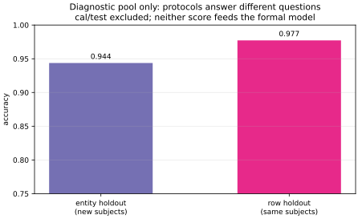

# 窗口、实体与四集隔离协议

## 一行没见过，不等于一个人没见过

UCI HAR 记录 30 名 19–48 岁志愿者腰间佩戴 Samsung Galaxy S II，完成 WALKING、WALKING_UPSTAIRS、WALKING_DOWNSTAIRS、SITTING、STANDING、LAYING 六种活动。加速度计与陀螺仪以 50 Hz 采样；发布方把信号切成 2.56 s、128 点的窗口，相邻窗口重叠 50%，再生成 561 个时域与频域特征。数据说明和原论文的实验设计见 [UCI 数据页](https://archive.ics.uci.edu/dataset/240/human+activity+recognition+using+smartphones) 与 [Anguita 等，ESANN 2013，第 437–442 页](https://www.esann.org/sites/default/files/proceedings/legacy/es2013-84.pdf)。

换一行，不附赠一位新受试者。相邻窗口共享 64 个原始采样点。即使两个窗口的特征向量字节不同，它们也不是独立的新实验；同一个人的步态、佩戴方式与身体特征还会让更远窗口相关。若随机分行，同一受试者可以同时出现在训练与测试，模型可能利用人的稳定特征。此时结果回答的是“已出现受试者的新窗口”，不能改写成“新人”。

本协议把实体定义为 `subject_id`。一个人的全部窗口必须同行移动，窗口重叠无需被逐对识别。原始特征文件没有窗口起始时间，因此无法从发布的 561 维表精确认证哪些行彼此重叠；按受试者整组隔离是更保守、也与读者问题一致的处理。

## 固定归档、许可冲突与数据边界

课程不收录大型归档。2026-09-20 从 UCI 数据集 240 的官方静态地址取得的外层 ZIP 文件为 61,005,872 bytes。`unzip -l` 显示的 61,005,618 是两个成员的解压后长度之和，不能当文件长度：

```text
outer SHA-256 c00b803081a5c797cd5e4b83700a9810b38d53d9d84e01917e090e1fdbc81031
inner SHA-256 2045e435c955214b38145fb5fa00776c72814f01b203fec405152dac7d5bfeb0
embedded dataset version 1.0, November 2013
```

下载、校验和显式数据路径见[[AI/65-可信AI与真实数据实践/10-实体拆分与概率校准/data/README|数据获取合同]]。当前 UCI 页面显示 CC BY 4.0；但同一官方外层归档内的 Version 1.0 README 同时写有“commercial use is prohibited”和引用要求，原论文标题又使用 “Public Domain”。这些文字并不一致。本组不擅自判定哪一条覆盖另一条，也不再分发数据。商业使用或再分发前应向 UCI/作者或机构确认适用条款；这项未决点不能被一个 SPDX 标签抹掉。

载入器核对外层和内层哈希，然后读取官方原 train/test 文件并合并为 10,299 行，再建立本课程的新实体协议。这样做不沿用官方 70%/30% 志愿者拆分，所得分数也不与官方基准成绩直接比较。

## 先冻结实体，再看任何结果

拆分种子 `20260920` 只在结果产生前对受试者编号 1–30 做过一次排列；所得 18/4/4/4 人列表现已硬编码为协议。CLI 的 `--seed` 只控制 Adam batch 顺序和独立 row 诊断抽样，改变它不会改变实体列表：

| 集合 | subject IDs | 窗口数 | 唯一用途 |
| --- | --- | ---: | --- |
| train | 2, 3, 4, 7, 8, 9, 11, 12, 13, 14, 15, 16, 17, 18, 19, 21, 22, 27 | 6014 | 附加标准化、softmax 权重 |
| dev | 1, 28, 29, 30 | 1456 | 从三个 $L_2$ 候选中按 NLL 选一个 |
| cal | 5, 20, 25, 26 | 1457 | 模型冻结后只拟合一个温度 $T$ |
| test | 6, 10, 23, 24 | 1372 | 一次冻结评估及预先声明的逐 subject 切片 |

四组 ID 两两不交，合起来恰为 1–30；每组都含六类。分组规则没有读标签或分数。测试集如今已经用于这份报告，后续若根据测试结果新增特征、改变优化轮数、候选 $L_2$、温度目标或分箱方案，就必须另找测试实体，不能继续叫同一 test “未见”。

## 全部 561 个发布特征进入清楚的基线

令 $X\in\mathbb R^{n\times561}$，标签 $y_i\in\{0,\ldots,5\}$。官方文件说发布特征已归一化到 $[-1,1]$；它们是上游滤波、窗口化和时频特征工程的产物。课程无法证明这些上游步骤或其归一化参数只使用本课程的 train subjects。这里的 “train-only” 只覆盖课程新增的列均值、列标准差和模型拟合，不能追溯改写发布方流程。

训练行给出每列 $mu_j$ 与总体标准差 $s_j$；常数列令 $s_j=1$。其他集合统一变换

$$
\widetilde x_{ij}=\frac{x_{ij}-\mu_j}{s_j}.
$$

追加截距后，设计矩阵有 562 列；多类权重 $W\in\mathbb R^{562\times6}$，logits $z_i=\widetilde x_i^T W\in\mathbb R^6$，概率为 softmax。固定优化器为 mini-batch Adam：36 epochs、batch 512、learning rate 0.012。只比较 $\lambda\in\{10^{-5},10^{-4},10^{-3}\}$，dev NLL 最小者胜出。这个有限、近似优化的线性概率基线使用全部实际发布字段，但不声称达到该数据集最佳成绩。

## 独立的 row/entity 机制对照

正式 cal 和 test 完全不进入对照。只在 formal train+dev 的 22 人、7470 行中，固定 $\lambda=10^{-3}$，做两个独立协议：

1. entity holdout：18 人拟合、4 个新人评估；
2. row holdout：同一 22 人的行按类别随机取约 80%/20%，22 人都出现在两侧。

两者不共享同一个“目标总体”，所以差异不是算法因果效应或置信区间。实际观察为 entity accuracy `0.9437`，row accuracy `0.9772`。它只演示随机分行可让问题变容易；该对照的任何分数都不参与正式模型、温度或 test 报告。



## 练习与答案

1. **同一受试者的窗口没有重复，能随机分行吗？** 若目标是新人，不能据此。无重复只排除完全相同的行；共享原始采样、同一人的稳定特征和同一实验段依赖仍在。
2. **能否先用全部 30 人求标准化均值，再按人拆分？** 不能。那会让 dev/cal/test 的输入分布进入训练状态。课程只用 18 个 train subjects 求新增的均值与标准差。
3. **为什么不声称整个 UCI 预处理 train-only？** 561 维文件在本课程拆分前已经由发布方完成滤波、窗口、特征与归一化；现有说明没有给出与本课程四集一致的拟合边界。
4. **四个 test subjects 表现不错，能推出所有新人都好吗？** 不能。它只是四个实体的描述性观察；年龄、设备、佩戴位置、自然环境与总体抽样都限制外推。

下一课用同一模型解释[[AI/65-可信AI与真实数据实践/10-实体拆分与概率校准/02-多类概率指标与温度缩放|多类概率指标与温度缩放]]。返回[[AI/65-可信AI与真实数据实践/10-实体拆分与概率校准/00-实体拆分与概率校准-MOC|课程地图]]。
