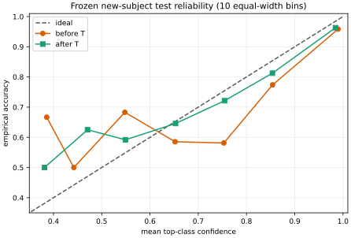

# 多类概率指标与温度缩放

已有[[AI/10-机器学习与深度学习基础/17-概率校准保形预测与分布偏移|校准主解释]]区分排序、校准和决策。本课固定多类实现口径，并说明为什么“cal 上变好”不是 test 保证。

## 一个预测需要四种不同读法

对第 $i$ 行的六类概率 $p_i\in[0,1]^6$、真实类别 $y_i$：

1. **accuracy** 只问 $\arg\max_k p_{ik}=y_i$ 是否成立；
2. **NLL** 为 $-\log p_{i,y_i}$，对把真类概率压得极低的错误惩罚很重；
3. **多类 Brier** 在本组定义为每行六类平方误差之和，再对行平均：

$$
\operatorname{Brier}=\frac1n\sum_{i=1}^n\sum_{k=1}^6
\left(p_{ik}-\mathbf 1[y_i=k]\right)^2.
$$

有的实现再除以类别数或 2；数值不能跨口径直接比较。本组不除，理论范围是 $[0,2]$。

4. **top-label reliability/ECE** 只取置信度 $c_i=\max_kp_{ik}$ 与正确指示 $a_i=\mathbf1[\arg\max p_i=y_i]$。固定 $B$ 个等宽箱：前 $B-1$ 个左闭右开，最后一个包含 1。空箱没有经验 accuracy，不伪造为 0。若非空箱集合为 $\mathcal B$：

$$
\operatorname{ECE}_B=\sum_{b\in\mathcal B}\frac{n_b}{n}
\left|\overline a_b-\overline c_b\right|.
$$

ECE 是分箱估计，不是 proper scoring rule，也不是逐组保证；改变箱数会改变答案。

## 手算：同一四行，ECE 可以从 0 变成 0.1

四行的 top confidence 为 `0.55, 0.65, 0.85, 0.95`，正确指示为 `1, 0, 1, 1`。

- 用 2 个等宽箱时，四行都在 `[0.5,1]`：平均置信度和准确率都是 `0.75`，所以 ECE 为 0。
- 用边界 `0,0.5,0.75,1` 时，`[0.5,0.75)` 两行的平均置信度 `0.60`、准确率 `0.50`；`[0.75,1]` 两行的平均置信度 `0.90`、准确率 `1.00`。两箱各占一半，故 ECE 为

$$
\tfrac24|0.50-0.60|+\tfrac24|1.00-0.90|=0.10.
$$

因此“ECE=0”不能脱离分箱方案读取。

实现 NLL 时直接使用

$$
\log\sum_k e^{z_k}-z_y
$$

的稳定 log-sum-exp 形式。例：$z=(1000,0,-1000,-1000,-1000,-1000)$、真类为第二类，NLL 约为 1000；先 softmax 再把零概率 clip 到 `1e-15` 会错误地得到约 34.54。

## 温度为什么不改变类别，却可能改变概率质量

固定 logits $z_i$，温度缩放为

$$
p_{ik}(T)=\frac{e^{z_{ik}/T}}{\sum_j e^{z_{ij}/T}},\qquad T>0.
$$

因为除以正数保持任意两类 logits 的大小与相等关系，argmax 和既定 tie rule 不变。$T>1$ 使分布变平，$0<T<1$ 使分布变尖。课程冻结模型后，只在 cal subjects 上用 80 步黄金分割搜索 $\log T\in[-3,3]$，即 $T\in[e^{-3},e^3]$，在这个有界区间内最小化 NLL；实际解 $1.2339$ 位于内部。这个数值实现没有证明整个 $T>0$ 开域上的全局最小值，也不能改变特征、权重或类别排序。[Guo 等，ICML 2017，§4.1 与 §4.3](https://proceedings.mlr.press/v70/guo17a/guo17a.pdf)给出 temperature scaling 与 ECE 的原始实验定义。

### 反例：cal NLL 改善，test NLL 仍可变坏

校准集有 10 行，logits 都是 $(4,0,0,0,0,0)$；8 行真类为第一类，2 行真类为第二类。程序求得 $T\approx1.3352$：cal NLL 从 `0.88762` 降到 `0.82229`。现在 test 只有一行、同样 logits，真类是第一类；它原本预测正确且很有把握，NLL 却从 `0.08762` 升到 `0.22314`。

所以温度是从 cal 分布估计的参数。若 cal 与 test 不同，cal 上优化不保证 test 的 NLL、Brier 或 ECE 改善。本组真实 test 恰好三者改善，只是一项观察，不是温度缩放的定理。

## 可靠性图能看什么，不能看什么

图中每个点是一个非空置信箱的 `(mean confidence, empirical accuracy)`。靠近对角线表示该分箱口径下吻合；点的样本数和误差条没有自动显示，少量箱可能很不稳定。总体曲线还会混合六类和四个测试受试者：一个简单 subject 可以抵消另一个困难 subject。

## 练习与答案

1. **$T=2$ 会把第二高类别变成第一吗？** 不会；所有 logits 同除以正数，严格次序和并列关系保持。
2. **温度后 accuracy 不变，能否省略 accuracy？** 不能。accuracy 说明区分能力，NLL/Brier/ECE 说明概率质量的不同方面；校准不能创造新的正确分类。
3. **整体 90% confidence 对应 90% accuracy，能否推出 subject 10 也如此？** 不能。总体校准是混合分布的平均关系，未给每个实体的条件保证。
4. **为什么同时报 5、10、15、30 箱？** 为暴露 ECE 对离散化的敏感性；不能看完 test 后挑一个最小值当主结果。本组主图和主 ECE 预先固定 10 箱，其余只作敏感性描述。

继续看[[AI/65-可信AI与真实数据实践/10-实体拆分与概率校准/03-冻结测试结果与实体切片边界|冻结测试结果与实体切片]]，或返回[[AI/65-可信AI与真实数据实践/10-实体拆分与概率校准/00-实体拆分与概率校准-MOC|课程地图]]。
