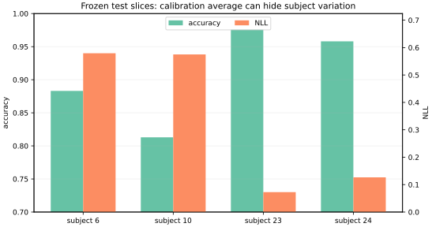

# 冻结测试结果与实体切片边界

## dev 只选模型，cal 只选温度

三个模型使用同样的 561 个特征、训练受试者、优化轮数和种子，只改变 $L_2$ 系数；选择指标预先固定为 dev NLL：

| $L_2$ | dev accuracy | dev NLL | dev Brier | dev ECE，10箱 |
| ---: | ---: | ---: | ---: | ---: |
| $10^{-5}$ | 0.9444 | 0.17386 | 0.08905 | 0.03020 |
| $10^{-4}$ | 0.9444 | 0.16965 | 0.08829 | 0.02950 |
| $10^{-3}$ | **0.9499** | **0.14606** | **0.08215** | **0.02569** |

因此冻结 $L_2=10^{-3}$。没有因为 test 分数再添加候选。cal 的 1457 行只在 $\log T\in[-3,3]$ 的固定边界内拟合温度，得到内部解 $T=1.2338653267$；cal NLL 从 `0.1872271514` 降为 `0.1818728614`。模型权重、标准化和 $L_2$ 都不在 cal 上重拟合。

## test 只观察一次

四个 test subjects 共 1372 个窗口。温度前后 argmax 改变数为 0，所以 accuracy 必须相同；其他概率指标在这次观察中改善：

| 冻结 test 指标 | 温度前 | 温度后 |
| --- | ---: | ---: |
| accuracy | 0.91399 | 0.91399 |
| NLL | 0.35283 | 0.31529 |
| 多类 Brier，六类求和口径 | 0.14325 | 0.14089 |
| top-label ECE，10个等宽箱 | 0.04344 | 0.02469 |

这不是“温度一定提升测试指标”的证据；上一课给了相反的有限反例。这里只能说固定版本、固定实体和固定测试观察到了这些数值。

ECE 还随预先列出的箱数变化：

| 等宽箱数 | 温度前 | 温度后 |
| ---: | ---: | ---: |
| 5 | 0.04344 | 0.02469 |
| 10 | 0.04344 | 0.02469 |
| 15 | 0.04496 | 0.02925 |
| 30 | 0.04912 | 0.03561 |

5 箱与 10 箱恰好相同，是因为额外边界没有在本测试置信度上产生新的非空划分，不是 ECE 对箱数不敏感。

## 平均数掩盖了不同新人

下面切片在观察 test 前已经固定为“逐个测试 subject 全报”，没有挑最差的人。ECE 每人仍用 10 箱，但每个切片只有 294–381 行，估计更不稳定，只作描述：

| subject | 窗口 | accuracy | NLL | Brier | ECE |
| ---: | ---: | ---: | ---: | ---: | ---: |
| 6 | 325 | 0.8831 | 0.5793 | 0.2063 | 0.0575 |
| 10 | 294 | 0.8129 | 0.5750 | 0.2937 | 0.1021 |
| 23 | 372 | 0.9758 | 0.0726 | 0.0391 | 0.0201 |
| 24 | 381 | 0.9580 | 0.1266 | 0.0665 | 0.0283 |

subject 10 的表现明显低于总体，说明总体可靠性不能替代实体切片。四个人仍太少，不能用普通窗口级误差条假装有 1372 个独立受试者；窗口内重叠和同人相关会把这种不确定性严重低估。本组也没有做 subject bootstrap，因为四个 test entities 不足以支撑精细总体推断。

## 结论的适用边界

- **新人泛化：** 只覆盖固定四名未参与训练、开发和校准的受试者，不覆盖任意人口总体。
- **上游数据：** 六种受控活动、腰间固定手机、Galaxy S II、19–48 岁志愿者；自然环境、其他设备和佩戴位置是分布外问题。
- **校准：** 总体 top-label reliability 不保证逐类、逐人或其他群体校准，也不保证 OOD 输入会低置信。
- **安全：** 置信度不是伤害、隐私、误报代价或安全动作规则。本组没有部署或真实干预。
- **优化：** NumPy softmax 是有限 epochs 的可复算基线；未给全局最优或最佳 HAR 模型证明。
- **测试寿命：** test 已被本报告观察。任何根据这些结果进行的设计修改都需要新的、未参与决策的受试者评估。

## 练习与答案

1. **温度后 accuracy 不变但 NLL 下降，能否说模型识别了更多活动？** 不能。argmax 一个也没变，只重新分配了类别概率。
2. **把四人的 1372 个窗口当独立样本做窄置信区间，问题在哪里？** 同一人的窗口相关，相邻窗还共享原始采样；有效独立实体更接近 4 而不是 1372。
3. **subject 10 的 ECE 较高，能否针对它重新选 $T$ 再保留原 test 结论？** 不能。那会用 test 适配参数。可把此观察形成下一轮假设，但需新实体作验证。
4. **当前 test 校准改善，能否推出换手机仍改善？** 不能。设备和佩戴变化会改变特征分布，温度没有 OOD 保证。

完整命令、源码、测试和 JSON 见[[AI/65-可信AI与真实数据实践/10-实体拆分与概率校准/80-实体拆分与概率校准复现实验|复现实验]]。返回[[AI/65-可信AI与真实数据实践/10-实体拆分与概率校准/00-实体拆分与概率校准-MOC|课程地图]]。
