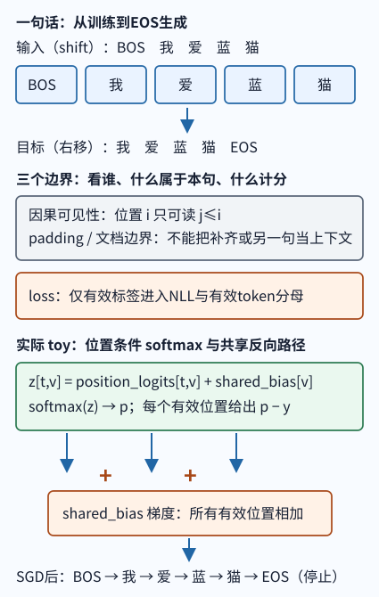

# 从一句话到学习与生成

**读者问题：** 给定同一句话，一次预测怎样计损失、怎样改参数，改完又怎样逐个词生成到 EOS？先完成这条循环，再区分哪些格子能看、哪些格子对损失负责。本页用一个短序列贯穿可运行的、受限的**位置条件 softmax 模型**。它没有 attention，也不读取输入词 ID，因而**不是 Transformer**；它让概率、交叉熵、梯度、一次 SGD 与用自身前缀的 EOS 停止可逐数复算。完整 Transformer 是本科加深入口，不是开始本页的硬先修。

图的替代文字：五个输入格从左到右是 `<BOS>、我、爱、蓝、猫`，右移标签是 `我、爱、蓝、猫、<EOS>`；位置 logits 与共享 bias 经 softmax 产生概率并汇总梯度；生成按自己的前缀长度取下一个 token，在 EOS 停止。toy 读取位置但不读取词内容。

## 先作直观预测：一条短序列的五个名字

令完整 token 为 $z=(\text{BOS},\text{我},\text{爱},\text{蓝},\text{猫},\text{EOS})$。训练输入 `shift` 是前五格，标签是右移一格：

| 名称 | 这条序列中的内容 | 作用 |
| --- | --- | --- |
| `shift` | BOS, 我, 爱, 蓝, 猫 | 同一次前向的输入 |
| `firstanswer` | 我 | BOS 后的第一个目标 |
| `teacherprefix` | BOS, 我, 爱 | 训练第三次预测时的真实前缀 |
| `generatedprefix` | BOS, 我, 猫 | 部署时模型先前自己给出的前缀，可能不同 |
| `EOS` | EOS | 也是一个可学目标；生成到它才可按约定停止 |

位置从 0 开始计数：位置 0 的目标是 `我`，位置 2 的真实前缀是 `teacherprefix=(BOS,我,爱)`，目标是 `蓝`。如果生成时前缀变成 `generatedprefix=(BOS,我,猫)`，读取内容的语言模型可能给出不同的下一词分布；**本 toy 对这两个同长度前缀给出完全相同的分布**，因为它只读取位置 2。这个反例提出下一步要补的依赖：token ID 先经 embedding 表变成向量，attention 再依据位置间的内容关系加权读取这些向量；embedding 查表本身还不让一个位置读取其他位置，也不能单独推出“理解所有内容”。沿 [[AI/20-LLM/20-架构/01-Transformer完整数据流#1. 先固定对象和符号|架构课的对象与 embedding]] 看整数 ID 如何成为向量，再沿 [[AI/20-LLM/20-架构/01-Transformer完整数据流#2.6 用 attention 权重混合 V|有限的 attention 加权读取]] 看位置如何聚合 V；读到这里即可返回本页，指出 toy 缺少哪两段依赖，**不要把它说成已经变成 Transformer**。teacher forcing 固定真实前缀来计算观测序列似然，并不保证内容模型在自己造成的前缀上同样正确。下面先核对 toy 的五个目标怎样进入一次更新。

### 程序实际执行的概率、梯度和一次更新

本例词表按源码顺序为 `BOS, 我, 爱, 蓝, 猫, EOS, PAD`，共 $V=7$ 个候选；五个输入位置给出 $T=5$ 行预测。程序参数是位置 logits $A\in\mathbb R^{5\times7}$ 和共享词表偏置 $b\in\mathbb R^7$，每个分数为

$$s_{tv}=A_{tv}+b_v,\qquad p_{tv}=\operatorname{softmax}(s_t)_v.$$

`probabilities(position)` 只收到位置编号；`inputs` 用来展示 shift 合同，输入词 ID 没有送进分数函数。这使各位置能背不同答案，**不构成按词内容理解前缀，也没有执行 attention**。

这次没有忽略目标，标签 ID 是 `[1,2,3,4,5]`，对应 `我,爱,蓝,猫,EOS`。令 $M=\{0,1,2,3,4\}$，有效数 $N=|M|=5$。初始 $A=b=0$，所以每个位置的七个候选都是 $1/7$；位置 0 给 `我` 的概率为 $0.142857$，它的损失为 $-\log(1/7)=\log7$。五个目标各得到同样概率，故

$$L=-\frac15\sum_{t=0}^4\log p_{t,y_t}=\log7\approx1.945910\ \text{nat}.$$

损失怎样指出“该改哪个分数”？单个位置的负对数概率可以展开成 $\ell_t=-s_{t,y_t}+\log\sum_v e^{s_{tv}}$。对候选 $v$ 的分数求导，第二项给出 $p_{tv}$，第一项只在 $v=y_t$ 时给出 $-1$，所以

$$\frac{\partial L}{\partial A_{tv}}=\frac15(p_{tv}-\mathbf1[v=y_t]),\qquad
\frac{\partial L}{\partial b_v}=\sum_{t=0}^4\frac{\partial L}{\partial A_{tv}}.$$

位置 0 的目标 `我` 得到 $(1/7-1)/5=-6/35$，其余候选得到 $1/35$。梯度下降减去梯度，负号让目标分数提高，正号让本位置的其他分数降低。共享 bias 却不能只取位置 0：`我` 在五个目标中出现一次，故它的 bias 梯度是 $(-6+1+1+1+1)/35=-2/35$；`爱、蓝、猫、EOS` 也各出现一次，同为 $-2/35$。`BOS、PAD` 没有作为任何目标出现，bias 梯度为 $5/35=1/7$。这就是源码中 `grad_bias[token] += delta` 的五条路径；最后统一除以有效数 5。

**一次同步更新。** 用同一份旧参数求完全部梯度，再以学习率 $\eta=8$ 同时更新 $A'=A-8\nabla_A L$、$b'=b-8\nabla_b L$，不在处理完第一个位置后重算其他位置。下面追踪位置 0 的全部七个候选；更新前每个候选的 $A_{0v}$、$b_v$、$s_{0v}$ 都是 0，概率都是 $1/7$。表中小数保留六位：

| 候选 $v$ | $\partial L/\partial A_{0v}$ | $\partial L/\partial b_v$（五位置之和） | $A'_{0v}$ | $b'_v$ | $s'_{0v}=A'_{0v}+b'_v$ | 更新后 $p'_{0v}$ |
| --- | ---: | ---: | ---: | ---: | ---: | ---: |
| BOS | 0.028571 | 0.142857 | -0.228571 | -1.142857 | -1.371429 | 0.021577 |
| 我 | -0.171429 | -0.057143 | 1.371429 | 0.457143 | 1.828571 | 0.529350 |
| 爱 | 0.028571 | -0.057143 | -0.228571 | 0.457143 | 0.228571 | 0.106874 |
| 蓝 | 0.028571 | -0.057143 | -0.228571 | 0.457143 | 0.228571 | 0.106874 |
| 猫 | 0.028571 | -0.057143 | -0.228571 | 0.457143 | 0.228571 | 0.106874 |
| EOS | 0.028571 | -0.057143 | -0.228571 | 0.457143 | 0.228571 | 0.106874 |
| PAD | 0.028571 | 0.142857 | -0.228571 | -1.142857 | -1.371429 | 0.021577 |

例如 `爱` 在位置 0 的位置参数下降，但共享 bias 上升，因为它是位置 1 的目标。分数必须把两条变化相加；不能只拿 $A'$ 当更新后的 logits。以 `我` 的新分数为基准，其余四个目标词低 $1.6$，BOS/PAD 低 $3.2$，因此

$$p'_{0,\text{我}}=\frac1{1+4e^{-1.6}+2e^{-3.2}}\approx0.529350.$$

五行分别把自己的目标提到同样的概率，新平均损失为 $-\log(0.529349665)\approx0.636106$ nat。一次更新降低了这条固定序列的损失；学习率 8 是本教学输入的选择，不是保证其他模型每步都下降的规则。

**接回生成。** 保持这次更新后的参数，从 `[BOS]` 开始；每次计算 `position=len(result)-1`，选本行概率最大的 ID，追加到自身前缀，再检查它是否为 EOS：

| 更新后已有前缀 | 使用位置 | 本次最大概率词（约 0.529350） | 追加后动作 |
| --- | ---: | --- | --- |
| BOS | 0 | 我 | 继续 |
| BOS 我 | 1 | 爱 | 继续 |
| BOS 我 爱 | 2 | 蓝 | 继续 |
| BOS 我 爱 蓝 | 3 | 猫 | 继续 |
| BOS 我 爱 蓝 猫 | 4 | EOS | 停止 |

这次轨迹是 `BOS → 我 → 爱 → 蓝 → 猫 → EOS`。EOS 先作为位置 4 的训练目标参与损失与梯度，随后成为生成出的停止标记；七个候选仍都参与 Softmax。程序还有生成 token 数上限，超过五行位置容量时会拒绝继续读取，因而不能从一次成功轨迹外推任意长度生成。

**可停点与下一问题：** 现在应能从位置 0 的目标 `我` 追到它的损失、位置参数梯度、共享 bias 梯度、更新后概率，再解释 EOS 为何在最后一行胜出。若把同长前缀 `BOS 我 爱` 改成 `BOS 猫 猫`，本 toy 接着都输出 `蓝 猫 EOS`；需要回答的是“已给的词怎样影响下一词”，下一站 [[AI/20-LLM/10-原理/03-Embedding表示与语义空间|Embedding、表示与语义空间]] 才开始给输入词建立表示。返回 [[AI/20-LLM/10-原理/02-自回归建模Logits损失与困惑度#困惑度能说什么，不能说什么|原理 02 的困惑度]] 可继续把同一计分汇总为 PPL。下面先扩展这次例子：加入补齐格或拼接另一条句子时，哪些边界需要分别处理？

## 再看机制：四种 mask 各守一条边界

刚才五个真实标签全部负责；现在才问补齐、跨文档或不监督某些位置会改变什么。下面的 attention 三种边界描述读取内容的模型应履行的合同；本 toy 只以责任谓词演示它们，没有 attention 运算。

| mask / 标记 | 问题 | 本例扩展后的责任 | 不能替代谁 |
| --- | --- | --- | --- |
| causal attention mask | query 能读哪些 key？ | 输入位置 $i$ 只能读 $j\le i$，用此前缀预测右移标签，防止偷看未来 | 不负责识别 padding，也不决定损失分母 |
| padding / key mask | 哪些输入格不是真实 token？ | 补齐批次的 PAD 不能成为可读 key | 不阻止本句读未来 |
| document / packing mask | 拼接样本能否跨文档读？ | 不同文档的 query/key 不能互相读取；如句 B 不读前面句 A | 不指定标签是否监督 |
| loss mask（`ignore_index`） | 哪些位置对参数负责？ | 仅有效标签进入交叉熵与分母 | 不改变 attention 可见性 |

本页 toy 的标签合同采用 `ignore_index=-100`：它是**标签值**，表示“这个目标不计损失”，程序先跳过它，因而它是被接受的合法标记而非要拒绝的标签。这与书中某个教程可写的 `include` 布尔掩码不同；`include=False` 是选择规则，不能把 `-100` 当词表内 token、再去取概率。现有 `AI/80-实践/01-微型Transformer预训练/tiny_transformer.py` 则以词表内 `pad_id` 作为 PyTorch `ignore_index`；从本 toy 迁移时须把本页的 `-100` 转换成该 tokenizer 的 `pad_id`，不能把两个数值合同混用。**本 toy 的 PAD ID 是 6，若直接把 6 放入标签，它会照常计分；词表中存在 PAD 不等于自动忽略 PAD。** 令有效标签集合为 $M=\{t:y_t\ne-100\}$、$N=|M|$，则

$$L=-\frac1N\sum_{t\in M}\log p_{t,y_t},\qquad N>0.$$

它延续前面五个有效目标的同一分母规则；忽略的位置不进入梯度，且有效位置的梯度改除以 $N$。两个局部批各有 $S=8$ 个槽位，有效目标数分别为 2 与 6；若各自 NLL 和为 $1.0$ 与 $10.2$，全局 token 平均是 $(1.0+10.2)/(2+6)=1.4$。它不是两个局部均值 $(1.0/2+10.2/6)/2=1.1$，也不是把后者的 $10.2$ 除以 batch size 2。程序检查全批无有效目标时拒绝除零。

梯度共享同一参数时是相加而不是二选一：$\nabla_\theta(L_A+L_B)=\nabla_\theta L_A+\nabla_\theta L_B$。若框架先把每个微批除以自己的有效数，累积时需按各自有效数加权，才能等于整个批次的 token 平均。

## 没有方法提示的联合条件迁移

> 两条独立句子被放进同一次训练计算：左句是 `BOS 我 爱 EOS`，右句是 `BOS 你 爱 EOS`，末尾为了组成张量补了一个空位。写出一份可交付的边界说明：哪些 token 可以成为哪些预测的上下文、空位怎样不影响学习、总损失怎样报告，以及若第一句运行时改用模型先前输出会改变什么。

答案

document / packing mask 阻止跨句读取；padding/key mask 令 PAD 不能作 key，loss mask 把 PAD 标签写为 `-100`。分母是两句中所有非 `-100` 标签数，而不是句数。在读取内容的模型中，用先前生成的 token 替换真实前缀可能改变后续条件分布；sampled prefix 来自模型随机变量，这是部署覆盖问题，不能把它误说成 causal mask 失效。本页 toy 若前缀长度相同，分布仍相同；因此它不能验证这种内容变化的影响。

## 两个反例与可复算入口

**反例一：只用 causal mask。** 若内容模型仍能读取 PAD key，补齐格可能干扰真实位置；若 PAD 仍作为监督标签，它会进入目标和分母。只有 causal mask 不能分别解决这两件事。

**反例二：位置而非内容。** 令相同输入 token `爱` 分别在位置 0 与 1；测试把位置 0 的最大概率词设为 `我`、位置 1 设为 `猫`，输出不同。这证明位置参数能改变分布；反过来，提示中的 `蓝` 改成词表内的 `爱` 而提示长度仍为 5 时，本 toy 仍给相同预测，因为它不读取内容。加位置表不等于实现相对位置、RoPE 或 Transformer。

运行 `python3 lm_toy.py -v` 会执行 softmax 概率、交叉熵、`p-y` 梯度、共享 bias 汇总、SGD、贪心 EOS 生成、接口拒绝和位置反例。同长改词不变可从 `probabilities(position)` 不接收词 ID、`generate_greedy` 只用前缀长度选取位置这两个接口事实静态复核，也可用同长的两个前缀分别调用生成接口核对。四种 mask 在本程序只以责任谓词模拟，**没有执行 attention**；真正 attention 的可见性验证要到本科入口。它只用标准库，既不下载模型，也不训练真实网络。

**证据范围：** 术语与公式以本机 V19 固定版本和原始 Transformer 论文为来源；本页 toy 的数据、数字与 SVG 是教学构造；已完成针对该教学合同的独立内容与运行审阅。真实 Transformer、注意力运行、客户端与真人学习效果另行验证，实际范围见 [[Logs/2026-10-04_跨层理解方案实施|本轮实际结果]]。
