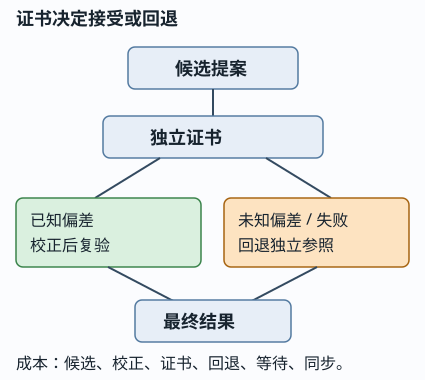

# 提案、校正、回退与最终结果：不要用一个成功掩盖另一种成本

读者问题：**一个学习提案经过校正后给出合格答案，能不能说它“覆盖了问题”或“加速了求解”？** 不能。先把它当候选，再用独立最小方程和证书决定接受、校正或回退；最后把候选的命运和最终解、全部成本分开记录。

图的替代文字：候选提案进入独立参照和残差证书。已知固定偏差时可校正后复验；偏差未知时证书拒绝并走参照求解器。两路都交给最终解，但成本表保留候选、校正、证书和回退。

## 一个足够小的独立方程

取线性系统 `2x=6`，独立参照解为 `x*=3`。候选给 `x̂=2.8`，残差证书是 `r=|2x̂-6|=0.4`。对于这一个标量系统，任务误差恰为 `|x̂-x*|=r/2=0.2`，因为系数 `A=2`；一般系统不能由“小残差”直接推出小解误差，误差还受 `||A^{-1}||`、条件数、范数和数据误差影响。若接受门为 `r≤0.1`，它不合格。若已由**独立的、固定版本校准集**确认偏差定义为 `b=proposal-truth=-0.2`，校正量才是 `c=-b=+0.2`；`x_c=x̂+c=3`，重新计算证书得 `r=0`，才接受 `x_c`。最终结果是 3，但它不是“未经校正提案被接受”。

若偏差只是从这一题事后猜到，或随输入改变而未知，`+0.2` 没有可迁移合同；必须拒绝候选并用独立参照返回 3。校正路线合法的前提是偏差来源、适用域、版本和复验门都已写清；未知偏差路线失败，正是回退机制应显式保留的情形。

V19 的 E518/SYN-01 给出一条不同的、已知恒偏差快路线：条件真均值 `16/45`，快输出 `98/225`，所以 `b=98/225-16/45=2/25`，校正量 `c=-2/25`，校正后恰回到 `16/45`。条件风险从含偏差的 `1/48+(2/25)^2` 恢复到 `1/48<1/40`。逐请求时间合同是 `4.7ms+校正成本≤5.5ms`，即校正额外成本至多 `.8ms`；若仅作假设账取 `.1ms`，则总计 `4.8ms`，不是任何设备实测。这个例子正面说明已知偏差、风险门、时间门和复验都满足时，校正快路线可以合法；它不推出所有候选都会加速。

## 四类记录：不要混为一个百分比

| 记录 | 问题 | 本例答案 |
| --- | --- | --- |
| 原提案 | 未校正的候选是否过门？ | 否，残差 0.4 |
| 校正后 | 固定校正和复验证书后是否过门？ | 是，残差 0 |
| 最终结果 | 对用户交出了什么？ | 独立可验的 `x=3` |
| 完整成本 | 为得到结果付了什么？ | 候选、校准/校正、证书、回退或参照的全链时间与资源 |

所以“最终解合格”不自动归因给学习提案；“校正后接受”也不是原提案覆盖率，更不是普遍泛化或在线加速。局部预测时间更短，仍可能被校正、证书和回退抵消。

## 已核对的 V19 两条运行身份

本页只转述本次本地只读核对的 V19 自审 `STATE-SCI-01`。它明确要求把两个分支分开：

| 身份 | 请求数 | 回退 | 其余流程状态 | 能说什么 |
| --- | ---: | ---: | --- | --- |
| SCI-FR | 360 | 198 | 162 经校正后接受 | 这是校正流程结果，不是未校正覆盖或加速 |
| SCI-FNO | 360 | 360 | 全部回退 | 该分支无候选接受 |

自审证据将 SCI-FR 的 15 个确认 JSON 独立重计为每 seed 66 回退、合计 198/360；SCI-FNO 的 360/360 属于另一方程/输入族/模型/预算身份。这里没有重跑任何生产求解器、训练或硬件基准，也不把这两个历史分支用于本例的数值证书。

## 没有方法提示的迁移题

一个新输入仍要求解 `2x=6`，候选给 `x̂=2.9`。旧校准集只说明 `b=proposal-truth=-.2`、故旧校正量为 `c=+.2`，但新输入的偏差是否仍相同未知。若盲目加 `.2`，得到 `x_c=3.1`，`r=|2(3.1)-6|=.2`，超过 `.1` 门。请提出一个可接受或回退的判定，并列出必须计入的成本；也接受任何等价方案，只要不把最终解归因给未证实的候选。

答案与等价方案

盲目校正后的 `.2` 残差已明确拒绝，因此回退参照并返回 3 是合法答案。也可先取得覆盖新输入域的独立校准并复验证书；只有达到门才记录“校正后接受”。完整成本至少列候选运行、获得/验证校正、证书、参照回退、排队/数据准备和同步；需要相同输入、质量门和端到端边界才能比较速度。

## 最小复算与边界

同目录 `proposal_costs.py` 和 `test_proposal_costs.py` 用 `fractions.Fraction` 验证标量残差/任务误差的限定关系、已知偏差 E518 的风险与时间不等式、未知偏差反例和两条计数身份。它们是教学真源，不是 V19 生产代码镜像。脚本没有读取原始 15 JSON、没有运行 CUDA/学习模型、也没有测量线上时延；它只防止本页把 `198+162`、`360` 或已知偏差的分数算错。原始计数与更严格的复算证据见所引 V19 `REVIEW.md` 的 STATE-SCI-01 与 SYN-01。

返回 [[AI/80-实践/00-AI实践-MOC|AI 实践 MOC]]；系统层的 shape、stride 与端到端账本见 [[计算机知识/40-并行与异构计算/80-张量跨层执行/01-同一张量从数值到线程|同一张量从数值到线程]]。
