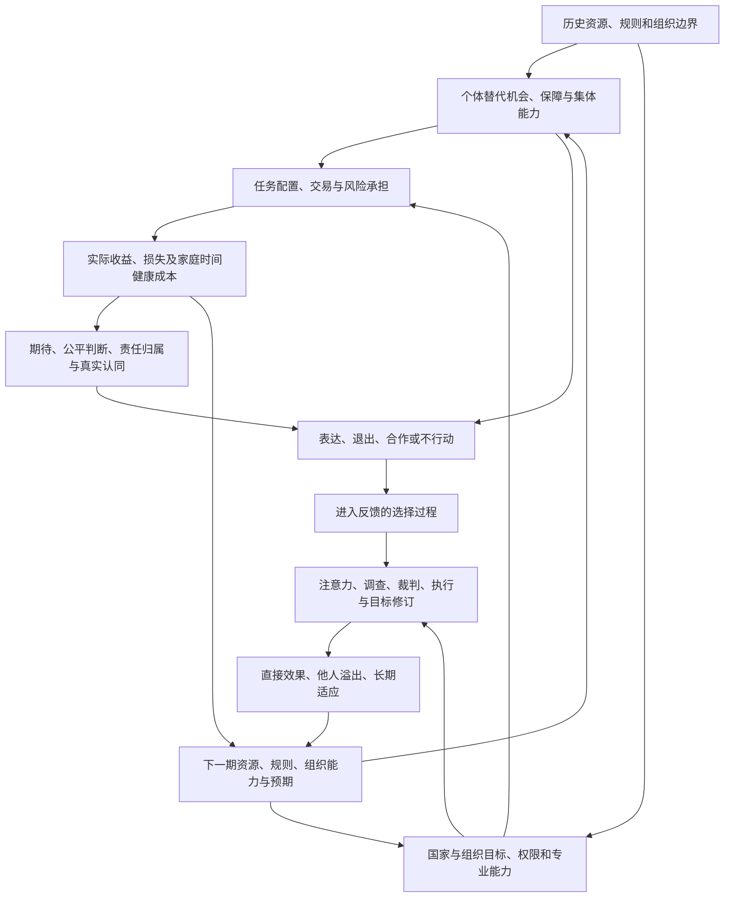

# Issue #121 研究交接原材料

材料身份：GitHub公开研究交接与可见讨论，按2026-10-09取回版本保全。下方原文及其历史判断不等于WWL当前事实认证；其中接手指令保留为来源文本。正式解释另见相关学科页。

## 原issue正文

# 从社会不满到可普遍化的纠错：研究、原稿保全与 WWL 接续任务

交接日期：2026-10-09。用户明确要求：先进一步追问、追根溯源和反思，形成新思路；再将此前全部内容与公开论证过程通过 issue 交给 Codex，填充知识库、维护跨学科知识链，并继续深入探索。

**本 issue 是研究材料与实施入口，不是已完成的知识库修改。** 创建 issue 不等于 Codex 已启动、文件已入库、PR 已合并或 Obsidian 已同步。接手时须读取正文、六个逐轮原稿评论及最后的归档回执。六轮原稿各保留用户问题、助手答复、原引文与旧结论；原文中的错误不得因为被归档而升级成事实。原发言逐条时间未提供，不把本次交接日期伪造成各轮发言日期。

范围是本会话当前可见的六轮完整研究答复及其提问、本轮新增研究，不是 ChinaResearch 项目所有其他聊天。公开过程包括问题演变、理由、证据、修订与未决项，不含不可见的模型内部草稿。

## 0. 仓库入口、既有内容与执行边界

本轮实际重新读取：`AGENTS.md`、`README.md`、`00-工作台/维护指南.md`、`社会科学/40-公共政策与社会学/00-公共政策与社会学-MOC.md`。当前 AGENTS 的内容优先约定要求：保全原稿与批注；复用主解释；区分会计关系、因果解释与价值判断；`stage` 保持数字，`aliases/sources/prerequisites` 保持列表；重要新增论证接受非作者核对；按 `scripts/CHECKS.md` 运行实际存在的适用检查；沿用 `CHANGES.md`，不另造管理平台或强制 manifest。

**检索结果与实时路径曾不一致。** `01-索引/MOC-中国研究.md` 在本轮直接读取返回 404，不将它作为已确认路径。以接手时的实际文件树、现行 AGENTS 和目标正文为准，不采用旧摘要中的目录或 issue 身份。不得为了执行本任务修改 `.codex`、AGENTS、权限、插件或工作流。

已定位的相关任务有 #111、#116、#117、#118、#119。它们分别涉及组织纠错、地方债、文化准入以及中国财政民生交接；**这里只作为去重和衔接线索，不把检索正文或 issue 存在当作已经实现。** 接手后核对当前内容及相关 PR。尤其复用 #117 对串联/并联、信息选择的形式纠错，以及 #119 对行政负担、风险归宿和宏观数据的审计，不重建平行基础课程。

## 1. 先反思：此前六轮有什么贡献，仍缺少什么？

六轮公开论证大体经历：

1. **R1：事实与测量。** 从 China GT 出发，区分经济压力、企业纠纷、社会上升预期、抗议记录和中央支持；讨论样本、分母、可见性与间接民调。
2. **R2：生活机制。** 追到努力与回报、家庭缓冲、照护、退出成本、纠纷处理和责任归属；拒绝把民众当作利益一致的整体。
3. **R3：权力与历史。** 引入剩余控制权、非支配、户籍/单位保障/财政重组、成本外部化与不可逆人生投入。
4. **R4：组织学习与问题定义。** 从知道事实转向优先级、议程、单环/双环学习、试点外推、内生信息需求与个案普遍化。
5. **R5：自我批判与动态模型。** 承认选择偏差、循环定义、功能与动机混同、不可证伪风险；把损害再生产与真实纠错同时放进模型。
6. **R6：理论组合。** 用权力—依赖、集体行动、国家能力、威权内部权力分享、多任务代理、社会再生产、制造同意、承认与内生制度变迁连接社会必要性和个体可替代性。

这些构成问题史，不构成六次独立验证。多轮引用同一论文不是多源证实。六种理论分别解释某个环节，也不等于整个跨层链条已经得到联合识别。

### 本轮必须追加的修订

- **局部改善不等于可普遍化改善。** 投诉者更容易得到处理，既可能增加了真实治理能力，也可能改变有限处理能力的分配。应区分直接、间接、总体和长期效果。
- **“能退出”与“更有公共表达”没有固定方向。** 退出可能提供谈判后盾，也可能带走信息和组织资源。不能把 Hirschman 的概念固定成单向政策结论。
- **平均处理率不等于有效保障。** 时间、执行、费用、报复风险、退出样本和损害不可逆性都影响实际使用价值。
- **一般规则不天然公正。** 稳定且普遍实施的排斥，也可以极不公正。规则可靠性、结果分配和规范正当性必须分别判断。
- **更完整的信息不是完整的公共授权。** “观测—行动—反馈”可作为方法类比，但社会没有预先给定、人人认同的单一目标函数。不能用控制工程稳定性证明政治正当性。
- **从政策结果不能唯一识别中央偏好。** 资源不足、能力不足、协调失败、分配冲突和保留控制权可能产生相似结果；不能用一组政策反推已知且固定的秘密权重。
- **旧动态式和重复博弈式是条件模型。** 参数不经识别不能预测中国的危机年份；其中惩罚概率、未来损失及贴现并非制度变化下必定不变。
- **不能将所有正向结果都降格为维稳。** 保护、专业执行、收入增长、社会保险与司法约束可以产生真实改善；改善必须有机会推翻原来的局部负面命题。

## 2. 本轮新中心：从“社会是否不满”转到“纠错能否不依赖特殊地位而持续兑现”

提出一个工作概念：**可普遍化的纠错**。它不是已经验证的新学术定律，也不是单一分数，而是要求逐项比较：

- 相似且有充分依据的损害，是否得到相近的进入与复核机会；
- 没有传播优势、关系资源或充裕等待能力的人，是否也能实际使用救济；
- 处理是否在仍有用的时间内发生，并真正执行；
- 一次纠正是否降低后来者遭遇相同损害的风险；
- 改善是否把成本或排除转给未被观察的人；
- 预算、人员、价格和行为发生调整后，效果是否仍存在；
- 受影响者能否挑战目标或规则本身，而不仅要求规则被更熟练地执行。

“普遍化”不等于所有人获得相同结果。案件严重性、证据、风险、法律依据和合理需要可以导致不同处理；需排除的是与理由无关、不可辩护的差别，而不是取消判断。

最强的问题因此成为：**同一社会能够不断处理显眼问题，却是否仍让普通人承担把自己的问题变得足够显眼的成本？如果是，这来自处理能力稀缺、排序标准偏差、信息不足还是权力关系？何种改革能够改变它，代价又由谁承担？**

## 3. 新探索一：可见性收益可能是相对优势，也可能是公共能力扩张

此前引用环保投诉实验时，重点在公开渠道比私下渠道有效。但要从个体效果推到制度效果，必须增加规模和溢出维度。

作一个明确的教学反例：假设同一时期有100个同等有效、处理成本相同的请求，机构只能完成20个。公开关注仅改变排序，不改变预防、人员、预算或处理效率。一个请求获得额外关注，可以提高其获处理机会；但若所有100个请求获得完全相同的额外关注，排序相对关系不变，仍只能完成20个。

这不是中国实测，也不说明公开监督无效。公开监督可以减少拖延、打破寻租、改变资源配置、促使预防，从而真正增加有效能力。**反例只推翻“个别公开投诉有效，所以所有人同样公开就能以同样效果普遍解决”的外推。**

用有干扰的潜在结果表示：

`Y_i(z_i, z_-i)`，而非只写 `Y_i(z_i)`。

自己获得反馈渠道的直接效应，必须在其他人处理分配固定或按某个明确机制分配时定义。全面推行的总体效果需要比较不同分配制度，不等于若干个体直接效应相加。Hudgens 与 Halloran（2008）提供了区分直接、间接、总体效果的原始方法入口[S1]；本 issue 没有据其方法估计中国数据。

需要继续核查前文环保论文对跨企业替代、持续时间和机制的处理。若原研究发现未处理企业也改善，应作为反对“纯零和排序”的证据保留，但不能自动推广到所有部门与时间。

**新假说 H1：** 公开关注的相对优势随覆盖率上升而减弱，但整体服务仍可能改善；两者应同时估计。若扩容后低资源群体也持续改善、未处理群体未受损，就应撤回该领域“只靠显眼程度分配救济”的强判断。

## 4. 新探索二：纠错的时间结构，可能比最终胜负更接近生活经验

“最终得到解释”“裁判胜诉”“得到实际交付”“在需要时得到”，不是同一结果。

设 `T_i` 为实际兑现时间，`D_i` 为该救济仍能避免关键损失的时限。则：

`有效及时兑现 = P(获得适当救济 且 T_i ≤ D_i | 明确定义的有效请求总体)`。

这是定义性表达，不是假设两个事件独立。D可以因人、领域和损害类型而不同，也可能是一个区间而非确定日期。补发工资能弥补部分损失，不能自动撤销期间失去住房或教育机会的全部后果；医疗、保全证据和新闻时效各有不同结构。

更深的推论：同样的等待，在资源不足者身上可能造成更大的不可逆损失。因此，程序完全同速，也可能产生不平等的实际影响。反过来，按紧急性优先并不天然是关系特权。

研究应同时报告最终兑现、时长分布、撤回/放弃、仍未完成观察、费用、重复补件、后续损害。仅计算已结案者平均时间，会排除最难解决的人；需要处理右删失及竞争事件，不能把未结案全部计为拒绝。

**新假说 H2：** 在事实依据和名义待遇相近时，现金缓冲、照护责任和时限差异会调节救济的实际效果。可反证：控制这些差异后，时间与真实损害无实质关系，主要瓶颈在供给质量或资格定义，应降低时间机制权重。

此部分与既有 #119 行政负担、其他任务的等待分析复用主解释，不复制为第二套课程。

## 5. 新探索三：退出既可能削弱依赖，也可能改变留下者的组织条件

此前常把“退出成本降低”视为增强议价能力的条件，这通常有逻辑基础，但并不是对所有结果的单调定理。

Hirschman 在1993年关于民主德国的回顾中，正面讨论了退出与呼吁可以互补，而不仅是替代[S2]。本次实际读取出版方摘要、书目信息及相关脚注；这是一项历史机制讨论，不是中国未来路径的模板。

由此进一步提出：

- 退出是可信后盾时，留下者可能更能要求改善；
- 退出也可能移走资源、技能和公共监督，使留下者处境更差；
- 退出造成财政或企业收益损失时，组织可能改善，也可能提高留下者负担；
- 跨地区接续、替代雇主和独立服务，可以降低依赖，但若共享同一上游许可或基础设施，名义替代不等于真实替代。

不能从某人迁移、储蓄或减少投入推断其政治反对。这里研究的是相互作用与实际后果，不是为行为贴立场标签。

**新假说 H3：** 退出机会的效果受网络、财政归宿与关键资源是否可携带调节。需要同时观察退出者、留下者、接收地与原组织，而非只看成功退出的个人。

## 6. 新探索四：谁约束监督者，不能靠无穷上溯解决

前几轮不断追问“谁决定复核者的任免、预算与权限”，容易形成一个永远无法满足的标准：任何保障都要有更高的保障，而最终永远不算真正保障。

这一标准应撤回。现实制度只能比较可观察的依赖关系、相互制约、公开证据、可替代入口与失败修复，而不是证明存在绝对无权力、无错误的最终裁判。

Ostrom（2010）的多中心治理研究是进一步比较不同层级、规则和监督组合的原始入口[S3]。本轮核对了正式论文书目信息，尚未完成全文和案例审计；不能据标题声称已证明某种中国改革必定有效。

本轮综合推论：中央设定可执行的底线与跨区保险、地方保留适配空间、专业主体审查、受影响者有实际申诉，可能是互补安排，也可能因权责不清、地方俘获或协调成本而失败。所谓独立，应具体说明在哪个决定、人事、预算、证据和执行环节减少了何种依赖，不能当抽象勋章。

**新假说 H4：** 与其比较抽象“集中/分散”，应比较权限组合。研究何时集中能够打破地方保护、何时分散能够保留知识和纠错，并检查二者对不同群体的成本。

## 7. 新探索五：动态闭环必须允许政策改变行为规则，也必须区分目标之争

上一轮写过 `H_(t+1)=b+(1+α−β)H_t` 和可信承诺的不等式。这些可用于演示条件，但不能把α、β或制裁概率当固定的社会常数。

政策改变可能同时改变申请人数、证据保存、风险选择、工作配置、价格、迁移、预期与统计可见性。把改革前估计关系直接推进改革后，可能失去结构稳定性。Lucas（1976）是这一问题的原始文献入口[S4]；本轮只核对出版信息与可见页面，全文推导仍待核，不能冒称复现。

建议分开五种检验：

1. **概念检验**：权利、损害、满意、政治支持是不是不同对象？
2. **因果检验**：改变哪一项条件，会改变哪个结果？
3. **范围检验**：该机制适用于谁、何地、哪个时期？
4. **制度变化检验**：全面实施后，预算、价格、预期和组织行为是否改变效果？
5. **规范检验**：即使有效，它如何分配成本、尊重权利、处理真实分歧？

这五项不能由一个显著系数或一张反馈图替代。社会系统的目标不是工程控制中的外部给定标量；“稳定”“效率”“少争议”“公正”“自主”可能冲突。控制论只提供结构类比，不从稳定性推出正当性，也不从不稳定推出某种政治预测。

**新假说 H5：** 一项改革可能降低损害、提高表达并暂时降低满意度。需要并行测量这些维度，而不是选择最符合预设方向的指标。若真实改善持续且广泛，就必须修改悲观结论；若好看的指标来自排除困难样本，也必须修改乐观结论。

## 8. 修订后的跨层链路：不是万能总理论，而是可拆验的研究图

所有箭头均是待分别检查的机制/时序关系，不是全图已被识别。宏观冲击、人口、技术、外部环境可进入多个节点。公开可见数据还受独立的观察过程影响，不把 `H` 当社会全体事实。

正向闭环：保障降低不可承受风险 → 更可靠信息与行动 → 公平有效纠错 → 预防改善与合作 → 增强保障能力。

负向闭环：损害削弱资源 → 更难退出和追索 → 反馈偏向有资源者 → 纠错覆盖不均 → 同类损害继续削弱资源。

两者可以并存，参数和边的方向可因领域变化。不能预设净效果，也不能把不符合模型的观察永远解释成隐藏得更深。

## 9. 证据审计：原稿必须保留，正式正文必须重新获得资格

### 优先审计清单

- **China GT**：本轮可打开报道将事故放在2026-09-05上海；不同报道在车队名称、车辆与叙述细节上存在不一致，逐项回原始声明/影像/官方调查核对。车手所述救护等待、人员行为、转播叙述仍须按声明身份归档，不作已独立确认的完整法证时序。事件不能单独估计全国失职率。[S5]
- **R1宏观与投诉统计**：2026年7月工业/零售/失业，2025财政/投诉/劳动争议数值均保留为旧主张，正式使用须核发布日、统计期、版本、分母与原表。全国“件数”不能当独立人数。数据不足不是捏造替代数字的理由。
- **Alisky/Rozelle/Whyte**：面对面与在线抽样、加权、题目与回答类别变化；赞同减少不等于剩余者全部反对；三轮在线样本不自动等于同一个人的面板。
- **日本财团青年调查**：国家样本库、年龄、年份和方式可比性；不是全国概率抽样，不将点差全部当态度因果变化。
- **CDM**：事件数、人数、帖子数不同；去重、捕获、审查与平台曝光各自变化。无法识别捕获率时采用敏感性/部分识别，不反推真实全国抗议率。
- **列表实验**：样本、题项、设计假设、残留表达偏差与置信区间；不同论文不同目标不能混成一个2026“真实反对率”。保留仍存在多数真实信任的竞争证据。
- **环保、基层回复、考评、司法、养老金实验/准实验**：逐项核处理、单位、样本期、目标量、标准误、异质性、退出、干扰和外推；不把回应、胜诉、交付与福利互换。
- **全部原典**：原作者论证、后续发展、本轮类比与规范判断分开；不得用读过摘要冒充读完专著。

### 时间与来源身份

事件日、报道日、研究样本期、论文首次发表年、网页上线日、当前访问日分别记录。原R1标题的“资料截止2026-09-07”是原稿身份，不是本issue对全部事实的重新认证。未找到原文时标待核，不找一篇主题相似论文替换旧出处。

多轮AI复述、同源转载和同一数据库的不同图表不计为独立证据。没有实际执行的统计复现、独立审核或工具运行，一律不写已完成。

## 10. 跨学科知识链：接入真实主解释，不平行复制

下列路径来自本轮实际读取的README与公共政策MOC。**只有上述四个入口已全文读取，其余是入口中确认的目标路径，实施前仍须读取当前正文和局部约定。** 不预占新文件数字编号，不批量重排目录。

### 链A：依赖关系 → 组织与分层 → 劳动/家庭 → 可执行权利

- `社会科学/40-公共政策与社会学/04-阶层地位权力与组织.md`：定义与机制主解释。
- `社会科学/40-公共政策与社会学/05-网络社会资本制度与文化.md`：替代机会、资源动员、选择与影响。
- `社会科学/40-公共政策与社会学/06-规范身份歧视与自我实现.md`：分类及反馈，不把群体本性当原因。
- 与伦理页衔接时，明确“有社会价值”不逻辑蕴含“拥有同等权力”；后者取决于制度转化与规范选择。

### 链B：目标、预算与制度 → 风险归宿 → 社会再生产

- `社会科学/40-公共政策与社会学/01-政策目标工具约束与矛盾.md`。
- `社会科学/40-公共政策与社会学/02-税收转移公共服务与归宿.md`。
- `社会科学/40-公共政策与社会学/03-外部性公共品公地与集体行动.md`。
- `社会科学/40-公共政策与社会学/10-财政货币与分配/00-财政货币与分配-MOC.md`。
- 将单位内效率与家庭时间/健康/跨期成本分别核算，复用#116/#119相关研究，避免同一损失重复计数。

### 链C：损害与政治态度 → 观测选择 → 因果识别 → 政策推广

- `社会科学/10-共同工具/03-因果图反事实与识别.md`。
- `社会科学/40-公共政策与社会学/07-政策评估RCT与准实验.md`。
- `社会科学/40-公共政策与社会学/08-局部有效政策与累积优势的判断.md`。
- 补充干扰、规模化、删失、非随机缺失与测量不变性时先搜索已有数学主解释；没有才建立最小完整新页，不制造悬空链接。

### 链D：多层控制与组织学习 → 有限控制论类比 → 目标正当性

- `哲学与文化/10-主题/01-文化政治与组织结构/00-文化政治与组织结构-MOC.md`。
- `信号与系统/00-开始/00-信号与系统-首页.md` 是现有技术入口；只在相关控制知识确实存在并兑现解释时链接。
- 类比边只用于区分观测、行动、执行和反馈；不能借稳定性定理证明集权优劣、民众偏好或崩溃预测。
- 政策目标与伦理主解释复用，不把“最大化满意度”作为未经论证的公共目标。

### 链E：知识生产本身 → 引用溯源 → AI测量风险

- `AI/00-开始/05-问题驱动知识图谱与难点导航.md` 与 `AI/80-实践/00-AI实践-MOC.md` 是已在README定位的入口；具体证据抽取/评测页再搜索。
- 以本对话六轮为研究对象，演示“重复引用不等于验证”“批判者也会选择证据”“总结不能恢复缺失数据”。
- 原稿、证据、作者计算、理论推导、规范立场、未知分别标识；知识图谱边标为前提、机制应用、证据、反例或有限类比。

不要求所有相关页都改动。目标是少量完整的阅读路线：具体问题 → 主解释 → 可复算反例或识别设计 → 原始证据 → 回到问题并知道限制。不要靠链接数量制造知识链已经完成的假象。

## 11. Codex 的实施顺序与完成条件

### 第一组：原稿保全与修订地图

读取正文和六个原稿评论，保存至现有 `Clippings/WorkWithLLM/` 原稿体系的合适位置；实际文件名按当前索引确定。六轮分别标R1—R6；本issue新增分析为R7；保留用户逐轮批评，不改写成其已接受的结论。原稿不可被新版散文覆盖。

建立简洁的“旧主张→为何保留/限定/修正→证据入口→新位置”表即可，不建立庞大强制状态机。需要核对的事实进入轻量证据表，不让历史原稿直接承担正式结论。

### 第二组：写出可独立阅读的主解释

优先在现有公共政策/社会学路线中建立或改进一个综合应用页，主题可为“社会不满、依赖与可普遍化纠错”；先查重，不强制新建文件。正文必须讲通第2—8节，而不是只复制本issue或列一串学者名。

保留国家、企业、劳动者、家庭、不同收入/地区、专业执行者与决策者的异质性；从一个明确案例走通贡献、依赖、任务、风险、救济与制度反馈。分析性情境标为构造，不编造访谈。

### 第三组：完成两个最小但实质的继续研究

A. **局部反馈与整体推广**：回读原环保实验的全文/复制资料，核查直接、间接、总体、持续时间和预算/能力机制。比较本issue100请求/20处理教学反例。原文拿不到时明确已读层级，不把摘要扩写成已证机制。

B. **结果与及时兑现**：选择一项合法公开的行政/劳动/福利研究，核查其实际终点是回复、决定、支付还是福利，以及未解决案件如何处理。优先复用现有任务的数据，不收集可识别受害者或进行高风险政治实验。

可以进一步研究退出的外溢、权限组合或动态承诺，但不能只继续扩张问题清单而不完成一篇可读主解释。资料不足时交付已有论证与具体缺口，不用未知参数生成全国预测。

### 第四组：连接、独立核对与交付

按当前AGENTS由未参与关键论证修改者核对重要统计、因果与规范跳步；没有真实独立审查能力就明确未完成，不能虚构subagent互审。读取 `scripts/CHECKS.md` 后只运行适用的真实命令，核YAML类型、链接目标、锚点、图示箭头含义、公式假设与表格分母。不得以静态通过替代来源、Obsidian显示或真人理解。

更新实际受影响MOC、原稿索引及 `CHANGES.md`；提交范围内候选PR并关联本issue，保持既有用户改动。未合并/未客户端验证分别注明。

### 验收

- [ ] 六轮原文与用户问题可逐轮找到，原文与R7校注身份清楚；不声称保存了其他不可见聊天或内部草稿。
- [ ] 历轮所有重要主题均有归属，未因整合而删掉真实支持、有效治理、家庭积极作用和改革改善等反向证据。
- [ ] China GT等事实进入核验表；时点、样本、分母与来源缺口没有被原稿的自信语气掩盖。
- [ ] 主解释明确区分损害、不满、行动、归责、政治支持与规范评价。
- [ ] 实质解释局部/总体、及时/最终、个案/普遍、退出者/留下者、信息/决定资格的区别。
- [ ] 100请求/20处理反例可以复算，且没有被写成现实中国的参数估计。
- [ ] 至少完成两条跨域阅读链，并对其余延伸给出可检验问题；不堆名词、空页或无目的双链。
- [ ] 原因、功能、意图和正当性没有混成一个概念；不存在不满升降都只能支持原理论的封闭解释。
- [ ] 至少一条旧强判断因反例而被实质收窄，明确什么数据会进一步推翻它。
- [ ] 回执区分已写文件、已核来源、已跑检查、已独立审查、已合并及客户端/同步；未完成项不假报。

## 12. 本轮新增来源及实际核验层级

以下为可移植URL，不使用聊天瞬时引用作为唯一来源。旧六轮链接完整留在各原稿中，正式入库逐项查证。链接存在不等于全文审计。

**S1：干扰与政策外推。** Michael G. Hudgens & M. Elizabeth Halloran (2008), *Toward Causal Inference With Interference*, JASA103(482):832–842。DOI:10.1198/016214508000000292。
https://pubmed.ncbi.nlm.nih.gov/19081744/
https://www.tandfonline.com/doi/abs/10.1198/016214508000000292
本轮核对出版信息及可见摘要；PMC全文入口遇到访问验证，未声称完成全文复现。方法可作为研究设计依据，不提供中国社会效应大小。

**S2：退出与呼吁的自我修正。** Albert O. Hirschman (1993), *Exit, Voice, and the Fate of the German Democratic Republic: An Essay in Conceptual History*, World Politics45(2):173–202。DOI:10.2307/2950657。
https://www.cambridge.org/core/journals/world-politics/article/abs/exit-voice-and-the-fate-of-the-german-democratic-republic-an-essay-in-conceptual-history/F80371FDC6F34ED2A8BFA9D31C95992A
本轮读出版方摘要、书目及脚注关于互补/替代的说明。2011网页上线日期不替代1993刊期，不把民主德国结局套用于中国。

**S3：治理组合，而非唯一最终监督者。** Elinor Ostrom (2010), *Beyond Markets and States: Polycentric Governance of Complex Economic Systems*, AER100(3):641–672。DOI:10.1257/aer.100.3.641。
https://www.aeaweb.org/articles?id=10.1257/aer.100.3.641
本轮核对正式出版信息，未声称完整审读所有案例。全文应作为后续比较研究，不以多中心之名预定结果。

**S4：制度变化下的参数稳定性。** Robert E. Lucas Jr. (1976), *Econometric Policy Evaluation: A Critique*, Carnegie-Rochester Conference Series on Public Policy1:19–46。DOI:10.1016/S0167-2231(76)80003-6。
https://www.sciencedirect.com/science/article/pii/S0167223176800036
本轮核对出版页与元数据，全文受访问限制；未声称重新证明其全部模型。此处参数随制度改变的讨论为明确标识的方法延伸。

**S5：事故日期与声明身份。** Motorsport.com, 2026-09-05：
https://www.motorsport.com/gt/news/hartog-hailed-as-hero-after-rescuing-millroy-from-fiery-shanghai-crash/10852780/
ABC, 2026-09-07：
https://www.abc.net.au/news/2026-09-07/ollie-millroy-loek-hartog-china-gt-flaming-crash/107122520
本轮读取可见报道，支持事故发生于2026-09-05的定位。不同车队/车辆表述须回原始资料，精确医疗时序与责任不能由转载数量确认。这些媒体材料是事件来源，不是全国制度发生率的证据。

## 13. 用户当前原请求与接续说明

> 请你先进行进一步的追问，追根溯源与反思，形成新的思路之后，将新的思路和上面所有的内容和过程通过issue提交至WWL Repo,让codex接过你的内容将内容填充进知识库，并注意维护跨学科跨领域知识链，同时对于你认为应进一步拓展，延伸，追问的地方进行更深层的探索。

原文分卷将置于本issue评论，以R1—R6标识。接手时以最后的归档回执检查是否齐全；不因主issue已创建便认定原稿全部写入。

**研究目的不是证明预定政治结局，而是让新事实有能力改变解释，并让读者沿着“生活经验—制度关系—组织行为—观测与识别—规范边界—可执行纠错”走通一条真实的知识链。**

## 公开讨论 6074966539

作者：EunsonZ；发布：2026-10-09T05:33:24Z；更新：2026-10-09T05:33:24Z；[原评论](https://github.com/EunsonZ/WWL/issues/121#issuecomment-6074966539)。

# 原稿 R1 / 6：事实调查、统计口径与不满的测量

> 档案说明：以下保存本会话第一轮用户问题与助手答复正文，供追溯而非作为新增一手证据。链接、旧数据和原有判断按原稿保留；入库前按主 issue 审计。原回答末尾没有实际条目的导航组件残留不收入正文。原稿所写资料截止日不是本次对全部来源重新核验的声明。

## 用户问题 U1

请你使用各种相关语言进行深度探索，绕过中国大陆似乎繁荣的表面，追根溯源，调查深埋于内部的不满，包括民众对企业的不满，对制度的不满，对经济的不满，对中央的不满，例如最近的China GT，反映出来的社会运转的深层问题和矛盾，并进行相对严格的量化

## 助手答复 A1

# 中国大陆不满的结构：从 China GT 到就业、契约、公平与中央信任

**资料截止：2026年9月7日。**

我的核心判断是：**公开证据支持的，并不是“繁荣全部虚假”或者“民众普遍反对中央”，而是产业与设施的发展，未能同步转化为个人生活的安全感、契约的可靠履行，以及出事后的可信纠错。** 就业压力、商业纠纷和社会上升预期的变化可以相对扎实地量化；当前究竟有多少人不满中央、其中多少人反对现行政治制度，则存在显著的测量障碍，不能把前面的数字直接换算过去。([stats.gov.cn](https://www.stats.gov.cn/sj/sjjd/202608/t20260817_1965064.html))

这份调查的证据主干，是中国官方行政记录、英文同行评审研究和日文原始调查；China GT 部分则交叉核对中文、英文、荷兰文报道及其中引述的当事人声明。需要特别注意：**多种语言转述同一名车手的声明，仍然只是一条原始证据，不是多次独立验证。**

下文始终区分四种东西：**生活压力、表达出来的不满、采取维权行动，以及对政治权力的态度。** 它们有关联，却不是同一个变量。

## 一、China GT：值得追究的不是“为什么赛车会出事故”，而是保障和纠错是否真实存在

### 已经能确认什么？

2026年9月5日，上海国际赛车场的 China GT 比赛发生撞车起火事故。Ollie Millroy 被困于起火赛车，另一名车手 Loek Hartog 停下自己的比赛参与救援。随后，FIST AUTO 车队宣布退赛，要求完整、独立、公开的调查。9月6日，赛事组织方承认细节管理存在需要改进之处，同时称初步检查显示整体赛事安排符合国内竞赛要求。([globaltimes.cn](https://www.globaltimes.cn/page/202609/1369923.shtml))

争议还包括两层：一是车手指称现场救援与医疗响应不及时；二是车队指责转播把获救过程说成车手“自行离开赛车”，没有准确呈现他人施救。前者涉及安全保障，后者涉及事故事实如何被对外叙述。**救护车约15分钟才到、个别工作人员的具体行为等，目前仍应标为当事人指控，而不是已经独立核实的时间线。** 我检索到的材料中，尚未见到能够完整解决这些争议的独立调查报告。([globaltimes.cn](https://www.globaltimes.cn/page/202609/1369923.shtml))

### 这个事件真正有诊断价值的地方

赛车运动本来就存在事故风险。因此，单凭撞车，不能推出中国社会的制度结论。真正需要检验的是：

**赛事有能力完成品牌包装、商业运营和技术展示，是否也有能力在低频、高后果的紧急情境下，兑现此前承诺的保障？事故发生后，组织首先保护的是事实与人的安全，还是赛事继续运行和自身声誉？**

这是一个可以调查、而不是只能情绪化争论的问题。关键材料应当是同步视频、无线电记录、救援出动与抵达时间、人员资质、装备状态、演练记录，以及各主体的合同责任。没有这些，就不能准确计算响应延迟，更不能直接判定赞助商、场地方、承办方各自承担多少责任。

由此提出的结构性假说是：

> **容易展示、容易验收的投入得到较高优先级；平时不显眼、只有出事时才能检验的专业能力，可能投入不足。**

它值得检验，但一宗赛事不能证明其全国发生率。后面需要用其他类型的数据和已调查案件来交叉验证。

## 二、经济层面的不满：不是“没有增长”，而是增长与个人处境可能脱节

先看几个可以核对的指标。

| 维度 | 时期与数值 | 可以支持的判断 | 不能直接推出的判断 |
|---|---|---|---|
| 工业与零售 | 2026年7月：规模以上工业增加值同比 **+4.5%**；社会消费品零售总额 **+0.6%** | 生产与居民购买端表现分化 | 不能把两者相减，当成居民被“拿走”的增长 |
| 就业入口 | 2026年7月：不含在校生的16—24岁劳动力失业率 **17.9%**；30—59岁 **3.9%** | 年轻劳动力进入就业市场明显更困难 | 不是17.9%的全部年轻人失业 |
| 房地产投资 | 2026年1—7月：房地产开发投资同比 **−19.2%** | 房地产及相关需求仍在明显调整 | 不是所有住宅价格下跌19.2% |
| 土地财政 | 2025年：国有土地使用权出让收入 **4.1518万亿元，同比−14.7%** | 地方土地相关收入承压 | 不等于地方政府全部收入或可用财力下降14.7% |

来源分别为国家统计局发布及其数据报道、财政部。工业增加值增速为实际口径，零售额增速为名义口径，二者不能直接作增长贡献比较。([reuters.com](https://www.reuters.com/world/asia-pacific/chinas-july-industrial-output-grew-45-yy-retail-sales-up-06-2026-08-17/))

### 1. “国家很强”与“我的工作不好找”可以同时为真

上述青年与中年失业率之比约为：

\[
17.9/3.9 \approx 4.59
\]

这是一个描述性的年龄组差异，不是年龄的因果效应。但它说明，使用总体失业率判断年轻人的处境，很容易掩盖就业入口的压力。同时，这个青年指标只覆盖相应口径的劳动力，不包含全部在校生，也不能与2023年包含在校生的旧口径直接拼接；毕业季又有季节性，不能把单月变化全部解释为长期恶化。([finance.eastmoney.com](https://finance.eastmoney.com/a/202608193846049597.html))

这里的社会矛盾不只是收入多少，而是**个人投入和社会回报之间的关系**：教育、考试、实习和求职投入已经发生，稳定岗位与预期收入却未必随之出现。即使某些高技术产业增长很快，也不意味着其新增岗位能够吸纳所有专业、地区和技能层次的求职者。世界银行2026年报告也指出，新产业正在创造就业机会，但技能缺口限制了就业收益的广泛分配。([worldbank.org](https://www.worldbank.org/en/news/press-release/2026/07/07/rebalancing-growth-china-economic-update))

### 2. 房地产调整同时触及企业、家庭和地方财政

房地产不是孤立的一个行业。一个需要检验的传导链是：

**房地产需求下降 → 开发与相关企业现金流承压 → 投资、采购和用工收缩；同时，土地相关收入下降 → 地方支出安排和债务管理压力增加。**

家庭则可能面对另一种不对称：资产预期改变，既有债务和未来教育、医疗、养老支出却不会按同比例下降。世界银行将房地产持续调整与谨慎消费同时列为当前经济的重要约束，并建议通过提高社会保障待遇、覆盖非正规就业者和改善按常住地获得服务的条件，减少家庭的预防性储蓄动机。([worldbank.org](https://www.worldbank.org/en/news/press-release/2026/07/07/rebalancing-growth-china-economic-update))

但不能因此写成“公共保障全面崩塌”。财政部数据显示，2025年社会保障和就业支出增长 **6.7%**，教育支出增长 **3.2%**，卫生健康支出增长 **5.7%**。这些是必须纳入的反向证据：财政压力与政策托底可以同时存在，关键是资金能否有效改善具体家庭的处境。([mof.gov.cn](https://www.mof.gov.cn/zhengwuxinxi/caizhengxinwen/202601/t20260130_3983013.htm))

**这一层最稳妥的结论是：生产能力增长是真实的，个人对就业、资产和未来支出的不安也可以是真实的。用前者否定后者，或者用后者否定全部发展，都不成立。**

## 三、对企业的不满：最显著的裂缝在“承诺之后”

官方投诉和司法记录，提供了一种不依赖社交媒体热度的观察窗口。

| 指标 | 2025年记录 | 同比变化 | 主要测量对象 |
|---|---:|---:|---|
| 市场监管部门受理消费者投诉 | **2036.6万件** | **+9.3%** | 进入正式渠道的消费争议 |
| 其中合同问题投诉 | **210.2万件** | **+40.3%** | 退款、合同条款、履约与承诺问题 |
| 法院审结劳动争议案件 | **67.4万件** | **+9.8%** | 进入司法程序并审结的劳动争议 |

前两项来自市场监管总局发布的信息，第三项来自2026年最高人民法院工作报告。合同投诉属于总投诉的一部分，不能重复相加；劳动案件也不能与仲裁、调解数量直接累加为“受害人数”。([news.cn](https://www.news.cn/fortune/20260315/8f97f8b27afa4f3ea1f8085be831e4bb/c.html))

这里有两个很有解释力的细节。

**第一，问题集中在交易的后半程。** 售后服务投诉为534.7万件，占全部投诉的26.3%；合同问题的增速尤其突出，涉及退款难、条款不透明、未按约履行、宣传与合同不一致等。它们指向的不是“商品不够丰富”，而是付款、签约或进入组织后，消费者能否获得原先承诺的待遇。([news.cn](https://www.news.cn/fortune/20260315/8f97f8b27afa4f3ea1f8085be831e4bb/c.html))

**第二，便利的交易系统，不等于同样便利的权利救济。** 一个市场可以做到快速下单、快速支付、快速获客，却把退款、解约、举证和赔偿留给个人承担较高成本。这是我认为比笼统的“企业没有良心”更值得追究的机制：组织有重复处理争议的经验、法务与信息，个人往往只处理自己的一次事件。

可以用一个概念式说明：

\[
\text{个人维权的预期净收益}
=
\text{成功获得并兑现救济的概率}\times\text{可得补偿}
-
\text{时间、举证及其他成本}
\]

这不是已经估计出来的模型，而是一个机制框架。**只要维权成本足够高，纸面上的权利就可能不足以约束反复交易的一方。**

### 两个不能忽略的统计陷阱

首先，投诉增加不必然意味着侵权发生率同比增加。交易量、投诉便利性、消费者意识和统计归类都会影响记录。因此，2036.6万件不是2036.6万个独立投诉人，更不是同等数量的制度反对者。

其次，劳动争议也不能只挑最醒目的增幅。2025年上半年，劳动争议一审受理案件同比增长 **40.17%**；但同一时期全部民商事一审受理案件增长 **38.87%**，增速差只有 **1.30个百分点**。这提示我们：必须考虑更广泛的立案、调解流转及诉讼行为变化，不能凭一个40%的数字，就断言劳资矛盾出现了同等幅度的特异性恶化。上半年“受理一审”和全年“审结”也不是同一口径。([ipc.court.gov.cn](https://ipc.court.gov.cn/zh-cn/news/view-4528.html))

与此同时，救济渠道并非完全无效。市场监管部门报告2025年为消费者挽回损失43.5亿元；最高法报告帮助追回农民工工资等劳动报酬241.2亿元。**这些数字证明存在实际纠错，却不能在缺少应赔金额、到账时间和未解决案件分母时，被当成整体救济成功率。**([news.cn](https://www.news.cn/fortune/20260315/8f97f8b27afa4f3ea1f8085be831e4bb/c.html))

## 四、比抱怨数量更深的一层：努力、机会与回报的联系正在受到怀疑

这一部分，是本次调查中最值得重视、也最需要控制推断幅度的证据。

### 1. 大样本研究中的社会上升预期变化

Michael Alisky、Scott Rozelle、Martin King Whyte 的研究，将2004、2009、2014年的调查，与2023年的三轮调查进行比较。2023年三轮样本分别为12,059、13,022、7,544人。下表取2014年与2023年第四季度，列出对相关陈述持肯定态度的比例。([martinwhyte.scholars.harvard.edu](https://martinwhyte.scholars.harvard.edu/sites/g/files/omnuum2491/files/2025-04/Getting_Ahead_in_Today%27s_China.pdf))

| 态度维度 | 2014年 | 2023年第四季度 | 变化 |
|---|---:|---:|---:|
| 相信努力与回报之间存在可靠联系 | 62.3% | 28.3% | **−34.0个百分点** |
| 认可成功机会对所有人平等 | 34.4% | 19.9% | **−14.5个百分点** |
| 认为当前大环境有利于自己改善生活 | 62.1% | 27.7% | **−34.4个百分点** |

数据来自论文表6，差值为据表计算。([martinwhyte.scholars.harvard.edu](https://martinwhyte.scholars.harvard.edu/sites/g/files/omnuum2491/files/2025-04/Getting_Ahead_in_Today%27s_China.pdf))

这组结果的意义，不只是“有人觉得经济不好”，而是**个人是否仍相信遵循既有路径，就能获得可预期的改善**。

但必须作两项重要修正。

一是调查方式改变了：早期主要是面对面调查，2023年通过支付宝渠道开展在线调查。即使进行了加权，也不能保证不同年份的人群构成、回答环境和敏感性完全相同。**所以，不能把表中的34个百分点直接宣布为全国真实态度变化的无偏估计。**

二是“赞同减少”不等于全部变成强烈反对。例如，对努力能够得到回报持否定态度的比例，由16.4%升至31.3%，增加14.9个百分点；2023年另有约40.4%落在非赞同、非反对的中间位置。不能把剩余71.7%全部写成“相信努力无用的人”。([martinwhyte.scholars.harvard.edu](https://martinwhyte.scholars.harvard.edu/sites/g/files/omnuum2491/files/2025-04/Getting_Ahead_in_Today%27s_China.pdf))

我的解释是：**数据更支持信念动摇和确定性下降，而不是所有人都形成了相同的悲观意识形态。**

这一区别很重要。一个人可以暂时接受收入不高，却难以长期接受“投入更多，并不能提高获得公平回报的概率”。后者动摇的，是社会合作的预期，而不仅是当年的消费意愿。

### 2. 日文原始调查提供了更近的信号，但可比性限制更明显

日本财团2026年公布的第78次“18岁意识调查”，于2026年2月访问六国各1000名17—19岁受访者。中国样本与2024年同题调查的比较如下。([nippon-foundation.or.jp](https://www.nippon-foundation.or.jp/wp-content/uploads/2026/04/new_inf_20260406_03.pdf))

| 中国受访样本的回答 | 2024年2月 | 2026年2月 | 变化 |
|---|---:|---:|---:|
| 预期本国未来变好 | 85.0% | 54.8% | **−30.2个百分点** |
| 预期本国未来变差 | 3.3% | 16.1% | **+12.8个百分点** |
| 认可本国拥有优秀领导者 | 95.0% | 77.7% | **−17.3个百分点** |

原始报告分别列出了国家前景与领导者评价的时间比较。([nippon-foundation.or.jp](https://www.nippon-foundation.or.jp/wp-content/uploads/2026/04/new_inf_20260406_03.pdf))

**最大的限制不是样本“只有1000人”，而是样本怎么来的。** 这是在线调查，不是全国青少年概率抽样；报告还特别提醒，日本以外国家前后调查样本库的差异可能影响时间比较。因此，这是一项值得复核的明显信号，不能直接称为“中国青少年乐观度真实下降30.2个百分点”。([nippon-foundation.or.jp](https://www.nippon-foundation.or.jp/wp-content/uploads/2026/04/new_inf_20260406_03.pdf))

同样不能忽略另一半结果：在2026年受访样本中，对国家未来乐观者仍然过半，对“本国拥有优秀领导者”持肯定态度者仍有77.7%。而后一问题不是点名询问习近平支持率，也不是关于中共执政合法性的问卷，不能偷换概念。([nippon-foundation.or.jp](https://www.nippon-foundation.or.jp/wp-content/uploads/2026/04/new_inf_20260406_03.pdf))

**综合这两类调查，较合理的判断是：社会上升与国家前景的乐观预期出现了值得警惕的弱化信号，但精确幅度仍受调查方式和样本可比性限制。**

## 五、公开抗议有多少？为什么记录减少不等于不满减少？

Freedom House 的 China Dissent Monitor，以下简称CDM，记录到：

**2024年3704起，2025年5343起，记录数量增加约44.2%。** 这是其收集、识别到的抗议或异议事件数，不是全国完整普查，更不是参与者人数。([freedomhouse.org](https://freedomhouse.org/report/china-dissent-monitor/2025/issue-11-october-december-2025))

最新一期又显示：**2026年第二季度记录846起，同比减少45%**。该季度记录中，业主主导的事件占36%，工人24%，农村居民18%。这些百分比描述的是事件构成，不是相应社会群体中不满者的比例。([freedomhouse.org](https://freedomhouse.org/report/china-dissent-monitor/2026/issue-12-april-june-2026))

这里出现了一个关键问题：**2025年记录上升、2026年记录下降，究竟是实际冲突变化，还是信息可见度变化？**

### 1. 信息环境确实不是固定的

2026年2月12日，中央网信办启动春节网络环境专项行动。其中包括治理“恶意挑动负面情绪”，并具体涉及不婚不育、婚育焦虑、性别对立等表达，也包括谣言、诈骗式信息和AI垃圾内容。不能把这项行动的全部对象都称为政治异议；但它明确说明，网络信息的留存与传播受到内容价值判断的影响。([cac.gov.cn](https://www.cac.gov.cn/2026-02/12/c_1772627849788243.htm))

CDM报告，其初步分析发现，2026年3—6月可观察到的抖音抗议帖子明显减少，约为其比较基准的一半，并认为审查加强可能解释事件记录下降的相当一部分。**这是监测机构的分析，不是已经通过独立研究识别的因果效应。**([freedomhouse.org](https://freedomhouse.org/report/china-dissent-monitor/2026/issue-12-april-june-2026))

此外，CDM是带有民主与人权倡议立场的机构项目，其公开来源收集不是随机抽样。立场本身不能使事件记录自动无效，但来源选择、地区覆盖、视频是否存活、团队资源和重复事件识别，都可能影响时间比较。

### 2. 用一个敏感性分析，说明我们究竟知道多少

假设事件定义稳定，误报可以忽略，把观测过程简化为：

\[
E[O_t]=N_t p_t
\]

其中，\(O_t\) 是记录到的事件数，\(N_t\) 是实际事件数，\(p_t\) 是一宗事件最终被公开、留存并被收集的概率。

既然2026年第二季度记录数约为上年同期的55%，则：

\[
\frac{N_{2026}}{N_{2025}}
=
\frac{0.55}{p_{2026}/p_{2025}}
\]

由此得到以下**假设情景，而非实际估计**：

| 假设：信息被捕获的概率相当于上年多少 | 与已观测数据相容的实际事件变化 |
|---:|---:|
| 100%，完全不变 | −45.0% |
| 75% | −26.7% |
| 55% | 0% |
| 50% | +10.0% |

这意味着：**同一个“记录下降45%”，可以与实际冲突下降、不变，甚至上升同时相容。**

尤其不能把“抖音帖子减少约50%”直接当作“捕获概率下降50%”，因为帖子数量本身也受到事件数量、发帖意愿和重复传播影响。没有独立估计的捕获率，真实事件变化的方向就未必能够确定。

而即使知道真实事件数量，也还没有测到全部不满：从产生不满，到决定行动，再到行动被观察，中间还有多道筛选。

**所以，2025年的记录增加值得重视；2026年的记录减少也必须如实报告。但二者都不能不经校正地当作全国不满指数。**

## 六、对中央的不满：有证据表明直接民调会高估支持，但不存在一个可直接套用的“真实反对率”

这是最容易被两种相反叙事误导的部分。

一种是把九成以上的直接回答当成毫无偏差的民意；另一种是认为，既然有表达风险，所有支持回答就都是假的。现有研究不支持这两个极端。

### 1. 间接提问显示，支持程度会明显变化

Carter、Carter和Schick发表于《China Quarterly》的研究，在**2020年6月和11月**实施了两轮不同受访者的在线配额调查。

研究使用“列表实验”：受访者只报告自己赞同若干陈述中的几项，不直接指出赞同哪一项；随机分组后的平均计数差，用来估计敏感陈述的认同比例。其结果大致如下。([cambridge.org](https://www.cambridge.org/core/journals/china-quarterly/article/do-chinese-citizens-conceal-opposition-to-the-ccp-in-surveys-evidence-from-two-experiments/12A2440F948D016E8D845C492F7D0CFE))

| 测量对象 | 直接提问 | 列表实验估计 |
|---|---:|---:|
| 对习近平的支持 | 约95% | 约65%—70% |
| 认可政府为人民办事、回应民众 | 约90%—94% | 约65% |
| 认可本国现行政治制度最好 | 约85%—89% | 略高于50% |

这是不同题目与轮次的结果概括；**50%—70%不是一项全国支持率的置信区间**。([cambridge.org](https://www.cambridge.org/core/journals/china-quarterly/article/do-chinese-citizens-conceal-opposition-to-the-ccp-in-surveys-evidence-from-two-experiments/12A2440F948D016E8D845C492F7D0CFE))

它支持一个重要判断：**政治敏感性和社会期许会使直接提问中的支持回答偏高，偏差可能很大。**

但不能进一步说“因此2026年有30%—50%的人反对中央”。因为调查发生在2020年，样本不是完美的全国概率样本，不同问题测量的是不同对象；不认同某项陈述，也不等于积极反对整个政治制度。列表实验还需要满足无设计效应、受访者理解并诚实报数等假设，匿名保护本身也可能不完全。

### 2. 另一些研究确认偏差，同时仍发现多数信任

Nicholson与Huang发表于《American Political Science Review》的研究同样发现政治信任存在高报，但其间接测量仍支持“多数受访者信任中央政府”的结论；中央同时比地方更受信任，也更令人忌惮。([cambridge.org](https://www.cambridge.org/core/journals/american-political-science-review/article/making-the-list-reevaluating-political-trust-and-social-desirability-in-china/2C65F37EAEDF2CCE7C5C68399F4478D6))

同一研究对取消国家主席任期限制的态度进行测量时，没有发现当时存在多数支持的证据。注意，这不等于已经证明多数反对；它说明的是：**一般性的政府信任，与对某项重大中央制度变动的支持，可以明显不同。**([cambridge.org](https://www.cambridge.org/core/journals/american-political-science-review/article/making-the-list-reevaluating-political-trust-and-social-desirability-in-china/2C65F37EAEDF2CCE7C5C68399F4478D6))

因此，需要拆开至少几个对象：对国家的认同、对中央能力的信任、对具体领导人的支持、对某项政策的不满，以及对整个政治制度的评价。一个人完全可能在这些维度上给出不同答案。

### 3. 不应把制度责任与群众归责混为一谈

前面涉及的财政安排、全国性社会保障准入条件，以及中央网信办的内容治理，显然不能全部归为某家企业或某个县市的自主选择。分析反复出现的问题，需要追问谁制定规则、分配资源、设置考核并监督执行，而不是每次只追究最基层人员。([mof.gov.cn](https://www.mof.gov.cn/zhengwuxinxi/caizhengxinwen/202601/t20260130_3983013.htm))

但这里有一个必须保留的区分：

> **分析者认为某个问题具有中央层面的制度责任，不等于已经测量出民众也把责任归给中央。**

目前这批证据不足以给出可信的“2026年全国反中央人口比例”。强行填入一个数字，会把研究变成政治愿望的投射。

## 七、追根溯源：几类不满背后，可能存在什么共同机制？

以下是基于前述材料的机制推断，不是已经通过单一全国模型估计出的因果结论。

### 1. 可见成绩与不可见保障之间，存在激励不对称

China GT提出的疑问，是设施与赛事运营能力是否对应真实的应急能力。另一宗已有正式调查的案件，把这种问题呈现得更具体。

甘肃2025年7月的调查通报确认：天水涉事幼儿园为了增强食品外观、拍摄宣传照片和视频，使用不可食用颜料制作食品；医院方面，同一幼儿园先后有7名幼儿检出血铅异常，其中2人的报告结果被改低，分别从292.37改为42.37、从440.14改为103微克/升。其余异常记录也没有被有效关联起来形成预警。([news.cn](https://www.news.cn/local/20250720/a06dbe4f10674ce7b4f8f125aaaf8e60/c.html))

这件事值得重视，不只是因为有人违法，而是因为**多层保护环节都曾有机会发现、制止问题，却没有及时形成有效纠错**：园方经营、食品管理、检验质量控制、异常病例关联分析。

它与China GT不能简单等同，更不能推出“全国机构都如此”。但它为一个机制提供了具体证据：**展示效果可能先于专业标准，组织形式已经存在，关键岗位的责任和纠错能力却没有真正落地。**

同样，省级提级调查、国务院食安办督办和刑事追责，也表明国家具有纠错能力。问题不是“完全不能纠错”，而是**为什么常规机制没有更早触发，为什么需要事态升级后才能有效介入**。([news.cn](https://www.news.cn/local/20250720/a06dbe4f10674ce7b4f8f125aaaf8e60/c.html))

### 2. 风险承担与决策权可能不对称

对消费者而言，付款之后才发现履约有问题；对劳动者而言，付出劳动之后才遭遇报酬或解约争议；对购房者而言，长期负债可能已经形成，而交付、质量和物业服务仍需要持续维权。这些关系不同，却共享一个值得检验的结构：**较弱的一方较早承担不可逆成本，较强的一方掌握更多后续解释和处置空间。**

这不意味着所有企业都在蓄意侵害个人。经济下行中的企业也可能是欠款链上的受损者，小商户与大型平台的处境也不相同。关键问题是：发生冲击时，损失按什么顺序分配，谁有能力把成本转移给别人，谁能强制执行原有承诺。

### 3. “有渠道”与“可兑现”之间仍有距离

投诉量、案件量和追回款项说明，正式渠道确实存在并能发挥作用。但若只考核受理数、结案数、调解成功数，而不持续观察实际到账、解决时长和重复侵权，就可能高估纠错效果。前述司法数据本身就区分了案件办理与执行到位，说明两者不是同一件事。([ipc.court.gov.cn](https://ipc.court.gov.cn/zh-cn/news/view-4528.html))

我认为，制度信任更接近下列问题的答案：

**一个没有特殊关系、没有巨大传播能力、也没有充裕时间的人，能否以可承受的成本，使对方兑现应尽义务？**

这比“投诉入口是否存在”，更接近日常生活中的程序公平。

### 4. 不满可以广泛存在，却保持分散、局部和相互矛盾

CDM记录中，住房、劳动和农村利益相关事件占据重要位置；政治信任研究又表明，具体不满与一般性政府支持可以共存。二者结合，更适合支持一种“分散而多层”的图景，而不是一个意见一致的反对阵营。([freedomhouse.org](https://freedomhouse.org/report/china-dissent-monitor/2026/issue-12-april-june-2026))

在逻辑上，受损者既可能要求限制权力，也可能要求更强的中央监管；既可能反感企业，也可能认为地方监管妨碍经营；既可能批评现行政策，也可能担心替代方案带来更大不确定性。

**共同的不满对象，不会自动产生共同的政治目标。** 因此，不能把所有维权事件相加，就宣布一个统一的政治转向已经发生。

## 八、最终能量化到什么程度？

下面的“把握程度”是对证据的定性评价，不是人为打出来的社会危机分数。

| 命题 | 本次调查的判断 | 主要限制 |
|---|---|---|
| 年轻劳动力、房地产相关部门面临明显压力 | **证据较强** | 群体差异大；不能由总量推算个体体验 |
| 大陆市场中存在规模可观的履约与劳动争议 | **证据较强** | 记录不是独立人数，也不是发生率 |
| 努力回报与社会上升预期有所弱化 | **有实质证据，方向比幅度更可信** | 调查方式、样本库和回答环境变化 |
| 直接政治民调可能高估支持 | **多项研究支持** | 偏差大小随题目、样本和方法变化 |
| 2026年实际抗议比2025年减少 | **尚不能由现有记录识别** | 信息可见度与捕获率改变 |
| 可以算出当前全国反中央比例或政治危机概率 | **现有证据不支持** | 缺少足够近期、可比且能处理敏感性的测量 |

从这批证据出发，**最值得警惕的不是某个孤立的“怨气百分比”，而是三种预期是否同时受损：努力能获得回报，守规则能得到保护，出了问题能得到可信纠正。** 社会上升调查涉及第一种；合同、劳动争议涉及第二种；China GT争议和天水正式调查暴露的问题涉及第三种。它们相互呼应，但目前还不能被压缩为一个全国性的单一因果模型。([martinwhyte.scholars.harvard.edu](https://martinwhyte.scholars.harvard.edu/sites/g/files/omnuum2491/files/2025-04/Getting_Ahead_in_Today%27s_China.pdf))

要进一步验证或推翻这一判断，应该持续观察同口径的就业质量与工资到账、纠纷实际解决时间和执行效果、事故独立调查与整改，以及保持抽样方式稳定的公平感和政治态度调查。若这些指标改善，即使网络仍有大量抱怨，也应下调悲观判断；若它们持续恶化，即使宏观增长和正面宣传依然亮眼，也不能据此认为社会信任没有受损。

**因此，对中国大陆内部不满更准确的描述，不是“繁荣之下人人反对”，而是：发展成果、风险承担和纠错权利之间存在不均衡；这种不均衡正在某些群体和领域转化为可观察的失望、争议与行动。最深的矛盾，是组织能够要求个人信守义务，而个人未必能以同等确定性要求组织兑现承诺。**

---
原稿卷末标记：`WWL-121-R1-END`。后续 R2—R6 会继续修正与深化以上表述；本次 R7 主 issue 中的审计要求优先用于新知识正文，不回写或掩盖原稿历史。

## 公开讨论 6074985581

作者：EunsonZ；发布：2026-10-09T05:35:11Z；更新：2026-10-09T05:35:11Z；[原评论](https://github.com/EunsonZ/WWL/issues/121#issuecomment-6074985581)。

# 原稿 R2 / 6：进入民众生活，家庭缓冲、交换预期与责任归属

> 以下保留第二轮公开提问与答复正文。它记录当时的推论和引文，不表示本次已重新核验所有旧来源；资料身份与后续校注分开。

## 用户问题 U2

请你在理论层面继续深入，继续追根溯源，继续深入民众

## 助手答复 A2

继续往下追，核心问题就不再是“中国人有多少怨气”，而是：

**一个人为什么会觉得：社会可以持续要求自己努力、守规矩、承担责任，却不能同样可靠地保证自己的劳动得到报酬、生活能够规划、损失得到纠正？这种感觉又如何从一件具体的事，扩展为对企业、社会规则乃至中央权力的判断？**

我的工作假说是：**许多不满的共同底层，不只是收入分配不均，而是风险承担、决定权和纠错能力之间的不对称。** 个人承担的义务可以很具体，组织对个人承担的责任却可能附带条件；个人作出长期投入以后，规则、回报和救济的确定性未必相应增加。

这不是所有不满的唯一根源，也不是对全国民众的心理诊断。下面涉及个人生活的例子，是用于解释机制的分析性情境，不是虚构的采访引语；较早研究用来识别机制，不能充当2026年的全国态度比例。

## 一、不满更深的起点：不是“我得到的少”，而是“这场交换还算不算数”

要进入普通人的生活，需要区分三件事：现在能获得什么，相信未来能获得什么，以及出了问题能要求谁负责。

它们分别对应**生活水平、人生轨迹和社会地位**。这里的“社会地位”不只是收入排名，而是一个人是否被当作有资格要求解释、要求履约的人。

设想两个收入相同的人。一个有稳定住房、可预期的医疗保障和能够承受失业的积蓄；另一个需要支付房租、赡养老人，收入中断一个月就必须借钱。他们的工资相同，但拒绝不合理工作、等待司法救济、承担职业转换风险的能力完全不同。

所以，“收入没有下降，为什么还不满意”这个问题，本身可能漏掉了真正变化的东西：**收入的可靠性、必要支出的刚性，以及一个人对自己生活的控制程度。**

更重要的是，人并不只评价当下，还在评价自己已经投入的过去。

一个家庭为了教育积累十几年，一个劳动者为了升职接受多年高强度工作，一个年轻人为了在城市安定下来承担长期负债。他们判断社会是否公平时，比较的可能不是“我比别人穷多少”，而是“按照先前被认为合理的路径投入之后，为什么未来仍然无法确定”。

这里有一个重要的理论线索。赫希曼与罗斯柴尔德讨论过“不平等的隧道效应”：看到别人前进，起初可能使等待者相信自己也将前进；但如果等待持续、通道似乎关闭，同一现象就可能从希望的信号变成排斥的证据。这是一个关于预期的理论机制，不是说现实中的所有不平等都先被接受、随后必然引发反抗。([academic.oup.com](https://academic.oup.com/qje/article-abstract/87/4/544/1843861))

中国的调查中，确实出现了值得重视的归因变化。Alisky、Rozelle与Whyte比较2014年调查和2023年三轮调查：认为努力对致富有很大影响的比例，从69.5%降至42.7%；认为不公平的经济制度有很大影响的比例，从28.5%升至42.3%。但反向细节同样重要：认为关系有很大影响的比例，也从62.0%降至54.7%，并非所有非个人因素都上升。前后调查从面对面转为支付宝渠道在线调查，不能把差值全部解释为真实态度变化。([martinwhyte.scholars.harvard.edu](https://martinwhyte.scholars.harvard.edu/sites/g/files/omnuum2491/files/2025-04/Getting_Ahead_in_Today%27s_China.pdf))

这组证据提示的，不只是悲观，而是一个更深的问题：

**个人还在多大程度上相信，自己的努力能够改变结果？**

这种信念变化可能经历两种不同的归因，而不是单向的“觉醒”。

当一个人相信规则基本公平时，失败容易被解释为能力不足、努力不够。他可能更努力，也可能羞于求助。当反复努力仍无法改善处境，而且观察到规则对不同人适用方式不同时，他才可能把解释转向机会结构。但这只是待检验的路径，不能假定每个人都经历同样的心理过程。

教育竞争尤其能说明这种矛盾。布迪厄在法文原始研究中分析过，家庭如何通过教育投资维持或改善社会位置，以及学历竞争如何改变学历与职位之间的关系。由此可以提出一个适用于中国、但仍需具体检验的机制：**对单个家庭而言，多读书可能依然是合理选择；但如果竞争者普遍追加投入，而理想岗位没有同比扩张，所有人一起增加投入，并不等于所有人一起提高相对位置。**([persee.fr](https://www.persee.fr/doc/arss_0335-5322_1978_num_24_1_2613))

这不是“读书无用”，而是说，不能把职位结构的问题全部交给个人通过追加学历解决。

同时，应当区分合法权利与主观期待。工资应当支付、合同应当履行，属于明确的权利要求；买房一定升值、读某种学历一定进入精英岗位，则不是天然保证。真正的研究需要判断：人失去的是依法应得的东西、被明确承诺的东西，还是一个曾经合理、后来落空的预期。三者都会产生不满，但不能混为一谈。

## 二、风险为什么没有立即显现为社会危机？因为家庭在承担看不见的成本

如果只观察企业、政府和个人，就会漏掉中国社会一个极重要的中间层：家庭。

对一个劳动者而言，离职不一定只是换工作，而可能意味着父母重新补贴生活；对一个年轻家庭而言，生育不只是夫妻的决定，而可能意味着祖辈迁居、退出原有生活、长期承担照护；对一个遭遇收入冲击的人而言，最先启动的也许不是公共救助，而是配偶增加工作、父母减少消费、亲属借钱。

阎云翔关于“新家庭主义”的研究，强调这种家庭强化不能简单解释为传统文化复活。它也是个人和家庭适应社会经济变化的结果。他对东北一个村庄的长期研究，还呈现了资源向年轻一代倾斜时，老人照料与代际责任之间的紧张。但这是特定田野中的机制证据，不是全国所有家庭的画像。([journals.sagepub.com](https://journals.sagepub.com/doi/abs/10.1177/00380261251347745))

由此可以推导出家庭的双重作用。

一方面，家庭提供真实的爱、支持和保险，防止一次失业、疾病或经营失败迅速变成生活崩溃。另一方面，家庭越是承担公共保障和市场收入没有覆盖的风险，个人就越难把自己当成可以独立退出某种关系的人。

**不是他没有意见，而是他的退出成本里，包含其他家庭成员的生活。**

这种安排还有一个分配后果：同样的竞争失败，对不同家庭意味着不同的东西。

有家庭积蓄的人，可以尝试转行、等待合适岗位、承担较长的学习期；没有缓冲的人，可能必须接受眼前条件较差的工作。如果这种差异持续存在，家庭资源就不仅影响消费，还会影响谁有资格冒险、谁能够等待、谁能够把一次失败重新开始。

于是，表面上看起来像“个人选择”的差异，可能部分来自不同的风险承受能力。这是一个需要通过家庭资产、负债、支持网络和职业轨迹共同检验的机制，不能仅凭一个人的最终职业反推其能力。

照护劳动中的差异也不能隐去。国家统计局2024年时间利用调查显示，在6岁及以上调查对象中，参加无酬劳动活动的女性平均每日投入3小时29分钟，男性为1小时52分钟，相差97分钟。这里的无酬劳动不只包括照护，且是活动参与者平均值，不是所有成年男女的家务时间；该差异本身也不能分离年龄、职业和家庭结构的因果贡献。([stats.gov.cn](https://www.stats.gov.cn/sj/zxfb/202410/t20241031_1957215.html))

但它提醒我们：讨论一个家庭“扛住了压力”，需要继续问是谁用什么扛住的。家庭收入没有显著下降，并不等于每个人的休息、职业发展和自主性都没有损失。

制度安排也会影响家庭需要承担多少。Jiang、Qian和Wen对城市非正规就业者的研究发现，社会保险覆盖既受个人选择影响，也受户籍和政府间财政安排等约束，不能把未参保完全解释为个人不愿意。([cambridge.org](https://www.cambridge.org/core/journals/journal-of-social-policy/article/social-protection-for-the-informal-sector-in-urban-china-institutional-constraints-and-selfselection-behaviour/185719470883F136949F1A7126FAFD87))

这里必须更新现实：国务院2026年5月18日印发的文件，已经提出由常住地提供基本公共服务、逐步消除服务与户籍挂钩的因素，并调整教育、社保、住房和救助安排。因此，不能把制度描述为从未变化。真正需要追踪的是实际准入、财政保障和使用成本，而不是用政策发布替代落实，也不能因落实有困难就否认改革方向。([mee.gov.cn](https://www.mee.gov.cn/zcwj/gwywj/202605/t20260525_1155865.shtml))

**进入民众生活的关键，不只是问他们支持什么，而是看他们的账本和时间表：哪些本应由更大范围共同分担的风险，最后落到了某个家庭成员的积蓄、身体和未来上。**

## 三、“民众”不是一个统一的人：不同位置产生不同的不满，也产生彼此冲突的要求

要继续深入，就不能把所有人都装进“受压迫者”或“支持者”一个抽屉。

下面几种分析性情境，体现的是不同利益位置，并不意味着相应群体普遍持这些态度。

对一个遭遇欠薪的劳动者而言，核心要求可能非常具体：已经付出的劳动必须得到报酬。他不需要先形成完整的制度批判，才有充分理由愤怒。对一个投入大量教育成本的毕业生而言，核心问题则可能是竞争是否公平、评价标准是否透明，以及自己还有没有可行的职业路线。两者都可能谈公平，但公平的具体内容不同。

对一个高负债购房家庭而言，不满可能来自资产缩水、交付风险和对家庭积累被侵蚀的恐惧；对一个尚未买房的人而言，更低的房价反而可能意味着机会。同一种经济变化，可能同时制造一方的不满和另一方的希望。不能把“房价下降引发不满”和“房价太高引发不满”加在一起，假装它们指向同一套解决方案。

对承担大量照护的家庭成员而言，问题可能是时间和责任的分配；对一个小商户而言，可能是租金、平台费用、客源和规则的可预期性。但小商户自己也可能雇人，把经营压力继续传给员工。处于某种关系的弱势一方，并不意味着在所有关系中都没有权力。

平台劳动研究提供了一个具体切口。一项基于中国外卖平台的一年田野研究，分析了派单、信息控制、奖励惩罚和多方管理如何共同组织劳动。由此看到的企业权力，不只是老板态度好坏，而包括谁能改变评价规则、掌握完整信息，以及决定劳动者如何申诉。([kclpure.kcl.ac.uk](https://kclpure.kcl.ac.uk/portal/en/publications/algorithmic-management-in-food-delivery-platform-economy-in-china/))

因此，真正需要调查的不是抽象的“对企业是否不满”，而是一个人在哪些环节失去了谈判能力：进入关系之前是否有替代选择，进入之后规则是否可预期，发生争议后能否获得证据，退出时能否带走应有收入和保障。

再往下，还有一个不太讨人喜欢、但必须承认的事实逻辑：**同一个人可能同时要求劳动者获得更高工资、消费者获得更低价格、自己的住房保值、孩子享有更好的竞争位置。**

这些要求并不总能同时实现。

因此，结构性不满不一定导向普遍平等。它也可能导向保护既有位置、排斥外来竞争者，或者只要求恢复自己原先预期的待遇。受过不公正对待，不会自动使一个人的所有诉求都公正。

这里更深的矛盾是：当安全感依赖某个稀缺位置，个人可能一边痛恨竞争，一边拼命保住排他性的门槛。**他想离开残酷的竞争，并不意味着他已经相信所有人都应获得不依赖竞争名次的基本保障。**

## 四、为什么问题会反复发生？因为组织更在意什么，不完全由社会更需要什么决定

到这里，只批评“坏老板”“不负责的工作人员”已经不够。

个体失职当然存在。但如果类似模式在不同组织重复出现，就需要追问：什么行为容易被奖励，什么损失容易被忽略，谁有能力让组织付出代价？

周雪光的组织研究指出，地方官员可能跨部门、跨层级形成策略性合作，以满足上级的政绩要求，或掩盖执行中的问题。这不是说所有官员都如此，而是把某些失真行为解释为组织环境下形成的策略，而非只归因于个人品德。([cambridge.org](https://www.cambridge.org/core/books/abs/logic-of-governance-in-china/collusion-among-local-governments/89CA4C04C9A9632A16A5BF03F4A64C62))

据此，可以提出一个重要的激励机制。

假设一项工作能够快速形成可见结果：项目完工、交易增长、活动顺利举办。另一项工作则主要防止未来损失：持续培训、设备维护、独立质量检查、异常信息上报。后者的价值往往在事故没有发生时不容易直接展示。

如果考核更容易识别第一类成果，而第二类投入只有出事后才受到重视，就可能产生一种偏差：**成果有明确的归属，预防失败却缺乏同样稳定的奖励。**

这是一种待检验的组织机制，不能仅凭一次事故认定它成立。放回China GT，正确的调查方向就是检查平时的预算、训练、权限和责任记录，而不是在事故后只看谁表现慌乱。

问题还在于，上级需要的信息可能由被考核者提供。一个系统可以具有很强的指挥能力，却仍然面对信息被选择性呈报的问题。加强命令未必自动改善信息质量；如果坏消息本身带来不可预测的惩罚，组织成员反而可能更加谨慎地报告坏消息。这是信息与激励问题，不是“命令还不够响亮”的问题。

但这也不能成为替中央免责的说法。**上级是否直接指使某次失职，与上级是否对考核、资源、监督和纠错机制承担责任，是两个问题。** 不能把执行者的所有行为都归因于中央，也不能把反复出现的制度性激励永久归为基层偶发偏差。

这里有一项比较有力的量化证据。Chen、Pan和Xu发表于2016年的现场实验，在**成功提交诉求的2103个县**，比较了不同信息对政府回复的影响。以一般性的最低生活保障咨询为基准：

| 随机分配的诉求内容 | 回复率 | 相对基准的变化 |
|---|---:|---:|
| 基准诉求 | 32.0% | — |
| 加入集体行动相关信息 | 42.1% | +10.1个百分点 |
| 加入向上级反映的信息 | 40.3% | +8.3个百分点 |
| 强调长期党员身份 | 36.0% | +4.0个百分点，证据不足以确认效应 |

前两项效应根据论文稳健标准误计算的近似95%区间，分别为4.2至16.0、2.4至14.2个百分点，未作多重比较校正。这里测量的是回复，不是实际获得救助；也不能因为一项显著、另一项不显著，就断言两项效应彼此显著不同。([jenpan.com](https://jenpan.com/jen_pan/online_exper.pdf))

它所支持的判断是有限而重要的：**诉求本身没有改变，但附带的政治与行政风险信息，可以改变组织是否回应。**

需要进一步问的，就是这种回应在多大程度上由问题的严重性决定，又在多大程度上由投诉者能够带来的压力决定。

同时，不能预设所有结果都向有资源者倾斜。Fu、Li和Yan发表于2025年的研究，分析上海一个城区2016至2019年的热线数据，发现较富裕社区获得更快处理，但没有发现贫困社区获得正面解决的概率更低。单一区域、以社区房价代理富裕程度，也限制了结论的推广。这个结果说明，**处理速度的不平等与最终结果的不平等，应当分别测量。**([jiaweifu.org](https://jiaweifu.org/pdf/hotline.pdf))

所以，更准确的区分不是“政府回应”与“政府不回应”，而是：

**回应是一种组织行为；问责则意味着，普通人拥有稳定、可重复、不过度依赖个人影响力的能力，要求组织解释并纠正错误。**

偶尔获得高度重视，并不能单独证明后一种能力已经普遍存在。

## 五、最容易积累深层不满的，可能是“损失之后又失去被认真对待的资格”

第一次不满可能来自钱、工作或安全。

第二次不满则可能来自处理方式：证据不断被要求补充，责任不断转移，申诉者的动机受到怀疑，或者原本的实质争议被改写为沟通和情绪问题。

这两层损失不同。前者是没有得到应有结果，后者是发现自己难以成为一个能够要求组织回应的主体。

Rui Hou在北京一个信访机构的田野研究，分析了工作人员如何通过不同的情绪处理方式降低冲突，其中有些做法能够在原问题未解决时维持秩序。这是一处机构的研究，不能概括所有信访实践；但它揭示了一个重要可能性：**情绪得到处理，与造成情绪的问题得到处理，不是同一件事。**([cambridge.org](https://www.cambridge.org/core/journals/china-quarterly/article/abs/maintaining-social-stability-without-solving-problems-emotional-repression-in-the-chinese-petition-system/9BE02E6F906394946FEDCA1B5CC13D90))

倾听、调解和情绪支持本身当然有价值。问题在于它们是否替代了权利救济。一个人可以被耐心接待，同时没有拿回工资；也可以在拿回工资以后，仍然发现同类违规没有受到有效约束。

Lee和Zhang关于基层不稳定事件的研究，也呈现了抗议协商、法律行政程序和私人关系等不同处理机制。这些方式能够促成真实让步，却不必然使个案结果转化为普遍适用的规则。([researchportal.hkust.edu.hk](https://researchportal.hkust.edu.hk/en/publications/the-power-of-instability-unraveling-the-microfoundations-of-barga/))

由此可以提出两个不同的研究问题：争议是否得到解决，以及下一位处境相同、但没有同样资源的人，能否获得相近的结果。

不过，也不能把“被尊重”说成比实际利益更重要的万能解释。何欣与冯静发表于2021年的研究，在华南一个基层法院发现，案件结果对当事人满意度的影响很突出；部分当事人对程序不熟悉，也难以区分过程和结果。它提醒我们，程序感受必须放在具体情境中理解，不能靠更温和的沟通取代本应得到的实质救济。([cambridge.org](https://www.cambridge.org/core/journals/law-and-society-review/article/abs/unfamiliarity-and-procedural-justice-litigants-attitudes-toward-civil-justice-in-southern-china/CF133844EC22BB8B35E712CC23A6465E))

**人既需要被当回事，也需要事情真正得到处理。把这两者拆开，各自挑一个宣称完成任务，是非常方便的组织做法，却不是完整的纠错。**

## 六、对中央的不满如何产生？关键不是愤怒有多大，而是责任如何被重新归属

从企业纠纷到政治不满，中间没有自动传送带。

一个人可能认为企业侵犯自己，所以希望中央加强监管；也可能认为监管长期失效，因此开始怀疑监管体系；还可能认为问题来自规则本身，而不是某个执行者。

这些是不同的解释，不是必经的思想阶段。

李连江发表于2008年的研究区分了对中央**意愿**和**能力**的信任：相信中央愿意保护权益，与相信中央有能力做到，并不相同。研究还发现，信访经历与这两类信任的减弱相关，而对中央保护意愿的不信任，又与更强硬的参与倾向相关。它提供了归责机制的线索，但不能据此计算今天的转变概率，也不能排除原本更不信任者更可能持续上访的选择效应。([scholars.ln.edu.hk](https://scholars.ln.edu.hk/en/publications/political-trust-and-petitioning-in-the-chinese-countryside/))

据此，可以区分三种需要分别调查的解释：上面不知道下面发生了什么，上面知道但控制不了，上面知道且仍接受这种安排。

这三种解释对政治态度的意义不同。第一种可能强化向中央求助，第二种可能削弱能力信任，第三种才更直接涉及保护意愿与制度选择。

但判断一个人采用哪一种解释，不能只看他有没有批评地方，也不能只看他有没有使用爱国或官方语言。

O’Brien与Li关于“依法抗争”的研究表明，行动者可以引用官方承诺和规则，对抗具体权力实践。这样做既可能体现真实认同，也可能是一种更有效、更安全的表达方式，不能仅凭语言形式判定其全部政治信念。([cambridge.org](https://www.cambridge.org/core/books/rightful-resistance-in-rural-china/rightful-resistance/4AFF18F187C8D1939D1F38F96D4B211E))

这里有一个更深的张力：**中央承诺可以成为信任的来源，也可以成为评判现实的标准。** 承诺越明确，执行偏差就越容易被识别；但偏差究竟被解释为地方背离中央，还是中央无法兑现自身承诺，需要观察实际经历与信息，而不是替民众作答。

同样，真实支持不能因为存在表达风险就被一笔勾销。Nicholson与Huang发表于2023年的间接测量研究，确认直接政治信任回答存在高报，同时仍得到多数受访者信任中央的结果。该研究不能回答2026年的全国支持比例，却足以否定“只要排除恐惧，支持就会全部消失”的推断。([cambridge.org](https://www.cambridge.org/core/journals/american-political-science-review/article/abs/making-the-list-reevaluating-political-trust-and-social-desirability-in-china/2C65F37EAEDF2CCE7C5C68399F4478D6))

理论上，一个人完全可能同时具有国家认同、对秩序的重视、对某些治理成就的认可，以及对自身遭遇的强烈不满。他也可能不相信现有安排理想，却担心替代安排更差。

这些可能性需要认真对待。把支持者统一解释成受骗，把批评者统一解释成别有用心，都是绕过研究的捷径。

真正值得追踪的是**归责的扩展是否发生、在哪些经历之后发生、能否被有效纠错逆转**。若同类问题跨越多个机构反复出现，或明确的上级规则本身造成损失，制度性归责的合理性可能增加；但多个曝光个案不能自动证明一条统一的指挥链，更不能证明所有人的判断都已改变。

## 七、为什么深层不满不一定变成公开抗议？因为不满、表达和行动是三个不同问题

赫希曼的“退出、表达与忠诚”框架提供了一个基本区分：面对不满意的关系，人可以离开，可以要求改变，也可以因为认同、依赖或其他原因继续留在其中。实际处境往往限制这些选项，并使它们相互影响。([hup.harvard.edu](https://www.hup.harvard.edu/books/9780674276604))

放在个人生活中，退出未必是移民或彻底脱离社会。它可能是离开一个行业、减少额外投入、不再轻信长期承诺、尽量保留现金和选择余地。

但必须防止政治解释的过度扩张：不结婚、不生育、储蓄增加、消费下降或减少工作投入，都有多种可能原因。**不能看到一个人减少投入，就宣布他正在进行政治抵抗。** 要区分政治表达、生活偏好、经济约束和单纯疲惫，必须询问动机并观察替代解释。

公开行动则需要满足更多条件。一个人不但要认为自己受损，还要认为行动可能有效，能够承担成本，并对他人是否参与具有某种判断。

因此，处境越艰难，并不必然越容易行动。一个没有积蓄、照护责任重、难以停工的人，即使不满程度很高，也可能没有持续维权的条件。这是行动成本机制的推论，不是对穷人政治态度的概括。

信息环境还会改变从私人不满到共同判断的过程。

King、Pan和Roberts发表于2013年的研究发现，在其研究时期，具有集体动员潜力的信息比单纯批评政府的信息更容易受到审查。这项历史发现不能概括2026年的全部内容治理，但它说明：**控制的对象可以不只是负面观点，也包括人们形成共同行动能力的过程。**([cambridge.org](https://www.cambridge.org/core/journals/american-political-science-review/article/how-censorship-in-china-allows-government-criticism-but-silences-collective-expression/C7EF4A9C9D59425C2D09D83742C1FE00))

自己知道有问题，与知道别人也知道、相信别人愿意共同承担风险，并不是同一件事。

这就解释了一种可能的社会状态：许多人分别对自己的工作、住房、家庭负担或维权经历不满，却没有形成一致的归责，更没有形成相同的政治目标。前面讨论过的利益冲突，会进一步降低这种一致性。

因此，沉默至少可能与满意、谨慎、依赖、疲惫、失望以及优先处理其他生活事务相容。**它既不能被直接记为支持，也不能被直接记为隐藏的反对。**

与此同时，短期秩序与长期合作质量也应分开。

一个人可以继续工作、还债、照顾家庭，却不再愿意承担额外风险，不再相信长期承诺，不再付出超出最低义务的合作。这种变化是否广泛发生，需要数据；但理论上，它可能降低公开冲突，也可能削弱长期投资与合作。由此不能推出社会即将崩溃，只能推出：衡量社会状态不能只看有没有大规模事件。

## 八、再追到根部：为什么个人的合理自保，可能不断复制共同困境？

把前面的机制连起来，会出现一个值得检验的循环。

当公共保障不足以覆盖风险，家庭就更加依赖自身积累。为了积累，家庭增加教育、就业和资产竞争中的投入。竞争越激烈，人越难轻易退出；越难退出，就越难拒绝不利条件。遇到损失以后，家庭继续通过储蓄、照护和内部转移支付维持生活，而有能力取得个案补偿的人离开争议，未必留下适用于所有人的改变。

这里没有必要假定每个环节都由某个统一意志精心设计。**个人、家庭、企业和行政组织分别作出对自己有利的选择，也可能共同形成一个对许多人都不友好的结果。**

但“不是统一设计”也不意味着没有政治责任。规则决定哪些成本可以转移、哪些权益必须兑现、谁能够组织起来谈判，以及哪些纠错结果能够成为一般规则。

所以，比“市场太残酷”更深的问题是：为什么承担风险的人，未必同时拥有相称的决定权？

比“基层执行不好”更深的问题是：谁能够改变基层面对的激励和约束？

比“民众焦虑”更深的问题是：哪些不确定性本来可以通过制度安排减少，却长期要求个人用更多努力、更多储蓄和更多家庭牺牲消化？

这也说明，不能把一切归结为某种永恒的民族性。若问题来自风险分配和组织激励，就应当预测：当保障可携带性、实际救济能力和规则透明度改变时，人的行为也会改变。若行为完全不随这些条件变化，理论就需要修正。

我会把最核心的结构性假说表述为：

**当竞争主要由个人参加，冲击主要由家庭缓冲，关键资源由组织配置，而纠错又依赖不均等的影响力时，社会可以维持很高的投入与运转强度，却未必产生同等程度的安全感和制度信任。**

这是一种机制组合，不是“中国社会的全部真相”。它与真实的发展、真实的支持、有效的公共服务和局部改革可以同时存在。它的解释力，取决于能否说明不同人群的差异，以及哪些变化能够改善他们的处境。

## 九、怎样继续量化，才不是给理论配几个好看的数字？

真正深入民众，下一步应当从笼统态度转向**生活轨迹、具体事件和归责变化**。现有证据还不能给这个综合模型估计一个全国统一效应，但可以明确如何检验。

**首先，区分低收入与失去控制。** 在收入相近的人之间，比较收入波动、必要支出、流动资产、保险实际覆盖和家庭照护责任，观察哪些因素更能解释生活预期与不满。若控制收入以后，这些因素几乎没有额外解释力，那么“风险与自主性”模型就弱于单纯的收入解释。仅比较不同人的横截面还不够，最好跟踪同一个人遭遇变化前后的情况。

**其次，追踪一宗纠纷的全过程，而不只调查已经出来投诉的人。** 需要记录直接损失、第一次求助、处理时长、实际到账、重复转交、当事人理解，以及责任归属如何变化。尤其要包含有损失但没有投诉的人，否则研究只会看见有能力、有意愿行动的那部分人。若同样损失下，及时有效的纠错明显减少制度性归责，就支持纠错机制；若没有这种差异，就需要考虑其他解释。

**再次，把政策变化当成待评估的干预，而不是论证材料。** 常住地公共服务改革可以用于研究：实际获得服务后，家庭自付成本、照护时间、职业流动和未来预期是否改变。地区先后实施的比较必须处理政策选择、人口流动和原有趋势差异，不能简单把改革地区与未改革地区的一切差别算作改革效果。

**最后，政治态度必须拆开测。** 对企业行为、基层服务、中央能力、中央保护意愿、具体政策和整体制度的评价，需要分别记录；同时处理敏感问题的回答偏差、拒访和样本流失。匿名或间接提问只能改善部分问题，不能自动生成真实全国比例。这样的研究还必须保护受访者，避免把可识别的个人信息与敏感表达绑定。

样本也不能只来自擅长在网上讲述自身经历的城市青年。农村老人、低学历劳动者、少上网的照护者、非正规就业者，以及对调查缺乏信任的人，都可能被现有观察系统性漏掉。不同群体的代表性需要在抽样和缺失分析中处理，不能靠多找几个动人的故事补齐。

**我的结论是：继续往民众内部走，最值得追查的不是一种统一的“反对情绪”，而是个人如何逐渐失去对交换关系的信心。**

这场交换包括：劳动与报酬，投入与机会，守规则与受保护，承担责任与获得回应。当其中一项失效，不满可以停留在具体事件；当多项失效叠加，而且纠错本身也不可靠，人才更有理由把问题理解为超出个人或单个组织的结构性问题。但这种理解会不会指向中央、采取什么行动，仍取决于经历、利益、信息和真实认同，不能预先填好答案。

因此，我认为比“繁荣是假象”更准确、也更有解释力的判断是：

**繁荣可以真实存在，而一个普通人仍然缺乏稳定要求组织兑现承诺的能力。最深的矛盾，不只是他有没有分享到增长，而是他是否必须不断适应组织，却很难要求组织同样认真地适应他的正当需要。**

检验这一点，最终要看一个没有特殊关系、没有传播优势、也不能长期停工的人，能否得到应有的安全、报酬、保障和纠错。这比城市天际线，也比评论区的声量，更接近社会运转的底层。

---
原稿卷末标记：`WWL-121-R2-END`。

## 公开讨论 6075002987

作者：EunsonZ；发布：2026-10-09T05:36:46Z；更新：2026-10-09T05:36:46Z；[原评论](https://github.com/EunsonZ/WWL/issues/121#issuecomment-6075002987)。

# 原稿 R3 / 6：剩余控制权、历史重组与制度关系的再生产

> 原始讨论层。保留当时的表述与来源，不能把归档日期当研究日期或重新核验完成日期。后续 R4—R7 对部分强判断有继续修订。

## 用户问题 U3

请你继续深度思考，深度探索，在理论层面继续深入，继续追根溯源

## 助手答复 A3

上一轮，我们把问题追到了“风险承担、决定权和纠错能力的不对称”。但这仍然没有解释最关键的一点：**为什么这种不对称能够反复再生？为什么即使换掉一些负责人、处理一些案件、增加一些投入，类似的问题仍可能以别的形式回来？**

我认为，再往下追，需要把研究对象从“不满的数量”转向**产生不满的社会关系如何被维持**。

一个值得优先检验的解释是：**决定规则的人、承担规则后果的人，以及有权纠正规则的人，没有形成足够稳定的相互约束。** 经济增长、行政动员和家庭自保可以使这种安排持续运转，却未必使承担后果的人获得相称的决定权。

这不是“中国一切问题的唯一根源”。如果一种理论能把增长和衰退、支持和反对、改革和停滞都解释为自己的胜利，它就几乎没有解释力。下面需要同时说明机制、历史条件，以及什么证据会使我们修改判断。

## 一、比收入分配更深的问题：谁拥有决定例外的权力？

通常讨论不满，我们首先看结果：工资多少、住房贵不贵、公共服务好不好。

再深入一层，会看规则：工资如何确定、资源如何分配、责任如何追究。

但还有第三层：**规则未写清、环境变化或双方发生争议时，究竟谁有权解释、修改和决定例外？**

这是理解权力的一个重要入口。

格罗斯曼与哈特的不完全契约理论指出，现实中不可能事先写清资产使用的所有情形，因此，剩余控制权的归属会改变各方的投资激励和谈判处境。原理论讨论企业产权，不能直接当成关于政治制度的定理；但它提示我们：不能只检查合同和规则写了什么，还要检查未明确规定的部分最终由谁决定。([journals.uchicago.edu](https://www.journals.uchicago.edu/doi/abs/10.1086/261404))

把这个问题放进分析性情境中：两个劳动者的收入、工时和岗位完全相同，但其中一人的考核规则不能被管理者随意改变，处分可以受到有效复核；另一人则需要不断猜测管理者的意图。

他们当下得到的资源相同，所处的权力关系却不同。后一人即使暂时没有遭受明显损失，也需要为潜在的任意处置调整行为。

政治哲学中的“非支配”概念，正是要区分“暂时没有受到干涉”与“别人没有不受约束地干涉你的能力”。这是一个规范性评价标准，不是关于中国民众心理的调查结论。([eui.eu](https://www.eui.eu/Documents/MWP/ProgramActivities/20152016/master-classes/Pettit-The-Globalized-Republican-Ideal.pdf))

由此可以提出一个比“待遇不好”更深的假说：

**某些不满来自实际损失；另一些则来自发现自己的生活安排，始终取决于一个自己难以约束的决定者。**

但管理权本身不等于支配。企业需要分工，公共机构需要决策，任何规则也都需要解释。真正需要区分的是：决定是否有明确边界，理由能否被检验，受影响者能否申诉，纠错是否不依赖原决定者的善意。

所以，问题不是“有没有领导”，而是**领导权能否转化成不必向承担后果者充分说明的处置权**。

这也使“国家强大”与“个人安全”之间的关系变得复杂：前者描述组织能够做什么，后者还要问组织不能随意对个人做什么。两者可以相互支持，但不能直接画等号。

## 二、这种关系不是凭空出现的：它来自保障、发展与身份的历史重组

追根溯源，不能把今天的问题解释成某种永恒的民族性，也不能假定过去存在一个人人平等、后来才突然失去公平的起点。

中国社会保障与资源分配的历史，更接近几次不同制度安排的叠加。

在计划经济时期，户籍及相关制度不仅管理人口流动，也参与形成城乡之间不同的资源与身份位置。程铁军与塞尔登的历史研究，分析了1950年代这一制度体系如何塑造空间等级和农村居民的社会位置。因而，早期保障不能简单理解为对所有人同等开放的普遍权利。([cambridge.org](https://www.cambridge.org/core/journals/china-quarterly/article/origins-and-social-consequences-of-chinas-hukou-system/8E996524ABFE1AD5193C3354C5C867B3))

朱珉关于中国社会保障形成的日文研究进一步梳理了另一条变化：从依附单位的保障，转向单位之外的社会保险与救助体系。市场化削弱了终身依附同一单位的前提，同时推动新的保障制度建立；此后，制度覆盖又从城市就业者逐步扩展到其他城乡居民。这个过程既包含旧保障的破裂，也包含新保障的真实扩张。([asia-u.ac.jp](https://www.asia-u.ac.jp/albums/abm.php?d=448&f=abm00010489.pdf&n=PJ119%E5%8F%B702%E3%80%90%E6%9C%B1%E7%8F%89%E3%80%91.pdf))

因此，更准确的问题不是“市场化之后有没有保障”，而是：

**当一个人越来越需要独立面对就业与生活风险时，不依赖特定单位、特定身份和特定家庭的保障，是否同步充分建立？**

与此同时，地方组织的发展激励也发生变化。许成钢的研究把改革时期的重要制度特征概括为中央控制干部人事、地方承担大量经济治理职能；这种结构既为地方试验和发展提供动力，也可能产生严重的治理问题。它解释的是一组历史机制，不意味着所有时期、所有层级的干部都只按经济增长指标行事。([aeaweb.org](https://www.aeaweb.org/articles?id=10.1257%2Fjel.49.4.1076))

财政关系又为这些激励提供了具体约束。黄佩华对1994年分税制及公共支出的研究，指出理解教育、卫生、社会保障等服务，必须分析政府间的收入、支出责任和财政管理关系，而不只是全国财政总量。([cuhk.edu.hk](https://www.cuhk.edu.hk/gpa/wang_files/C%20Wong%202000.pdf?utm_source=chatgpt.com))

这里要避免一个常见误读：不能只拿地方本级收入与地方支出的差额，就宣布中央“拿走了钱、把责任留给地方”。转移支付是制度的重要组成部分。财政部2026年7月披露，全年安排中央对地方转移支付约10.42万亿元，并调整部分资金安排以增强地方统筹能力。这是财政安排，不等于每项服务已经改善，但足以说明不能忽略中央再分配这一环节。([mof.gov.cn](https://www.mof.gov.cn/zhengwuxinxi/caizhengxinwen/202607/t20260722_3994019.htm))

把这些历史线索结合起来，我提出的解释是：

**个人进入市场竞争的程度、地方组织追求发展的激励，以及保障责任的普遍化，并不必然同步推进。**

于是可能出现一种制度组合：劳动、住房和职业竞争越来越要求个人独立承担后果，获得保障与救济却仍取决于地域、就业关系、缴费经历和组织位置。

这不是说这些条件一概不合理。缴费与待遇关联、地方财政承担本地服务，都有实际理由。需要研究的是：这些条件的组合，会不会使最难承担风险的人，反而最难获得足够保障。

历史解释的价值正在这里：它使我们看到，今天的不满可能不是一次政策失误造成的，而是**多套各有来由的制度，在同一个人的生活中发生了冲突**。

## 三、为什么不合理的结果可以持续？因为对组织合理，不等于对社会合理

这里可以用一个简单模型，把“结构性问题”说得更具体。

假设一个组织可以选择风险水平 \(x\)。较高风险带来收益 \(B(x)\)，同时造成预期社会损失 \(C(x)\)。组织只承担损失的一部分，比例为 \(\lambda\)。

它面对的选择可以写成：

\[
\max_x\; B(x)-\lambda C(x)
\]

而考虑全部损失时，评价标准是：

\[
\max_x\; B(x)-C(x)
\]

在收益递减、损失递增等常见条件下，若 \(0\leq\lambda<1\)，组织会倾向于选择比计入全部损失时更高的风险。

**这个模型没有估计中国的任何参数。它只说明：即使组织内部的人都在认真完成任务，只要部分后果由别人承担，内部的理性选择也可能产生社会上不理想的结果。**

现实中的法律责任、声誉损失、保险安排、监管处罚和消费者选择，都会改变组织实际承担的成本。它们是否有效，才是应当调查的东西。

这比“某些人不够善良”更有解释力。因为它预测：即使换成另一个同样面临这些激励的人，行为也可能相似；反过来，即使没有换人，只要责任和约束真正改变，行为也可能改变。

再追一层，为什么有的人能够把成本转给别人？

一个重要条件是**拒绝与退出的代价不对称**。

能够等待、转行、搬迁或承担诉讼成本的一方，与收入不能中断、照护责任很重的一方，谈判能力不会完全相同。这不是说困难者一定无法行动，而是说相同的行动，对不同人意味着不同代价。

保障因此不只是事后的补偿，还可能改变人在关系中的位置。不过，这种“保障提高谈判能力”的效应需要直接检验，不能从任何福利改善中自动推出。

已有研究至少说明，行为并不是固定的文化特征。黄炜与张川川利用新农保逐县推行开展研究，发现符合年龄条件的人获得更高家庭收入和食品支出，农业劳动减少；未达到领取年龄的成年人则出现从农业向非农劳动的转移。这支持“制度资源会改变生活选择”，但并未直接估计劳动谈判权。([aeaweb.org](https://www.aeaweb.org/articles?id=10.1257%2Fapp.20170789))

组织能力也需要分开看。关于中国企业集体协商的田野研究发现，即使在同一地方改革背景下，实际运作也存在显著差别，从较实质的协商到管理方主导都有；作者把这种差异与劳动者的权力资源及雇主对潜在影响的判断联系起来。不能仅凭存在工会或签订集体合同，就断言劳动者拥有同等程度的代表能力。([link.springer.com](https://link.springer.com/article/10.1186/s40711-022-00178-x))

由此出现一个可能自我强化的循环：

一个人保障不足，所以不容易退出；不容易退出，所以较难拒绝不利条件；条件不利，又使他难以积累退出所需要的资源。

**这不是循环论证，因为其中每条连接都能分别检验。** 可以观察流动资产增加后是否更容易换工作，保险可携带性改善后是否减少对某个雇主的依赖，以及实际代表机制变化后，责任分配是否随之改变。

真正需要解释的，是这些连接何时存在、何时被打断，而不是把所有弱势处境都概括成“没有力量”。

## 四、中央层面的深层问题：愿意改善民生，与愿意接受约束，不是同一件事

前面的解释如果只停在企业和基层，还不够。

中央权力可能真实地希望提高生活水平、减少腐败、纠正地方侵权；与此同时，也可能对自主组织、政策议程和最终裁量权保持较强控制。**这两种倾向在逻辑上并不互相排斥。**

关键区别在于：让民众过得更好，是一个政策目标；允许民众以稳定、可重复的方式约束决策者，则是一种权力关系。

一个组织可以愿意听取意见，却不愿让意见形成对自己具有约束力的程序；可以愿意补偿一次损失，却不愿将补偿转化为今后人人可主张的责任。反过来，稳定规则也有利于减少反复协调的成本，因此，组织并非只会拒绝约束。这是一组相互竞争的激励，而不是单一动机。

潘建芬关于低保制度的研究提供了一个具体例子：维护政治秩序的目标，可能进入原本以生活救助为目的的资源配置，使福利分配同时承担其他治理功能。这支持“一个领域的目标会改变另一个领域的执行”这一机制，不能据此说所有救助都只是控制工具。([academic.oup.com](https://academic.oup.com/book/32114/chapter/268049555))

同样，不能把国家与资本简单看成永远一致的整体。Pearson、Rithmire与Tsai在2021年的分析强调，私人资本本身也受到党国权力的约束与整顿。由此至少应当放弃一个过于简单的模型：国家只是替所有企业家服务，而所有企业在政治关系中都处于强势。([online.ucpress.edu](https://online.ucpress.edu/currenthistory/article-abstract/120/827/207/118341?utm_source=chatgpt.com))

更有解释力的问题是：

**某项具体安排中，谁的损失会被优先识别，谁的要求能够改变决策，谁又主要被当作需要安抚、管理或动员的对象？**

这需要逐领域研究。税收、企业经营、劳动权益、公共安全和政治表达，可能采用不同的责任与回应规则，不能用同一套动机解释全部政策。

在这里，“知道民众的需求”还不是最深的问题。更深的是：

**民众只是向决策者提供信息，还是也具有改变决策规则的资格？**

信息反馈可以提高治理能力；但信息本身不会自动决定什么需求应当获得优先级。那仍然涉及价值判断与权力分配。

资源约束当然是真实的。任何政府都不可能满足全部需求，稳定的福利承诺也涉及长期财政责任。但从“资源有限”不能直接推出“某种分配已经合理”。还必须说明，哪些需求被削减、为什么由这些人承担，以及受影响者能否参与这一判断。

所以，制度责任不能只问中央是否直接指使了某次失职，还要问：**谁设定目标、保留裁量、配置资源，并有权决定哪些成本可以继续由个人承受？**

这与把每次基层错误全部归罪于中央，是两回事。

## 五、还有一个常被低估的根基：组织可以调整战略，个人却不能撤回已经投入的人生

经济与制度分析容易只看某一时点，却忽视不同主体面对时间的方式。

一个组织可以调整预算、业务或考核体系；一个人已经完成的教育、已经承担的照护、已经错过的职业机会，却不可能完整撤回。

这并不意味着组织不应改革。环境变化时，拒绝调整也可能造成更大损失。真正的问题是：**调整的收益与过渡成本如何分配，以及先前依赖旧规则投入的人获得什么保护。**

这里可以区分三种并不相同的东西：依法成立的权利、明确作出的承诺，以及根据过去经验形成的预期。养老金权益、企业合同、对房价或某种学历回报的期待，不能混成同一种债权。但它们都会影响个人是否愿意作出长期安排。

因此，一个政策即使当期增加了资源，如果人们怀疑其持续性，可能产生不同于长期可靠保障的行为效果。这是可检验的预期机制，而不是仅凭“信心不足”四个字就完成的解释。

德国社会学家罗萨提出的“动态稳定化”概念，也提供了一个有用的理论视角：一些现代社会安排，需要持续增长、加速和创新，才能维持原有运转，而不只是为了获得额外改善。这是理论诊断，不是已经证实适用于所有中国制度的规律。([uni-erfurt.de](https://www.uni-erfurt.de/en/forschung/beratung-und-service/aktuelles/forschungsblog-wortmelder/soziale-energie-diese-kraft-zu-verstehen-ist-ueberlebenswichtig-fuer-uns-alle))

把它转化成关于中国的可检验假说，可以这样表述：

当收入、财政和资产价值持续增长时，不同群体的要求较容易通过新增资源得到部分满足，已有分配矛盾可以被延后；当新增资源减少时，谁优先获得保障、谁承担调整，就更难回避。

于是，增长放缓的政治社会意义，不只是“大家得到的钱少了一些”，还可能是**过去靠未来改善来维持的妥协，需要重新谈判**。

这也解释了为什么“重新恢复增长”重要，却未必足够。

如果增长不能提高长期承诺的可靠性，人们仍可能谨慎；如果增长主要恢复原有优势位置，也未必改善那些一直承担高风险者的处境。反过来，即使增长不如过去快，若损失分担更公平、基本生活更有保障，也不能预设信任必然下降。

因此，应当把两件事分开：未来可分配的资源有多少，以及个人对自己能获得什么、能要求谁负责，具有多大确定性。

## 六、继续进入民众内部：人们不仅接受规则，也会参与复制规则

这里必须放弃一种过于舒适的叙事：组织制造问题，民众只是被动承受，而所有受损者天然支持更公平的制度。

一个更深的机制假说是：**当安全感依赖某种稀缺资格时，人们可能倾向于争取资格，而不一定要求改变资格背后的分配方式。**

设想教育、住房、就业或保障中的一种竞争。一个家庭可能认为整个竞争过于残酷，但只要退出意味着自己的孩子处境更差，它仍然有理由继续投入。一旦获得较有利的位置，又可能担心规则改变会降低此前投入的价值。

这并不是说人们虚伪。它说明，**个人合理的自保行为，可能与普遍改善的方向存在冲突**。

这里至少有两种不同的公平观：一种要求竞争过程对自己更公正；另一种要求某些基本保障不再过度依赖竞争名次。前者不一定自然发展成后者。

但也不能把争取既有权益都贬低为维护特权。长期缴费形成的待遇、依法取得的权利、依赖公开规则作出的投入，都需要认真处理。改革不能仅因未来分配更合理，就忽略过渡成本。

真正困难的是区分：什么是应受保护的正当权益，什么是依靠排他性规则维持的优势，什么又是两者混合。

这也是为什么“群众不满”不能直接推出某种统一的政治方案。不满者可能希望恢复原有待遇、扩大中央干预、减少行政干预、强化市场竞争，或者限制市场竞争。这些目标可以相互冲突。

更进一步，制度还可能影响人们如何理解自己的需要。一个人在什么条件下觉得自己“有资格要求”，可能取决于长期接触的评价标准：是因为已经付出劳动，因为符合法定条件，因为对组织有贡献，还是仅仅因为作为社会成员应获得基本保护。

这部分需要细致访谈和长期调查，不能由研究者代替民众回答。尤其不能把赞同解释成受骗，把不满解释成看清真相。这样做只是把预设结论换成了心理描述。

在规范层面，我会坚持一个区别：**人的基本安全与尊严，不应完全取决于其当下的生产能力或竞争成绩。** 这是我用于评价制度的价值标准，不是假装从调查中发现的全民共识。

## 七、必须修正前面的一个直觉：权利改善，短期内反而可能使不满增加

这一点很重要，因为它直接限制我们怎样使用“民众满意度”。

一项发表于2023年《公共经济学杂志》的研究，利用行政诉讼跨区域管辖改革，分析约6.24万宗案件。主规格估计，改革使政府败诉概率增加约**3.9个百分点**。不过，将标准误聚类层级从县改为地级市后，统计证据由5%显著水平减弱至10%，因此不能把估计当作没有不确定性的定论。([pbcsf.tsinghua.edu.cn](https://www.pbcsf.tsinghua.edu.cn/__local/F/AF/3D/A9EDC4583A818BDD5987E1E45C6_7D68B74D_F1CD7.pdf))

同一研究还观察到，短期地方政府满意度反而下降。作者提出，更多诉讼可能暴露了原先不易看见的问题；这是对机制的解释，不是已经排除其他原因的唯一答案。([pbcsf.tsinghua.edu.cn](https://www.pbcsf.tsinghua.edu.cn/__local/F/AF/3D/A9EDC4583A818BDD5987E1E45C6_7D68B74D_F1CD7.pdf))

这迫使我们区分：**被保护得更好，与评价政府更高，不必同步。**

如果过去不容易提出的要求，现在能够提出，投诉与诉讼可能增加；如果过去不容易确认的损害，现在得到公开认定，评价也可能变得更严厉。

反过来，公开不满减少，也可能与退出、放弃或表达条件变化相容。仅凭数量的升降，不能确定真实处境。

另一项关于2014至2020年行政司法文书的研究，也同时呈现了法院处理常规、复杂行政争议能力的增强，以及涉及政治决定等问题时的边界。它提醒我们，制度的某些方面可以改善，而另一些方面仍受到限制。([cambridge.org](https://www.cambridge.org/core/journals/china-quarterly/article/rise-of-the-chinese-judiciary-and-its-limits-administrative-litigation-in-the-reform-period/02B80E54B4558C857B40CF3BA2E83CDE))

由此还有一个重要推论：

**中央加强对地方的约束、地方行政权受到限制、个人在某些案件中获得更好保护，这三件事可以同时发生。**

所以，“集权一定损害个人”与“中央介入一定保护个人”，都不足以解释具体结果。必须追问：什么权力被集中，什么权力被限制，个人获得的保护能否稳定延续，又在什么边界停止。

这也意味着，我们不能把降低不满当作制度评价的唯一目标。若改善权利使问题更可见，短期更尖锐的批评可能是纠错过程的一部分，而不是治理全面恶化的证据。

## 八、最深的解释必须允许被推翻：至少有四种竞争机制

到这里，我更倾向于一个关于权力与责任关系的解释，但不能让它包办一切。

对于同一种反复出现的损失，至少需要区分以下机制。下表是研究上的预测，不是已经完成的全国检验。

| 主要机制 | 它优先预测什么 | 什么结果会削弱它 |
|---|---|---|
| 资源不足 | 增加可支配资金与服务供给，能较普遍地改善结果 | 资源已明显增加，但改善主要取决于关系或身份 |
| 专业能力不足 | 培训、人员配置和流程改进，能减少失误 | 相同能力条件下，对不同对象持续采用不同标准 |
| 权力依赖与责任不对称 | 降低被投诉方对调查、裁判和执行的控制后，结果改善 | 改变这些关系后没有稳定效果，而单纯加资源已解决问题 |
| 期待、认识与表达变化 | 实际损失下降时，投诉或不满意仍可能增加 | 同口径数据表明损害本身持续增加，不能由表达变化解释 |

这些机制可以共存。一家机构可能既缺钱、又缺专业人员，同时还偏向有影响力的对象。研究的任务不是给它选一个最响亮的标签，而是估计各机制的相对作用。

还需要反对制度宿命论。阿西莫格鲁与罗宾逊的理论模型指出，正式政治制度变化以后，既有强势群体可能通过其他形式的实际权力，部分抵消改革效果。这不是关于中国的直接实证结论，但说明：改变制度名称不等于权力关系必然改变；同样，不能据此断言任何改革都无效。([aeaweb.org](https://www.aeaweb.org/articles?id=10.1257%2Faer.98.1.267))

中国现实中的改革也必须计入判断。2026年国务院关于常住地基本公共服务的文件，提出减少服务与户籍挂钩的因素，扩大未落户常住人口的服务享有范围。这类变化的理论意义在于，它可能减少保障对某种身份的依赖。是否真正产生这一效果，要看准入、资金和服务落实，不能仅凭文件宣布完成，也不能预先断言无用。([mee.gov.cn](https://www.mee.gov.cn/zcwj/gwywj/202605/t20260525_1155865.shtml?utm_source=chatgpt.com))

因此，对我提出的解释，最有力的检验不是再寻找十个令人愤怒的个案，而是比较：

在资源和需求相近时，**个人拥有更可靠保障、更低退出成本、更实质代表能力，以及更少受对方控制的救济程序，是否确实减少了损失、缩短了纠错时间，并改变了后续行为？**

如果答案持续是否定的，就必须下调权力关系解释的权重，寻找其他机制。

如果答案稳定是肯定的，那么“加强教育”“改善态度”“换个负责人”就很难成为充分答案。因为真正起作用的，是人与组织之间的关系发生了变化。

## 结论：根源不是单纯的贫富，而是社会成员以什么条件获得安全

把这几层连起来，可以形成一个暂时的、可检验的因果框架：

历史形成不同的身份与资源位置；这些位置影响个人能否拒绝、退出和主张权利；这种能力差异又影响成本如何分配；成本分配反过来改变下一轮的资源与能力。增长可以缓冲这个过程，家庭可以吸收冲击，组织也可以通过个案纠错维持运转，但它们未必自动改变底层关系。

**所以，我现在认为，比“繁荣下面藏着多少不满”更深的问题是：社会成员必须依赖某个组织、身份或家庭才能生活时，是否同时拥有足够可靠的权利，不必任由这种依赖关系中的强势一方处置。**

这不是说收入不重要。没有物质资源，很多权利难以实际行使；但只有物质改善，没有可靠约束，安全感也可能始终附带条件。

也不是说中央越强，问题就必然越严重。中央可以打破地方保护、提供再分配和推动保障普遍化；关键在于，这些改善究竟形成稳定的权利，还是主要依赖持续的上级关注。

更不是说所有不满都指向同一种政治结论。真实支持、具体愤怒、利益自保与制度批评可以共存，不能由研究者替民众合并。

**追到这一层，真正需要衡量的，是一个人不再优秀、不再年轻、不再能持续追加投入，或者与有权力的组织发生分歧时，他还能保有多少不必反复证明自己“值得”的安全、尊严与救济。**

社会的深层质量，不只体现在它如何奖励成功者，还体现在它是否允许普通人失败、拒绝和提出异议，而不因此失去基本生活的立足点。

---
原稿卷末标记：`WWL-121-R3-END`。

## 公开讨论 6075019779

作者：EunsonZ；发布：2026-10-09T05:38:13Z；更新：2026-10-09T05:38:13Z；[原评论](https://github.com/EunsonZ/WWL/issues/121#issuecomment-6075019779)。

# 原稿 R4 / 6：问题定义、组织学习、信息与改变目标的资格

> 保留第四轮用户问题与助手正文，包括当时的概念、数值、来源和限制。原文出现的模型或全国推断，在正式知识页中仍须接受 R5—R7 的反思和证据审查。原稿中的无意义分隔符不作为正文知识保留。

## 用户问题 U4

请你继续深度思考，深度探索，在理论层面继续深入，继续追根溯源

## 助手答复 A4

再往下追，我需要先修正前面几轮的解释：**“权力不对称”并不是终点，它本身也是需要解释的现象。** 如果每遇到一个问题，都把它归为“结构性矛盾”，却说不清这种结构怎样运转、何时失效、什么能够改变它，那只是给结论换了一个更深沉的名字。

这次，我更重视这样一个问题：

**为什么一个社会可以不断发现问题、处理问题、改善某些结果，却仍然难以让普通人的受损经验，稳定地转化为对组织目标和行为的约束？**

我的进一步判断是，必须区分三个过程：**知道有人受损，决定处理这次损失，以及修改导致损失反复出现的安排。** 前两者可以很活跃，第三者却未必同步发生。

这比“上面不知道下面的情况”，也比“知道但完全不在乎”，更接近一种值得检验的解释。以下研究主要用于识别机制，不能直接当成2026年全国不满程度的测量。

## 一、首先排除一个过于方便的解释：很多问题未必只是“信息没有传上去”

一项2024年发表于《美国经济评论》的随机实验，提供了很有分量的证据。

研究者利用中国已经公开的企业自动排污监测数据，在八个月内，随机通过私下渠道或公开社交媒体渠道，对企业违规提出投诉。关键在于：**相关排污数据原本就对监管者可得，投诉并不是首次揭示污染事实。**

作者公开全文表3的一组估计如下：

| 投诉方式 | 对企业单日违规概率的估计影响 | 标准误 |
|---|---:|---:|
| 私下投诉 | −0.2个百分点 | 0.1个百分点 |
| 公开投诉 | −0.6个百分点 | 0.1个百分点 |

对应对照组的企业单日违规均值约为0.9%。这是“企业在一天内是否违规”的指标，不是企业全年违规率；表中也是回归估计的处理效应，不宜把四舍五入后的数字换算成过度精确的百分比。([sdwang.org](https://www.sdwang.org/uploads/4/4/8/5/44856715/pollution_appeals_final.pdf))

这个结果不能证明每位监管者已经逐条看过数据，更不能证明所有治理问题都是故意忽视。但它明显削弱了一个单一解释：只要把损失事实告诉管理者，后续行动就会自然发生。

由此，我提出一个更重要的区分：

**组织掌握的事实，未必都是能够改变组织优先级的事实。**

一项信息可能已经进入数据库，却没有进入日常注意力；已经进入注意力，却被认为可以暂缓；已经被承认重要，却仍不足以改变资源分配。

这不是中国独有的现象。任何大型组织都要筛选任务，公共监督本来就可能改善治理。中国案例的研究价值，是让我们进一步追问：筛选主要依据损害严重程度、法律义务、专业判断，还是某种外部关注与行政压力？

同时，这项实验也构成对悲观论的限制：公开数据与投诉渠道确实帮助产生了实际改善，不能说一切回应都是表演。([aeaweb.org](https://www.aeaweb.org/articles?id=10.1257%2Faer.20221215))

**深层问题不是“有没有回应”，而是同等严重的问题，在没有额外关注时，能否得到相近的处理。**

## 二、比信息失真更深的一层：谁有权决定“这究竟是什么问题”

设想一个劳动者在高强度工作中发生事故。这里只是分析性情境，不是对某宗案件作事实判断。

它可以被定义为个人操作失误，也可以被定义为培训不足，还可以被定义为工作安排中的时间压力过大。

三种定义对应完全不同的纠正方向：要求个人更加谨慎，要求组织增加培训，或者要求重新设计任务与绩效目标。

所以，调查不仅是在寻找事实，也是在确定**哪些因果关系进入责任范围**。

一个社会中的损失，通常需要经过多次转换：从当事人的生活经验，变成可被验证的事实；从事实，变成被承认的责任问题；从责任问题，变成某个机构必须处理的事项；最后，才可能变成对一般规则的修改。

每一次转换都可能必要。不能因为存在筛选，就认定筛选本身邪恶。证据不足的指控不能直接成立，所有生活遗憾也不都是可要求他人补偿的损害。

但问题在于：**当事人是否能够对这种转换提出有效异议？**

韩志明关于“大事化小”与“小事闹大”的理论研究，分析了治理者与诉求者围绕问题性质、规模和重要性进行不同界定的逻辑。这不是全国因果效应的估计，却提示我们，组织与个人不只是争夺资源，也在争夺问题的解释。([ass.nanjing.gov.cn](https://ass.nanjing.gov.cn/skkw/njshkx/201707/t20170714_1946431.html))

例如，一个关于规则公正性的要求，可能最后只被处理成一次补偿；一个涉及长期风险分配的问题，可能只被处理成沟通不充分。这样的处理有时能解决实质困难，有时却只解决了组织当前能够处理的部分。

这里需要防止另一种简单化。布迪厄在法文原始研究《法律的力量》中，同时反对把法律理解为完全脱离社会的自足体系，以及把法律理解为强者随意使用的纯粹工具。他强调，应当研究法律专业制度如何形成自身相对独立的运作逻辑。([persee.fr](https://www.persee.fr/doc/arss_0335-5322_1986_num_64_1_2332))

这个提醒很重要：**不能因为规则产生于权力关系，就认定规则没有真实约束力；但也不能因为存在规则，就停止调查谁能够影响规则的解释与适用。**

因此，深入民众，不仅要问“你遭遇了什么”，还要问：

当你试图说明自己的遭遇时，哪些部分被听见了，哪些部分被重新命名了，哪些部分从此不再进入讨论？

## 三、为什么组织可能越来越会处理问题，却未必越来越会改变自己？

组织学习理论区分两类纠错：一类是在既有目标下改进做法，另一类则重新检验目标、假设和评价规则本身。阿吉里斯将其称为单环与双环学习。([jstor.org](https://www.jstor.org/stable/2391848))

这个区分可以说得很具体。

假设一家组织发生安全事故。补充培训、增加检查、处罚失职人员，都可能是必要而有效的改进。

但还有另一组问题：此前的时间要求是否合理？安全投入是否受到不恰当压缩？员工是否有权在发现风险时暂停任务？上报风险是否会影响个人评价？

前一类纠错要求人更好地执行任务。后一类纠错则可能要求组织改变任务本身，以及谁有资格判断任务是否应当继续。

**真正困难的地方，不是组织不会学习，而是某些学习会改变组织内部的权力与责任。**

这不是对中国所有机构的实证结论，而是一个机制假说。它预测：不改变资源分配和责任关系的改进，可能较容易被接受；一旦需要改变评价者、目标制定者或责任承担方式，阻力可能增加。

一项发表于2023年的随机实验，提供了微观层面的支持。研究涉及两省788个乡镇的3785名“三支一扶”服务人员。研究者随机决定是否事先告知具体考评者身份。知道谁决定评价时，参与者会更多投入该考评者重视、容易看见的任务；暂不揭示具体考评者，减少了这种定向调整，并改善了研究测量的工作表现。([sdwang.org](https://www.sdwang.org/uploads/4/4/8/5/44856715/cgcs_accepted_full.pdf))

这个结果的意义，不在于证明基层人员普遍“拍马屁”。论文对无法直接观察的非生产性影响活动也保持谨慎。它更有力地说明：**同一类人，在评价关系改变后，工作配置就会改变。**([aeaweb.org](https://www.aeaweb.org/articles?id=10.1257%2Faer.20211207))

因此，“提高责任心”与“改变责任心朝向谁”，不是同一个政策。

同时，不能反过来把这个实验解释为“越不透明越好”。明确的工作标准、稳定的程序和有效复核，与是否事先知道某个具体考评者，是不同问题。

还有一种更隐蔽的学习偏差，并不需要任何人编造成功。

王绍达与杨大卫发表于2025年的研究，发现中国政策试验存在试点选择偏向、试验期间额外投入难以在推广时复制，以及上级未充分校正这些因素的问题。研究同时承认，现有制度支持了大规模政策试验，而非根本没有学习能力。([journals.uchicago.edu](https://www.journals.uchicago.edu/doi/10.1086/734873))

这意味着，一个示范项目可以真的成功，却仍不能证明普通条件下也能成功。

先选择条件好的地方做试验，并不必然错误。错误发生在把“特殊投入下能够实现”，未经调整地理解为“普遍环境下可以稳定实现”。

**因此，展示能力、动员能力与日常可靠性，应当分别测量。**

放回最初的China GT问题，理论上需要追查的，不只是某次事故现场的表现，而是安全能力是否存在于平时的预算、训练、授权和工作习惯中。这里并不预判事故责任，而是在说明什么证据才能触及组织机制。

## 四、再往下：有些争议根本不是“怎么做得更好”，而是“究竟优先实现什么”

一个容易被技术语言掩盖的问题是：**即使信息完全准确，公共决策也不总有一个不涉及价值选择的唯一答案。**

更快的服务、更低的价格、更高的工资、更充分的休息、更严格的安全余量，都可能是合理目标，但它们不一定能够同时最大化。

统计模型可以估计某种取舍的后果，却不能仅凭估计结果，就替所有人决定谁应当承担什么。

这正是“行政问题”与“政治问题”的区别之一：行政可以在既定目标下寻找更好的手段，政治还涉及目标的排序，以及受影响者如何参与这种排序。

王浦劬、汤彬2019年发表于《中国社会科学》、由求是网刊载的文章，将国家、人民与执政党的意志在根本层面的统一，作为理解中国党政治理结构的重要前提。这里应把它看作一种关于制度正当性与运作方式的理论论述，而不是对所有具体利益是否一致的经验测量。([qstheory.cn](https://www.qstheory.cn/llwx/2019-10/17/c_1125115546.htm))

对这一前提，需要作一个严格的逻辑区分。

社会成员可以共享和平、发展、安全等长远目标，**但共同的长远目标，并不意味着每项具体取舍已经存在唯一正确答案。**

不同地区、代际、职业和收入群体，可能都支持发展，却对发展的成本由谁承担、收益如何分配、什么风险不可接受，持有真实分歧。

如果这种分歧主要被解释为信息不足、沟通不够，或者局部利益尚未理解全局，那么某些真正的利益冲突就可能被降格为认知问题。

这是一种需要检验的制度风险，不是说所有群众工作都在否定利益差异。倾听、解释与协调完全可能改变政策，也可能确实澄清误解。

关键是：**当受影响者充分理解政策以后仍不同意，他们的不同意，是否仍被承认为一种可以参与决定的理由？**

专家不能替代所有价值判断，投票也不能替代专业知识或少数群体保护。更好的安排需要两者之间的约束，而不是假定其中任何一方天然拥有全部答案。

所以，深层问题并非“谁更聪明”，而是**谁有资格决定什么损失可以被视为必要代价，以及这种决定能否被重新检验**。

## 五、国家越来越能“了解社会”，不等于社会越来越能影响国家

这一区分尤其重要，因为它解释了为什么治理能力的提升，不必然带来相同程度的个人自主性提升。

马丁内斯－布拉沃、钱楠、姚洋等人发表于2022年的研究，利用跨越近四十年的村庄资料，发现村级选举的引入改善了部分受欢迎的公共政策，也削弱了部分不受欢迎要求的执行。研究还发现，区域政府资源增加与村庄自治空间的收缩相联系，偏远村庄的这一关系较弱。后一部分不是随机实验，不能视为完全排除了混杂因素。([aeaweb.org](https://www.aeaweb.org/articles?id=10.1257%2Faer.20181249))

作者提出的组织解释是：当上级直接掌握地方信息和监督基层的能力较弱时，村民参与能够帮助约束地方代理人；但这种参与也可能限制纵向控制。当直接监督能力增强后，民众参与的信息价值可能变得相对不那么不可替代。([aeaweb.org](https://www.aeaweb.org/articles?id=10.1257%2Faer.20181249))

这项研究的标题不能被读成“中国村级选举已经全部取消”，也不能直接描述2026年所有村庄。它的价值是揭示一种可能的张力。

从这里，我作出的理论推论是：

**民众作为信息来源的价值，与民众作为有权参与决定的社会成员的地位，并不相同。**

如果参与的理由只是“上面需要知道下面发生了什么”，那么更好的数据库、监测系统和行政网络，可能替代部分参与功能。

但若参与还意味着人有资格对自己承担的风险和义务提出异议，那么这种资格不能用“现在已经有足够数据”来替代。

这并不是反对技术。公开监测可以帮助公众监督，数字化可以减少办事成本，跨区域信息可以打破地方保护。问题在于技术改变了哪一种关系：只是让组织更准确地观察个人，还是也让个人更有效地检验和约束组织？

**一个被充分了解的人，仍然可能没有充分的决定权。**

这也解释了为什么“政府知道很多”与“个人觉得自己的处境不被认真对待”，在逻辑上并不矛盾。被记录、被预测、被管理，与能够改变决定，不是同一种经验。

## 六、继续进入民众内部，必须放弃“每个人心里都藏着同一个真实答案”

前几轮讨论容易留下一个隐含印象：人原本已经形成了某种不满，只是由于表达成本而没有说出来。

这种情形可能存在，但不能涵盖全部过程。**人的判断本身，也会受到信息、经验、可行选择与生活责任的影响。**

陈玉宇与杨大卫发表于2019年的现场实验发现，单纯提供不受原有访问限制的互联网渠道，并没有自动促使受试者大量获取政治敏感信息；暂时性的获取鼓励却带来了较持久的信息使用变化，并影响知识、信念和部分态度。研究跟踪了18个月，但样本有特定的大学生背景，不能推广成全国人口的态度比例。([aeaweb.org](https://www.aeaweb.org/articles?id=10.1257%2Faer.20171765))

这个结果不支持两个简单结论。

它不支持“没有主动寻找信息，就说明原有环境完全不影响判断”。因为信息需求本身可以变化。

它也不支持“接触外部信息以后，所有人就会形成同样的正确政治立场”。外部信息不天然正确，态度变化也不等于完成了客观真相的鉴定。

我认为更有用的理解是：**偏好与判断既是真实的，也可能是可改变的。** 受到环境影响，不等于一个人的意见没有价值；当前表达稳定，也不等于它完全不受条件限制。

可以设想一个人真诚地重视秩序，同时对某项政策不满；他可能相信中央保护民众的意愿，却怀疑具体执行能力；也可能支持某项再分配政策，却反对其在自己所在行业中的成本安排。

这些组合不一定是虚伪或逻辑混乱，很多时候只是人在不同关系中的利益与价值并不一致。

更隐蔽的一种适应，则可能是缩小愿望的范围。

一个人未必会说“制度不公平”，而可能逐渐不再考虑某种职业，不再相信某种申诉值得投入，或者只愿意选择风险较低的生活。这些行为可能来自经济约束、真实偏好、经历后的理性更新，也可能包含无力感。不能仅凭结果作政治诊断。

因此，深入民众不是替他们找到研究者期待的“真正想法”，而是理解：

**在什么经历之后，他们改变了对可能性的判断；哪些选择是偏好，哪些选择是为了避免不可承受的后果。**

这同样限制了批判者的自信。不能把赞同解释成尚未理解，把反对解释成终于理解。那不是研究，而是给所有答案预先安排座位。

## 七、为什么社会关系越密集，也不必然意味着普通人越有力量？

前面谈过家庭的风险缓冲功能，但还需要进一步修正：社会关系不是天然独立于权力的保护层。

马廷利在《中国政治控制的艺术》中，结合案例、实验和调查，分析了地方社会团体与有影响力的社区人物，如何也能成为非正式控制和政策执行的渠道。它反对把“社会组织越强，政府就必然越回应民众”当作普遍规律。([politicalscience.yale.edu](https://politicalscience.yale.edu/publications/art-political-control-china))

这不意味着亲属、邻里或社会团体都是控制工具，也不意味着孤立的人更自由。

它要求我们把“有组织”继续拆开：组织领导者由谁产生，资源从哪里来，成员是否能够提出异议，退出的代价是什么，组织最终向谁负责。

一个熟人可能真诚地关心当事人的生活，同时劝其放弃争议；一个社区中间人可能确实帮助解决困难，同时也把更多损失留在社区内部消化。这两种作用可以共存，不需要假定所有参与者都怀有恶意。

由此，我提出另一种可能的再生产机制：

**权力并不总是从外面压在社会关系上，也可能借助真实的信任、情感和相互依赖来运转。**

这就比“国家与社会对立”复杂得多。

个人可能通过关系获得保护，也因此承担额外义务；组织可能通过熟人网络更了解实际困难，也因此更容易把争议转化为私人协调。哪一种作用占主导，不能只靠数组织数量或看人情是否浓厚来判断。

这部分也使“民众为何没有形成一致行动”不再只是一个恐惧问题。不同人嵌入不同的责任网络，有不同的损失承受能力，对改变的期待也可能不同。

**不满可以真实而广泛，但产生不满的关系，同时也可能是人暂时无法离开的生活支撑。**

## 八、一个更深的稳定机制：个案可以解决，一般责任却未必随之确立

现在可以把几个机制连接起来。

设想一家组织面对一个有充分理由要求补偿的人。为其解决问题，可能成本可控，也能结束争议。

但承认同类条件下的所有人都具有相同请求权，意味着更大范围的资源支出，也可能改变今后作决定的方式。

这并不是说所有普遍化要求都合理，更不是说组织只能采取个案补偿。一般规则也能减少反复协商与冲突的成本，长期可能更有效。这里的重点是：**解决一个人的问题，与承认一种可以反复向组织主张的责任，面临不同的激励。**

因此，一种值得检验的组织倾向是：愿意作出某次让步，却不愿承认让步可以成为普遍依据。

如果这种倾向存在，就会出现一种很特殊的社会经验：有人获得帮助，而且帮助是真实的；但后来的人仍然需要重新证明、重新争取，甚至重新寻找关注。

这时，个案纠错可以维护生活，也可以维护对上级或机构的部分信任，却没有充分减少下一次纠错对个人资源的依赖。

**深层不满可能就积累在这里：不是从未被帮助，而是不知道为什么相同的合理要求，总需要重新变得足够重要。**

这个模型也解释了一种表面悖论。

社会可以拥有高强度的办件、协调、调解和督办活动，同时仍然存在普遍性的低确定感。因为管理争议的能力，不等于减少争议必须依赖个体动员的能力。

但必须强调，目前不能仅凭这些研究，就断言这一机制在全国各领域占多大比例。它应当通过实际结果来检验：同类案件后续处理是否趋于一致，规则是否改变，重复损失是否减少，未获得关注者是否也受益。

这里也有一条明确的规范性界线：我不认为每个人都应当得到自己要求的结果。**需要普遍化的，是事实被认真检验、理由得到对等考虑和决定能够被复核的资格，而不是所有诉求都获得满足。**

## 九、这样深入以后，应该量化什么？

与其继续给“中国不满”寻找一个总分，我认为更值得量化的是：**个人经验改变组织行为的条件，究竟有多不平等。**

首先是**关注带来的处理差异**。在损害程度、证据质量和诉求内容相近时，公开可见与私下提出，是否导致不同的处理速度和实际结果。前面的环境随机实验已经提供了一种识别方式。普通投诉数据则必须处理选择偏差，因为能够公开表达的人和事件，本来就可能不同。

其次是**纠错结果能否惠及后来的人**。某次被重视的事件之后，相同处境、但没有额外影响力的人，能否获得类似处理？这一点比“处理了一宗重大事件”更能说明组织是否形成了稳定责任。

再进一步，是**纠错究竟改变了什么**。不能只数整改措施数量，而要区分培训、流程、资源、绩效标准和决定权限的变化，并观察哪类改变真正降低了重复损失。一百项程序补充，不一定比一项有效的责任调整更有意义；但也不能预设修改目标总优于做好基础工作。

最后，需要观察**不同意见能否进入目标修订**。例如，原先被当作执行困难的问题，在出现证据后，是否能够被承认为政策设计需要调整；还是只能在不触碰目标的范围内继续寻找执行者的问题。研究这里必须保护表达者，不能为了获得数据给个人增加风险。

这个框架有明确的反证条件。

如果增加资源和专业能力，就能普遍改善结果，而且处理不再明显依赖关注、身份和关系，那么应该降低权力关系解释的权重。

如果技术透明、行政改革和内部复核，已经使普通人的正当要求能够稳定兑现，就不能因为改革没有采用研究者偏好的形式而否认其效果。

反过来，如果资源和能力已经具备，同等损失仍因提出者的影响力而得到系统性不同的对待，那么仅仅诉诸“还需要发展”“还需要培训”，就不足以解释问题。

还必须进行比较。同样的机制也可能存在于其他国家、私营企业、大学或非营利组织。**只有同口径比较，才能判断哪些是大型组织的一般问题，哪些是中国特定制度组合放大了的问题。** 从中国找到一个机制，不等于已经证明中国在该机制上独一无二。

## 最后的综合：更深的根源，可能在于谁能让社会经验改变共同规则

这次推论比前面更进一层。

不满的根源不仅可能是分配不均、风险不对称，或者纠错成本过高，还可能是：**这些经验能否被承认为需要重新审视目标与规则的理由。**

信息可以被收集，却不改变优先级；个案可以被处理，却不形成一般责任；组织可以学习得更有效率，却不必因此扩大受影响者的决定资格；个人也可以越来越善于适应，而没有获得更多改变条件的能力。

这些都是可能的机制，并非对中国全部社会生活的定论。现有研究较有力地支持其中若干环节，但尚不足以给整个机制估计一个全国统一效应。

我现在最重视的工作假说是：

**当组织有较强能力识别和处理民众的困难，却保留了对问题性质、目标优先级和纠错边界的主要决定权时，治理改善与个人无力感就可能长期并存。**

这不是说只有个人感受才是真实的，也不是说公共目标应当向每个要求让步。个人会判断错误，诉求会相互冲突，集体决策也需要专业知识和协调能力。

真正的分界在于：**当普通人的可靠经验与组织既定目标发生冲突时，这些经验能否使目标接受重新检验，而不只是要求个人再次适应。**

因此，最值得追问的，不只是“有没有人替民众解决问题”，而是：

**解决问题之后，民众是否获得了更稳定的资格，使下一次相同的问题不必重新依赖某个人的关注、某个特殊机会，或者一次足够引人注目的损失。**

---
原稿卷末标记：`WWL-121-R4-END`。

## 公开讨论 6075041327

作者：EunsonZ；发布：2026-10-09T05:39:52Z；更新：2026-10-09T05:39:52Z；[原评论](https://github.com/EunsonZ/WWL/issues/121#issuecomment-6075041327)。

# 原稿 R5 / 6：自我质问、竞争解释与动态闭环

> 本卷特别保存对前四轮的自我批判，不把这些修正倒写成前文从未犯过的错误。动态方程和数值例子为原作者教学构造，不是中国数据估计。

## 用户问题 U5

请你继续深度思考，深度探索，对前面自己的观点进行质问，自我反思，在理论层面继续深入，继续追根溯源，形成逻辑清晰可自洽闭环的链路

## 助手答复 A5

这一次，最重要的不是再给前面的解释增加一层概念，而是先承认：**前几轮虽然反复保留了限定条件，但整体叙述仍然倾向于把“权力与责任不对称”逐步确认为最深根源。现有证据并不足以支持这么强的结论。**

更准确地说，我提出了若干有证据支持的机制，却还没有证明它们在全国范围内如何组合、相对重要性有多大，以及哪些群体主要受到哪种机制影响。**一条链上若干环节分别有研究支持，不等于整条链已经得到验证。**

下面我会重建这个解释。这里的“闭环”，指前一阶段的结果能够改变后一阶段的条件，而不是让理论无论遇到什么事实都能宣布自己正确。后者不叫闭环，叫给理论穿上防弹衣。

## 一、先质问自己：前面的解释有哪些需要真正修改的地方？

### 1. 我是否从“寻找不满”滑向了“预设不满才是真相”？

有这个风险。

最初的问题要求穿透繁荣表象，因此材料自然偏向事故、纠纷、维权和信任裂缝。这种研究视角有价值，但**围绕失败事件选择材料，不能据此判断整个社会的失败率，更不能判断没有进入材料的人真实感受如何。**

China GT这样的事件，可以帮助识别需要调查的组织机制；但没有同类活动总量、事故基准率、救援表现分布和跨地区比较，就不能从其曝光程度推出制度问题的普遍程度。

同样，选择性披露不只会遮蔽坏消息。研究者主动搜集异常事件，也会高估异常在日常生活中的占比。这两个偏差可能同时存在，不能假定它们恰好抵消。

**因此，前面关于“何种问题可能存在”的讨论，不能直接升级为“这些问题主导了多数人的生活”。**

### 2. 我是否用“权力不对称”解释结果，又用结果证明权力不对称？

部分表述确实接近这种循环。

如果“权力不对称”只是指弱者容易吃亏，那么说“弱者吃亏是因为权力不对称”，几乎没有增加信息。

要避免循环，必须在结果发生前独立测量相关关系。例如：一方能否单方面修改规则；争议处理者是否在经费、人事或业务上依赖被投诉方；当事人是否有现实可行的替代选择；同等证据能否获得相近处理。

**然后才能检验：这些差异是否预测后续损失和纠错结果。**

不应把“结果不好”本身定义成制度缺乏约束，也不能把“结果改善”自动定义成约束已经存在。

### 3. 我是否把制度的某种功能，误当成所有参与者的意图？

这是另一个需要收窄的地方。

某项福利、调解或回应有助于维持秩序，并不能证明其唯一目的就是控制民众。维护秩序、履行职业责任、改善生活和保护组织声誉，可以同时存在。

更重要的是，组织成员并非只能被惩罚、晋升和舆论压力驱动。唐蒙、孟天广对一个县植树造林工作的四个月田野研究发现，在缺少主要领导持续关注的情况下，专业追求、常规考核和任务之间的衔接，仍能推动工作。它是单案例，不能估计全国比例，但足以反驳“没有上级特殊关注，常规工作就不会实质推进”的强命题。([dps.tsinghua.edu.cn](https://www.dps.tsinghua.edu.cn/info/1114/3041.htm))

**我前面更注意组织如何偏离职责，没有同等深入地解释组织为什么经常仍能履行职责。** 一个完整理论必须解释两者。

### 4. 我是否把“民众应当拥有更多决定资格”与“民众实际都希望如此”混在一起？

需要明确分开。

前者是我用于评价制度的规范性立场；后者是经验命题，必须调查。

一个人可以真实地支持现有政治秩序，也可以真实地对就业、企业或某项政策不满。Nicholson与Huang的间接测量研究发现，直接回答确实高报政治信任，但其结果仍支持多数受访者信任中央政府。该研究不是今天的全国比例，却明确限制了“真实支持主要是表达风险造成的假象”这一解释。([cambridge.org](https://www.cambridge.org/core/journals/american-political-science-review/article/making-the-list-reevaluating-political-trust-and-social-desirability-in-china/2C65F37EAEDF2CCE7C5C68399F4478D6))

不能把支持者解释成尚未理解，把批评者解释成终于理解。这样一来，研究者永远正确，民众只是负责给结论提供台词。

### 5. 我是否让所有反向证据都失去了反驳能力？

这是最需要防止的问题。

如果不满增加被解释为矛盾加深，不满减少被解释为压抑加深；改革不足证明制度有问题，改革有效又只被解释为制度更善于维持自身，那么理论就没有可能输。

**一个有解释力的批判，必须允许某些改善实质性削弱自己的判断，而不是只把它们放进脚注。**

据此，我撤回“可以不断向下追到一个统一根源”的隐含方向。接下来建立的，应当是一个有条件、有分支、能够被证据修改的机制模型。

## 二、重新确定研究对象：损害、不满、行动与政治态度不是同一个变量

我现在会把解释对象拆成四个。

**实际处境**，包括工资是否兑现、风险是否得到合理控制、公共服务是否可获得，以及已经发生的损失是否得到纠正。

**主观不满**，是个人如何评价这种处境，涉及预期、比较对象、公平观和生活经历。

**行为反应**，包括投诉、诉讼、公开表达、退出某种关系、继续合作，或者暂时不行动。

**政治归责与认同**，则涉及把责任归给谁，以及对企业、地方、中央、具体政策和整体制度分别如何评价。

它们之间有联系，却没有可以无条件成立的等号。

一个人遭受损失，可能归因于运气；一个人实际处境改善，仍可能因为比较对象变化而更不满意；一个人提出强烈抗议，可能恰恰因为相信上级会纠正问题。

后一种可能性有直接的研究依据。2021年一项使用亚洲民主动态调查第四波资料的研究发现，相比其他受访者，那些更信任中央、较不信任地方的人，更可能报告参与过抗议。这是观察性关联，不足以确认因果，但足以说明“参与抗议”不能直接编码成“反对中央”。([cambridge.org](https://www.cambridge.org/core/journals/journal-of-east-asian-studies/article/who-protests-and-why-hierarchical-government-trust-and-protest-participation-in-china/33F9F177C3BBE8B14D652378C8E16ADF))

因此，这次要解释的不是抽象的“为什么中国人不满”，而是一个更有限的问题：

> **在什么条件下，本来能够降低或纠正的损害，会重复发生，并逐渐削弱某些人的生活确定性、程序信任或政治信任？又在什么条件下，这个过程能够被打断？**

这里还要设定一个边界：**不是所有落空的期待都等于不公正。** 已付劳动的报酬、明确的合同义务，与希望某种资产永久升值、某种身份永远享有竞争优势，不是同类要求。不能只要有人不满，就认定组织必然亏欠了他。

## 三、再追根：问题的起点不是“有人天生恶意”，而是合作为何需要权力，权力又为何可能脱离约束

下面是我重建模型的逻辑起点。这部分是机制推导，不是对中国历史的完整叙述。

社会合作需要组织。生产、安全、公共设施和资源再分配，都涉及协调、专业分工和集体行动。组织因此必须获得一定决定权，否则可能无人能够承担责任或执行决定。

但授权以后，会出现三个并不自动消失的问题。

**第一，信息不完全。** 委托者难以知道执行者做了什么，受影响者也未必能看见决定依据。

**第二，规则不完全。** 无法事先写清全部情形，因此总有人需要解释规则和决定例外。

**第三，后果分布不完全一致。** 作决定者获得的收益、承担的风险，与其他人不一定相同。

这些问题本身还不足以推出不公正。专业伦理、法律责任、声誉、市场竞争、内部监督与公众参与，都可能约束决定者。

真正需要研究的是：**这些约束是否足够可靠，还是主要依赖某个主体暂时愿意自我克制。**

这也解释了为什么不能把“组织强大”当成单一变量。

一个机构可能在调动资源方面很强，在专业判断方面较弱；可能能够约束企业，却难以约束地方行政；也可能通过增强上级司法管理，减少地方对具体案件的干预。

许成钢对改革时期制度的分析，强调中央人事控制与地方经济治理之间的组合，以及地方在政策执行、协商和调整中的作用。这是理解历史制度差异的一种框架，不能把它直接当成2026年各领域都不变的描述。([aeaweb.org](https://www.aeaweb.org/articles?id=10.1257%2Fjel.49.4.1076))

所以，“为什么会出现这种关系”的答案，要分成两部分：

**历史解释哪些主体最初获得了什么资源与权限；当期激励解释为什么这些安排在下一轮仍被维持。**

只讲历史，容易变成宿命论；只讲当期选择，又容易忘记人们并不是从同一起点自由选择。

## 四、把机制完整连接起来：从制度条件，到个人经历，再回到下一轮制度条件

我现在提出的闭环如下。每个箭头都是需要分别检验的关系，而不是因为写在一起就已经成立。

**既有资源、保障与权力配置**  
→ **组织面对的目标、约束和实际能力**  
→ **预防投入、规则执行与风险分配**  
→ **个人获得的收益或承担的损失**  
→ **个人解释、归责与行为选择**  
→ **组织接收到的反馈及其回应**  
→ **下一轮资源、预期、规则和约束发生变化**  
→ 回到起点。

经济冲击、技术变化、人口变化等外部因素，可以在多个环节进入，不能把它们全部改写成权力问题。

### 第一段：为什么组织有时不充分预防损害？

可以用一个简化模型说明：

\[
\min_x\left[c(x)+\theta\,\mathbb E(L(x))\right]
\]

其中，\(x\) 是预防或保障投入，\(c(x)\) 是其成本，\(L(x)\) 是对外造成的损失，\(\theta\) 表示这些损失有多大程度会进入组织自身的决策考虑。

这里的“进入考虑”，既可以来自法律和经济责任，也可以来自专业伦理、声誉和监督。这个模型不是说组织成员没有道德，更不是已经估计出中国的某个参数。

它表达的只是：**在其他条件相同、投入能够降低损失时，对后果承担得越少，充分预防的动力就可能越弱。**

但有两个必须加入的限制。

一方面，投入受实际能力和预算约束。组织可能非常重视后果，却没有足够人员、技术或资源。另一方面，某一项风险受到过强惩罚，也可能使组织过度规避该风险，把成本转移到其他未被同样考核的领域。

因此，不能从结果不好就推出“不在乎”，也不能认为“加大问责”总能改善总结果。必须调查究竟缺少能力，还是激励失衡，或者二者并存。

### 第二段：为什么同样的损失，对不同人影响不同？

因为损失不仅减少当期资源，还可能改变未来选择。

这里可以提出一个分析性情境：两个人遇到相同金额的欠款，一个有足够积蓄，能够等待并继续追索；另一个必须立即支付基本生活费用，只能接受折价解决。

两者面对的法律文本可能相同，但实际可行选择不同。

由此产生一种可能的反馈：一次未被纠正的损失，削弱当事人下一次拒绝不利条件、等待救济或更换工作关系的能力。

**但这种反馈不是必然的。** 家庭支持、公共保障、法律援助、替代就业与有效赔偿，都可能切断它。

这也是为什么社会保障不只是事后补偿，还可能改变行为。关于新农保逐县实施的研究发现，符合领取年龄者的家庭收入、食品支出等出现改善，农业劳动减少；未达到领取年龄的成年人则出现向非农劳动的转移。它支持“制度资源会改变实际选择”，但并没有直接估计政治不满或谈判权。([aeaweb.org](https://www.aeaweb.org/articles?id=10.1257%2Fapp.20170789&utm_source=chatgpt.com))

### 第三段：损失如何变成不满，又如何影响归责？

中间至少需要经过两个判断：

这件事是否本来可以避免，或者是否违反了合理规则；以及谁对它具有决定或纠正能力。

同样的结果，被理解为不可避免的冲击、一个人的违规，还是多次纠错失败后的制度问题，对态度的影响会不同。

所以，前面“努力不再可靠地带来回报”的解释应当保留，但只能作为其中一条路径。人也可能因为规则改善而提高期待；因为获得新信息而改变标准；或者因为自己的既有优势受损而不满。

不能提前把所有归责变化安排成一条从个人失败走向制度反对的必经路线。

### 第四段：为什么真实不满未必成为可观察的反馈？

因为表达本身需要条件。

是否有时间、证据、渠道，是否相信表达有效，能否承担关系破裂的成本，都会影响行为。可见的投诉者并不等于全部受损者，未投诉者也不能直接归类为满意或恐惧。

这里还存在一个统计上的选择问题：如果我们只研究已经进入投诉渠道的人，就可能把“能够坚持到这一步”所需要的资源，误当成所有受损者共有的条件。

因此，反馈系统接收到的，不是未经筛选的社会现实，而是经过表达和收集机制过滤的信息。

### 第五段：组织回应究竟改变了什么？

回应可能有不同深度：给出解释、解决当期困难、纠正具体行为、改善预防能力，或者改变同类问题今后的处理规则。

这些形式并不天然互相排斥。一次及时赔偿，既可能真实帮助当事人，也可能促成后续制度改进。

关键不在于研究者给它贴上“个案处理”还是“结构改革”的标签，而在于后续结果：

**同样处境、但没有同样关注和资源的人，是否也获得了更可靠的保护？**

如果改善能够持续覆盖后来者，闭环中纠错的力量就增强了。若每个人仍需重新制造足够关注，反馈更多停留在个体层面。

但后一种情况的存在率，必须调查，不能从某些案例推成全部制度的常态。

## 五、两组证据，要求这个闭环同时容纳真实改善与真实缺口

这里不能只拿支持原有观点的研究。

**环境投诉实验显示，外部反馈能够改变真实结果。** 2024年发表的全国性随机实验中，公开投诉使企业单日违规概率下降约0.6个百分点，私下投诉下降约0.2个百分点，对照组均值约0.9%；这是企业每日是否违规的指标，不是企业年度违规率。([sdwang.org](https://www.sdwang.org/uploads/4/4/8/5/44856715/pollution_appeals_final.pdf))

前面我重点强调了“公开关注比私下反馈更有效”。但同一研究还有一个不能轻描淡写的结果：被投诉企业的污染改善，没有被对照企业增加污染所抵消。这反对把回应一概理解成“只给被看见的人解决问题，损失不过转移到别处”。([aeaweb.org](https://www.aeaweb.org/articles?id=10.1257%2Faer.20221215))

同时，数据原本对监管者可得，并不等于每位执行者已经充分理解、验证和处理了每条记录。实验有力识别了投诉渠道的效果，却不能单凭这一点证明所有未处理问题都源于故意漠视。

**行政诉讼改革则表明，约束关系可以在既有制度内部发生实质变化。** 一项2023年研究利用跨区域管辖改革，基于62,392宗案件估计，改革使政府败诉概率增加约3.9个百分点；但改用地级市聚类标准误后，统计证据由5%水平减弱到10%水平，需要保留不确定性。([pbcsf.tsinghua.edu.cn](https://www.pbcsf.tsinghua.edu.cn/__local/F/AF/3D/A9EDC4583A818BDD5987E1E45C6_7D68B74D_F1CD7.pdf))

这个结果不是对全部司法问题的解决证明，也不是“原告越容易胜诉，制度就必然越好”。它支持的较窄判断是：改变被告政府与审理法院的关系，可能提高对行政行为的实际约束。

更值得注意的是，该研究还发现短期地方政府满意度下降。作者提出，更多问题被暴露可能是原因之一，但机制尚非定论。**客观纠错改善与主观评价提高，确实不必同步。**([pbcsf.tsinghua.edu.cn](https://www.pbcsf.tsinghua.edu.cn/__local/F/AF/3D/A9EDC4583A818BDD5987E1E45C6_7D68B74D_F1CD7.pdf))

据此，我需要把原来的强命题：

> “缺乏对组织的决定资格，会使改善主要停留在个案层面。”

修改为：

> **不同的监督、保障和组织安排，能够以不同方式改善结果；哪些改善难以普遍化、哪些领域存在更强的边界，应当分别测量，而不能提前由宏观标签决定。**

## 六、真正的动态闭环：再生产力量与纠错力量在竞争

前面几轮偏重了一条强化路径：

损失没有得到纠正，削弱个人资源；资源减弱，使个人更难拒绝或追索；较弱的追索能力，又降低组织承担后果的压力。

但必须同时加入反向路径：

问题被发现，促成赔偿、能力建设或规则调整；这些变化减少后续损失，也提高后来者的保障与纠错能力。

这两条路径可以同时存在。**只有比较它们的强弱，才能判断某个领域是在积累问题、维持较高损害水平，还是逐步改善。**

用一个仅作机制说明的模型表示：

\[
H_{t+1}=b+(1+\alpha-\beta)H_t
\]

这里，\(H_t\) 是某个明确领域、采用同一单位衡量的未解决损害负担；\(b\) 是每期新进入的基础损害；\(\alpha\) 是既有损害导致额外损害的再生产强度；\(\beta\) 是每期被真正消除的比例。假设 \(\alpha\geq0\)、\(0\leq\beta\leq1\)，且参数暂时稳定。

这不是全国数据拟合，也不能把欠薪、污染和心理不安随意加成一个“社会损害总分”。

在这个简化模型中，当 \(\beta>\alpha\) 时，负担会趋向：

\[
H^*=\frac{b}{\beta-\alpha}
\]

它给出一个重要但有限的结论：

**存在问题，不等于问题一定失控；系统稳定，也不等于问题水平很低。**

例如，以下数字完全是假设：若 \(\alpha=0.10\)、\(\beta=0.30\)，一次额外冲击的影响每期乘以0.80，逐渐衰减。若纠错强度降至0.12，系统仍然稳定，但在相同 \(b\) 下，长期损害负担是前一种情景的十倍。

这说明，社会运行是否稳定，与普通人承受多少可避免损失，是不同问题。

如果 \(\beta\leq\alpha\)，线性模型中的负担可能持续积累。但这也不能直接推成政治崩溃预测，因为现实中的政策、行为和资源会改变，模型会出现非线性。

**方程本身没有证明中国处在哪个区间。它只是把原来模糊的“矛盾不断再生产”，改写成了需要测量的竞争关系。**

而且，强化民众的保护未必削弱国家。2026年发表的一项金夏沙实验，向家庭和小企业提供信息或社会组织保护；作者报告，获得保护后，正规税费支付增加了约三分之一。这个结果不能外推为中国的效应，但它反驳了“社会成员更有能力约束官员，就必然更少与国家合作”的普遍命题。([ajps.org](https://ajps.org/2026/02/12/seeing-like-a-citizen-experimental-evidence-on-how-empowerment-affects-engagement-with-the-state/))

## 七、再追到更深处：为什么一个更好的安排，不一定自动出现？

如果普遍可靠的规则能减少反复纠纷，为什么各方不主动采用？

我认为最有解释力的答案，不是“所有人都想压迫别人”，而是两个相互关联的问题。

**一是承诺问题。**

在个人作出长期投入之前，组织有理由承诺稳定待遇和规则。投入发生之后，当事人的退出成本可能提高，组织面临的短期激励也可能变化。

这里并不必然发生违约。长期声誉、职业伦理、法律和持续合作，都可能维持承诺。但如果这些约束不可靠，个人就需要对未来规则变化保持警惕。

更深的难题是：保障往往在最需要它时最难兑现。风险集中发生时，企业、家庭和地方财政可能同时承压。因此，可靠性既需要约束决定者，也需要有能力分担跨期、跨地区风险。仅要求善意不够，仅要求遵守承诺而不讨论承受能力，同样不够。

**二是集体行动与分配问题。**

一项一般规则可以使许多人长期受益，但建立规则的成本可能集中落在少数人身上；反对规则的收益也可能高度集中。

由此，社会总体上较好的安排，不一定是每个有决定能力的主体当下最偏好的安排。

反过来，普通人也可能倾向于寻求自己能够获得的个别保护，而非投入高成本改变一般规则。这不必然是短视，因为他还要支付房租、照顾家人，也不能确定自己的投入能否带来公共改变。

于是，一种安排可以在没有统一设计者的情况下被重复维持：组织保留灵活性，个人寻找例外和缓冲，各方都在解决眼前问题，却没有充分改变下一轮的基础条件。

**但“没有统一设计”不等于没有责任。** 必须继续调查谁有权限改变安排、改变会损失什么、谁能够阻止改变，以及哪些替代方案确实可行。

这就是我现在认为更深的根源：**不仅是损失如何分配，而是使承诺可信、使一般规则可执行的条件，是否能够被持续维持。**

这些条件可以通过多种制度组合实现，不需要假定存在一个永远正确的最终监督者，也不能把任何制度名称当成自动保证。

## 八、对中央的不满在链路中的位置：它是条件性结果，不是预设终点

闭环还必须解释一个问题：为什么某些人的不满停留在企业或地方，另一些则扩大到中央？

关键是责任认知与纠错经历，而不只是损失大小。

如果一个人认为中央与自己站在同一边，只是地方没有落实，那么损失可能强化向上求助。如果反复求助失败，他可能怀疑执行能力。若他认为损失源于明确的全国性规则，则可能直接把责任归到中央。

但这些不是必经阶段，个人也可能因为新的改善重新调整判断。

2022年一项关于中国政策表现与央地信任的研究发现，责任评价随政策领域不同而变化，中央并非总能免于被归责。它支持“领域差异与责任认知重要”，但主要是观察性证据，不能把关联解释成已经识别的个人心理转变。([cambridge.org](https://www.cambridge.org/core/journals/journal-of-public-policy/article/government-policy-performance-and-centrallocal-political-trust-in-china/3FACC5318660107F9946D25641B35F57))

还要把**事实责任、法律责任、政治责任和民众实际归责**分开。分析者认为某项制度具有中央责任，不等于民众已经作出同样判断；民众作出某种判断，也不自动证明它准确。

因此，更完整的链路是：

**实际经历与可获得信息，影响个人对规则可靠性、责任主体和可行替代的判断；这些判断与原有认同、利益位置共同影响政治态度；政治态度再影响求助、表达和合作方式。**

从这条链路出发，不能用消费谨慎、低生育、网络讽刺或抗议数量，直接估计反中央比例。那些现象可以有政治含义，也可以主要由其他机制产生，必须另行识别。

## 九、什么证据会使这个解释输？

这里是整个闭环能否成立的关键。

| 竞争解释 | 更有区分力的检验 | 我必须作出的修正 |
|---|---|---|
| 主要是资源不足 | 增加可用资源后，同类问题普遍减少，而且改善不依赖身份或额外关注 | 下调权力关系解释的权重 |
| 主要是专业能力不足 | 培训、人员与流程改进足以持续降低损害 | 不能把问题主要归为组织拒绝受约束 |
| 主要是激励与责任不匹配 | 资源和专业条件相近时，改变考核、成本承担或复核关系后，结果明显改善 | 提高制度关系解释的权重 |
| 主要是期待和可见度变化 | 实际损害下降，但投诉、不满意或已披露事件增加 | 不能将表达增加直接解释为处境恶化 |

这些检验不是互斥的。一项改革可能同时增加资源、改变组织关系并提高问题可见度，因此需要尽量拆分效果。

此外，还应设定三个研究约束。

首先，**不能只研究已经投诉的人**。需要同时观察有损失而未投诉者，否则无法估计进入反馈渠道的选择过程。

其次，**不能从局部实验直接跳到全国结论**。环境投诉实验支持特定渠道影响特定治理结果，不等于同一效应适用于劳动、住房或政治表达；司法改革支持某种约束关系有效，不等于所有领域不存在更高层面的边界。

最后，**不能把中国案例中的一般组织问题宣布为中国特有。** 只有在相近任务、资源、风险和测量条件下比较，才能判断哪些机制具有普遍性，哪些被中国特定的制度组合强化或削弱。

这些要求会使结论变得不那么戏剧化，却会使它更难被轻易推倒。

## 综合判断：我现在保留什么，放弃什么？

我放弃把各类不满逐步汇总成一个统一政治心理的方向，也放弃把“权力不对称”当成无需再证明的最终解释。

我保留的，是一个更有限、但更清楚的命题：

> **当组织有能力降低某些损害，却未充分承担不降低损害的后果；当受影响者缺乏可承受的退出与纠错条件；当损失又进一步削弱这些条件时，可避免的损害就可能被持续再生产。反过来，资源保障、专业能力、可靠监督和能够普遍适用的纠错，可以打断这一过程。**

这条命题解释的首先是损害与不确定性，不直接预测全国不满率，也不直接预测政权支持。

在人的层面，真正需要追踪的是：反复经历怎样改变他对未来和规则的判断。在组织层面，需要追踪的是：损害能否持续改变其决策，而不只是改变一次回复。在制度层面，需要追踪的是：改善能否覆盖没有特殊影响力的后来者。

**因此，逻辑闭环的核心不是“问题最终都来自权力”，而是：谁作决定，谁承担后果，后果通过什么机制改变下一轮决定；这种改变又是否降低了下一轮的损害。**

前几轮强调了这个闭环可能失灵的地方。这一次必须同等承认，它也可能真实地运转、局部改善，并由此削弱原来的悲观解释。

最终要判断的，不是一张固定的“中国社会病理图”，而是不同领域、不同群体、不同阶段中，**损害再生产与有效纠错究竟谁更强，以及为什么。** 只有走到这一步，“追根溯源”才从不断深化批判，变成可以被现实检验的研究。

---
原稿卷末标记：`WWL-121-R5-END`。

## 公开讨论 6075061977

作者：EunsonZ；发布：2026-10-09T05:41:40Z；更新：2026-10-09T05:41:40Z；[原评论](https://github.com/EunsonZ/WWL/issues/121#issuecomment-6075061977)。

# 原稿 R6 / 6：理论重建，依赖、国家、劳动与制度的内生变化

> 最后一轮既有正文。用户对理论深度不足的批评与助手的承认都保留。它与主 issue 中本次新增 R7 是两个版本，不把后来的限制悄悄写进历史答复，也不把历史自信当成当前已核事实。

## 用户问题 U6

你前面进行的思考都太浅，太缺乏理论支持，不够深入，请你继续深度思考，深度探索，对前面自己的观点进行质问，自我反思，在理论层面继续深入，继续追根溯源，形成逻辑清晰可自洽闭环的链路

## 助手答复 A6

前面的问题，确实不只是“引用不够多”。**更根本的缺陷是，我把需要解释的现象，提前放进了解释它的概念里。** 例如，用“权力不对称”解释弱者受损，却没有充分解释权力为什么不对称；用“损害再生产”解释问题反复出现，却没有说明哪些行动者、通过什么选择，把上一轮的结果变成下一轮的条件。

上一轮那个关于“损害积累与纠错”的方程，也有同样的问题：它把关键机制装进两个未估计的参数，数学上可以讨论稳定性，却没有真正解释制度如何运行。方程没有错，但它承担不了我赋予它的解释任务。

这次需要从更基础的位置重建：

**社会为什么离不开普通人的劳动、照护和合作，却不因此自动赋予这些人相称的议价能力？国家为什么能够改善他们的处境，又可能限制他们改变规则的方式？普通人为什么会真实地参与、支持甚至维护某种安排，同时又在其中积累不满？这种关系怎样通过自身的运行延续，又怎样被自身的运行改变？**

这四个问题必须连起来。否则，经济分析、国家理论和民众心理，只是被摆在同一篇文章里，并没有形成理论。

## 一、权力的起点：社会不可缺少某种贡献，不等于贡献者不可替代

这是前面没有充分抓住的第一层。

理查德·埃默森在1962年的“权力—依赖关系”理论中，把权力理解为一种关系，而不是某个人随身携带的属性：甲对乙的依赖，取决于乙所控制的东西对甲有多重要，以及甲能否以可承受的代价从别处获得它。由此，权力分析必须考察替代关系，而不能只看谁名义上更重要。([web.mit.edu](https://web.mit.edu/curhan/www/docs/Articles/15341_Readings/Power/required_reading/2Emerson_1962_Power-dependence_relations.pdf))

这个区分能够解释一个表面悖论：

**一个社会离不开劳动者，不意味着某个雇主离不开面前这一个劳动者。**

同样，一个社会离不开照护，不意味着具体承担照护的人，能够向所有受益者要求相称的资源。

这是整体层面的依赖，与个体层面的替代之间的差别。把前者直接换算成后者，是一种合成谬误。

举一个分析性情境。某类工作对城市运行不可或缺，但单个从业者容易被替换。如果从业者无法承受收入中断，组织却能较快找到替代者，那么这份工作的社会必要性，不会自动成为个人谈判中的优势。反过来，某项工作即使不直接满足基本生活需要，只要技能稀缺、替代困难，个人也可能获得很强的议价能力。

因此，**社会贡献、市场报酬、组织内地位和政治影响力，是四个不能直接互相换算的量。**

奥费与维森塔尔在1980年的《集体行动的两种逻辑》中进一步指出：企业与劳动者并不是两个对称的利益群体。资本可以先被集中到统一决策的组织中，而劳动者即使在同一家企业协作，也仍然是具有不同家庭、需要和风险承受能力的个人；他们形成共同要求，需要另外完成组织与协调。([hwiesenthal.de](https://www.hwiesenthal.de/publik/hw/2logics.pdf))

由此可以得出一个重要推论：

**分散的一方，不仅可能在一次交易中处于劣势，还可能在“改变交易条件的能力”上处于劣势。**

但这里必须同时限制理论。稀缺技能、公共保障、专业组织、有效法律救济，都可能改变依赖关系；小企业也可能对平台、银行或大客户高度依赖。因此，不能预先把所有企业放进强者一栏，把所有个人放进弱者一栏。

真正的研究单位，应当是具体关系：谁能替换谁，谁能等待，谁控制证据，谁能够把自己的要求转化成对方必须考虑的后果。

**这比“资本强大”“民众弱小”更严格，因为它告诉我们应当测量什么，也允许结论随关系改变。**

不过，这还不是终点。替代机会、资产所有权、劳动组织和救济条件，本身受到制度塑造。市场不是先自然产生权力差距，然后国家才从外面决定是否干预。制度同时参与定义交易对象、组织边界和可接受的行为。

中国的历史变化也不能被压成纯粹的“国家”或纯粹的“市场”。Piketty、Yang与Zucman对1978—2015年的估计显示，公共财产占国民财富的比例从约70%降至约30%。这是历史时期的财富所有权估计，不是公共部门的国内生产总值占比，更不是2026年的现状数字。它说明，私人积累显著扩张与重要公共所有权可以同时存在。([aeaweb.org](https://www.aeaweb.org/articles?id=10.1257%2Faer.20170973))

因此，我们需要解释的，是**市场依赖与政治组织权力怎样结合**，而不是从两者中任选一个当作全部根源。

## 二、国家并不是事先给定的“公共利益代理人”

这是前面最严重的理论漏洞。

委托代理模型能够解释上级如何监督下级，但如果直接把上级目标等同于公共利益，就会提前排除另一种可能：**问题不只是执行者偏离目标，也可能在于目标本身如何形成，以及谁有资格影响目标。**

迈克尔·曼区分了国家的两种能力：一种是把决定实际贯彻到社会中的基础性权力，另一种是政治精英不经社会力量常规协商而作出决定的权力。前者不只是修路建桥，而包括行政、信息、征税和政策执行能力。两者在分析上并不相同。([cambridge.org](https://www.cambridge.org/core/journals/european-journal-of-sociology-archives-europeennes-de-sociologie/article/autonomous-power-of-the-state-its-origins-mechanisms-and-results/338F971178F06BCD3ABC9C573E67B2D8))

据此，一个国家可以在某些领域具有很强执行力，同时个人对其决定的影响较弱；也可以通过加强中央监督，提高地方行政受到约束的程度。不能仅凭“国家更强了”，就判断普通人的地位必然改善或恶化。

Svolik的威权政治理论又补上一层：统治者既要处理与社会之间的控制问题，也要处理统治集团内部的权力分享与可信承诺问题。因此，“国家想要什么”不能被理解成一个完全统一、没有内部约束的意志。([politicalscience.yale.edu](https://politicalscience.yale.edu/publications/politics-authoritarian-rule))

这使我们能够把国家的行为解释得更准确。

政府可能需要经济增长提供就业与财政资源，需要公共服务维持真实支持，需要组织纪律确保政策执行，也需要处理内部联盟与安全问题。这些目标有时一致，有时冲突。专业使命和意识形态也可能真实影响决策，不能全部改写成伪装。

**因此，改善民生与维持政治控制不必互相排斥；保护民众与让民众拥有独立改变规则的能力，也不是同一种行动。**

这里有一个关键区别：

让某人获得更多资源，改变的是分配结果；让某人能够持续约束分配者，改变的是以后如何决定分配。

后者可能使承诺更可信、减少反复纠纷，但也可能改变既有组织的权限和联盟。这种差异不能只用“财政上是否负担得起”解释。

卡莱茨基在1943年讨论充分就业时，就提出过类似的理论问题：某项政策即使能够增加总产出甚至利润，也可能因改变劳动纪律和社会力量关系而遭到部分企业领导者反对。这里有价值的是“收益与控制权不等价”的论证，不能据此断言中国存在某种蓄意制造失业的统一意图。([pluto.huji.ac.il](https://pluto.huji.ac.il/~mshalev/ppe/Kalecki_FullEmployment.pdf))

中国劳动政治中的历史研究，也显示两类行动可以并存。Elfstrom使用2003—2012年的劳动抗议资料及省级数据，发现劳动冲突较多与某些更有利于劳动者的争议处理结果、较高的武警支出同时相关。这是相关性研究，不能排除反向因果，也不能代表今天所有地区；但它反对把“让步”与“加强控制”理解成非此即彼。([cambridge.org](https://www.cambridge.org/core/journals/china-quarterly/article/two-steps-forward-one-step-back-chinese-state-reactions-to-labour-unrest/26149D446A12B7A030C62C4E1E64B249))

由此，我提出一个更严格的研究问题：

**某种要求被接受或拒绝，究竟主要因为资源成本、专业判断、协调难度，还是因为它会改变谁有权提出和执行要求？**

只有把这些机制区分开，才能真正讨论中央责任，而不是把每次问题都归为基层偏差，或反过来把每个基层行为都想成中央直接安排。

## 三、组织如何把这些目标变成日常生活：问题可能来自“认真完成任务”

前面常用“不负责”“纠错不力”描述组织问题，但这遗漏了一种更难处理的情形：

**执行者可能正在认真完成被要求完成的任务，而损害恰好来自任务之间的配置。**

霍姆斯特伦与米尔格罗姆的多任务委托代理理论指出，当不同工作争夺同一份精力，而其中一些成果容易测量、另一些难以验证时，对可测量成果加强激励，可能把努力从难测量的任务转移出去。理论关注的不只是人是否努力，还包括努力流向哪里。([sfu.ca](https://www.sfu.ca/~allen/HolmstromMilgrom.pdf))

这里必须保留条件：任务需要存在替代关系，评价又存在不均衡。若技术进步使两类工作互相促进，或者质量本身得到有效衡量，加强激励也可能同时改善数量和质量。

周雪光、练宏的“控制权”理论，则把中国政府内部权威关系分解为目标设定、检查验收和激励分配等不同权利。其意义在于，不能只看正式层级，还要看谁实际决定目标、承认成绩并分配后果；不同权利的组合会形成不同治理模式。([web.stanford.edu](https://web.stanford.edu/~xgzhou/zhou_book2017.pdf))

把两种理论连接起来，可以形成一条明确的机制：

**谁掌握评价与资源分配，影响什么任务更值得完成；任务之间的激励差异，影响有限资源投入哪里；投入结构，再影响不同人的生活结果。**

这里至少有两种不同的问题，不能混淆。

一种是**代理偏差**：上级确实重视安全，但下级隐瞒风险。另一种是**目标偏差**：任务期限、成本或数量要求本身，就没有充分容纳必要的安全余量。前一种可以通过监督改善，后一种却需要重新决定目标与成本分担。

还有第三种：并非目标不合理，而是资源和专业能力不足。即使人员完全忠实，也做不到。

因此，对最初China GT这类事件，理论上真正有诊断价值的材料，是事前预算、训练、授权、人员配置和考核规则。没有这些，只从事故现场的失误跳到全国性制度判断，仍然是在用结果倒推原因。

**组织理论的深入之处，不是把个人责任取消，而是说明：为什么换一个同样认真、同样有能力的人，某些问题仍可能发生。**

## 四、更深的政治经济学问题：组织的再生产，不等于人的生活能够持续再生产

前几轮提到了家庭吸收风险，但没有充分说明其理论地位。

社会再生产理论所问的，不只是“谁生孩子”，而是：劳动能力、照护关系、身体健康、知识与合作能力，如何被日复一日、代际之间持续维持。

弗雷泽强调，经济生产依赖这些条件，却可能把维持它们的活动放在报酬与正式责任边界之外。积累活动因此可能侵蚀自己所依赖的社会条件。这是一种理论论证，不是关于中国每个领域的实证结论。([newleftreview.org](https://newleftreview.org/issues/ii100/articles/nancy-fraser-contradictions-of-capital-and-care))

在此基础上，我提出一个需要具体检验的区分：

**某项组织成本下降，可能来自生产效率提高，也可能来自成本被转移。**

如果更好的技术减少了劳动负担，这是实际效率改善。如果机构节约了人员费用，却要求家庭成员长期填补照护；或者生产速度提高，却增加了个人恢复身体所需要的时间，那么组织账面上的改善，就不等于社会总成本同步下降。

这里没有必要预设每次成本控制都是转移。判断必须同时观察机构成本、个人时间、健康风险、服务质量和后续支出。

更深的一步是，人的再生产与资产再配置具有不同时间结构。

企业可以较快调整供应商、项目或人员组合；一个人的健康、教育、照护关系和职业经历，却不能按相同速度重新配置。资源流动的速度，与生活恢复的速度之间，可能存在差距。

由此可推导出一个条件性矛盾：

**组织为了维持自身竞争力，要求个人更灵活；但个人维持这种灵活性的条件，又依赖不能无限压缩的收入、时间、照护与稳定预期。**

它不是形式逻辑上的矛盾，而是可能损害系统持续性的张力。只有当资源消耗长期超过恢复、替代或补偿能力时，才能进一步说存在再生产危机。不能看到加班、低生育或消费谨慎，就直接完成这一步判断。

家庭在其中具有双重作用。它能够真实地保护个人，也可能使某些公共问题被内部消化。家庭支持还可能增强一个人的退出与维权能力，因此不能把家庭一概解释成压低反抗的工具。

真正重要的是分布：**哪些家庭有能力提供缓冲，哪些没有；家庭内部又是谁用自己的时间、健康和职业机会提供缓冲。**

这使宏观繁荣与生活不确定性能够在理论上并存。生产能力增长是真实的，但其增长是否充分补充了人的生活条件，是另一个需要测量的问题。

## 五、为什么普通人会参与维持这种关系？不能再用“被蒙蔽”填补解释空白

仅有利益与约束，还不足以解释人们为什么投入那么多努力，为什么对组织产生认同，又为什么会把某些竞争结果看成自我价值的证明。

布若威在《制造同意》中研究工厂劳动，关注工人怎样通过工作中的竞争、技巧和成就体验参与劳动秩序。它的关键不只是管理者施加控制，而是劳动过程可以提供真实的局部满足与能动性。作者后来也明确限制其适用范围，并不主张所有工厂都通过同一种机制组织合作。([burawoy.berkeley.edu](https://burawoy.berkeley.edu/Books/Public%20Sociology/15.Manufacturing%20Consent.pdf))

据此可以区分两种能力：

**在规则之内行动得更好，与能够决定规则，不是同一种能力。**

一个人可能真实地享受专业进步、团队合作和成功，同时对考核或分配方式缺少影响。前一种体验并不虚假，后一种限制也不因此消失。

这比“明明被压迫，为什么还不反抗”更接近现实。后一个问题常常偷偷假定：研究者已经知道当事人真正应该重视什么。

布迪厄关于学历、分类与社会位置的研究，则提供了另一种机制：教育投资既可能提高个人机会，也可能在竞争者共同追加投入时，成为维持相对位置的必要条件。个人投入与社会位置再生产，因此需要放在同一过程中分析。([persee.fr](https://www.persee.fr/doc/arss_0335-5322_1978_num_24_1_2613))

将其用于一个分析性情境：每个家庭都认为竞争太激烈，但退出会使自己的孩子面临更大风险，于是继续投入。一旦获得较有利位置，又可能反对削弱该位置价值的改革。

这种行为不需要以虚伪为前提。**对单个家庭合理的自保，可以共同维持一种许多家庭都不喜欢的竞争方式。**

这里还有一个必须承认的复杂性：同一个人同时是劳动者、消费者、房产持有人、照护者和纳税人。不同位置可能产生相互冲突的要求。他可能支持更高工资，也希望自己购买的服务更便宜；希望住房更可负担，也希望自己的资产保值。

所以，不能先把“民众利益”假定成已经统一，再把不统一归因于操纵。

韦伯对支配的分析也提醒我们，服从可以出于利益、习惯、情感或对正当性的信念；这些动机不能互相替代。持续合作，并不能单独证明全面认同；但有结构性约束，也不能单独证明认同是假的。([mwg-digital.badw.de](https://mwg-digital.badw.de/dreitypen/))

这意味着，理性选择理论和社会化理论不能随意混用。较短时期内，我们可以研究人在既定需要下如何选择；较长时期内，则必须研究这些需要、身份和判断标准如何形成与改变。不能一会儿把偏好当固定事实，一会儿又在遇到反例时说偏好都被塑造了。

## 六、不满怎样产生：物质损失必须经过规则判断与责任归属，才具有特定政治意义

前面的链路还没有自动生成不满，更没有自动生成对中央的不满。

至少存在三个不同判断：

事情对我是否不利；这种不利是否违反了我认为合理的规则；谁对规则或结果负有责任。

这三个判断可以分离。一个人可能接受不可避免的共同损失，却无法接受同类人受到不同对待；也可能对自己失去排他性优势不满，而那项变化对其他人更公平。

霍耐特的承认理论关注社会冲突中的道德经验：人受到的伤害，不只涉及资源数量，还可能涉及自己是否被当作有资格提出要求的人。这有助于解释为什么程序中的贬低会放大冲突，但不能用“尊重”替代工资、住房或实际赔偿。([suhrkamp.de](https://www.suhrkamp.de/buch/axel-honneth-kampf-um-anerkennung-t-9783518287293))

因此，深入民众并不是只问“满意吗”，而是理解其判断依据：

他认为自己应得什么？这一期待来自法律、明确承诺、长期惯例、家庭投入，还是与他人的比较？在他看来，问题是偶发失误、规则执行不一，还是规则本身不公？

中国不同劳动群体的历史研究，已经显示这种差异的重要性。李静君对东北老工业区与南方外向型工业地区的研究，把不同劳动抗争放在国企改革、流动劳动与不同权利经验中理解。它支持“相似经济损失可能具有不同道德含义”，不是说今天所有劳动者仍然对应当年的分类。([content.ucpress.edu](https://content.ucpress.edu/pages/9609/9609.ch01.pdf))

从具体不满到政治支持，还需要继续区分对象。伊斯顿区分针对具体表现的支持，与较广泛、较持久的政治支持。这意味着对某项政策不满、对某个机构失望和否定整个政治秩序，不是同一件事。([cambridge.org](https://www.cambridge.org/core/journals/british-journal-of-political-science/article/reassessment-of-the-concept-of-political-support/AB4247844AE98071637EEE4701B171C7))

我的推论是：**制度承诺既能产生认同，也能成为批评制度实践的依据。** 承诺越被当真，违反承诺的经验越可能具有道德冲击。但它究竟被归为个别人背离原则，还是整个安排无法兑现原则，需要具体经验来决定。

因此，对中央不满不是经济压力的固定终点。中央可以被看作问题来源，也可以被看作纠正地方和企业行为的资源；真实支持、强烈不满与向上求助，可以在同一个人身上共存。

## 七、闭环究竟怎样成立：制度不是一张规则表，而是一组不断被执行的关系

到这里，才可以解释“再生产”，而不是只使用这个词。

格雷夫与莱廷的内生制度变迁理论区分了两个问题：某种安排在当下为什么能够自我执行，以及它的运行是否在改变维持这种安排的条件。一个制度可以在短期内稳定，同时逐渐增强或削弱自己的持续基础。([cddrl.fsi.stanford.edu](https://cddrl.fsi.stanford.edu/publications/theory_of_endogenous_institutional_change_a))

这里的“自我执行”不意味着公平，也不意味着所有人喜欢。它只意味着：在他人预期行为和现有可行选择下，关键行动者没有足够理由或能力单方面改变做法。

为了把承诺问题说清楚，可以作一个极简推导。

假设某个组织遵守承诺，可以维持长期合作；偏离承诺，会获得一次性净收益 \(g\)，可能承担当期预期处罚 \(pF\)，并从下一期开始每期损失合作收益 \(\Delta r\)。在折现因子为 \(\delta\)、后续损失稳定且能够可信发生的条件下，遵守承诺需要满足：

\[
g\leq pF+\frac{\delta}{1-\delta}\Delta r
\]

这是一个说明机制的重复互动模型，不是对中国的估计。\(g\) 已经扣除了行为者自身认为重要的职业、道德等代价；模型也没有假定所有承诺都只能靠惩罚维持。

它真正揭示的是：

**“组织看重长远”本身，不足以保证它重视每一个受影响者。关键在于，忽视这个人或这类人的要求，是否会改变组织未来实际得到的东西。**

如果当事人容易被替换，其遭遇也不会影响法律责任、其他人的合作或组织声誉，那么即使组织很有长期规划，相关的 \(\Delta r\) 仍可能很小。

反过来，可靠司法、专业监督、消费者选择和实质代表机制，都可能提高某些承诺的可信度。这些机制可以互补，并不存在一种名称正确、其他条件便自动满足的制度。

但式子仍然不够。必须继续问：谁决定 \(p\)？谁有能力使后续损失真实发生？为什么有的人能，有的人不能？

答案回到前面的关系：

资源和组织能力影响要求能否被执行；执行结果影响下一轮的资源、信誉和组织能力。

这样，时间上的闭环就形成了：

**既有制度与资源分布，塑造当前依赖关系；当前依赖关系影响规则执行和收益分配；这些结果再改变下一轮的资源分布与制度执行条件。**

这不是同一时刻的循环定义。必须分别测量前期条件、当期行为和后期结果，才能检验它。

### 为什么这种循环不一定不断恶化？

因为同一过程存在相反力量。

财富积累可以扩大某些组织的优势，也可以提高家庭的退出能力；教育可以强化资格竞争，也可以提高专业能力和规则要求；中央监督可以压缩地方裁量，也可能增强普通人对地方权力的救济；福利扩张可以增加财政义务，也能减少个人对特定组织的依赖。

因此，不能把每一条变化都预先指向同一结局。

格雷夫与莱廷理论更深的地方，是提示我们观察那些在短期互动中像固定条件、长期却被制度运行改变的因素，例如财富分布、组织能力与共同预期。([cambridge.org](https://www.cambridge.org/core/journals/american-political-science-review/article/theory-of-endogenous-institutional-change/161BF12CD6B8AA93F80EDA25CCDE12A9))

据此，我提出一个关于发展过程的条件性解释：

**一种安排早期能够依靠新增机会、家庭缓冲和较低协调复杂度维持合作；它自身的发展，可能逐渐提高生活承诺、专业要求和规则期待。如果保障与纠错方式没有同步调整，过去有效的协调方式就可能越来越难以维持相同的合作质量。**

这不是“发展必然带来危机”。增长也能提供适应所需的资源。真正的变量是：制度产生的新能力与新要求，是否进入下一轮规则调整，而不是被要求永久适应旧的责任分配。

## 八、哪些理论不能互相替代？这是自洽性的关键

到这里，需要防止另一种浅：把不同学者串成一排，仿佛彼此引用就等于彼此证明。

上述理论存在分工，也存在张力。

埃默森解释关系中的可替代性，但不能独自解释产权与组织资格的历史来源。奥费与维森塔尔解释组织能力的不对称，却不能据此断言资本在所有关系中都更强。国家理论解释政治组织的自主目标与约束，防止把国家降格成某个经济阶层的传声筒。

多任务激励理论解释努力如何配置，但通常需要先给定目标；因此它必须接上政治分析，而不能替代政治分析。社会再生产理论要求我们把组织账外的生活条件纳入分析，但不能预先认定每次成本下降都是剥夺。

劳动过程与承认理论解释合作和冲突如何被体验，却不能替代对实际收入、风险和救济的测量。内生制度变迁理论解释前面这些关系如何跨期延续，但它也不会自动告诉我们哪条作用在中国更强。

**这些理论不是共同证明一个既定结论，而是分别堵住其他理论容易忽略的地方。**

还有一个重要的经验约束：中国内部并非只有一种福利与发展组合。

陈超、蒙克对东莞与昆山的历史比较，解释了两地融入全球化的时机、地方政府内部共识及政商关系，如何对应不同的福利供给路径。它是两个案例的比较，不能排除全部混杂因素；但它足以要求我们放弃“只要市场化就必然低保障”或“只要宏观政治制度相同，结果就必然相同”的强判断。([opentimes.cn](https://www.opentimes.cn/html/Abstract/22970.html))

所以，对中国的应用必须落实到具体领域与时期：

哪些资源受到什么规则控制，哪些群体能够把贡献转化成请求权，哪些保障能够脱离特定身份持续获得，哪些纠错成果能够覆盖后来者。

不能把这些差异全部塞进一个“中国模式”标签里，然后宣称已经解释了它们。

## 九、这条理论链怎样被证伪，而不是只被例子装饰？

真正有区分力的检验，应当观察机制变化，而不只观察不满增减。

| 待检验机制 | 理论预测 | 什么结果会削弱它 |
|---|---|---|
| 不对称依赖 | 收入缓冲、保障可携带性或替代就业改善后，同类人更能拒绝不利条件、获得履约 | 改善了这些条件，实际选择与救济几乎不变，而专业能力变化解释了结果 |
| 多任务激励偏差 | 在任务争夺资源时，单独强化数量指标，会挤压未被同等评价的质量投入 | 数量提升稳定地伴随独立测量的质量改善，没有出现预期的替代效应 |
| 资源约束与控制权成本不同 | 实质成本相近时，改变未来决定权限的要求，与一次性资源补偿获得不同处理 | 差异完全由财政、证据质量或执行难度解释，不需要权力关系机制 |
| 组织成本向生活领域转移 | 组织“节约”伴随家庭时间、健康风险或后续支出增加 | 总资源消耗与损失同时下降，表明主要是真实效率进步 |
| 制度性纠错 | 某次改革之后，未获得额外关注的同类人，也持续得到更可靠保护 | 改善只出现在特殊案件，随后同类损害与处理差异保持不变 |

这些不是全国结论，而是从理论推出的可观察差异。

研究设计还必须区分两个时间尺度：短期内，资源变化怎样影响行动；长期内，行动结果怎样改变资源、预期和制度。否则，很容易把原因与结果的位置对调。

政治态度更应单独测量。工资改善不能自动等同于支持上升，诉讼增加不能自动等同于制度信任下降，公开沉默也不能被编码为隐藏反对。

在量化上，我不会再把各类问题合成一个缺乏依据的“社会危机指数”。更合适的是分别估计实际损害发生率、救济兑现率与时长、同类人的处理差异、退出成本，以及具体对象的政治评价，再检验它们之间的路径。

**理论越宏大，越需要接受局部效应可能很小、方向相反，甚至不存在。** 不能因为它听起来揭示了“深层真相”，就免于这些检验。

## 结论：闭环的根部，不是“所有问题都是权力”，而是社会依赖如何转化为有效约束

现在可以把整条链清楚地压缩出来：

**社会合作产生共同成果，但贡献者的替代机会与组织能力不同。**

这种差异使社会必要性不能自动转化为个体议价能力。国家与市场制度又参与塑造这些机会，同时政治组织具有不能简单还原为全体成员收入最大化的目标。

这些目标经过组织考核、资源配置与责任边界，产生真实的发展成果，也可能把部分成本留给个人、家庭与未来。人们通过真实收益、职业成就、家庭责任和身份竞争参与其中，并非只是被动承受。

当生活经验与被认可的规则冲突时，不满形成；但其归责和政治意义，取决于具体承诺、认同与纠错经历。个人与组织的回应，再改变下一轮的资源、预期和可执行约束，于是制度被延续，也可能被改变。

**我现在认为最有解释力的深层问题是：社会对普通人的功能性依赖，能否转化为普通人对共同生活条件的制度性影响；以及这种影响能否不依赖稀缺身份、特殊关注或不可持续的个人成本。**

这与单纯追求“让每个人更满意”不同。满意可能来自真实改善，也可能来自期待收缩；不满可能要求更公平，也可能维护排他优势。因此，规范评价还必须明确：我重视的是基本安全、同等请求资格和能够被检验的公共理由，而不是所有诉求都得到满足。

这条理论能够解释繁荣与不安全感、支持与不满、让步与控制为什么可以共存，但**不能仅凭逻辑自洽，就证明它已经解释了中国多数人的生活，更不能据此计算当前的反中央比例。**

真正需要判断的，是在具体制度关系中：发展产生的资源，是否持续增强普通人的保障与实际选择；纠错是否改变后来者的处境；而人的可靠经验，是否能够反过来改变组织的目标与规则。

**制度的深层分界，不只是它能否不断要求人们合作，而是当合作产生的代价显现时，承担代价的人能否稳定地参与决定下一轮如何合作。**

---
原稿卷末标记：`WWL-121-R6-END`。六轮既有正文至此结束；本次新增研究、来源审计和实施要求见主 issue。

## 公开讨论 6075075854

作者：EunsonZ；发布：2026-10-09T05:42:57Z；更新：2026-10-09T05:42:57Z；[原评论](https://github.com/EunsonZ/WWL/issues/121#issuecomment-6075075854)。

# 归档回执与 Codex 接手索引

**交接写入完成：主 issue 的新增研究 R7 + 六轮既有提问与答复 R1—R6。** 已通过 GitHub 回读评论，并检出六卷各自的 `WWL-121-Rn-END` 卷末标记。以下链接指向本 issue 已实际存在的内容，而非待建附件。

| 卷次 | 已写入的材料 | 入口 |
|---|---|---|
| R1 | China GT、经济与契约压力、流动预期、抗议记录、中央支持的测量；全部表格、口径限制与来源 | [R1 原稿](https://github.com/EunsonZ/WWL/issues/121#issuecomment-6074966539) |
| R2 | 民众生活、努力回报、家庭与照护、利益异质性、回应与问责、责任归属、退出和表达 | [R2 原稿](https://github.com/EunsonZ/WWL/issues/121#issuecomment-6074985581) |
| R3 | 剩余控制权、非支配、制度历史、风险外部化、不可逆投入、权利改善与满意度分离 | [R3 原稿](https://github.com/EunsonZ/WWL/issues/121#issuecomment-6075002987) |
| R4 | 问题定义、单环/双环学习、试点外推、信息与决定资格、内生偏好、个案与一般责任 | [R4 原稿](https://github.com/EunsonZ/WWL/issues/121#issuecomment-6075019779) |
| R5 | 对前文的选择偏差、循环解释、意图推定与不可证伪风险的批判；正反反馈和竞争检验 | [R5 原稿](https://github.com/EunsonZ/WWL/issues/121#issuecomment-6075041327) |
| R6 | 权力—依赖、集体行动、国家理论、多任务代理、社会再生产、同意/承认及内生制度变迁 | [R6 原稿](https://github.com/EunsonZ/WWL/issues/121#issuecomment-6075061977) |
| R7 | 本次新思路、五个可检验延伸、纠错普遍化、规模/溢出、时间结构、退出互作用、治理组合与跨域实施要求 | [主 issue 正文](https://github.com/EunsonZ/WWL/issues/121) |

## 来源身份与范围

六卷保留本次交接时可见的用户原问题和助手答复正文，不仅是末版摘要。为便于 GitHub 阅读增加了卷次、角色标签、档案说明和结束标记，统一部分标题层级；删除了原回答无内容的导航残留及无意义分隔符。它不是带原发言时间戳、UI组件、后台检索日志的官方聊天导出，未声称字节级一致。原发言时间不齐全，不伪造。

没有取得或声称归档 ChinaResearch 其他对话的完整原文。其他 issue 只用于后续查重。原稿里“查得”“确认”“证据较强”等词是当时答复的表述；它们不能替代主 issue 要求的新核验。特别是2026统计、事故细节、抽样与估计数值、原典全文阅读层级，需要分别检查。

## 接手时的优先事项

先按当前 AGENTS 与实际目录核对任务边界；保存六卷与本回执，再建立“旧主张—修订理由—证据—正式落点”的简洁映射。不要只导入R6，也不要把R1中待核数字散落到正式正文后失去来源身份。

本次新结论的核心不是“权力决定一切”，而是：**普通人是否能在不依赖特殊关注的情况下，及时得到可执行的纠错；这种改善能否覆盖后来者，且不把代价转移给其他人或未来。** 个体、组织、总体和长期效果必须分开。主issue给出了反例、假说、反证与研究入口，不要求证明某个预定政治结局。

按主 issue 完成两个实质研究起点：环保反馈的直接/间接/总体效果与可推广性；一项公开行政、劳动或福利研究的真实救济终点、等待与未结案处理。利用已有主解释维护“依赖与组织—财政与风险归宿—时间与照护—因果识别—政治归责—规范评价”的知识链。引用边应说明其是前提、机制、应用、证据、反例还是有限类比。

## 完成状态，不混报

- **已完成**：用户授权范围内的 issue 创建；本轮新研究与反思写入；六轮公开讨论归档；相关仓库入口读取；原稿评论回读及六个卷末标记确认；Codex实施步骤、检查与验收要求。
- **尚未完成**：Codex实际接手运行、知识库文件修改、旧来源全部重新核验、统计复现、独立审查、仓库检查、候选PR、合并以及Obsidian客户端/同步验证。
- 本次没有为触发执行而修改工作流、权限、配置或虚构机器人账号，也未宣称创建issue自动启动了Codex。

如在后续研究中发现重要错误，保留原稿身份，并在正式解释与修订映射中明确更正。归档的目的，是让论证可以被检查和修正，而不是让重复过的判断自动成为知识。

回执结束标记：`WWL-121-HANDOFF-COMPLETE`。
