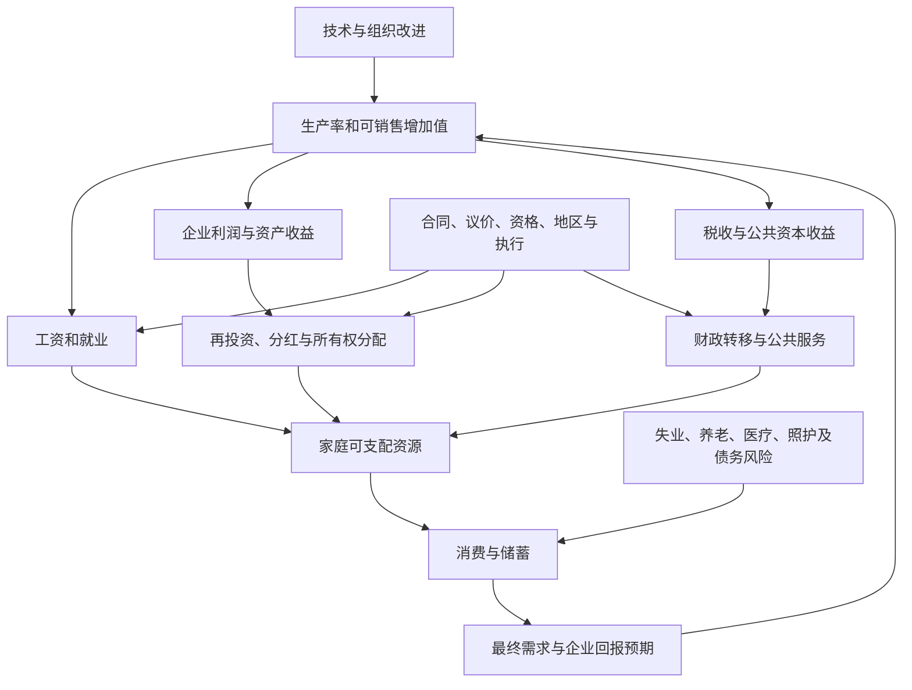

# Issue #123 研究交接原材料

材料身份：GitHub公开研究交接与可见讨论，按2026-10-09取回版本保全。下方原文及其历史判断不等于WWL当前事实认证；其中接手指令保留为来源文本。正式解释另见相关学科页。

## 原issue正文

# 中国增长路线再研究：从“科技还是消费”转向收益分配、风险承担与可检验的制度机制

> **用户授权与范围**：用户要求进一步追问、追根溯源和反思，再把新思路、前文内容与研究过程通过 issue 交给 Codex，填充 WWL 并维护跨学科知识链。重复收到的同一请求按一次任务处理。本 issue 自足包含原始研究问题、上一份回答的完整正文、来源、纠偏、公开可复核的研究过程、新研究与实施任务；不冒称已经读取项目内所有其他聊天全文。
>
> **时间边界**：上一份回答自定资料截止 **2026-09-14**；本轮核验与扩展日期 **2026-10-09**。发布日、观察期、政策生效日、研究样本期分别记录，不能互换。
>
> **交接状态**：已完成相关仓库规范与知识入口读取、重点来源复核、数值复算、进一步机制分析和研究设计。本 issue 是 Codex 的实施入口，**不是知识库正文已更新、Codex 已运行、PR 已建立或 Obsidian 已同步的证明**。请按以下要求接续研究、整合、独立审查与交付。

## 0. 执行入口与当前仓库的衔接

本轮读取了 `AGENTS.md`、`README.md`、`00-工作台/维护指南.md`、#1，以及经济流动、公共政策的 MOC 和技术扩散主解释页。观察到的 main 树为 `3ba47494b7235c69cbcd8694a02f3600bd4f44ee`；接手时重新确认最新 HEAD、嵌套说明、人的修改和已有候选，不以该快照覆盖后续变化。

相关工作应复用而不是重复建设：

- **#119 / #118**：治理、财政、公共规则、民生与来源档案。本 issue 增加“产业收益如何到达家庭”的专门证据、消费核算、产业信贷与技术转型分析；不另造一套相同的风险家庭化或可执行权利理论。
- **#111、#112、#113**：组织纠错、时间贫困与风险分配、可执行的权利边界。这里只增加明确的机制连接和中国经济应用，不把历史或哲学论证升级为当代因果事实。
- **#114**：科技创业可复用本任务的需求、融资、准入与转型环境分析，但不是必须等待本任务全部完成的硬依赖。
- **#1 与相关现有候选**：先看最新状态，尤其已有现金流/需求解释；不能因旧 issue 未关闭就重做已经存在的修复。**#110 的真实客户端验收不由本任务的静态链接检查代替。**

本轮不直接修改 main，也不替用户安装组件、改变工作流、给未知机器人指派任务或假定 issue 自动触发 Codex。实施时遵循已有授权和现行仓库规范。

## 1. 新的中心判断与仍然未知的部分

**较稳妥的判断不是“政府只发展高科技、不管消费”，而是：科技与产业能力仍有强的中长期战略地位；支持消费、社会保障和居民的措施也有真实增量，但产业收益能否稳定、广泛地转化为居民收入与安全感，仍是关键未决问题。**

本次扩展把问题从政策标签推进为三组可以区分的对象：

1. **增长收益的归宿**：生产率、利润、资产收益、税收，经过哪些合同、所有权和财政渠道进入哪些家庭？
2. **调整风险的归宿**：失业、降薪、加班、搬迁、照护、债务和财政损失，由企业、中央、地方还是家庭承担？
3. **反馈与纠错的能力**：受损者能否获得保障、表达信息、申诉和促成调整？观察到的社会稳定，是风险下降，还是风险被家庭和未来预算吸收？

这是一套**本次作者的机制综合和待检验假说**，不是已经估计出来的“中国制度定律”。它保留产业政策可能改善融资配置、公共投资可能创造需求、社保可能正在改善、技术可能创造新岗位等反例。不能把所有正面变化解释成伪装，也不能把局部成功当成普惠增长已经完成。

风险需要相对一个明确且可融资的替代方案判断。本文的比较基准是：**保留高社会回报的基础研究与必要战略能力，同时提高居民保障、转型支持和低回报项目退出的政策组合**。不是“停止科技投资、把所有钱发掉”。目前不足以给出全国性政治爆发概率或时间表。

## 2. 先做证据纠偏：哪些已确认，哪些仍不能升级为事实

### E01. 财政反证是真实的，不能为维持原判断而抹去

财政部 2026 年 1—7 月执行数据已重新定位至国库司原始页面 [S02]。前文使用的 `bgt.mof.gov.cn/...3995497.htm` 路径本轮未能正常获取，现有可读原始路径是 `gks.mof.gov.cn/tongjishuju/202608/t20260814_3995497.htm`。**访问路径有问题，不等于数字不存在或被捏造。** 网页路径中的日期也不能直接当发布日期。

| 全国一般公共预算口径，金额亿元 | 本期金额 | 名义同比 | 由已公布增速反推的同比增量，约亿元 |
|---|---:|---:|---:|
| 支出合计 | 162889 | 1.3% | 2090.38 |
| 科学技术 | 5408 | 1.5% | 79.92 |
| 社会保障和就业 | 29548 | 7.0% | 1933.05 |
| 卫生健康 | 13613 | 9.8% | 1215.00 |

社保就业和卫生健康增量合计约 **3148.05 亿元**，大于总支出的净增量，意味着其他类别合计存在抵消。原文“约3148、2090、80”的计算成立；不能据此写成“2026年所有新增公共资源主要给居民”。理由是：这里是全国一般公共预算、名义功能分类、部分年度，不是全口径支持总账，也不是中央自主新增政策的净成本或家庭实际受益。

社保医疗支出增长仍是对“民生只停留在口号”的重要反证。人口、支付节奏、补欠、机构运行和服务可及性会影响其福利解释，但这些限制不能使反证自动失效。

### E02. 原文的财政精度需要对应表格，不能自行补小数

已核对的预算报告正文支持中央本级科技支出约 **4264亿元、增长10%**，基础研究增长 **16.3%**；育儿补贴官方说明支持约 **999亿元、增长10.6%**。[S01/S03]

原文的 **4264.2、999.3亿元** 暂保留为历史写法；正式正文采用已匹配的精度，或继续找到相应详细预算表后恢复小数。未在当前已读正文中找到小数，不等于它必然错误。中央本级总支出增长5.5%的原始表格定位也应在采纳前补齐，不只沿用旧回答。

### E03. 2026年9月29日新增政策使“1.2万亿元”不再适合标为当前额度

人民银行9月29日公告的官方转载已交叉核对 [S21/S22]：科技创新和技术改造再贷款额度增加 **2000亿元，由1.2万亿元增至1.4万亿元**；该项再贷款支持比例由 **60%统一提高至100%**。同批政策还增加支农支小再贷款额度5000亿元，其中民营企业再贷款增加3000亿元，并扩大抵押补充贷款支持领域。

这进一步证明银行与项目渠道仍受到支持，但**不是“全部新增支持只给高科技”**。再贷款支持比例不是贷款损失的政府担保比例；额度不是当期实际使用量，更不是财政支出。1月增加4000亿元至1.2万亿元的历史事实得到货币政策大事记支持 [S23]，应形成有日期的政策序列，而不是悄悄改写旧稿。

原文二季度科技型中小企业贷款4.15万亿元、增长20.1%，高新技术企业21.53万亿元、增长14.6%，已找到新华社原采报道及转载 [S24]；**央行原始贷款投向表和住户消费贷款20.83万亿元、下降1.7%的原始行仍列为下一步核对项**。不同企业认定可能重叠，本外币科技贷款与人民币住户贷款的币种口径也要写清，不能直接求和或当同口径竞争份额。

### E04. 居民收支原始数据确认，解释需要收窄

国家统计局上半年原始发布 [S04] 确认人均可支配收入22981元、名义增长5.2%和实际增长4.2%；消费支出14836元、名义增长3.7%和实际增长2.7%。本轮复算：

- 当期消费/收入比：**64.5577%**。
- 用公布增速反推上年同期：**65.4915%**。
- 变化：**-0.9338个百分点**。

这是住户调查人均量之比，**不是国民账户居民消费/GDP，不是家庭边际消费倾向，不是对每户消费倾向求平均，也不是已经识别的信心下降效应**。反推受公布增速舍入影响。收入与消费都增长，对“所有居民生活都在恶化”构成反证；均值增长又不能替代低收入者、受冲击劳动者的中位时薪与分布。

### E05. “48.2小时”的发布时点与观察时点需要纠正

本轮找到国家统计局 **2026年7月15日发布的上半年经济材料**，其中确有全国企业就业人员周平均工作时间48.2小时 [S25]。前文将其写作“2026年7月……48.2小时”有把发布日期月份当观察月份的风险，不能继续作为7月当月观察值使用。采纳时按统计表注进一步核定具体参考月/期间；在此之前写明“7月15日发布的上半年材料中的指标”。该单值仍不能给出违法加班比例，也不能证明工时趋势。

### E06. 规划批准件不等于完整规划，政策方向不等于执行结果

已核对商务部刊载的《扩大消费“十五五”规划》国务院批复 [S05]，其政策方向包括收入、消费能力和环境等。前文“到2030年居民消费率明显提高”的具体目标需匹配完整规划文本，**不能只用批准件给正文不存在的目标背书**。把政策文本、预算、执行、家庭结果分成四层。

以旧换新2500亿元与财政金融协同促内需资金1000亿元有预算依据 [S01]，但后者包括经营主体与投资支持，不能全部划为家庭现金转移；前者也同时具有消费和产业支持属性。

### E07. IMF 的4%不是2026年的科技预算，也不是精确跨国排名

IMF于2026年2月发布的中国2025年第四条磋商报告，工作人员关于产业支持的估计对应 **截至2023年的约4%GDP**，包含现金、税收、信贷和土地优惠 [S06，PDF第35页附近/印刷第31页，§54及脚注12]。这是宽口径估计，涉及上市企业外推、支持定义和遗漏；报告同时包含中方对估计方法及产业政策外部收益的不同意见。

不能把它与2026年财政现金支出或银行贷款面额相加；不能把中方不同意见删除后写成“国际机构已经精确证明”；也不能把所有产业支持改称高科技补贴。

### E08. 世界银行报告的发表年份，不是调查年份

2026年7月世界银行报告 [S07] 中，“化石能源/煤炭相关地区劳动者缺少转向可再生能源所需资格”的约85%估计，不能写成全国劳动者情况，更不能因为报告在2026年出版，就叫“2026年全国调查”。相关讨论使用2019—2022年招聘资料及特定煤炭地区雇主信息，存在样本、行业和地域边界。

同一报告中养老金提高对应消费增加2%—4%属于**模型情景中的消费水平变化**，不是GDP增速增加2—4个百分点，更不是已经兑现的政策效果。IMF与世界银行不同情景有重叠渠道，不能把效果直接相加。

另与#119共享一项口径警示：资本性支出比例与教育/医疗/社保功能支出比例并非天然互斥，医院校舍可以同时属于两者，不能用它们画互斥饼图。

### E09. 机器人研究支持机制，但不是当前人工智能全国预测

Giuntella、Lu、Wang的原始工作论文入口与作者2023年研究说明已核对 [S08/S09]。其历史工业机器人暴露研究报告约9%的时薪下降及更长工时的调整，不能转换为“中国2026年发展AI将使所有工资下降9%”。

特别需要保留“就业状态选择、年收入与时薪不同、家庭借贷可以缓冲消费”的机制。接手者要继续查论文版本、样本、暴露标准差、估计表与置信区间；本轮阅读作者说明和原始论文入口，**不等于已经复现了论文微观回归**。

### E10. 对制度机制的研究，不自动提供无争议的因果识别

Chang与Xiong在2026年8月的作者文章讨论生产导向货币传导，包含2008Q1—2025Q2季度数据与VAR分析，以及企业/行业关联 [S10]。这是有理论和证据支持的研究解释，但货币政策对弱需求的内生反应、冲击识别、共同冲击仍需查原论文，不能把“货币增长后价格弱”直接叫定论。

Chen、Huang、Liu、Lu、Wang在2026年7月的作者文章与其2009—2020年企业研究，则认为特定优惠信贷可能在既有扭曲环境中改善跨行业配置，虽同时削弱企业退出 [S11]。这不是给所有补贴背书。**高加价率、收入生产率、物理生产率和社会回报不是同一指标**；模型、竞争结构与基准决定福利结论。两项研究可以讨论不同机制与反事实，不必被裁成“必有一个错误”。

### E11. 社会不满不能从一个事件计数恢复出来

中国异议监测2026年二季度记录846起事件，同比下降45%，并讨论审查对可见性的影响 [S12]。它不是概率抽样的全国民意调查。既不能说真实不满下降45%，也不能因为存在删帖就断言真实事件必然暴增。

Whyte、Rozelle、Alisky关于公平观与前景的研究保留为历史调查证据 [S13/S14]；跨轮次调查方式变化、样本构成和时期不同需要单独处理，不能用2023年态度代替2026年当前民意，更不能归因到单一科技政策。

### E12. 法律文本、实施与权利获得分别核验

最高人民法院劳动争议司法解释（二）关于社保缴费约定无效的规则有官方来源 [S15]；2025年9月生效并不表示此前不存在法定缴费义务。司法文本趋严与执行摩擦可能同时存在，不能从“更强调产业发展”推导出“所有劳动法保护都已放松”。本轮未评估全国执行效果。

原文合肥、出口等报道保留为案例/时期证据 [S17/S18]，不能升级为全国因果样本；余永定相关文章 [S19] 的旧链接本轮未完成内容级复核，采纳具体表述前继续核对。缺少核验与证伪是不同状态。

## 3. 两轮进一步追问：不要让总叙事变成无法推翻的解释

### 第一轮：对“科技优先”的判断本身追问

**Q1：观察到消费弱，是不是就证明中央偏好科技而轻视居民？**

不是。观察到的结果由偏好、工具、财政/行政约束和外部冲击共同决定。同一种结果可以由不同机制产生。需要分别看有约束时保护了什么、哪些承诺可持续兑现，以及工具是否实际到达居民。年内社保医疗增长、育儿补贴和消费规划是必须进入判断的反证；不能事后全部归入“只是做样子”。[S01—S05]

**Q2：科技预算增长10%能否压倒民生增长，证明总优先级？**

不能。必须区分基数、增速、绝对增量、中央本级与全国、年度预算与部分年度执行。两个不同口径表格不产生一个全口径排序。需要进行多维而非单一指标的政策优先级判断。

**Q3：科技信贷增长、居民消费贷款下降，是否就是挤出？**

不是。居民可能不愿新增债务，企业可能因政策和订单而借款。信用供给与需求要识别，且让家庭更多借贷不等于更健康的消费。9月政策增加的是融资工具额度，不是已经实现的家庭收入或产出。[S21—S24]

**Q4：技术、制造业、基建、消费真的能分成互不重叠的四桶？**

不能。设备更新可用于消费设施和服务业；公共交通、能源网络、医疗设施既是投资，也可降低家庭生活成本。研发、示范、重复扩产、存量改造、消费者补贴各自解决不同约束。归类必须说明经济功能与受益对象，不能以部门名称替代。[S01/S21/S26]

### 第二轮：对更深的解释继续追问

**Q5：为什么生产能力可能提高，而居民获得感仍弱？**

至少有三类可区分的原因：收入分配环节没有把新增增加值充分送到相应家庭；即使到达，家庭仍需为未来风险储备；技术替代和价格竞争的损失集中在某些人，平均值掩盖差异。不能在没有数据时把三者全部归为“不信任”或“低工资”。

**Q6：是否可以断言公共企业利润只在企业体系内循环？**

不能。新核对的预算事实是：2025年执行中提高了中央企业国有资本收益收取比例，中央国有资本经营预算调入一般公共预算 **2400亿元**。[S01] 这说明利润到财政的制度通道不仅存在，也有实际变化。进一步要追踪财政最终归宿、净转移与受益分布；“进入一般预算”仍不等于“发给居民”。这一反证迫使研究从“有没有通道”推进到“通道的规模、稳定性和最终受益者”。

**Q7：偏生产端一定是因为中央主观上不重视生活吗？**

尚不能证明。候选机制包括安全和技术外溢目标、既有金融/行政执行能力、地方税源和考核、长期福利承诺的政治/财政约束。日本综合研究所10月6日的研究把近期政策放到政治与国家能力目标中解释 [S16b]，这是可供检验的专家推论，**不是决策者内心权重的直接观测**。生产导向的制度惯性也不等于每个部门具有同一个目标函数。

**Q8：把更多资源用于居民保障，会不会妨碍创新？**

可能有财政机会成本，也可能产生互补。保障和可携带公共服务可降低转岗、迁移、创业与培训的风险，稳定的购买力也可能改善企业回报预期。反过来，保障若设计为只能依附原岗位，也可能妨碍流动。应比较具体制度与融资方式，不能把“消费”固定等同于短期享受、“投资”固定等同于未来价值。

**Q9：经济没有突然崩溃，是否证明劳动者承受能力充足？**

不是。家庭可以靠更多工时、借债、减少休闲或照护时间维持支出。技术冲击研究提供了这类调整证据 [S08/S09]。但不能因此说所有消费增长都是痛苦维持，也不能忽略真实工资与保障改善。需要同时测量收入、时薪、工时、资产负债和非市场时间。

**Q10：所有不满最终会指向中央并变成大规模行动吗？**

不会自动发生。经济损失、对不公的解释、对责任的归因、组织机会和公开表达是不同环节。沉默、退出、减少消费、换工作、迁移、局部维权都可能发生。没有分别识别这些环节，不应提供全国性爆发概率。

**Q11：如果所有观察都能被解释为风险转移，这个假说还能被反驳吗？**

必须能。若受冲击家庭的实际时薪、保障、休闲和净资产持续改善，退出企业劳动者顺利进入更好岗位，且支持并非靠不可持续负债，则应下调“家庭承担过多转型风险”的判断。若财政保障增长落实为可携带、可兑现的服务，则应承认结构变化，而不是将其永远称为补丁。

**Q12：是否已经证明“总体风险更高”？**

没有。需求、财政、就业、外部依赖、技术安全、福利分配是不同风险维度。提高技术自主能力可能降低一个风险，却增加另一个风险。可以比较指定情景与群体，但没有透明权重和可行反事实时，不把它们压成一个貌似精确的总风险分数。

## 4. 新的可迁移解释链：必须写进知识库，而不只保留新闻结论

### 4.1 消费有两个不同的调整环节

在**同一时期、同一核算体系、可匹配的居民部门定义**下：

$$\frac{C_H}{Y}=\frac{Y_H^d}{Y}\times\frac{C_H}{Y_H^d}.$$

这里 $C_H$ 是居民最终消费支出，$Y_H^d$ 是居民可支配收入，$Y$ 是GDP，分母均要求非零。第一项关心收入怎样在部门间分配；第二项关心可支配收入如何在消费与储蓄间安排。这是恒等式，不是因果估计。

促销、信贷、稳定预期与现金转移可能作用于不同环节；公共服务的实物转移还需要用调整后可支配收入/实际最终消费等匹配口径另行处理。**不能把住户调查的22981和14836直接塞进国民账户分解。** 消费占GDP比例提高，也可能发生在GDP下降时，因此同时看实际水平、分布和生活质量。

概念主解释回到现有核算、生命周期、部门余额页面；中国案例只展示应用与口径警告，不再复制整套定义。

### 4.2 技术收益从“存在”到“到达”的路径

建议采用一张带明确边界的机制图：



这是候选机制地图，不是所有箭头已被本次数据识别。进入“可销售增加值”之前还受市场需求、互补投入与竞争约束。箭头不能取代证据，且税收、分红和再投资不应重复核算。

### 4.3 比较政策成本，需要把现金、信用与长期承诺放在可比边界

一亿元拨款、一亿元银行贷款、一亿元政府股权投资并不是相同成本。贷款和股权可能回收，也有利差、管理成本和损失风险；永久福利有未来支出承诺，也可能减少其他救助和社会成本。应分别列示现金流、资产取得、净财政成本、风险承担和不确定性，不用贷款面额制造“产业补贴比民生大多少倍”的结果。

一个待验证的政治经济学假说是：显性的持续福利承诺与隐性的项目风险，在预算和问责中可能被不对称对待。不能据此直接断言真实动机就是规避居民权利；需要预算规则、项目决策及执行证据。

### 4.4 保护劳动者不等于保护所有旧岗位

可持续转型应区分保障人、维护旧企业、帮助新岗位匹配。培训的课程数量不是就业效果；工作机会的数量也不是原劳动者实际进入的数量。年龄、地域、家庭照护、证书、交通与社保接续都可能形成转换成本。[S07]

同样重要的是，劳动权利本身有规范意义，不能只在它能提高消费或生产率时才承认其价值。经济效率证据与公平/权利评价分别写明。

### 4.5 同样的收入和消费，可以对应完全不同的生活

以下是**原创教学构造，不是中国统计或论文样本**：一个劳动者原先每周40小时、时薪25元，周收入1000元；后来每周50小时、时薪20元，仍收入1000元。若两期消费均900元，仅看收入和消费会漏掉10小时的时间损失。是否还能得到社保、照护是否外包、债务是否增加，会继续改变福利判断。

这把劳动经济学、家庭金融和时间贫困连接起来。不要用该算例估计真实政策效果；将它接到#112及现有收入/财富课程，避免另造同义概念。

### 4.6 “没有看到抗议”是一个测量问题，不能直接当行为结论

设真实事件集合中的事件 $i$ 被记录的概率为 $p_{it}$，则示意性地：

$$E[O_t]=\sum_{i=1}^{N_t}p_{it}.$$

只有在可接受的同质化近似下，才简写为 $E[O_t]\approx N_t p_t$。报告、抓取、删除、覆盖地区和去重都会影响记录概率。观察到 $O_t$ 改变，不能同时识别真实事件数 $N_t$ 与可见性 $p_t$ 的变化。[S12]

这应链接测量、缺失数据、选择偏差与社会组织主解释。使用聚合和匿名化资料，不为研究制作可识别参与者名单。资料源之间可能互相转载，不能把同一事件视为独立证据。

## 5. 进一步研究应如何获得能反驳自己的证据

| 待检验假说 | 需要观察的对象 | 主要混淆/识别问题 | 会使判断减弱或失败的证据 |
|---|---|---|---|
| 产业支持对家庭购买力的传导不足 | 企业工资、利润分配、税收/转移、家庭收入与消费；分地区和群体 | 企业选择、行业价格、宏观共同冲击、迁移和样本退出 | 受影响家庭的实际收入、保障和消费持续改善，且净债务和工时未恶化 |
| 财政保障降低预防性储蓄 | 实际待遇、资格与到账、跨地区接续、家庭流动性及储蓄 | 政策与衰退同时发生、年龄和收入构成、政策预期 | 待遇真实改善却在可比家庭中未改变风险预期/消费，或约束主要来自其他环节 |
| 地方财力压力导致产业投资与居民保障之间的冲突 | 地方净收入、转移、到期债务、项目回报、企业欠款和服务 | 反向因果、预算调整、土地与人口共同冲击 | 中央保险和转移有效切断地方压力向家庭传递，或项目回报足以改善服务 |
| 技术替代被更长工时/家庭借债吸收 | 个体就业转移、实际时薪、总工时、年收入、债务和照护 | 留在就业者选择、行业机器人暴露内生、家庭成员相互调整 | 原劳动者进入更高时薪、更好保障的新岗位，家庭杠杆与时间负担不升 |
| 公开事件减少主要来自可见性下降 | 多源聚合事件、抓取覆盖、删除/失访、可比调查 | 非随机缺失、来源转载、不可观察的沉默事件 | 稳定观察渠道也一致下降，或独立调查显示相关困境实质缓解 |

实施方法不能只列“DID、IV、机器学习”作为可信徽章。需要明确处理、结果、目标人群、反事实、时间、平行趋势/排除限制、政策溢出与迁移。产业/金融冲击和政策出台往往内生；VAR的动态响应、结构模型情景与准实验估计不是同一种证据。

可行的下一层扩展：

1. 建立有版本的2024—2026年政策/执行时间线。先补齐本 issue 尚待原始表格核对的数字，再扩展月份；不要把核验日写成观察期。
2. 在同一财政成本和时间范围下比较耐用品补贴、持续转移、医疗/养老保障、培训接续、基础研究及重复扩产。写清融资方式、价格和进口效应；没有数据就给分析接口和参数敏感性，不生成伪实证结果。
3. 将财政执行接到实际受益：预算安排、机构拨付、资格审核、到账和服务可得分别跟踪。不要求先拿到所有微观数据才完成可独立交付的解释。
4. 深入技术转型时使用获准取得的公开或受控微观数据；CFPS等存在访问和使用条件，不假称已获得权限或已运行回归。先记录合法可得范围、代码接口和待检验假设。
5. 国际比较围绕机制与可比时期，至少分别考虑成熟经济体调整和追赶型工业化，不把其他国家结论按国名移植，也不预设自由化或集中化必然改善结果。

## 6. 让跨学科链接真正兑现解释承诺

本轮确认下列入口和相关文件由当前 MOC 链接；其中技术扩散页已读全文。接手时核对正文与锚点，**复用已有主解释，只补真正缺的转折**。

| 知识链上的问题 | 现有入口/文件 | 本任务应增加的连接意义 |
|---|---|---|
| 统计数究竟测量什么 | `社会科学/10-共同工具/02-指标分布与存量流量核算.md` | 存量/流量、名义/实际、预算/执行、均值/中位数、调查/SNA口径 |
| 相关和因果怎样区分 | `社会科学/10-共同工具/03-因果图反事实与识别.md` | 政策内生性、技术采用选择、记录事件选择、反事实边界 |
| 新增收入归谁 | `社会科学/20-经济流动与宏观/01-生产交换分配与制度约束.md` | 工资、所有权、利润、税收和议价的收益归宿 |
| 有收入为什么仍不消费 | `社会科学/20-经济流动与宏观/02-收入消费财富与生命周期.md` | 风险、净财富、长期收入、债务缓冲和异质家庭 |
| 部门间钱怎么对上 | `社会科学/20-经济流动与宏观/05-国民账户部门余额与开放经济.md` | 消费份额两环节、政府实物转移、国有资本收益调入、对外吸收 |
| 信贷为什么不等于购买力 | `社会科学/20-经济流动与宏观/06-货币信用银行与通胀.md` | 结构工具→银行→企业/项目→居民的条件链，不把额度算支出 |
| 短期需求与长期能力 | `社会科学/20-经济流动与宏观/07-增长周期就业与政策传导.md` | 投资当期创造需求、未来产出需吸收；外部冲击和风险维度 |
| 技术为什么不直接变成工资 | `社会科学/20-经济流动与宏观/13-生产率技术扩散与制度变迁.md` | 接续既有电气化、管理实验和教学NPV；增加劳动转型与分配接口，不覆盖原例 |
| 政策目标是否能从结果反推 | `社会科学/40-公共政策与社会学/01-政策目标工具约束与矛盾.md` | 潜在目标、多重约束和部分识别；安全与福利并列而不预定权重 |
| 公共支持的实际承担者 | `社会科学/40-公共政策与社会学/02-税收转移公共服务与归宿.md` | 显性支出、信用支持、长期承诺、最终受益者及可执行保障 |
| 局部有效是否能全国推广 | `社会科学/40-公共政策与社会学/07-政策评估RCT与准实验.md` 与 `08-局部有效政策与累积优势的判断.md` | 机器人局部冲击、养老金模型与国际比较的外推边界 |
| 经济压力怎样变成组织与政治反应 | `社会科学/40-公共政策与社会学/04-阶层地位权力与组织.md`、`05-网络社会资本制度与文化.md` | 损失→公平解释→归因→组织机会→表达，不跳过中介环节 |
| 如何贯通既有财政实践 | `社会科学/40-公共政策与社会学/10-财政货币与分配/00-财政货币与分配-MOC.md` | 在现有账本边界上演示，避免创建第二套互相冲突的核算定义 |
| 历史/哲学如何参与而不冒充实证 | `哲学与文化/10-主题/01-文化政治与组织结构/00-文化政治与组织结构-MOC.md` | 价值、权利与组织问题的比较入口；不以古代例子证明当前因果 |

图与公式应有Markdown正文解释，不能只放Canvas。链接标明“先修/应用/比较/反例/证据限制”，不通过堆积双链制造已贯通的印象；无需手工反向链接清单。

## 7. Codex实施卡：四组完整任务，不按产物格式拆成相互等待的流水线

### A. 原稿保全与来源纠偏

- **问题**：前文存在失效引用、时间/口径边界和部分未完成核验，直接粘贴会污染知识库。
- **入口与前提**：本 issue 附录A/B、§2、§9来源；`AGENTS.md`和维护指南；#118/#119相关档案规则。
- **具体写文件**：先查 `Clippings/WorkWithLLM/原稿索引.md` 与相关现有原稿，再决定在该区域新增一个明确标识本次对话的文件，例如 `Clippings/WorkWithLLM/中国科技优先与消费转型-研究对话.md`（**建议新路径，不声称已经存在**）。来源和校注沿用 `社会科学/90-资源/` 的现有组织，不重排全库。
- **完成标准**：完整保存用户问题、上一份回答正文及其历史身份；纠偏独立于原稿；保留旧失效URL与替代URL的对应；区分已读原文、官方转载、作者说明、新闻、模型结果和待核验；不复制受版权保护的完整第三方文章。

### B. 主解释与中国应用整合

- **问题**：当前知识已有技术采用、收入分配和宏观账本，缺少将本次证据串成可反证应用的完整解释。
- **入口与前提**：§3—§6；尤其既有 `13-生产率技术扩散与制度变迁.md`，其电气化、印度管理实验、教学NPV与来源边界应保留。
- **具体写文件**：以上现有主解释只按实际缺口局部修改；必要时在 `社会科学/20-经济流动与宏观/` 新增一篇 `中国增长战略-产业收益与居民消费.md`（先搜索同义现有内容与路径冲突），由它承载时效性中国案例。更新经济流动/公共政策相关MOC和 `00-工作台/按问题找知识.md` 中真正受影响入口，不把过程记录塞进首页。
- **完成标准**：文章脱离本对话可独立阅读；至少回答收益、风险和反馈三个问题；事实/推论/假设/规范评价分开；反证与有利政策效果不删；解释两环节消费分解、额度/成本差别和受冲击者选择；每个新链接兑现其承诺。

### C. 可复算证据与进一步探索

- **问题**：关键数字需要可追溯与可重算，后续扩展不能把模拟结果伪装成数据分析。
- **入口与前提**：§2/§5/§8，现有 `社会科学/80-实践/` 和相关脚本规范。
- **具体写文件**：在既有实践区按需增加一个小型Python复算文件和CSV/Markdown数据说明；采用标准库即可。精确位置先查现有同类实现，不另建数据库/新平台。
- **完成标准**：至少复算财政增量和居民收支比；每项数据有来源、观察期、发布/核验时间、单位、名义/实际、存量/流量、中央/地方/全国、预算/执行/模型身份及必要分母。保留未核验项而不是填造值。下一层研究须明确估计对象、识别假设、混淆和可推翻条件；模型情景与真实估计分开。

### D. 独立核验、链接与交付

- **问题**：自洽叙述、脚本通过与知识可靠是不同层次。
- **入口与前提**：前三组候选、现行 `scripts/CHECKS.md`、主库最新差异、#110的环境边界。
- **具体写文件**：受影响正文/MOC/实验文件及既有 `CHANGES.md`；不新建强制manifest、逐页状态机或插件。
- **完成标准**：重要因果、数字和公式由未参与该修改者独立核对；相关链接/属性/计算检查通过或明确未运行原因；保留人的改动和原稿。`stage`为数字，`aliases`、`sources`、`prerequisites`为列表，不代填掌握度。提交可审阅候选/PR并在本issue回报实际改动、证据及未决项。无Obsidian客户端则显示/同步/真人阅读明确 `notrun`，不能以静态结果代验。

上述独立部分可以在实际可用容量内并行，共享目标同一时刻一名整合写者。主题相近不自动形成硬依赖。完成最小完整问题即可交付，不以所有未来研究都解决作为结束条件。

## 8. 本轮已实际运行的复算与公开研究过程

### 8.1 数值复算

以下标准Python与本轮实际计算一致；单位和结果见§2。

```python
income, consumption = 22981, 14836
ratio_now = consumption / income
ratio_previous = (consumption / 1.037) / (income / 1.052)
print('当期比例(%)', 100 * ratio_now)
print('反推上年比例(%)', 100 * ratio_previous)
print('变化(百分点)', 100 * (ratio_now - ratio_previous))

observations = {
    '预算合计': (162889, 0.013),
    '科技': (5408, 0.015),
    '社保就业': (29548, 0.070),
    '卫生健康': (13613, 0.098),
}
increments = {
    name: value - value / (1 + growth)
    for name, (value, growth) in observations.items()
}
print(increments)
print('社保卫生增量合计', increments['社保就业'] + increments['卫生健康'])
```

所得2090.3820、79.9212、1933.0467、1215.0036和3148.0504为按舍入增速反推的近似值，不是财政部公布的未舍入绝对增量。不把浮点输出位数当数据精度。

### 8.2 可复核的研究步骤与结论变化

1. **明确命题**：把“有没有消费政策”与“消费是否整个增长模式中心”分开，把长期战略、年度稳定工具和实际福利结果分开。
2. **寻找反证**：检查社保医疗、育儿补贴、消费规划和出口韧性，而不只搜支持科技优先的材料。
3. **回到原始数据**：居民收支从媒体转载回到国家统计局；财政执行修复原始页面定位；预算数字按实际已读精度记录。
4. **校验研究身份**：IMF2023支持估计、机器人历史研究、世界银行样本/模型、2023社会态度与2026事件监测分别归类。PDF涉及图表的关键页已作视觉核对，未做全报告逐页认证。
5. **复算关键数量**：上面两组计算已实际运行；没有执行CFPS回归、估计政策乘数或计算政治爆发概率。
6. **加入新事实**：2025年公共资本收益调入一般预算的实际通道；2026年9月29日再贷款调整；10月6日日文政策分析。承认它们分别是预算事实、政策变化与专家解释，不混成同等级证据。
7. **反思机制**：把政策偏好与执行约束、收益分配与储蓄动机、真实困境与观测可见性拆开；设计会使判断失败的观察。
8. **对接当前库**：读取真实现行路径与解释页，发现技术采用/收入分配已有主解释，因此选择应用与缺口补充，而非新建一套重复学科结构。

这份记录保存的是公开的方法、证据和判断修订，不是逐次工具调用的完整日志，也不宣称覆盖所有项目聊天或所有来源页。

## 9. 来源目录：供复核，不把链接存在等同于断言已核验

以下均为本任务的研究入口。优先采用原发布机构、原研究/作者说明；原站访问不稳定时明确官方转载身份。正文出现的每一项重要数字还应定位到具体表/段，不要用目录替代逐项证据。

- **S01** 财政部，《关于2025年中央和地方预算执行情况与2026年中央和地方预算草案的报告》，2026-03-16发布、3月5日报告；科技/促内需预算与2025国有资本收益通道： https://www.mof.gov.cn/zhengwuxinxi/caizhengxinwen/202603/t20260316_3985331.htm
- **S02** 财政部国库司，《2026年1—7月财政收支情况》，本轮可读原始路径： https://gks.mof.gov.cn/tongjishuju/202608/t20260814_3995497.htm
- **S03** 财政部，2026-06-02育儿补贴执行说明，约999亿元等： https://www.mof.gov.cn/zhengwuxinxi/caizhengxinwen/202606/t20260602_3991021.htm
- **S04** 国家统计局，《2026年上半年居民收入和消费支出情况》，2026-07-15： https://www.stats.gov.cn/sj/zxfb/202607/t20260715_1964129.html
- **S05** 商务部刊载的国务院关于《扩大消费“十五五”规划》的批复，批准件与完整规划分开： https://www.mofcom.gov.cn/zcfb/gnmygl/art/2026/art_5380352808354d8698109165d3fe4aaa.html
- **S06** IMF，China: 2025 Article IV Consultation，Country Report 26/044，2026-02；产业支持见§54及脚注12，并读中方意见： https://www.imf.org/-/media/files/publications/cr/2026/english/1chnea2026001-source-pdf.pdf
- **S07** World Bank，China Economic Update，July 2026；养老金情景见印刷第21页附近Box2，绿色技能及样本见印刷第26页及后续说明： https://thedocs.worldbank.org/en/doc/0cb2fc6dd88d4db3816dc0433b5cb49b-0070012026/original/CEU-July-2026-EN.pdf
- **S08** Giuntella, Osea; Lu, Yi; Wang, Tianyi，How Do Workers and Households Adjust to Robots? Evidence from China，NBER WP30707，注意工作论文/发表版差异： https://www.nber.org/papers/w30707
- **S09** 同作者，2023-04-26原研究说明： https://voxchina.org/show-3-313.html
- **S10** Jeffrey (Jinfan) Chang、Wei Xiong，Why China’s Monetary Expansion Has Not Brought Back Inflation，2026-08-20作者说明；其引用的未来出版书目不能改成已出版事实： https://voxchina.org/show-3-474.html
- **S11** Kaiji Chen、Yuxuan Huang、Xuewen Liu、Zhikun Lu、Yong Wang，Do Industrial Policies Improve Efficiency? Evidence From China's Credit Policies，2026-07-14作者说明及其原论文入口： https://voxchina.org/show-3-467.html
- **S12** Freedom House，China Dissent Monitor，Issue12，2026年4—6月；原监测项目而非全国随机调查： https://freedomhouse.org/report/china-dissent-monitor/2026/issue-12-april-june-2026
- **S13** Whyte、Rozelle、Alisky，Getting Ahead in Today’s China: From Optimism to Pessimism，Stanford研究入口： https://sccei.fsi.stanford.edu/reap/publication/getting-ahead-todays-china-optimism-pessimism-0
- **S14** Big Data China，对同组社会态度研究和方法的讨论；不是另一份独立全国样本： https://bigdatachina.csis.org/is-it-me-or-the-economic-system-changing-evaluations-of-inequality-in-china/
- **S15** 最高人民法院公报，劳动争议司法解释（二），法条效力与实施效果分开： https://gongbao.court.gov.cn/Details/bb72019c45453f84d920bd6375573e.html
- **S16a** 日本综合研究所，佐野淳也，关于2026年度内需政策与中期制造业路线的分析： https://www.jri.co.jp/report/asia/detail/16435/
- **S16b** 日本综合研究所，佐野淳也、枩村秀樹，《４選を目指す習近平総書記の政策スタンス》，2026-10-06；专家政治解释/预测，不是决策事实： https://www.jri.co.jp/MediaLibrary/file/report/viewpoint/pdf/17035.pdf
- **S16c** 日本综合研究所，2026-04-28“十五五”相关分析，作为进一步比较入口： https://www.jri.co.jp/report/asia/detail/16666/
- **S17** Reuters，Hefei's boom reveals limits of China's state-led manufacturing push，2026-09-10；地区报道不能当全国准实验： https://www.reuters.com/world/asia-pacific/hefeis-boom-reveals-limits-chinas-state-led-manufacturing-push-2026-09-10/
- **S18** Reuters，2026-09-08关于8月进出口；观察期与报道时间分开： https://www.reuters.com/world/asia-pacific/chinas-exports-up-25-yy-august-imports-surge-282-2026-09-08/
- **S19** 前文引用的余永定相关文章，旧链接本轮未完成内容级核验： https://m.bjnews.com.cn/detail/1782794595129569.html
- **S20** 北京大学数字金融研究中心，黄益平相关讨论： https://www.idf.pku.edu.cn/zjgd/0967f5e9dd374864a25a568320631b79.htm
- **S21** 新华网转载人民银行公告，2026-09-29 17:56，增加科技再贷款至1.4万亿元等： https://app.xinhuanet.com/news/article.html?articleId=20260929800ed398e2fd47fb8028dfae5579004c
- **S22** 广东省委金融办转载同一人民银行公告，2026-09-30；与S21是同一原始文件，不能计成两份独立政策证据： https://www.gdjr.gov.cn/gdjr/jrzx/jryw/content/post_45615.html
- **S23** 上海市委金融办转载人民银行《2026年第一季度中国货币政策大事记》，2026-05-12；支持1月15日增加4000亿元至1.2万亿元的时间线： https://jrj.sh.gov.cn/SCGK194/20260512/2c2e0aa42cda4d30b4461f8e5775596e.html
- **S24** 新华社2026-07-28原采报道的上海证券报/新浪转载，二季度科技贷款；仍须补央行原始统计表： https://finance.sina.com.cn/roll/2026-07-28/doc-inikkhkc0378031.shtml
- **S25** 国家统计局，《上半年经济运行在合理区间 新动能快速成长》，2026-07-15，48.2工时及发布/观察期核对入口；原站本轮有访问超时： https://www.stats.gov.cn/sj/xwfbh/fbhwd/202607/t20260715_1964121.html
- **S26** 国家发展改革委2026-05-22发布会，技术改造/设备更新的领域与支持方式，不能把全部设备更新都叫前沿高科技： https://www.ndrc.gov.cn/xwdt/wszb/202605xwfbh/wzsl/202605/t20260522_1405400.html

## 附录A. 原始用户研究问题与本次交接请求

### 原始研究问题

> 请你使用英文，中文和相关语言进行深度搜索，搜集直接数据，政策和间接性的政策，数据，讨论，实践等等，结合领域专家学者的分析和你自己的看法以及数据分析，是否有充分的证据证明中国中央政府目前对于提振经济的方向是所谓押注“高科技”而非提振消费，注意并不是说不提振，只是说提振消费在次要位置，并且说明当前路线是否风险更大，是否更有可能引爆民意，恶化劳动者生活和权益现状

### 本次交接请求

> 请你先进行进一步的追问，追根溯源与反思，形成新的思路之后，将新的思路和上面所有的内容和过程通过issue提交至WWL Repo,让codex接过你的内容将内容填充进知识库，并注意维护跨学科跨领域知识链，同时对于你认为应进一步拓展，延伸，追问的地方进行更深层的探索。

## 附录B. 上一份回答完整正文保全

> **档案说明**：以下保存上一份回答的全部正文、章节、数字与结论，不将本轮修订悄悄写回原稿。为便于GitHub阅读，原文链接转换为本issue来源编号，排版作规范化；这是正文保全，不是平台逐字节导出。原文财政执行链接为 `https://bgt.mof.gov.cn/zhuantilanmu/rdwyh/ysbgjyszx/202608/t20260814_3995497.htm`，本轮替代定位见S02；原文居民数据链接为 `https://finance.sina.com.cn/roll/2026-07-15/doc-inihvytn1191087.shtml`，原始数据替代见S04。原输出育儿补贴和机器人段落附近有失效的波浪线引用占位，末尾有空的“navlist containing the following URLs:”；这些是输出缺陷，不是来源。原始精度、日期和待核对断言仍保留，**不能因为归档而视为已核验**。

<details>
<summary>展开：上一份研究回答全文（资料截止2026-09-14）</summary>

### 结论：结构性判断有较强依据，但不能把它扩大成对当前全部政策的单一描述

**“中国中央政府仍把科技—产业升级视为中长期增长的主轴，而居民消费尚未成为整个增长模式的中心”，有相当强的证据支持。**但更强的命题“2026年当前提振经济的新增资源，普遍仍是科技第一、居民消费第二”，证据并不充分：今年实际财政执行已经明显向社保、就业和医疗倾斜，不能把这种变化仅仅归为口号。[S01]

风险方面，我的判断是：**与“保留必要科技投入，同时更大力度提高居民收入、完善公共服务和劳动转型保障”的组合相比，偏生产端的路线具有更明显的需求失衡、资源错配和分配风险。但这不等于技术发展必然损害劳动者，更不足以证明将引爆全国性政治或民意危机。**关于劳动力调整、社会不满的研究支持警惕，却没有支持这样确定性的预测。[S08]

下面以**截至2026年9月14日**可获得的资料为界。中文材料主要来自财政部、人民银行、国家统计局和政策原文；英文材料包括国际机构报告、研究论文与实地报道；日文材料采用日本综合研究所的分析。历史研究用于检验机制，不冒充2026年的即时情况。

### 一、怎样判断“消费处于次要位置”，而不是只统计口号？

你的限定非常重要：**存在消费政策，当然不能反驳“消费处于次要位置”。**真正需要检验的是：发生资源约束时，什么目标获得优先保护；支持居民的措施是临时促销，还是改变收入分配和保障制度；产业投资的收益与失败成本，最终由谁承担。

这里还需要区分两个容易混在一起的目标：

**“增加商品销售”不完全等于“提高居民福利和消费能力”。**补贴购买汽车、家电，既能惠及购买者，也能支持制造业；但无法直接帮助没有购置需求、没有配套资金的家庭。相反，养老金、医保、托育、公共教育和失业保障，即使没有被命名为“促消费”，也可能通过增加可支配资源、降低未来风险而支持消费。2026年的政策工具确实同时包含这两类措施。[S01]

因此，不能简单比较“科技支出”与“消费补贴”两个科目。科技产业还得到税收优惠、信贷、土地、采购和政府投资基金支持；居民也得到现金之外的公共服务。**公开资料尚不足以编制一张完整、去重、同口径的“科技支持总账 versus 居民支持总账”。**IMF也明确承认产业政策支持规模缺少充分官方信息，其估计需要外推并存在上下两个方向的误差。[S06]

### 二、支持“科技—产业升级仍是战略主轴”的证据是什么？

#### 1. 不只是政策表态，而是有财政与金融工具支撑

下面几项证据比“新质生产力”出现多少次更有分量：

| 观察对象 | 最新政策或数据 | 可以支持的判断 |
|---|---|---|
| 中央本级科技预算 | 2026年安排4264.2亿元，增长10%；基础研究增长16.3%，中央本级支出整体增长5.5% | 科技在中央直接支出中得到相对优先保障 |
| 科技创新和技术改造再贷款 | 2026年初额度从8000亿元增至1.2万亿元 | 中央通过金融工具主动降低相关融资约束 |
| 科技企业贷款 | 二季度末，科技型中小企业贷款余额4.15万亿元，同比增长20.1%；高新技术企业贷款21.53万亿元，增长14.6% | 科技企业融资扩张显著 |
| 居民消费贷款 | 二季度末，不含房贷的消费性贷款余额20.83万亿元，同比下降1.7% | 居民加杠杆消费没有与科技融资同步扩张 |

来源分别为财政部预算报告、人民银行政策发布及贷款投向统计。[原稿此处实际仅挂财政部预算报告链接，见S01；本轮补核状态见§2]

不过，最后两行**不能直接证明银行“把本来给消费者的钱抢给了科技企业”**。消费信贷下降可能主要来自居民不愿借款，而不是银行不愿放款；贷款余额也不是财政补贴成本，科技企业分类之间还可能重叠。更重要的是，提振居民消费未必应该依赖居民继续负债。

真正有力的是这些证据的组合：**中央明确设置产业目标，并配置专门资金、融资安排和配套制度；实际科技融资也在扩张。**这种组合比仅凭贷款流向推测政策意图可靠。

#### 2. 产业支持远大于“科学技术支出”这个预算科目

IMF在2026年发布的中国第四条磋商报告中，估计截至2023年的广义产业支持，包括补助、税收优惠、低成本信贷和土地优惠，相当于约4%的GDP。这是历史年份、经济学口径的估计，**不是2026年的科技财政预算，更不是可以与当前贷款余额相加的数字**。报告也记录了中方的异议：从上市公司外推可能高估非上市企业获得的支持。[S06]

这个有争议的估计不能当作精确账本，但揭示了一个重要问题：**只看财政预算里的“科技”科目，会漏掉产业政策的很大一部分。**

#### 3. 中长期规划与短期稳增长，确实呈现不同的优先次序

日本综合研究所佐野淳也的日文分析很值得重视，因为它没有简单站在“只重供给”或“已经转向消费”任何一边。他对中期规划的判断是：制造强国与核心技术突破处于中心位置；但对2026年年度经济政策的判断则是：面对供强需弱，政府在短期安排上优先扩大内需、尤其是消费。他同时担心刺激规模不足，以及制造业政策继续诱发过度投资竞争。[S16a]

**我认为，这种“长期产业优先、短期需求补强”的区分，比笼统说政府押注科技而不重视消费，更接近实际。**它也意味着：消费即使成为年度救急重点，仍不一定已经成为收入分配、财政金融和地方发展激励共同围绕的制度中心。

### 三、但最新反证必须实质性改变结论：财政并非全面“重科技、轻居民”

#### 1. 实际财政执行，比年初预算口号更能检验相对优先次序

2026年1—7月，全国一般公共预算执行如下：

| 支出项目 | 支出金额 | 同比增长 |
|---|---:|---:|
| 一般公共预算支出合计 | 162889亿元 | 1.3% |
| 科学技术 | 5408亿元 | 1.5% |
| 社会保障和就业 | 29548亿元 | 7.0% |
| 卫生健康 | 13613亿元 | 9.8% |

来源：财政部。[原稿使用本附录开头保留的bgt旧路径，现定位S02]

按公布的金额和增速反推，社保就业与卫生健康支出合计同比增加约3148亿元，超过全部一般公共预算支出的净增加额约2090亿元；科技支出的同比增加额约80亿元。这是根据四舍五入后的增速计算的近似值，之所以前两项增量超过总增量，是因为其他项目存在下降。[S02]

**因此，“今年新增一般公共预算主要投向科技，而不是民生”这一说法，与目前执行数据不符。**

当然，社保医疗支出不全是直接消费支持，其中可能包含人口老龄化带来的刚性支出；全国数据也不能完全代表中央自主选择，年内拨付节奏更不等于全年结果。但这些限制不能把反证抹掉。它表明：**至少在一般公共预算这个重要渠道，民生获得了实质性的相对保护。**

#### 2. 育儿补贴已经不是一次性购物刺激

2026年中央财政安排育儿补贴999.3亿元，比2025年执行数增长10.6%；国家基础标准为每名3岁以下儿童每年3600元。这属于对家庭的持续性支持，不能归类成只为去库存而设置的临时促销。[原稿此处引用占位失效；本轮参见S03及§2]

它的覆盖范围和金额当然不足以解决全部家庭负担，但**“支持不够”与“没有发生制度变化”是两种不同判断**。前者有讨论空间，后者已经不准确。

#### 3. 消费也正在从年度行动进入中期规划

2026年7月获批的《扩大消费“十五五”规划》提出，到2030年居民消费率明显提高，并将居民收入、社会保障、服务消费等纳入规划，而不只是扩大家电汽车销量。[S05；具体目标的本轮核验限制见E06]

同时，2026年的消费支持仍有明显的产业兼容特征：2500亿元超长期特别国债用于消费品以旧换新；1000亿元财政金融协同促内需资金则同时支持消费贷款、服务业经营主体和民间投资，不能全部算作直接给家庭的钱。[S01]

所以，两种判断可以同时成立：

**第一，政策确实在增加对居民和消费的支持，且不全是象征性措施。第二，这种变化尚不足以证明整个增长模式已经从“先扶生产、再期待收入扩散”，转向以居民购买力和保障为中心。**

### 四、居民端的实际数据说明了什么，又不能说明什么？

2026年上半年，全国居民人均可支配收入为22981元，名义增长5.2%、实际增长4.2%；人均消费支出为14836元，名义增长3.7%、实际增长2.7%。收入和消费都在增长，但消费落后于收入。[原稿Sina转载；本轮原始出处S04]

用同一住户调查口径计算：

$$\frac{\text{人均消费支出}}{\text{人均可支配收入}}=\frac{14836}{22981}\approx64.6\%.$$

根据公布增速反推，上年同期约为65.5%，即下降约0.9个百分点。这是我的近似计算；它**不是国民账户中的居民消费/GDP，也不等于精确的家庭储蓄率**。它说明，在这组调查数据里，消费使用收入的比例尚未提高。[S04]

这与居民谨慎消费相容，但不能单独判定原因：就业预期、房产财富变化、养老医疗风险、人口结构、债务偿还，都可能影响它。北京大学黄益平在2026年的分析中强调，收入和信心是消费的关键，而就业与社会保障会影响这种信心。[S20]

一个直观案例是合肥：路透社9月10日的报道指出，当地上半年GDP增长6.8%，零售额仅增长0.6%。这说明制造业发展与消费疲弱可以在同一城市并存；但GDP与零售增速口径不同，不能直接相减，更不能把一个城市当成全国的因果实验。[S17]

这里真正要检验的，不是有没有技术突破，而是：

> **技术突破形成的利润、工资、税收和公共服务，是否足够广泛、持续地转化为居民购买力？**

### 五、当前路线是否风险更大？必须明确“相对于什么”

我认为，最有意义的比较不是“发展高科技”与“放弃高科技、把钱花完”，而是：

**在保留基础研究、关键技术和合理产业投资的前提下，新增公共资源更多投向重复扩产，还是更多投向居民收入、公共服务及劳动者转型保障？**

相对于后一种更均衡的组合，继续明显偏向生产端，主要有以下风险。

#### 1. 产业成功不自动解决总需求不足

投资建设本身会创造工资和订单，因此不能说投资“只增加供给、不增加需求”。风险出现在：建设期之后，新增产能需要持续的最终购买，而居民收入和消费意愿没有同步增强，于是经济越来越依赖下一轮投资或海外市场来吸收产出。

Jinfan Chang、Wei Xiong在2026年的研究中讨论了类似传导问题：当货币扩张主要经由企业和地方政府进入生产体系，扩大融资未必能同等有效地恢复最终消费需求。它提供了一种解释机制，而不是对每一项产业政策无效的证明。[S10]

我的推论是：**如果主要约束已从“造不出来”转向“居民不敢买、收入不足以买”，继续把边际资源主要用于扩产，政策效果就可能递减。**企业随后可能通过价格竞争、压缩利润、控制人工成本应对。降价本身也会提高消费者购买力，不能一概视为坏事；真正危险的是降价与工资、就业和债务偿付能力的恶化相互强化。

#### 2. 对外部需求的依赖增加了不可控风险，但出口并非已经失败

黄益平强调，中国经济体量扩大后，很难无限依赖其他经济体吸收本国产出，扩大内需因此具有结构性意义。[S20]

不过，不能为了支持悲观判断而忽视出口韧性：最新公布的2026年8月美元计价出口仍同比增长25%。所以问题不是“出口路线已经崩溃”，而是国内就业与企业现金流在多大程度上暴露于中国无法单方面控制的海外需求和贸易环境。[S18]

#### 3. 地方投资的失败成本，可能与居民保障争夺财力

今年1—7月，地方国有土地使用权出让收入同比下降30.8%，地方一般公共预算支出仅增长0.5%，显示不同财政主体的约束并不相同。[S02]

**我的风险判断是条件性的**：如果地方在财力紧张时继续承担回报不确定、同质化竞争严重的产业项目，最终损失可能表现为拖欠企业账款、公共服务承压或未来财政负担。但不能从土地收入下降直接推出这些后果已经普遍发生，更不能把所有政府产业投资都认定为亏损。

#### 4. 反方向的风险也真实存在：少投科技并非免费午餐

对产业政策的学术证据不是一边倒。Kaiji Chen等人2026年的研究结合2009—2020年中国企业数据与多部门模型，发现定向信贷虽然可能维持低效企业，也可能纠正原有融资配置扭曲；其模型并不支持“取消所有产业信贷优惠必然提高效率”的简单结论。[S11]

余永定则在2026年6月主张以更强的基建投资支持需求，理由之一是政府投资可以更直接形成支出，而居民消费不能靠行政命令提高。这提醒我们：**争论应落在项目收益、就业效果与替代方案，而不是把一切投资都等同于压消费。**[S19]

因此，综合判断应当是：

**偏生产端的组合，在需求和分配维度可能风险更高；科技投入则可能降低技术依赖、提升长期生产率。没有充分证据把这些不同维度压缩成“总体风险必然更大”的单一数值结论。关键是边际投入是否仍投向高社会回报项目，以及居民端是否得到足够补偿和支持。**

### 六、是否更可能恶化劳动者生活与权益？分配机制比“高科技”标签重要

#### 1. 技术进步可以增加社会财富，同时使部分劳动者更困难

Giuntella、Lu、Wang使用中国家庭追踪调查历史数据研究工业机器人冲击，发现：机器人暴露程度提高一个标准差，与约9%的时薪下降有关；在仍就业的人群中，工作时长增加约14%。家庭消费未必立即下降，并不意味着劳动者没有受损，家庭可能通过多工作来维持收入和支出。[原稿此处引用占位失效；原研究入口S08，作者说明S09]

这项研究的重要性，在于揭示了失业率看不见的调整：

**技术替代的成本，可能表现为时薪下降、工作时间增加和生活时间减少，而不只是“有没有工作”。**

但它使用历史工业机器人暴露，不是2026年人工智能政策的预测模型；局部、行业性冲击也不能直接外推为全国长期工资效应。不能据此宣称“现在发展人工智能会让所有工人工资下降9%”。

#### 2. 新产业的高工资，并不保证旧产业工人能顺利进入

世界银行2026年7月报告指出，绿色技能对应的职位存在工资溢价；但其对煤炭依赖地区的调查与分析也发现，大量传统化石能源劳动者缺少进入可再生能源岗位所需的资格，估计比例约85%。这个数字有地区与样本范围，不能套用到全国劳动者。[S07]

这说明“新产业创造了岗位”与“被替代的人获得了这些岗位”是两件事。技能、地区、年龄和家庭照护责任都会影响转换能力。

**所以，科技路线对劳动者是否更危险，很大程度上取决于转型成本由谁支付。**由企业和公共财政承担培训、失业期间收入保障、迁移和社保接续成本，与让个人自费培训、失去收入后自行寻找出路，社会后果会非常不同。

#### 3. 当前数据不支持“所有劳动者生活都在恶化”，但也不足以证明升级收益已经普惠

前述全国居民实际可支配收入仍在增长，这是不能忽视的反证；但居民收入不是劳动者中位时薪，也不能代替对受冲击群体的追踪。另一方面，国家统计局公布的2026年7月全国企业就业人员周平均工作时间为48.2小时。单个月份的平均数既不能证明工时正在恶化，也不能直接计算违法加班比例。[原稿此句所挂Sina链接为7月15日居民数据转载；本轮日期纠偏见E05]

因此，更应监测的是实际时薪、中位工资、非自愿失业、欠薪、社保覆盖与工时，而不是只看产业产值和平均收入。

#### 4. “劳动权益恶化”也不能与“发展科技”直接画等号

法律层面存在反方向变化。例如，自2025年9月起施行的最高人民法院劳动争议司法解释（二），明确约定或者承诺不缴纳社会保险费无效。这是对既有劳动保障义务的司法强化，而不是中央在制度上全面放松劳动保护。[S15]

当然，纸面权利、劳动关系认定、取证能力和实际执行是不同层次。我的判断是：**如果产业政策奖励的是产量、成本和融资表现，却不把劳动保障纳入约束，竞争压力可能被转嫁给劳动者；但这种结果来自技术与制度、竞争结构共同作用，不是技术的必然属性。**

### 七、是否更可能“引爆民意”？有不满风险的证据，没有爆发性预测的证据

这里至少存在三条不同的因果链：

**经济压力是否增加不满；不满是否被归因于中央政策；这种归因是否转化为大范围集体行动。**

证明第一条，不等于证明后两条。

#### 1. 社会公平感与经济前景确实出现过值得警惕的变化

Whyte、Rozelle、Alisky对中国社会态度的研究发现，相较早期调查，2023年的受访者对经济前景更悲观，对不平等也更倾向于从机会和制度结构解释，而不只是归结为个人努力不足。[S13]

但它不是2026年的民意调查，而且不同轮次存在从面对面调查转向线上调查等方法差异。即使调整了人口结构，也不能完全消除调查方式的影响；更不能把态度变化全部归因于科技产业政策。[S14]

#### 2. 最新抗议监测，并不支持简单的“抗议持续暴增”叙事

Freedom House的“中国异议监测”在2026年第二季度记录846起事件，同比下降45%；其中业主相关事件占36%，工人相关事件占24%。监测方认为，审查和网络可见性下降是解释记录减少的重要因素。[S12]

这组资料必须双向谨慎解释：

**不能据此说民怨下降45%；也不能因为存在删帖，就反过来断言真实抗议一定暴增。**它不是概率抽样的全国民意调查，事件被记录的机会本身会随时间变化。监测方对删帖影响的解释，也不等于已经恢复出了真实事件总量。

#### 3. 更可信的风险判断，是局部冲突与低信心循环，而不是宣布全国性爆发

我的推断是：如果技术和产业成就持续无法转化为多数家庭感受到的收入、保障与可预期生活，那么“宏观成功—个人困难”的落差可能削弱公平感和政策认同。尤其当失业、欠薪或转型损失被认为由普通劳动者单方面承担时，局部劳资矛盾和社会不满的风险会提高。

但同样的不满，也可能表现为减少消费、降低创业意愿、退出高强度竞争，未必转化为公开集体行动。**目前没有可靠基础给出全国性民意爆发的概率，更没有充分证据证明科技优先路线会直接触发这种爆发。**

这不是说政治风险不存在，而是说：**经济压力、社会情绪与政治事件之间，不能省略中间的因果证据。**

### 八、我的总体评价：问题不是要不要高科技，而是增长收益与转型成本如何分配

我更倾向于下面这个诊断：

> **中国当前不是完全没有向消费转向，而是在科技—产业战略不变的前提下，增加了对需求和民生的修补。修补已经有实质内容，但是否足以改变长期偏生产端的制度结构，尚未得到证明。**

因此，对你的三个问题，我的最终回答是：

**关于政策方向：**中长期“科技—产业升级优先”的判断成立度较高；“居民消费尚未成为整个增长模式的核心组织原则”也有较强依据。但是，把2026年实际财政和全部稳增长工具一概描述成消费居次，忽略了重要反证。最准确的描述是：**战略产业优先与财政民生补强并存，居民端再平衡尚未完成。**

**关于经济与劳动风险：**与更均衡的政策组合相比，继续过度依赖扩产、地方投资和出口吸收，较可能加重需求与分配失衡；劳动者中的受替代、低技能和转岗困难群体风险尤其值得警惕。但合理科技投入本身有生产率和安全价值，风险并非来自“高科技”三个字，而是来自投入回报、收益分配及转型保障失配。

**关于民意：**存在值得严肃对待的不满机制和部分经验依据，但远未达到可以“证明将引爆民意”的程度。把生产率提升自动解释为生活改善是错误的；把消费疲弱自动解释为政治爆发前兆，同样是错误的。

更稳妥的政策方向，是保留高回报基础研究与必要的战略技术投入，减少缺乏退出机制的重复扩产，把更多新增中央财力用于可持续的居民保障、公共服务和转型支持。这也不只是“花钱求安心”：世界银行的模型估计，提高城乡居民基本养老保障可以显著增加消费；其中将相关养老金待遇翻倍的情景，估计可使家庭消费水平提高约2%—4%，但这是模型结果，不是保证兑现的效果，更不是GDP增速增加2—4个百分点。[S07]

未来判断这条路线是否正在降低风险，最关键的不是再发布多少个产业规划，而是观察：**居民消费相对收入是否持续改善；低收入与转岗劳动者的实际时薪、工时和保障是否改善；产业支持是否更透明并允许失败项目退出；公共投入的考核是否从产能和投资额，转向居民实际获得的收入、安全感和生活时间。**

**真正值得担心的，不是中国技术进步太快，而是生产能力增长与居民购买力、产业升级与劳动保障之间长期失配。技术成功可以为改善生活创造条件，但它不能替代改善生活本身。**

</details>

---

**交付时必须再次区分**：原稿已保全、来源已核验、解释已整合、计算已运行、独立审阅已完成、PR已提交、main已合并、Obsidian已同步，都是不同状态。本issue的建立只完成研究交接，不替后续任何一层认证。

<!-- WWL-TECH-CONSUMPTION-HANDOFF-END-20261009 -->
