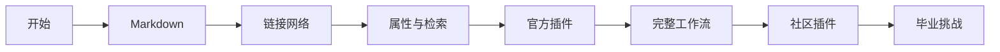

# Obsidian Playground

欢迎来到一个**可以阅读、点击、修改，也可以放心试错**的 Obsidian 练习场。这里不是一套只能从头读到尾的文档：每篇笔记、每条链接、每个属性和视图本身都是教材。

如果你是从应用初次打开时的 [[Obsidian知识/00-开始/Welcome|欢迎页]] 进入，这里就是它指向的完整课程地图；之后可以把本页作为日常入口。

> [!tip] 第一次来，从这里出发
> 1. 花 3 分钟读 [[Obsidian知识/00-开始/01-如何使用这个-Vault|01-如何使用这个-Vault]]。
> 2. 跟随 [[Obsidian知识/00-开始/02-30分钟快速上手|02-30分钟快速上手]] 做出第一条完整知识链。
> 3. 想稳步学习就收藏 [[Obsidian知识/00-开始/03-7天渐进学习路线|03-7天渐进学习路线]]。

## 选择你的入口

| 我现在想做什么 | 去这里 |
| --- | --- |
| 先体验最有代表性的功能 | [[Obsidian知识/00-开始/02-30分钟快速上手\|02-30分钟快速上手]] |
| 系统学习 Markdown | [[Obsidian知识/10-基础/01-Markdown基础/00-Markdown基础-MOC\|Markdown 基础 MOC]] |
| 理解双向链接、嵌入和图谱 | [[Obsidian知识/10-基础/02-链接与知识网络/00-链接与知识网络-MOC\|链接与知识网络 MOC]] |
| 学属性、标签、搜索和 Bases | [[Obsidian知识/10-基础/03-属性标签与检索/00-属性标签与检索-MOC\|属性、标签与检索 MOC]] |
| 逐一体验官方插件 | [[Obsidian知识/20-功能/01-官方插件实验室/00-官方插件实验室-MOC\|官方插件实验室 MOC]] |
| 判断哪些社区插件值得保留 | [[Obsidian知识/20-功能/02-社区插件实验室/00-社区插件实验室-MOC\|社区插件实验室 MOC]] |
| 找到沙盒与练习材料 | [[Obsidian知识/30-实践/01-实验区/README\|实验区入口与恢复说明]] |
| 把功能组合成真实工作流 | [[Obsidian知识/20-功能/03-完整工作流/00-完整工作流-MOC\|完整工作流 MOC]] |
| 复用模板或把工作交给 AI Agent | [[Obsidian知识/90-资源/04-AI协作工具箱/00-AI协作工具箱-MOC\|AI 协作工具箱]] |
| 查一个概念或语法 | [[Obsidian知识/90-资源/02-参考/07-Obsidian术语表\|Obsidian术语表]] · [[Obsidian知识/90-资源/02-参考/01-Markdown速查表\|Markdown速查表]] · [[Obsidian知识/90-资源/02-参考/02-搜索语法速查表\|搜索语法速查表]] |
| 进入独立的编程课程 | [[编程知识/00-开始/00-编程知识-首页\|编程知识首页]] · [[编程知识/10-基础/01-正则表达式/00-正则表达式-MOC\|正则表达式 MOC]] |

## 学习地图

也可以从视觉地图进入：[[Obsidian知识/40-视图/01-Canvas/Obsidian功能地图.canvas|打开 Obsidian 功能地图 Canvas]]。

## 今天就做三件事

- [ ] 用快速切换器打开 [[Obsidian知识/30-实践/01-实验区/Markdown/01-自由草稿纸|自由草稿纸]]。
- [ ] 在那篇笔记中输入一个 `[[`，链接到 [[Obsidian知识/30-实践/03-示例项目/周末读书会/00-周末读书会项目主页|00-周末读书会项目主页]]。
- [ ] 打开右侧的反向链接面板，观察链接如何让两篇笔记互相可达。

> [!example] 这是 Playground，不是考试
> 所有练习都可以从 [[Obsidian知识/30-实践/01-实验区/Markdown/00-Markdown实验室|Markdown 实验室]] 开始。做乱了先读 [[Obsidian知识/00-开始/04-安全实验与重置|04-安全实验与重置]]；不要为了恢复样例而覆盖自己的真实笔记。

## 两种学习方式

### 线性学习

按 [[Obsidian知识/00-开始/03-7天渐进学习路线|03-7天渐进学习路线]] 前进。课程页底部会给出“上一站 / 下一站”，适合第一次使用 Obsidian。

### 自由探索

打开 [[Obsidian知识/00-开始/05-Obsidian功能地图|05-Obsidian功能地图]]，根据“写作、连接、组织、检索、可视化、自动化、安全”选择想玩的功能。悬停任意内部链接可先预览，再决定是否打开。

## 你的进度

课程页的 `stage`、`difficulty` 和 `status` 描述教材；[[Obsidian知识/40-视图/02-Bases/课程进度.base|课程进度 Base]] 展示的是课程文件及作者标记的状态。个人进度请记在自己的学习笔记或日记中：链接所学课程，由自己写下实际做过的练习、遇到的问题和下一步。不要为登记个人完成情况修改共享课程页的 `status`。

> [!info] 知识域边界
> 本页负责 Obsidian 教学。编程课程保存在独立的 `编程知识/` 目录，并使用自己的属性、标签和实验区；上表只提供一条明确的跨域入口。

---

下一站：[[Obsidian知识/00-开始/01-如何使用这个-Vault|01-如何使用这个-Vault]]
