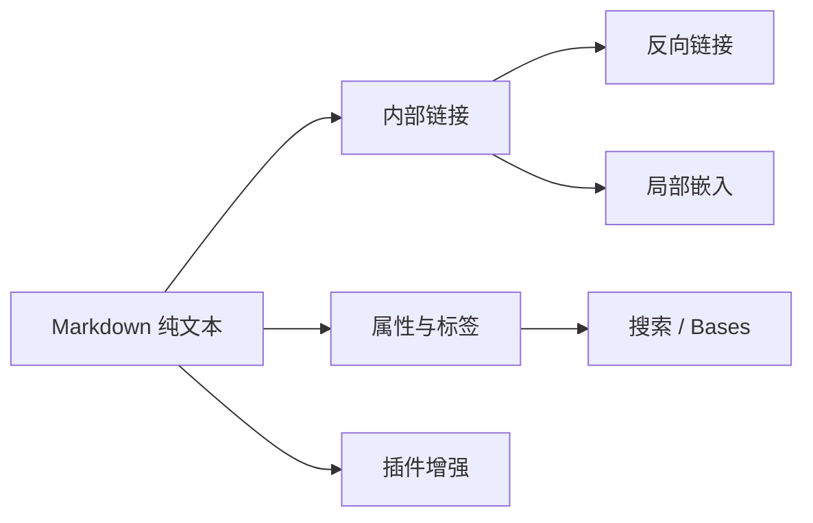

# Markdown 基础 · MOC

> [!abstract] 这一站学什么
> Markdown 是 Obsidian 的纸张，链接、属性、嵌入和插件是它的积木。本区不是只读说明书：每一页都安排了一个立即可做的小实验。MOC（Map of Content）则是把散落笔记组织成地图的常用做法。

## 先用 30 秒认识页面

- 顶部 `---` 之间是 **Properties / YAML frontmatter**，可用于筛选、排序和 [[Obsidian知识/10-基础/01-Markdown基础/05-脚注与进阶语法#属性与注释|添加结构化信息]]。
- `[[双中括号]]` 是 Obsidian 内部链接；链接目标不存在时会显示为未解析链接，点击即可创建。
- `#标签` 适合跨目录聚合；文件夹适合稳定分区；链接表达笔记之间的关系。
- 按 `Cmd/Ctrl + E` 在编辑视图和阅读视图之间切换，观察源码与渲染结果。

## 学习路线

| 顺序 | 课程 | 预计 | 完成后你能…… |
| --- | --- | ---: | --- |
| 1 | [[Obsidian知识/10-基础/01-Markdown基础/01-基础排版\|01-基础排版]] | 12 分钟 | 写标题、段落、强调与链接 |
| 2 | [[Obsidian知识/10-基础/01-Markdown基础/02-列表任务与表格\|02-列表任务与表格]] | 15 分钟 | 组织清单、任务和表格 |
| 3 | [[Obsidian知识/10-基础/01-Markdown基础/03-引用代码与Callout\|03-引用代码与Callout]] | 15 分钟 | 突出重点、记录代码和提示 |
| 4 | [[Obsidian知识/10-基础/01-Markdown基础/04-附件媒体与数学\|04-附件媒体与数学]] | 18 分钟 | 嵌入笔记、图片、音频与公式 |
| 5 | [[Obsidian知识/10-基础/01-Markdown基础/05-脚注与进阶语法\|05-脚注与进阶语法]] | 15 分钟 | 使用脚注、块链接、注释和属性 |
| 6 | [[Obsidian知识/10-基础/01-Markdown基础/06-综合练习\|06-综合练习]] | 15 分钟 | 独立完成一篇 Obsidian 风格笔记 |

## 实验区

不想改动课程示例？到 [[Obsidian知识/30-实践/01-实验区/Markdown/00-Markdown实验室|Markdown 实验室]]：

- [[Obsidian知识/30-实践/01-实验区/Markdown/01-自由草稿纸|自由草稿纸]]：尝试任意语法和双链。
- [[Obsidian知识/30-实践/01-实验区/Markdown/02-表格练习场|表格练习场]]：填写、增删和对齐表格。
- [[Obsidian知识/30-实践/01-实验区/Markdown/03-数学练习场|数学练习场]]：改写行内与块级公式。

## 本区会遇见的 Obsidian 特色

> [!tip] 边学边看反向链接
> 打开右侧边栏的“反向链接”，本页会看到所有链接回此 MOC 的课程。试着在草稿纸输入 `[[00-Markdown基础-MOC]]`，再回来观察数量变化。

## 插件接力

学完基础后，这些社区插件会把相同语法变得更顺手：

- [[Obsidian知识/20-功能/02-社区插件实验室/06-Advanced-Tables-Editing-Toolbar与Linter|Advanced Tables]]：用 Tab 导航、自动格式化与公式增强表格。
- [[Obsidian知识/20-功能/02-社区插件实验室/07-LaTeX-Suite|LaTeX Suite]]：用片段与快捷输入加速 LaTeX 数学公式。
- [[Obsidian知识/20-功能/02-社区插件实验室/06-Advanced-Tables-Editing-Toolbar与Linter|Linter]]：统一 frontmatter、空行、标题和列表格式。

> [!warning] 纯 Markdown 优先
> 插件能提高效率，但学习时先理解文件里真正保存的文本。这样即使换编辑器，你的笔记仍然可读、可迁移。

## 完成清单

- [ ] 我能区分外部链接 `[文字](URL)` 与内部链接 `[[笔记]]`
- [ ] 我修改过至少一份实验区笔记
- [ ] 我创建过一个内部链接并查看反向链接
- [ ] 我完成了 [[Obsidian知识/10-基础/01-Markdown基础/06-综合练习|06-综合练习]]

---

**上一站**：[[Obsidian知识/00-开始/00-Playground-首页|Playground 首页]] · **下一站**：[[Obsidian知识/10-基础/01-Markdown基础/01-基础排版|01-基础排版]] · **返回 MOC**：[[Obsidian知识/10-基础/01-Markdown基础/00-Markdown基础-MOC|00-Markdown基础-MOC]]
