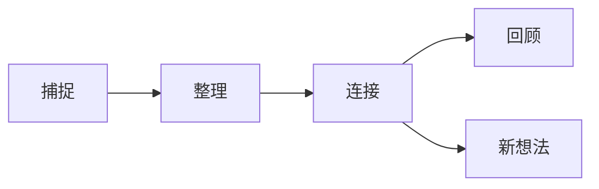

# 05 · 脚注与进阶语法

## 脚注

命名脚注适合来源和补充说明；行内脚注适合短内容。

**源码：**

```markdown
Obsidian 把笔记保存为本地 Markdown 文件。[^local]
也可以直接写行内脚注。^[这是一条行内脚注。]

[^local]: 本地优先意味着你可以直接查看、备份和迁移原始文件。
```

**渲染效果：**

Obsidian 把笔记保存为本地 Markdown 文件。[^local]
也可以直接写行内脚注。^[这是一条行内脚注。]

脚注定义可以放在文档任意位置。为了维护方便，长文通常把定义统一放在正文末尾、导航之前。

## 块 ID 与精确链接

在段落末尾添加 `^块标识`，可链接或嵌入这一小块，而不必引用整个标题。

这段话是一个可复用的知识块：链接表达关系，嵌入复用内容。 ^link-vs-embed

**源码：**

```markdown
[[05-脚注与进阶语法#^link-vs-embed|跳到知识块]]
![[05-脚注与进阶语法#^link-vs-embed]]
```

**渲染效果：**

- [[Obsidian知识/10-基础/01-Markdown基础/05-脚注与进阶语法#^link-vs-embed|跳到知识块]]
- ![[Obsidian知识/10-基础/01-Markdown基础/05-脚注与进阶语法#^link-vs-embed]]

> [!tip] 让 Obsidian 帮你找块
> 输入 `[[文件名#^` 后继续键入关键词，Obsidian 会建议可链接的块并自动生成标识，不必手工给每段命名。

## 属性与注释

本页顶部就是 YAML frontmatter。它必须从文件第一行开始：

```yaml
---
type: lesson
status: ready
topics:
  - 脚注
  - 属性
---
```

属性适合机器可筛选的信息；正文适合人阅读的内容。字段名稳定、值的类型一致，后续才能可靠使用搜索、Properties 视图或 Bases。

Markdown 注释在阅读视图中隐藏：

```markdown
这里会显示，%%这段只在编辑源码时可见%%。

%%
多行注释也不会在阅读视图显示。
可用于留草稿提示，但不要存密码。
%%
```

这里会显示，%%这段只在编辑源码时可见%%。

%%
多行注释也不会在阅读视图显示。
可用于留草稿提示，但不要存密码。
%%

## HTML 与键盘标记

Markdown 能嵌入少量 HTML；为了可迁移性，应只在标准语法不够用时使用。

**源码：**

```html
按 <kbd>Cmd</kbd> + <kbd>P</kbd> 打开命令面板。<br>
<mark>HTML 高亮</mark>
```

**渲染效果：**

按 <kbd>Cmd</kbd> + <kbd>P</kbd> 打开命令面板。<br>
<mark>HTML 高亮</mark>

## Mermaid 图

Mermaid 代码块会渲染为图形，适合流程、时序和关系说明。

````markdown

````


> [!example] 格式治理
> 当笔记越来越多，可用 [[Obsidian知识/20-功能/02-社区插件实验室/06-Advanced-Tables-Editing-Toolbar与Linter|Linter]] 统一属性顺序、标题和空行。自动格式化前先理解规则，并用 Git 或 File Recovery 保留可恢复版本。

## 轮到你

1. 给自由草稿纸的一段话添加块 ID，并从另一页链接它。
2. 添加一个脚注，脚注内容写明信息来源。
3. 切换编辑/阅读视图，确认注释只在源码中可见。
4. 修改 Mermaid 图，增加一个“归档”节点。

[^local]: 本地优先意味着你可以直接查看、备份和迁移原始文件。

---

**上一站**：[[Obsidian知识/10-基础/01-Markdown基础/04-附件媒体与数学|04-附件媒体与数学]] · **下一站**：[[Obsidian知识/10-基础/01-Markdown基础/06-综合练习|06-综合练习]] · **返回 MOC**：[[Obsidian知识/10-基础/01-Markdown基础/00-Markdown基础-MOC|00-Markdown基础-MOC]]
