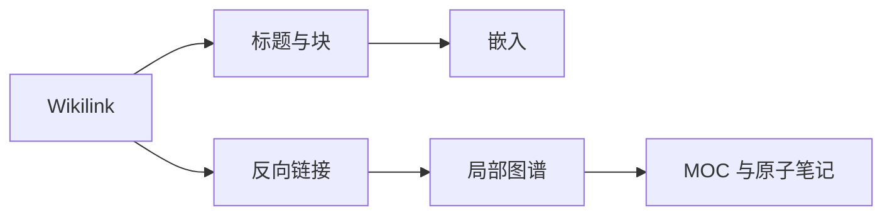

# 链接与知识网络

> [!abstract] 本章目标
> 把“许多 Markdown 文件”变成一个可以沿线索探索的知识网络。完成后，你会创建内部链接与别名，精确链接标题和块，嵌入内容，阅读反向链接与出链，并用局部图谱检查结构。

## 先观察：这不是目录树

文件夹回答“文件放在哪里”，链接回答“想法为什么有关”。这张 MOC（Map of Content，内容地图）是一条人工设计的阅读路线；同一篇笔记也可以同时出现在其他 MOC、项目和图谱里。

## 推荐路线

| 顺序 | 课程 | 你会看到什么 | 用时 |
| --- | --- | --- | ---: |
| 1 | [[Obsidian知识/10-基础/02-链接与知识网络/01-Wikilink、别名与未解析链接\|Wikilink、别名与未解析链接]] | 同一目标可以有不同显示文字；尚未创建的目标会成为未解析链接 | 8 分钟 |
| 2 | [[Obsidian知识/10-基础/02-链接与知识网络/02-标题链接、块链接与嵌入\|标题链接、块链接与嵌入]] | 精确跳到小节或段落，并把源内容显示在别处 | 10 分钟 |
| 3 | [[Obsidian知识/10-基础/02-链接与知识网络/03-反向链接、出链与未链接提及\|反向链接、出链与未链接提及]] | 链接的三个观察方向 | 8 分钟 |
| 4 | [[Obsidian知识/10-基础/02-链接与知识网络/04-全局图谱与局部图谱\|全局图谱与局部图谱]] | 同一网络的鸟瞰图与邻域图 | 8 分钟 |
| 5 | [[Obsidian知识/10-基础/02-链接与知识网络/05-MOC、原子笔记与渐进式总结\|MOC、原子笔记与渐进式总结]] | 从捕获到提炼、连接、导航的最小工作流 | 11 分钟 |

## 本章的真实样例网络

- [[Obsidian知识/10-基础/02-链接与知识网络/原子笔记/双向链接|原子笔记：双向链接]]
- [[Obsidian知识/10-基础/02-链接与知识网络/原子笔记/局部图谱|原子笔记：局部图谱]]
- [[Obsidian知识/10-基础/02-链接与知识网络/原子笔记/渐进式总结|原子笔记：渐进式总结]]
- [[Obsidian知识/30-实践/01-实验区/链接迷宫/00-链接迷宫-说明|链接迷宫：可以改坏、也可以复原的练习区]]

> [!tip] 一边学，一边看图
> 每完成一课，就打开当前笔记的局部图谱，把深度从 1 调到 2。你会看到“课程导航 → 概念 → 实验”的关系逐步展开。

## 完成检查

- [ ] 我能区分“文件别名”和“链接显示文字”。
- [ ] 我能创建标题链接、块链接和嵌入。
- [ ] 我知道 Backlinks 不是写进源文件的另一条 Markdown 链接。
- [ ] 我能解释 Outgoing links 和 Unlinked mentions。
- [ ] 我能用局部图谱发现重复、孤立或连接过密的笔记。
- [ ] 我能说出 MOC、原子笔记和文件夹各自解决的问题。

## 继续应用

完成课程后，打开 [[Obsidian知识/30-实践/03-示例项目/周末读书会/00-周末读书会项目主页|周末读书会项目主页]]，观察项目、人物、会议和概念如何交叉连接。项目中的 [[Obsidian知识/30-实践/03-示例项目/周末读书会/概念/双向链接|双向链接]] 是本章概念在真实项目中的一次复用。

---

导航：[[Obsidian知识/00-开始/00-Playground-首页|Playground 首页]] · [[Obsidian知识/10-基础/01-Markdown基础/00-Markdown基础-MOC|上一章：Markdown 基础]] · [[Obsidian知识/10-基础/03-属性标签与检索/00-属性标签与检索-MOC|下一章：属性、标签与检索]] · [[Obsidian知识/20-功能/01-官方插件实验室/00-官方插件实验室-MOC|相关课程：官方插件实验室]]
