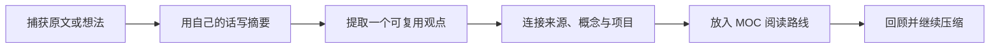

# MOC、原子笔记与渐进式总结

链接语法只是工具。真正的工作流是把临时材料逐步变成可复用观点，再用有意义的连接和阅读路线把它们组织起来。

## 三个构件的分工

| 构件 | 核心问题 | 本 Vault 的样例 |
| --- | --- | --- |
| 原子笔记 | 哪一个观点值得独立复用？ | [[Obsidian知识/10-基础/02-链接与知识网络/原子笔记/双向链接\|双向链接]] |
| 渐进式总结 | 如何在多次阅读中逐层提炼重点？ | [[Obsidian知识/10-基础/02-链接与知识网络/原子笔记/渐进式总结\|渐进式总结]] |
| MOC | 读者应按什么路径理解一组内容？ | [[Obsidian知识/10-基础/02-链接与知识网络/00-链接与知识网络-MOC\|本章 MOC]] |

“原子”不等于越短越好。一篇原子笔记应该围绕一个可命名、可链接、能独立理解的中心观点；如果拆开后必须来回跳转才能读懂，就拆得太细了。

## 一个笔记，一个主要问题

“原子”也不要求把每一句话拆成一张卡片。更实用的检查是：这篇笔记能否用一个主要问题、概念或结论命名？若能，它可以同时包含定义、机制、例子、证据、反例和局限；这些是在回答同一问题的不同层次。

反过来，课程安排、会议待办、晚餐清单和某个概念的论证即使恰好同时出现，也应分开记录，因为它们有不同的来源、使用场景和更新节奏。名称应让人多年后仍能大致判断内容；中英文名称或缩写优先放入 `aliases`，而不是为同一个概念维护两篇平行正文。

## 一个最小知识加工循环

### 1. 捕获

先保留来源、上下文和日期，不要求第一遍就整理完美。捕获笔记可以长、乱、暂时无链接。

### 2. 提炼

第二遍用自己的话写一到三句摘要。第三遍只突出最重要的关键词或句子。第四遍才考虑把稳定观点提取为独立概念。

### 3. 连接

每个新概念至少回答两个问题：

- 它从哪里来，证据或上下文是什么？
- 它对哪个项目、问题或其他概念有用？

例如，[[Obsidian知识/10-基础/02-链接与知识网络/原子笔记/渐进式总结|渐进式总结]] 连接到了 [[Obsidian知识/10-基础/02-链接与知识网络/原子笔记/双向链接|双向链接]]，因为提炼后的观点只有进入上下文网络才容易被再次使用。

链接最好写进句子，说明关系。例如“某项来源支持这个结论”“这个概念是另一概念的边界条件”或“这个方法用于当前项目”。单独列出“相关：A、B、C”通常无法说明方向、机制或证据强度。一个最小的证据路径可以是：原书或网页中的材料 → 阅读笔记中的页码与解释 → 概念笔记中的综合主张 → 项目中的使用；每一步都保留自己的职责，不把原文摘录伪装成已经验证的结论。

### 4. 导航

MOC 不是自动生成的文件列表。它可以解释顺序、层次、缺口和取舍。你正在阅读的课程，就是由 [[Obsidian知识/10-基础/02-链接与知识网络/00-链接与知识网络-MOC|链接与知识网络 MOC]] 手工策展的一条路径。

## 轮到你做：把项目观点提炼成原子笔记

1. 打开 [[Obsidian知识/30-实践/03-示例项目/周末读书会/00-周末读书会项目主页|周末读书会项目主页]]。
2. 找一个能脱离项目复用的观点，用一句话写出它的核心主张。
3. 在实验区建立一篇临时概念笔记，保留来源链接。
4. 链接一个相关概念，并写明“为什么相关”，不要只堆 `相关：A、B、C`。
5. 把临时概念加入你自己的小 MOC；用一行引导语说明阅读它的理由。
6. 查看局部图谱，确认它同时连接来源和使用场景。

## 检查结果

- 原子笔记能脱离来源独立读懂，但仍保留来源关系。
- 链接旁边有解释关系的语句，而不只是链接列表。
- MOC 给出阅读路线，而不是机械罗列文件。
- 多次提炼保留原文与自己的判断边界。

> [!warning] 不要过早系统化
> 刚开始时，一个清晰标题、两条有理由的链接和一张小 MOC 已经足够。复杂命名法、编号体系和插件自动化应该在真实摩擦出现后再引入。

## 挑战与复原

挑战：让你的临时概念成为两个主题之间的“桥”，然后用 Depth 2 的局部图谱解释这座桥为什么成立。

复原：临时概念和 MOC 都位于实验区，可在练习后删除；不要删除课程自带的三个原子笔记，它们支撑标题、块、嵌入和图谱示例。

---

导航：[[Obsidian知识/00-开始/00-Playground-首页|首页]] · [[Obsidian知识/10-基础/02-链接与知识网络/00-链接与知识网络-MOC|本章 MOC]] · [[Obsidian知识/10-基础/02-链接与知识网络/04-全局图谱与局部图谱|上一课]] · [[Obsidian知识/10-基础/03-属性标签与检索/00-属性标签与检索-MOC|下一章：属性、标签与检索]] · [[Obsidian知识/30-实践/03-示例项目/周末读书会/00-周末读书会项目主页|示例项目]]
