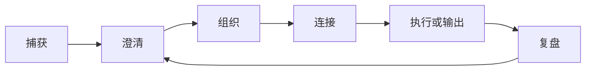
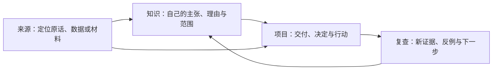

# 完整工作流

功能只有进入重复发生的流程，才会产生长期价值。本章把 Markdown、链接、属性、模板、任务、Base、Canvas 和社区插件组合成四条可以独立使用的工作流。

## 先选择结果，不要先选择插件

| 你想得到的结果 | 推荐工作流 | 最小工具 |
| --- | --- | --- |
| 把零散想法变成可复用知识 | [[Obsidian知识/20-功能/03-完整工作流/01-从收件箱到常青笔记\|01-从收件箱到常青笔记]] | Markdown、链接、属性 |
| 让每天的计划进入执行与复盘 | [[Obsidian知识/20-功能/03-完整工作流/02-每日计划任务与复盘\|02-每日计划任务与复盘]] | Daily Notes、checkbox、链接 |
| 让会议真正产生决定和行动 | [[Obsidian知识/20-功能/03-完整工作流/03-会议记录与项目管理\|03-会议记录与项目管理]] | Templates、项目主页、Backlinks |
| 把阅读材料转化为自己的概念 | [[Obsidian知识/20-功能/03-完整工作流/04-阅读批注到知识卡片\|04-阅读批注到知识卡片]] | 附件、块链接、概念笔记 |
| 验证能否独立搭建一个小系统 | [[Obsidian知识/20-功能/03-完整工作流/05-综合毕业挑战\|05-综合毕业挑战]] | 上述能力的最小组合 |

## 工作流的共同骨架

每条路线都要求你回答：

1. 输入从哪里来？
2. 什么时候判断它是否值得保留？
3. 哪些属性是真正稳定、可检索的？
4. 它和哪些既有笔记有明确关系？
5. 下一步行动或输出是什么？
6. 何时清理不再有用的内容？

## 不同角色怎样共同完成一项工作

文件的位置只说明它承担的角色，不能代替证据和推理。下面三类笔记保持各自职责，才不会把摘抄、结论和项目日志混成一页：

- 来源的链接回答“材料从哪里来、它说了什么”。
- 知识卡回答“我目前主张什么、证据和反例是什么、适用到哪里”。
- 项目页回答“为了一个交付，此刻采用什么判断、为什么、何时复查”。

每条连接都应留下可读的理由。一个 URL、一个标签或一张 Base 里的同一行都不能自行把来源升级为已证实的结论。

## 推荐顺序

第一次练习建议按下面的顺序：

1. [[Obsidian知识/20-功能/03-完整工作流/01-从收件箱到常青笔记|01-从收件箱到常青笔记]]：最小、最能体现 Obsidian 链接特色。
2. [[Obsidian知识/20-功能/03-完整工作流/02-每日计划任务与复盘|02-每日计划任务与复盘]]：把知识系统接到每日行动。
3. [[Obsidian知识/20-功能/03-完整工作流/03-会议记录与项目管理|03-会议记录与项目管理]]：体验人物、会议、决定和项目的关系网络。
4. [[Obsidian知识/20-功能/03-完整工作流/04-阅读批注到知识卡片|04-阅读批注到知识卡片]]：把外部信息转为自己的表达。
5. [[Obsidian知识/20-功能/03-完整工作流/05-综合毕业挑战|05-综合毕业挑战]]：不依赖逐步提示完成自己的主题库。

> [!tip] 社区插件是可选加速器
> 每个流程先给出原生最小版本，再链接社区插件增强版。先跑通最小版本，才能判断 [[Obsidian知识/20-功能/02-社区插件实验室/00-社区插件实验室-MOC|社区插件]] 是否真的减少了摩擦。

## 可观察的完成证据

完成工作流后，不只看“文件是否创建”，还要检查：

- 目标页的 Backlinks 中是否出现了合理来源。
- 属性是否能被 [[Obsidian知识/40-视图/02-Bases/示例笔记目录.base|示例笔记目录.base]] 或相关 Base 筛选。
- 任务是否有明确动词、上下文和时间边界。
- Canvas 是否指向真实笔记，而不是复制一份无法搜索的文本。
- 关闭社区插件后，核心内容是否仍然是可读 Markdown。

---

上一站：[[Obsidian知识/20-功能/01-官方插件实验室/00-官方插件实验室-MOC|官方插件实验室 MOC]] · 下一站：[[Obsidian知识/20-功能/03-完整工作流/01-从收件箱到常青笔记|01-从收件箱到常青笔记]] · 回到：[[Obsidian知识/00-开始/00-Playground-首页|00-Playground-首页]]
