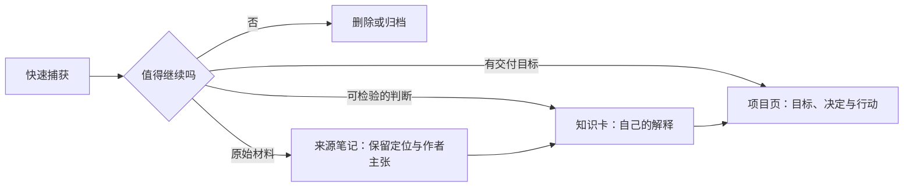

# 从收件箱到常青笔记

目标不是把所有灵感永久保存，而是用低摩擦方式捕获，再把少数值得保留的内容整理为**脱离原始上下文仍然可理解、能与其他笔记组合**的知识卡片。

## 最小流程



## 第一步：只捕获，不整理

在 `Obsidian知识/30-实践/01-实验区/收件箱` 创建一篇笔记，标题可以是“为什么链接比层级更适合未定型想法”。先写三行：

```markdown
来源：我在学习 [[Obsidian知识/10-基础/02-链接与知识网络/01-Wikilink、别名与未解析链接|Wikilink、别名与未解析链接]] 时想到。

直觉：想法刚出现时，我通常不知道它最终属于哪个文件夹。

待验证：链接是否能让我推迟分类，同时保留上下文？
```

捕获阶段只要求内容不丢失，不要求模板完美。若你已经完成 [[Obsidian知识/20-功能/02-社区插件实验室/02-Templater与QuickAdd|02-Templater与QuickAdd]]，可用 QuickAdd 加速；否则普通“新建笔记”已经足够。

## 第二步：澄清它是什么

第二天或练习时重新阅读，回答：

- 这是行动、资料、项目内容，还是自己的观点？
- 它在一周后是否仍有价值？
- 能否用一句完整的话表达核心判断？

再做一个容易漏掉的区分：**来源链接说明这条信息从哪里来，不等于它已经证明了你的结论。**

| 处理结果 | 最小保留物 | 暂时不要做的事 |
| --- | --- | --- |
| 来源笔记 | 作者或机构、链接/页码、它试图回答的问题 | 把作者的结论直接改成自己的知识卡 |
| 知识卡 | 自己的主张、理由、证据与反例/范围 | 只留下主题名或摘抄 |
| 项目页 | 交付物、下一步、采用或拒绝某个判断的理由 | 复制全部来源和知识页正文 |
| 临时记录 | 原始上下文和一个下次处理动作 | 为了清空收件箱强行升级 |

如果不能，删除或保留为临时记录都可以；不是每条捕获都需要“升级”。

## 第三步：重写为常青表达

把标题从主题名改成一个完整判断，例如：

> 在想法尚未定型时，链接比精确分类更能保留演化空间

正文使用下面的最小结构：

```markdown
---
type: concept
status: active
topics:
  - links
tags:
  - playground/exercise
---

# 在想法尚未定型时，链接比精确分类更能保留演化空间

## 一句话结论

用自己的话写结论。

## 为什么

写出推理，不只复制来源。

## 证据、反例与范围

- 支持这个判断的来源、观察或例子：
- 什么材料会构成反例或削弱它：
- 它适用于什么情境，不适用于什么情境：

## 相关

- [[Obsidian知识/10-基础/02-链接与知识网络/05-MOC、原子笔记与渐进式总结|MOC、原子笔记与渐进式总结]]
- [[Obsidian知识/10-基础/03-属性标签与检索/01-属性类型|属性类型]]
```

## 第四步：建立少量、明确的关系

给新笔记增加 2–4 条有理由的链接：

- 它解释或反驳什么？
- 它在哪个项目中有用？
- 哪篇笔记提供了例子？

不要为了让 Graph 好看而链接十几个泛泛相关的词。打开局部图谱，观察新笔记如何通过 [[Obsidian知识/10-基础/02-链接与知识网络/00-链接与知识网络-MOC|链接与知识网络 MOC]] 和 [[Obsidian知识/30-实践/03-示例项目/周末读书会/00-周末读书会项目主页|00-周末读书会项目主页]] 进入已有网络。

## 第五步：让它参与输出

在 [[Obsidian知识/30-实践/03-示例项目/周末读书会/00-周末读书会项目主页|00-周末读书会项目主页]] 或自己的项目主页中，写一句使用这条概念的判断，并链接回来。常青笔记的价值不在“被收藏”，而在未来写作、决策或讨论时可复用。

## 可选插件增强

| 摩擦 | 可尝试 | 原生替代 |
| --- | --- | --- |
| 捕获步骤太多 | [[Obsidian知识/20-功能/02-社区插件实验室/02-Templater与QuickAdd\|QuickAdd]] | 新建笔记 |
| 模板需要动态日期/提示 | [[Obsidian知识/20-功能/02-社区插件实验室/02-Templater与QuickAdd\|Templater]] | 核心 Templates |
| 想列出待处理 inbox | [[Obsidian知识/20-功能/02-社区插件实验室/03-Dataview与Bases对比\|Dataview]] | Search 或 Bases |
| 想统一格式 | [[Obsidian知识/20-功能/02-社区插件实验室/06-Advanced-Tables-Editing-Toolbar与Linter\|Linter]] | 手工整理单页 |

> [!success] 成功标准
> - 捕获内容已被删除、保留为临时记录，或升级为自己的观点；没有为了“全收集”而强行保留。
> - 常青笔记的标题是完整判断，正文能脱离来源独立理解。
> - 它能区分来源定位、支持理由、反例与适用范围；不把“有链接”当作“已经证实”。
> - 它有属性、2–4 条明确链接，并至少被一个项目或日记引用。
> - 关闭社区插件后，内容仍可阅读。

## 复盘

在今天的日记回答：哪个步骤最容易积压？如果只能保留一个自动化，你会自动捕获、自动整理，还是自动列出待处理内容？为什么？

---

上一站：[[Obsidian知识/20-功能/03-完整工作流/00-完整工作流-MOC|00-完整工作流-MOC]] · 下一站：[[Obsidian知识/20-功能/03-完整工作流/02-每日计划任务与复盘|02-每日计划任务与复盘]]
