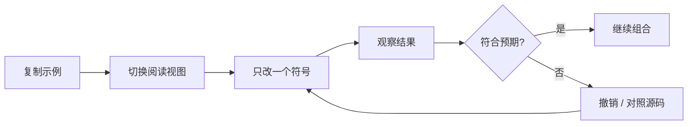

# Markdown 实验室

> [!success] 这里就是用来“改坏”的
> 所有练习都可直接删、写、重排。Markdown 是纯文本，只要还看得懂源码，就能修回来；需要时也可借助 File Recovery 或 Git 查看历史。

## 三张工作台

| 工作台 | 适合练什么 | 推荐先读 |
| --- | --- | --- |
| [[Obsidian知识/30-实践/01-实验区/Markdown/01-自由草稿纸\|01-自由草稿纸]] | 标题、链接、Callout、嵌入、脚注 | [[Obsidian知识/10-基础/01-Markdown基础/01-基础排版\|01-基础排版]]、[[Obsidian知识/10-基础/01-Markdown基础/03-引用代码与Callout\|03-引用代码与Callout]] |
| [[Obsidian知识/30-实践/01-实验区/Markdown/02-表格练习场\|02-表格练习场]] | 对齐、任务矩阵、单元格转义 | [[Obsidian知识/10-基础/01-Markdown基础/02-列表任务与表格\|02-列表任务与表格]] |
| [[Obsidian知识/30-实践/01-实验区/Markdown/03-数学练习场\|03-数学练习场]] | 行内、块级、对齐与矩阵公式 | [[Obsidian知识/10-基础/01-Markdown基础/04-附件媒体与数学\|04-附件媒体与数学]] |

## 推荐实验顺序



> [!tip] 最小改动法
> 学语法时一次只改一个字符，例如把 `**粗体**` 的星号删掉一个。观察结果比背规则更快。

## 双链实验

在任一工作台添加以下内容：

```markdown
我从 [[00-Markdown基础-MOC]] 来。
这个实验与 [[06-综合练习]] 有关。
```

然后打开目标页面的反向链接面板。你会看到“谁提到了我”；这正是 Obsidian 区别于普通文件夹式笔记的核心体验。

## 插件前后对照

- 表格：先在 [[Obsidian知识/30-实践/01-实验区/Markdown/02-表格练习场|02-表格练习场]] 手写，再到 [[Obsidian知识/20-功能/02-社区插件实验室/06-Advanced-Tables-Editing-Toolbar与Linter|Advanced Tables]] 体验编辑增强。
- 数学：先在 [[Obsidian知识/30-实践/01-实验区/Markdown/03-数学练习场|03-数学练习场]] 手写，再到 [[Obsidian知识/20-功能/02-社区插件实验室/07-LaTeX-Suite|LaTeX Suite]] 体验快捷片段。
- 格式：故意制造一个不一致的列表，再参考 [[Obsidian知识/20-功能/02-社区插件实验室/06-Advanced-Tables-Editing-Toolbar与Linter|Linter]] 课程理解自动治理。

---

**上一站**：[[Obsidian知识/10-基础/01-Markdown基础/06-综合练习|06-综合练习]] · **下一站**：[[Obsidian知识/30-实践/01-实验区/Markdown/01-自由草稿纸|01-自由草稿纸]] · **返回 MOC**：[[Obsidian知识/10-基础/01-Markdown基础/00-Markdown基础-MOC|00-Markdown基础-MOC]]
