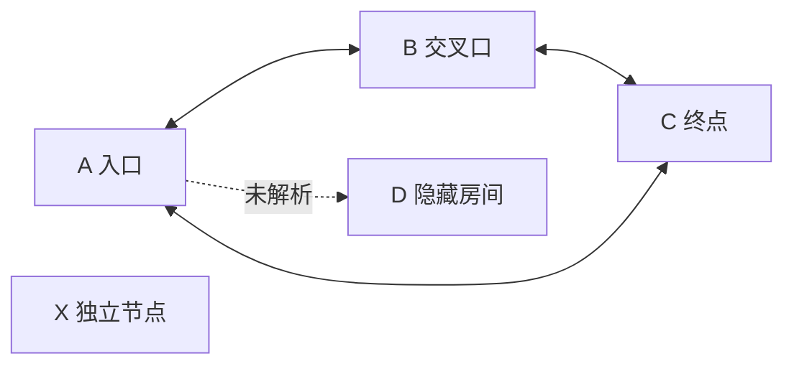

# 链接迷宫

> [!success] 这是可操作的实验，不是截图
> A、B、C 三篇笔记已经形成互相连接的三角形。迷宫里还放置了一个固定块、一次嵌入、一处普通文本提及、一条故意未解析的链接，以及一个真正没有连线的文件。

## 入口

从 [[Obsidian知识/30-实践/01-实验区/链接迷宫/迷宫-A-入口|迷宫 A]] 开始。不要先看文件树，尽量只沿链接移动。

## 五项任务

- [ ] 从 A 沿链接到 B，再到 C，最后回到 A。
- [ ] 在 B 找到固定块 ID，并在 C 查看它的嵌入结果。
- [ ] 在 A 的 Outgoing links 中找出未解析目标。
- [ ] 在 C 的 Backlinks 中区分 Linked mentions 和 Unlinked mentions。
- [ ] 在全局图谱中过滤 `path:"Obsidian知识/30-实践/01-实验区/链接迷宫"`，找出没有任何连线的真实文件。

## 一个刻意保留的普通文本提及

迷宫-C-终点 出现在这句话里，但这里没有使用双方括号。打开那篇笔记的 Backlinks 并展开 Unlinked mentions，应该能找到本段。

> [!warning] 不要“一键修复全部”
> 未链接提及需要语义判断；未解析链接可能是未来计划，也可能是拼写错误；孤立笔记可能是故意的。请先理解，再修改。

## 预期图形

Mermaid 只是答案示意，不会创建 Obsidian 内部链接。真正的连线来自 A、B、C 的 Wikilink 和 C 的嵌入。

## 复原方法

如果你把普通文本转换成了链接，请 Undo 或删去双方括号；如果你创建了隐藏房间，请删除那个新文件并恢复 A 中的未解析链接；如果你给独立节点增加了链接，请撤销。最终图形应回到“三角形 + 一个未解析占位 + 一个独立节点”。

---

导航：[[Obsidian知识/00-开始/00-Playground-首页|首页]] · [[Obsidian知识/10-基础/02-链接与知识网络/00-链接与知识网络-MOC|返回链接课程]] · [[Obsidian知识/30-实践/03-示例项目/周末读书会/00-周末读书会项目主页|示例项目]] · [[Obsidian知识/20-功能/01-官方插件实验室/00-官方插件实验室-MOC|相关课程：官方插件实验室]]
