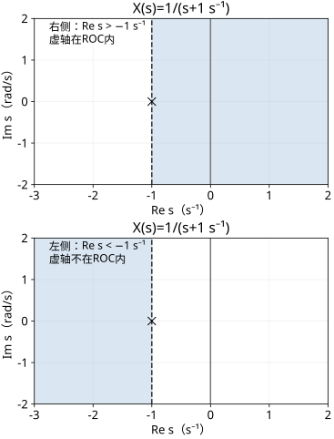

# Laplace与Z变换的收敛域

读者问题：同一个有理式，能不能确定系统过去和未来的响应？先预测：$1/(s+1\,\mathrm{s}^{-1})$ 一定代表衰减且因果吗？少写一项信息，答案就会改变。

**高中入口**：先算有限几何级数，再看无限和为什么只能在某个范围成立。**本科快进**：直接读双边定义、侧别、ROC与稳定判据，逐项保持输入输出对象。用积分和级数的同一推导汇合。

## CT：相同积分结果，不同积分方向

双边Laplace定义 $X(s)=\int_{-\infty}^\infty x(t)e^{-st}dt$，$s=\sigma+j\Omega$，单位s⁻¹。ROC指积分绝对收敛的s集合，排除边界的不收敛点。取a>0，a单位s⁻¹，以下x无量纲，X的单位为秒：

$$x_R(t)=e^{-at}u(t),\qquad
X_R(s)=\int_0^\infty e^{-(s+a)t}dt=\frac1{s+a},\quad\operatorname{Re}s>-a.$$

先用有限上限L积分得到 $(1-e^{-(s+a)L})/(s+a)$，再要求实部正，尾项才消失。取 $x_L(t)=-e^{-at}u(-t)$，点t=0的取值对普通积分无影响：

$$X_L(s)=-\int_{-\infty}^0e^{-(s+a)t}dt=\frac1{s+a},\quad\operatorname{Re}s<-a.$$

第二条在负时间指数增长，却给同一有理式。a=1 s⁻¹时，$x_R(1\,\mathrm s)=e^{-1}$、$x_L(-1\,\mathrm s)=-e$。式子与ROC合起来才确定此类双边变换。代数延拓可在域外写出数值，不代表原积分在那里存在。

## DT：收敛半径把侧别编码进去

双边Z变换 $X(z)=\sum_{n=-\infty}^\infty x[n]z^{-n}$，z无量纲。取a≠0，

$$a^n u[n]\ \longleftrightarrow\ \frac1{1-az^{-1}}=\frac z{z-a},\quad|z|>|a|.$$

因为有限和为 $[1-(a/z)^{N+1}]/(1-a/z)$，需 $|a/z|<1$。左侧序列为 $-a^n u[-n-1]$，令m=−n≥1，则

$$-\sum_{m=1}^\infty(z/a)^m=-\frac{z/a}{1-z/a}=\frac z{z-a},\quad|z|<|a|.$$

a=1/2时，右侧从n=0起为1,1/2,1/4；左侧n=−1,−2为−2,−4。不能凭极点1/2就把后者也认作稳定。特殊z=0、∞的端点取决于序列支撑与消去后的表达，不能只用“ROC不含极点”一句覆盖所有端点。

## 一般有理式的区域与稳定

对具有非空绝对收敛域的有理双边变换，CT通常是垂直条带/半平面，DT通常是同心环带/圆内外；极点不在ROC。右侧尾部向右的指数衰减要求ROC在对应极点右侧/圆外，左侧尾部则相反。有限时长/有限支撑是特殊情况。线性组合可能消去极点而扩大ROC，因此“取交集”只是保证域，消去后需重查。

对普通CT冲激核，BIBO稳定对应 $\int|h|dt<\infty$，即其绝对收敛域包含虚轴；DT对应绝对和有限，ROC包含整个单位圆。因果有理、无隐藏消去的零状态系统才可进一步用“全部有限极点在左半平面/单位圆内”判断。这是输入输出稳定，不能单凭消去后的传递函数认证内部状态稳定。

例如CT取α=1 s⁻¹，$H(s)=\alpha/(s-\alpha)$：右侧 $\alpha e^{\alpha t}u(t)$（ROC Re s>1 s⁻¹）因果但不稳定；左侧 $-\alpha e^{\alpha t}u(-t)$（ROC Re s<1 s⁻¹）不因果但绝对积分有限。DT $H=z/(z-2)$ 右侧 $2^n u[n]$ 不稳定，左侧 $-2^n u[-n-1]$ 绝对和1、稳定。稳定与因果须分别回答。

图的阴影是Re s>−1或Re s<−1（实部单位s⁻¹），虚轴是否在阴影内决定本例普通核的绝对可积性；虚线不是ROC的一部分。图只画数学区域，没有实际系统测量。

## 单边变换另有起始协议

[[数学/46-数理方程/14-Fourier-Laplace变换解数理方程#Laplace 变换适合初始时刻|数学46的单边Laplace]]明确积分0到∞并保留初值，负责初始值PDE/ODE。普通函数 $\int_0^\infty y'(t)e^{-st}dt=sY-y(0^+)$ 来自分部积分；若计入t=0冲激并采用0⁻约定，须明确左右初值和冲激贡献。双边变换在边界项消失时为 $\mathcal L_b(y')=sY$；全线响应中的状态信息进入全线函数及可能的冲激，不可凭空添加单边初值项。

因此“传递函数乘输入”等式默认匹配零状态与相容ROC，而初始值问题完整输出应为零输入加零状态。把数学46的单边公式原封迁入本页双边证明，会把时间协议改掉。

## 故意弄坏

把 $H(s)=s$ 当“所有s都能代入，所以稳定”会失败。它对应广义核δ′，是求导算子；对有界 $\sin(mt)$ 输出幅度m。ROC包含虚轴与普通L¹稳定判据的对应，只在该普通核及绝对收敛定义下使用；广义冲激直通 $D\delta$ 的稳定性则由有限测度界判断，见 [[信号与系统/10-连续与离散系统/02-冲激卷积与零状态响应#因果与稳定并不等价|冲激与稳定边界]]。

## 独立迁移：同时改变极点与时间侧别

给 $H(z)=z/[(z-1/2)(z-2)]$，分别指定三种ROC：|z|>2、1/2<|z|<2、|z|<1/2。求各h[n]，判断因果与BIBO稳定；再解释为何系统差分约束相同却不能确定实时计算方向。附加问题：若只给 $H(s)=(1\,\mathrm{s}^{-1})/(s+2\,\mathrm{s}^{-1})$ 与“稳定”，可选哪种上述指数型侧别？

> [!question]- 答案与接受标准
> 部分分式 $H=-(2/3)z/(z-1/2)+(2/3)z/(z-2)$。外侧h=−(2/3)(1/2)^n u[n]+(2/3)2^n u[n]，因果、不稳定。中间h=−(2/3)(1/2)^n u[n]−(2/3)2^n u[−n−1]，非因果、稳定。内侧h=(2/3)(1/2)^n u[−n−1]−(2/3)2^n u[−n−1]，非因果、不稳定。差分约束还需侧别/边界条件；中间和内侧使用未来输入。CT稳定筛出右侧 $(1\,\mathrm{s}^{-1})e^{-2t/\mathrm s}u(t)$，其ROC含虚轴。必须连同ROC和绝对和/积分依据交付；等价表达接受。

研究深化：选含极点消去的状态实现，分别检验内部模态与输入输出核。工程出口：把因果实现、初始状态和失效恢复写成协议。来源定位：[MIT 6.003 Lecture 5](https://ocw.mit.edu/courses/6-003-signals-and-systems-fall-2011/64490a008c1c5c25c86044351465abf7_MIT6_003F11_lec05.pdf)印刷页20–21、26–33、38、45核对双边Z、侧别与ROC；[Lecture 6](https://ocw.mit.edu/courses/6-003-signals-and-systems-fall-2011/84b35cc755ccd722ddbdbba00fd41e8f_MIT6_003F11_lec06.pdf)印刷页7–8、12–15、26核对双边定义、左右侧ROC、条带与导数边界。本页所有边界积分与新算例均展示推导，未认证内部实现或真实设备。
