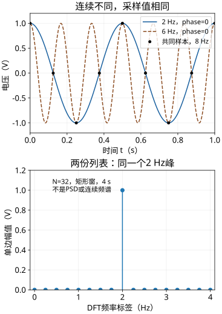
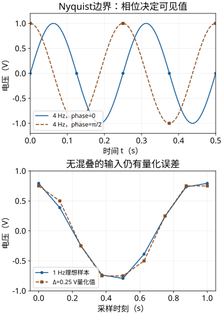
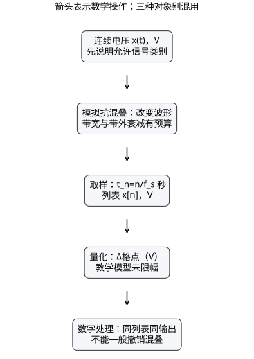

# 同一波形的采样误认

读者问题：一份数组为什么不能总告诉你它来自哪条波形？先预测：“采样点完全相同”能否证明连续波形相同；“量化误差很小”能否证明没有混叠？先写自己的判断，再看数据。

**高中入口**：代入下表四个时刻，先不用FFT。**本科快进**：从相位等价、边界零空间、量化规格与独立反例检查可辨识性。两入口一起交付预测修订与无提示迁移答案。先修按需回补 [[信号与系统/10-连续与离散系统/04-频率响应与采样重建|S04的单位与重建条件]]；电子器件知识不作为本实验前提。

## 固定对象与四点手算

输入为理想连续电压；采样率fₛ=8 Hz，时刻 $t_n=n/8\,\mathrm s$，不先量化。取

$$x_a(t)=\cos(2\pi\cdot2\,\mathrm{Hz}\cdot t)\,\mathrm V,
\quad x_b(t)=\cos(2\pi\cdot6\,\mathrm{Hz}\cdot t)\,\mathrm V.$$

两者相位均0，幅值均1 V。样本：

| n | t，s | 2 Hz值，V | 6 Hz值，V |
| --- | --- | --- | --- |
| 0 | 0 | 1 | 1 |
| 1 | 0.125 | 0 | 0 |
| 2 | 0.25 | −1 | −1 |
| 3 | 0.375 | 0 | 0 |

不是只前四点偶然相等：6n/8=n−2n/8，余弦周期与偶对称给所有整数n相等。可是在t=1/16 s，2 Hz为√2/2 V，6 Hz为−√2/2 V，连续值差√2 V。浮点计算只能显示小容差下相等；精确恒等式才证明所有n。

图上幅值均V，时间轴s，圆点为n/8；下图采用N=32、4 s矩形窗（无额外加窗）的单边DFT幅值，内部成对频率乘2、DC及Nyquist不乘2。这里2 Hz包含整数周期，峰值1 V；两者相同的离散谱不能反推出唯一连续谱。不是PSD，也不是所有现实记录都无泄漏。

## Nyquist的相位反例

$x(t)=\sin(2\pi4t+\phi)$ V时，$x[n]=(-1)^n\sin\phi$ V。φ=0是一条非零波形却给零列表；φ=π/2给交替±1。φ=π/6且幅值1 V，与φ=π/2且幅值1/2 V的列表相同。于是Nyquist边界丢失一维相位/幅值信息；“每周期两个点”不足以保证任意相位可辨识。

上图分别画phase=0与π/2的4 Hz信号，下图固定1 Hz、幅值0.83 V、phase=0.3 rad，避免混叠与边界失辨，把值轴量化单独拿出。

## 量化规格与有效反例

用未限幅的均匀量化器 $Q_\Delta(v)=\Delta\lfloor v/\Delta+1/2\rfloor$，Δ=0.25 V；恰在半格时取较大的格点（负值也向较大值），不是Python的ties-to-even规则。无限格点是教学模型，不是某个B位真实ADC。最近格点保证 $|Q(v)-v|\le\Delta/2=0.125$ V；无饱和、精确舍入且值有限是条件。

独立输入1 Hz波形严格低于4 Hz边界。第一点 $0.83\cos(0.3)=0.792929286$ V，量化为0.75 V，误差−0.042929286 V。改变Δ会改变幅值误差，却不改变前面2/6 Hz的采样等价；即使Δ→0也仍混叠。反过来没有混叠的1 Hz仍有量化误差。常值0.1 V用Δ=0.25 V得到全0，误差常数−0.1 V；它不是白噪声，不能对任意输入套用独立均匀噪声方差Δ²/12。真实有限量程ADC还有饱和，必须另定量程、码映射、建立与参考误差。

## 再撤去两个条件

非带限矩形脉冲在0.03≤t<0.08 s为1 V，其余0；8 Hz全部样本为0。增加低频基线仍无法从样本判断该脉冲存在否。把采样时刻改为 $n/8+0.01$ s时，6 Hz与2 Hz这组phase=0的等价可被破坏（不表示一般非均匀数据就足以唯一恢复任意输入）。1 V、2 Hz正弦/余弦的时刻误差满足均值定理界 $|\Delta x|\le2\pi2\cdot0.01=0.125663706$ V。实际脚本采用固定偏移，是确定性算例，未模拟随机时钟PSD、模拟前端或ADC。

箭头是数学操作：前置低通改变连续波形，取样改变时间域，量化改变值集合；数字滤波作用在已得到的列表上。不能把前置滤波和后置滤波交换来恢复混叠。

## 实际运行与可复算产物

[[信号与系统/80-实践/01-采样与系统辨别/README|实验操作与证据]]给命令、数据列和环境。规范源码 [signal_lab.py](../80-实践/01-采样与系统辨别/signal_lab.py) 与 [test_signal_lab.py](../80-实践/01-采样与系统辨别/test_signal_lab.py) 负责生成与独立期望测试；正式 [[信号与系统/80-实践/01-采样与系统辨别/code-sync/signal_lab|源码镜像]]供Obsidian阅读。测试包括手算四点、不同连续值、临界相位、半格负值、无效参数、BIBO相关解析算例与线性卷积，不能凭图上点重合当通过。

## 独立迁移：相位、采样率与位深同时改变

采样改为fₛ=10 Hz，输入候选A：$0.7\cos(2\pi3t+\pi/5)$ V，B：$0.7\cos(2\pi7t-\pi/5)$ V。另用Δ=0.1 V量化，允许一个0.02–0.07 s、幅值0.2 V的矩形瞬态。交付：两候选所有整数采样点是否可区分的理由；选择一个非采样时刻给不同连续值；量化误差界；瞬态是否可由列表识别；提出一项新的观测/类别限制并说明它能支持到哪一步。不给方法名称提示。

> [!question]- 答案与接受标准
> B的采样相位为2πn−(0.6πn+π/5)，余弦偶对称，所以与A同列表。在t=0.05 s，A=0（cosπ/2），B=0.7cos(π/2)=0，故此时刻不能作为区别证据；应另选如t=0.025 s：A=0.7cos(0.35π)，B=0.7cos(0.15π)，不相等。Δ/2=0.05 V，条件为未限幅最近格点。矩形在0与0.1之间被漏看，不能识别。提高到满足已知带限类别裕度的新采样率可区分3/7 Hz纯音，但有限率不能保证捕获任意未知窄脉冲；补一次落入脉冲的观测能验证本构造，却非全类别定理。可接受更一般观测设计，须明确假设与支持边界。选非采样时刻仍相同不是失败，主动重新选择正是检查的一部分。

## 回到最初预测与深化出口

修订预测时写清：“这份列表兼容哪些连续对象、排除了哪些对象”；图、位深、FFT峰值都不能单独补上类别承诺。去 [[数学/70-信号处理与多模态数学/02-采样定理波形STFT与Mel频谱#4. STFT：局部时间片上的 DFT|已有STFT页]]，携带本次fₛ、N、相位与幅值定义，观察窗对谱显示的影响，回来区分泄漏与混叠。该旧页路径和主解释保留。研究深化：把取样算子零空间写成严格问题；工程实践：明确抗混叠带外衰减、量程和时钟条件，之后才谈实测。

来源定位：[MIT 6.003 Lecture 21](https://ocw.mit.edu/courses/6-003-signals-and-systems-fall-2011/12e6e5d7567fca2e993ef8563fef5a60_MIT6_003F11_lec21.pdf)印刷页41、49、60核对采样谱与前置滤波；[Lecture 22](https://ocw.mit.edu/courses/6-003-signals-and-systems-fall-2011/95b4b245722073e5d0c4ea95b384446e_MIT6_003F11_lec22.pdf)页6–8区分时间离散与幅值离散。本页相位、量化规则、脉冲与迁移数据是独立教学构造。只交付解析/CPU复算；实际仪器、ADC、真人盲做、延迟回访及生产证据均未验。
