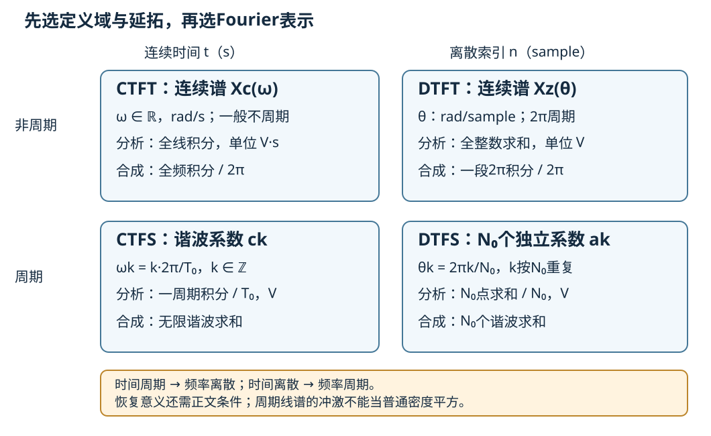
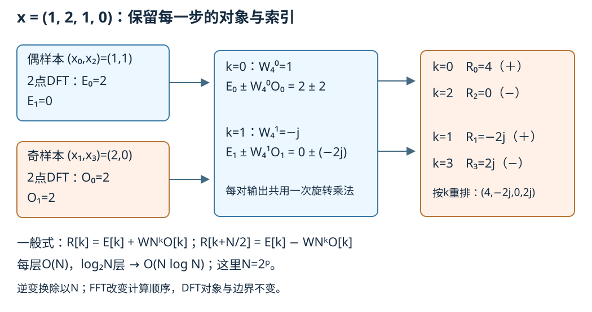
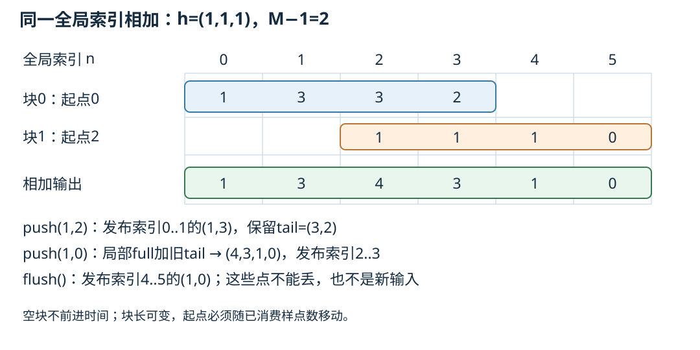

# Fourier四种表示与FFT卷积

录下四个电压值 (1,2,1,0) V，可以求四个复数 DFT 值。但这四个数究竟是某个周期信号的系数，还是一次非周期事件的频谱样点？两种解释都能用这些数，观察窗口外的对象却不同。先给信号的定义域和延拓，再选择表示；随后再问如何更快计算同一个算子。

第一次读先算“有限数组与周期延拓”的四点表，再按蝶形完成一次加减。数学入口从四种分析／合成和收敛条件进入，算法入口从偶奇拆分进入。最后双方都应能解释：输出差异来自边界、核方向、舍入，还是采样前已经失去的信息。

## 四种表示先分时间对象

连续时间 t 以 s 计，角频率 ω 以 rad/s 计；离散索引 n 是整数，离散角频率 θ 以 rad/sample 计。这里相位弧度在量纲运算中无量纲。设信号幅值单位为 V。CTFS 用周期 T₀、ω₀=2π/T₀；DTFS 用整数周期 N₀。分析取负指数，合成取正指数。

| 时间对象 | 分析／合成的范围与尺度 | 频域对象与单位 |
| --- | --- | --- |
| CT周期 x(t+T₀)=x(t) | 一周期积分除以T₀；全整数谐波求和 | k∈ℤ，频点 kω₀；cₖ为V，一般有无限个系数 |
| CT非周期 x(t)，t∈ℝ | 全线积分；全频逆积分除以2π | 连续ω∈ℝ；Xc为V·s，一般不周期 |
| DT周期 xp[n+N₀]=xp[n] | N₀点求和除以N₀；N₀个独立系数合成 | k模N₀，aₖ₊ᴺ₀=aₖ；aₖ为V |
| DT非周期 xz[n]，n∈ℤ | 全整数求和；任一长2π的频段逆积分除以2π | 连续θ，Xz(θ+2π)=Xz(θ)；Xz为V |

四种分析与合成按表中顺序写为；下文分别限定恢复等式的意义：

$$\begin{aligned}
c_k&=\frac1{T_0}\int_{t_0}^{t_0+T_0}x(t)e^{-jk\omega_0t}\,dt,&x(t)&=\sum_{k\in\mathbb Z}c_ke^{jk\omega_0t},\\
X_c(\omega)&=\int_{\mathbb R}x(t)e^{-j\omega t}\,dt,&x(t)&=\frac1{2\pi}\int_{\mathbb R}X_c(\omega)e^{j\omega t}\,d\omega,\\
a_k&=\frac1{N_0}\sum_{n=0}^{N_0-1}x_p[n]e^{-j2\pi kn/N_0},&x_p[n]&=\sum_{k=0}^{N_0-1}a_ke^{j2\pi kn/N_0},\\
X_z(\theta)&=\sum_{n\in\mathbb Z}x_z[n]e^{-j\theta n},&x_z[n]&=\frac1{2\pi}\int_{-\pi}^{\pi}X_z(\theta)e^{j\theta n}\,d\theta.
\end{aligned}$$

周期时间使谐波频率离散；离散时间使频率按2π重复。后一结论直接来自 e⁻ʲ²πⁿ=1，不需要先运行 FFT。DTFS 的有限 N₀ 个系数已包含全部独立自由度，CTFS 一周期上的连续函数却一般需要无限谐波。

### 公式存在与恢复成立各需什么

DTFS 的和式有限，任意 $x_p\in\mathbb C^{N_0}$ 都可精确恢复。证明是根单位正交：

$$\frac1{N_0}\sum_{k=0}^{N_0-1}e^{j2\pi k(n-m)/N_0}
=\begin{cases}1,&n-m\equiv0\pmod {N_0},\\0,&\text{其他。}\end{cases}$$

指数不为1时用有限几何和，其分子1−eʲ²π⁽ⁿ⁻ᵐ⁾=0；为1时每项都是1。把分析代入合成即可恢复每个样本，无限收敛不是这一步的障碍。

CTFS 的 cₖ 对一周期L¹信号可定义；平方可积时部分和是正交投影并在一周期L²意义收敛。逐点等式还需条件：周期延拓分段C¹且各段有有限单侧函数／导数迹时，普通对称部分和在跳点收敛到左右极限平均。L²恢复不指定单个点值，也不声称一致收敛。完整证明、Gibbs与Fejér条件复用 [[数学/16-数学分析/13-Fourier级数正交展开与收敛#三种收敛说的是三件事|数学中的三种收敛]]，携带T₀回本页核归一化。

CTFT 对 x∈L¹(ℝ)有普通绝对收敛分析积分；若同时 Xc∈L¹，逆积分给与x几乎处处相等的连续代表，在x的连续点恢复其值。对 Schwartz 函数两边直接成立；一般L²用稠密逼近的L²变换／Plancherel，不能假称原积分处处绝对收敛。去 [[数学/46-数理方程/14-Fourier-Laplace变换解数理方程#从光滑函数到有限能量：各层允许什么|Fourier的空间与条件]] 看准确对象后返回；本课不重复广义函数主课。

DTFT 对 xz∈ℓ¹绝对一致收敛，谱连续；交换积分／求和后以指数正交恢复每个整数样本。xz∈ℓ²则可在L²([−π,π])意义定义，逆式读作取Fourier系数；普通点值谱不自动存在。有限零延拓数组属于ℓ¹∩ℓ²。非零周期全线序列通常不属于ℓ¹或ℓ²，它的 DTFT 应作周期冲激线谱；不能把线谱画成普通连续密度后再做通常的谱平方。

## 采样与周期化改变了哪一个对象

从足够好的连续函数开始，例如 Schwartz 函数，作周期化 p(t)=Σᵣ x(t−rT₀)。绝对收敛允许把一周期积分移回全线，故 cₖ=Xc(kω₀)/T₀。时间周期化对应按间隔ω₀取频域样点并携带尺度；周期信号作为温和分布的CTFT为2πΣₖcₖδ(ω−kω₀)，不是一条普通密度曲线。

采样另是 x[n]=x(nTs)。同样在允许Poisson求和的条件下：

$$X_d(\theta)=\frac1{T_s}\sum_{m\in\mathbb Z}
X_c\!\left(\frac{\theta-2\pi m}{T_s}\right).$$

这里有V·s/Ts=V；连续谱复制后可能相加。严格带限与 fs>2B 才能在相应理想信号类中分离复制谱，详见 [[信号与系统/10-连续与离散系统/04-频率响应与采样重建#理想采样复制整个频谱|采样谱复制与类别承诺]]。改变样本率不是补救已经不可辨的信息。周期化、物理采样、记录截窗与算法补零各有不同操作，不因图都出现峰就混名。

另两条连接也要携带条件和尺度。若 $x\in\ell^1(\mathbb Z)$，作离散周期化 $p_N[n]=\sum_mx[n-mN]$，绝对收敛允许重排一周期求和，得到 $a_k=X_d(2\pi k/N)/N$。周期化仍是把不同整数时刻相加；仅有有限记录时，零延拓与这种周期化才退化成下一节的简单对照。

若连续周期 $p(t)=\sum_{\ell\in\mathbb Z}c_\ell e^{j\ell\omega_0t}$ 的系数绝对可和，并且取样间隔满足 $T_0=N T_s$，则 $p[n]=p(nT_s)$ 是N周期序列。把其分析式代入并使用有限根单位正交，得到

$$a_k=\sum_{m\in\mathbb Z}c_{k+mN},\qquad k=0,\ldots,N-1.$$

连续谐波索引相差N时，样点上指数完全相同，系数因而相加；不出现CTFT采样公式中的 $1/T_s$，因为这里比较的两套级数系数都以V计。绝对可和是此处交换级数与有限和的充分条件；仅有L²等价类不能随意指定取样点。若 $T_0/T_s$ 非整数，不能直接套这个N点式；当 $T_s/T_0$ 有理时可另找整数样本周期，无理时一般无整数周期。一个反例是 $p(t)=1+2\cos(\omega_0t)$，N=2时 $c_{\pm1}=1$ 合成 $a_1=2$，两点为(3,−1)，两套谐波已经不可分。这个合并与DFT归一化错误是不同问题。

## 有限数组与周期延拓

给 r=(1,2,1,0)，索引0..3，幅值V。它只是有限记录；定义域外至少有两种不同选择：xz[n]仅0..3取r，其余0；xp[n]=r[n mod4]。因此xz[4]=0、xp[4]=1，两个全线信号已不同。

零延拓的连续离散频谱为

$$X_z(\theta)=1+2e^{-j\theta}+e^{-j2\theta}=(1+e^{-j\theta})^2.$$

定义有限向量的 DFT 与逆：

$$R[k]=\sum_{n=0}^{N-1}r[n]e^{-j2\pi kn/N},\qquad
r[n]=\frac1N\sum_{k=0}^{N-1}R[k]e^{j2\pi kn/N}.$$

N=4、k=0..3，对同一记录有 R[k]=Xz(2πk/4)=4aₖ。得到

| k | θₖ，rad/sample | R[k]，V | xp的DTFS系数 aₖ，V |
| --- | --- | --- | --- |
| 0 | 0 | 4 | 1 |
| 1 | π/2 | −2j | −j/2 |
| 2 | π | 0 | 0 |
| 3 | 3π/2，等价−π/2 | 2j | j/2 |

DTFT Xz在两个bin之间仍有值，例如 θ=π/4 得 (1−j)(1+√2)。周期序列的DTFS只有4个独立系数；其分布DTFT为2πΣₖ∈ℤaₖδ(θ−2πk/4)，aₖ按4重复。这不是Xz的那条连续曲线。有限DFT是一种可逆坐标变换；把其基看成周期模式并不证明真实录音在窗口外重复。

本归一化的有限 Parseval 为 $\sum_n|r[n]|^2=(1/N)\sum_k|R[k]|^2$：本例6=(16+4+0+4)/4。xp的一周期平均功率为 $6/4=\sum_k|a_k|^2$，xz全线能量为 $6=(1/2\pi)\int_{-\pi}^{\pi}|X_z(\theta)|^2\,d\theta$。此处称能量是样本平方和V²；要近似连续能量须另乘Ts，不能自动把V²标成J。回 [[数学/70-信号处理与多模态数学/02-采样定理波形STFT与Mel频谱#3. 完整复数 DFT 与全局频谱显示|图像／音频DFT入口]] 时带N、延拓与1/N，不改原Mel特征数值。

### 周期核对不能代替无限网格的抽取证明

带本节的“N点向量、周期延拓、频率单位”去 [[AI/15-卷积神经网络/05-采样混叠感受野与平移鲁棒性#同一数组怎样把时间频率折到空间频率|共同抽取数组]]：$x_L[n]=\cos(\pi n/4)$、$x_H[n]=\cos(3\pi n/4)$，$D_2x[m]=x[2m]$，相位0。二者在原 $n=1$ 不同，抽取后都为 $\cos(\pi m/2)$；全部整数的结论来自余弦周期/偶性，不来自24点DFT通过测试。

24是8点原周期与6点平方例周期的公倍数，因此实验在这个周期对象中用DFT投影：保留 $|\omega|<\pi/2$ 的bin，原 $\pi/3$ 成分被保留，平方后 $2\pi/3$ 成分被去掉，DC保留。本节原有限记录零延拓的连续DTFT与该周期投影是不同对象；它也不等于任意有限记录上的因果砖墙滤波。时间解释带入8→4Hz采样率，空间解释带入输出像素间距加倍，不能把rad/input-sample和rad/output-sample标成同一坐标。

返回问题：改变DFT点数能否解除两个已相同的抽取数组？不能；应在抽取前处理所声明的新带外，而算法补零只改变显示/计算网格。两点均值的残留与非线性顺序继续由 [[AI/15-卷积神经网络/05-采样混叠感受野与平移鲁棒性#非线性之后为什么要重新检查带宽|CNN带宽反例]] 承担，实际有限结果在 [[AI/80-实践/抽取单位与正则尺度/results/2026-10-10/r1/README|本共同数组的独立执行]]；本Fourier课程的原实验与证据保持各自身份。

## 偶奇拆分如何省掉重复计算

直接算N个输出，每个都求N项，需O(N²)复运算。FFT改变计算顺序，输入、归一化和DFT对象都不变。这里只推 N=2ᵖ 的 radix-2 时间抽取；N=1停止。

设 WN=e⁻ʲ²π/ᴺ。把 n=2m 与 n=2m+1 分开：

$$R[k]=\underbrace{\sum_{m=0}^{N/2-1}r[2m]W_{N/2}^{km}}_{E[k]}
+W_N^k\underbrace{\sum_{m=0}^{N/2-1}r[2m+1]W_{N/2}^{km}}_{O[k]}.$$

E、O按N/2周期；WNᵏ⁺ᴺ/²=−WNᵏ，故0≤k<N/2：

$$R[k]=E[k]+W_N^kO[k],\qquad R[k+N/2]=E[k]-W_N^kO[k].$$

一对输出共用旋转后的 O[k]，这就是蝶形。四点原例：偶支 (1,1) 给 E=(2,0)，奇支 (2,0) 给 O=(2,2)。k=0的旋转为1，得R0=2+2=4、R2=2−2=0；k=1的旋转为−j，得R1=0−2j、R3=0+2j。

每层有N/2个蝶形、每个常数工作量。T(N)=2T(N/2)+cN，每层总工作cN、层数log₂N，故T(N)=O(NlogN)。本递归教学实现的临时分配并非最优原位FFT；实际小核性能还涉及缓存／调度，运算数不能当墙钟测速。N=3的DFT完全合法，只不在此radix-2 API域；实验用显式DFT核N=3，线性FFT滤波选择足够大的2幂N。

逆FFT可用 conj(FFT(conj(R)))/N。精确复代数下与直接DFT同值，浮点旋转／加减会产生残差，近抵消时相对误差可大。实验保留复数结果，核绝对容差及缩放，不悄悄丢虚部；整数参照可精确求和。算法吻合一组输入不是全部对象的证明，上面的拆分才给一般有限向量恒等式。

## 补零 折回与裁剪

取有限零延拓 x长度L、h长度M，y[n]=Σₖx[k]h[n−k]。非零支撑包含于0..L+M−2。长度N的周期卷积为

$$c_N[n]=\sum_{k=0}^{N-1}x_N[k]h_N[(n-k)\bmod N]
=\sum_{r\in\mathbb Z}y[n+rN],\quad0\le n<N,$$

其中N≥max(L,M)，xN、hN仅补零而不截短；第二式由把n−k的所有同余索引收在一起得到。有限DFT正交消元又给 cN=IDFT(DFT(xN)DFT(hN))。若 N≥L+M−1，y的支撑在一周期内，折回项消失，取前L+M−1点便是线性full输出。N不足时首尾已经相加，删掉输出的几个点不能分离它们。

原蝶形输入 x=(1,2,1,0)、h=(1,1,1) 得线性 (1,3,4,3,1,0)，N=4循环为 (2,3,4,3)。末尾1加到首项，末尾0加到第二项。radix-2取N=8，逆后保留前6点。

再用非对称例 x=(1,2,4)、h=(1,2)，均从索引0起，无偏置、步幅1：

| 操作 | 对象与索引 | 数值 |
| --- | --- | --- |
| 线性full卷积 | 全部L+M−1=4点 | (1,4,8,8) |
| N=3循环卷积 | 最后一项y3折至c0 | (9,4,8) |
| valid互相关 | x[n]+2x[n+1]，n=0,1 | (5,10) |
| 翻核后full卷积 | hrev=(2,1)，随后取索引1、2 | 完整(2,5,10,4)，裁剪(5,10) |

N=3与N=4的显式DFT乘法分别核循环与线性结果；N=4也可以用蝶形。一般 real valid 互相关 q[n]=Σᵣ₌₀ᴹ⁻¹ h[r]x[n+r]，与 hrev卷积的关系是 q[n]=(x*hrev)[n+M−1]，n=0..L−M。复数统计互相关通常另有共轭，本页CNN算例为实数，不混用两种约定。沿 [[数学/70-信号处理与多模态数学/01-空间几何Patch卷积与频域#4. 卷积定理为何重要|数学频域实现]] 带这组核返回，核“FFT只是换算法”；沿 [[AI/15-卷积神经网络/01-卷积互相关形状与参数共享#深度学习中的卷积通常是互相关|CNN API约定]] 带核方向／裁剪返回，核实现的具体算子。

上述频域乘法可逐项证明，避免把“卷积定理”当作API名字。将两次分析代入逆式，内层

$$\frac1N\sum_{k=0}^{N-1}e^{j2\pi k(n-u-v)/N}$$

只在 $u+v\equiv n\pmod N$ 时为1，其余为0，于是恰留下循环卷积的求和。只有限次和，不需无限域Fubini条件；够长补零将同余条件收紧为支撑内的普通索引相等。若讨论全线无限序列，$x,h\in\ell^1$ 是卷积和与DTFT乘法交换的充分条件，不能把任意两个ℓ²序列直接塞进同一证明。

## 互相关 核翻转与有限平移

输出长度相同不表示算子相同，算子相同也不自动给任意有限移位的等变。对上面的三点x定义：

$$C_0=\begin{pmatrix}1&2&0\\0&1&2\\0&0&1\end{pmatrix},\quad
C_p=\begin{pmatrix}1&2&0\\0&1&2\\2&0&1\end{pmatrix},\quad
S_0=\begin{pmatrix}0&0&0\\1&0&0\\0&1&0\end{pmatrix},\quad
S_p=\begin{pmatrix}0&0&1\\1&0&0\\0&1&0\end{pmatrix}.$$

C0右侧补零后保留三输出，Cp周期回绕；S0是有限画布右移丢末点，Sp是周期右移。先算C0x=(5,10,4)、S0x=(0,1,2)，得

$$C_0S_0x=(2,5,2),\qquad S_0C_0x=(0,5,10).$$

周期域 Cp=I+2Sp⁻¹，与Sp交换，故对任意三点向量恒有CpSp=SpCp；本例两边为(6,5,10)。S0奇异且不可逆，不组成平移群，不能拿它替无限域平移。无限零延拓全线卷积在收敛条件下仍可通过求和换元与整数平移交换；有限“延拓—运算—裁剪”的反例不否定该定理，也不证明所有零填充算子对所有有限移位都不交换。回CNN页 [[AI/15-卷积神经网络/01-卷积互相关形状与参数共享#不变与等变不要混用|等变的边界]]，先问比较的是S0还是Sp。

## 重叠相加如何保持同一时间线

一次长录音全做FFT需要等待全记录。因卷积线性，可以把输入分成从全局偏移oj开始、长度Pj的连续块 bj，再将每块零延拓卷积：

$$x[n]=\sum_j b_j[n-o_j],\qquad
y[n]=\sum_j(b_j*h)[n-o_j],\qquad o_j=\sum_{i<j}P_i.$$

每块选2幂Nj≥Pj+M−1，FFT所得局部full长Pj+M−1。相邻块输出的M−1点尾部在同一全局坐标相加；对已消费Pj点，未来块从oj+Pj才开始，在因果h下不影响更早输出。因此可立即发布Pj点，保留其后的M−1点作为待加状态。块长不是DSP物理采样间隔，改变块划分不改变样本时刻。

手算 x=(1,2,1,0)、h=(1,1,1)，切成 (1,2) 与 (1,0)：第一块full=(1,3,3,2)，第二块full=(1,1,1,0)放到全局索引2。发布第一块的(1,3)、保存(3,2)；第二块先加旧尾得(4,3,1,0)，发布(4,3)、EOF再发布(1,0)，恢复(1,3,4,3,1,0)。若每块各丢尾、各自重置或把EOF尾部当新输入都会改变算子。

### 本实验的push与flush合同

`OverlapAdd(h).push(block)`在每个非空块发布等长输出，保留M−1点tail和已消费计数；空块返回空且不移动时间。`flush()`只第一次返回尾部并关闭；未消费输入时返回空，重复flush返回空；关闭后push拒绝。非法输入先整块校验，失败不改变状态。不支持丢块推断、任意乱序、隐式裁剪或重采样。输入外的两侧零延拓已声明，EOF尾样点有真实全局索引，不压缩时间轴。每次记录输出起点即可将拼接恢复为原全卷积；设备缓冲延迟／deadline另验。

重叠保留采用另一合同：固定N与P=N−M+1，每帧带M−1个历史点和P个新点，做N点循环卷积，丢前M−1个被折回污染的输出，保留P点。历史属于输入，OLA的tail属于输出；两者不能混存。有限EOF补M−1个零并按声明长度裁剪才保留full尾。改变FFT块长可以，不能不更新历史／有效区／全局起点。本实验实现OLA，OLS通过上述索引作比较，不宣称有未提供的OLS API。

## 五种看起来相似的失败

把同一个有限记录的采集、截窗、补零、卷积和计算路径标出，才能知道改哪一步：

| 现象 | 产生位置与可检查例 | 哪一种修改有用 |
| --- | --- | --- |
| 物理采样混叠 | 例如8Hz采样，连续6Hz与−2Hz给同样样点 | 采样前类别／带宽与抗混叠；后补零不补信息 |
| 窗泄漏 | r[n]=cos(2π·1.25n/4)，0..3，矩形截窗；DFT能量不只一个bin | 声明窗／实际观察时长、相干条件；换窗有主瓣代价 |
| 循环折回 | 本页非对称核末项8加到首项1，变9 | 卷积嵌入N≥L+M−1或正确分块 |
| 补零网格变化 | 同r补到16点，间隔从fs/4变fs/16 | 只加密同一DTFT采样，没有新增观测／缩窄该窗主瓣 |
| 算法舍入 | 同N同边界直接DFT与FFT的小复残差 | 浮点容差／尺度／独立参照；不能拿容差修正整数折回8 |

同一矩形窗长L的频响为 e⁻ʲθ⁽ᴸ⁻¹⁾/² sin(Lθ/2)/sin(θ/2)，在θ=0按极限L取值；其第一零点在±2π/L。L=4、fs=8Hz时窗零点半宽2Hz；补至16点把频格由2Hz改.5Hz，窗仍L=4。只改变FFT点数不能把这个第一零点变近。完整STFT窗口／帧覆盖继续由 [[数学/70-信号处理与多模态数学/02-采样定理波形STFT与Mel频谱#时间—频率分辨率权衡|观察时长与显示网格]] 主讲。

## 撤去提示的迁移任务

给记录 z=(2,−1,3)，采样率8Hz，实核g=(2,−1)，初态为零，要求发布线性full输出。可用直接求和或任何确实现同对象的方法，不预设某框架：

1. 选择时间／频率表示，并给DFT的频率单位。N=3和N=4分别输出什么？
2. 一个接口只要valid互相关，怎样翻核和裁剪？它是否与前一要求同算子？
3. 把记录切成(2)、空块、(−1,3)，写发布与EOF结果；一次非法块和重复EOF怎样处理？
4. 如果真实6Hz成分已经在8Hz采样下混叠，补到32点或换FFT能否恢复它？若仅希望画更密的谱，又可以改变什么？
5. 三点周期Cp=I−Sp⁻¹是否与Sp交换？改成有限右补零C0时须检查哪个边界？

> [!question]- 参考答案与接受范围
> 1. 有限记录本身用DFT，零延拓全线用DTFT；周期模型另用DTFS并记a=DFT/N。线性full为(4,−4,7,−3)，N=3循环为(1,−4,7)，N=4恢复full。θ=2πk/N rad/sample，Hz按f=kfs/N并对高半区改负频标记。
> 2. valid互相关为(5,−5)；翻核(−1,2)的full为(−2,5,−5,6)，取索引1、2。长度及核方向不同，不能当同一full卷积。
> 3. 第一块发布(4)，tail=(−2)；空块不改状态；后块发布(−4,7)，tail=(−3)；EOF发布(−3)。非法块原子拒绝，重复EOF空，EOF后push拒绝。接受不同合法流式算法，但全局序号／full尾／初态相同。
> 4. 不能。可加密该记录DTFT采样网格，不能增加观察时长或恢复采样前丢失的信息；需要原信号类及采样前条件。
> 5. 周期Cp由Sp的逆与I构成，因此交换。有限移位会丢末样点，需逐项查延拓—运算—裁剪；可用矩阵或具体反例，不能由此否定全线卷积定理。

## 实验、来源与证据边界

[[信号与系统/80-实践/05-Fourier表示与FFT卷积/README|小数组与块状态实验]] 的真源固定DFT／FFT归一化、有限实核、complex残差、全局位置与EOF。测试含手算固定结果、显式频域求和、直接卷积／矩阵乘法以及多种块划分。2026-10-10同字节源码的8项测试、规范CLI和独立oracle已实际完成：162项独立比较的最大缩放误差6.365e−15，128种布局核full输出与EOF；[原始输入、日志与结果](../80-实践/05-Fourier表示与FFT卷积/results/2026-10-10/README.md)可复核。五图已用系统WebKit完整画布实际渲染并查看，Obsidian与真人迁移仍未验；有限运行不替代一般Fourier定理的证明。

本页四表示约定对照 [MIT6.003 Lecture19，PDF第4–8页](https://ocw.mit.edu/courses/6-003-signals-and-systems-fall-2011/57963f2e8c8bcb3050d7cb87e9201fd2_MIT6_003F11_lec19.pdf)，PDF第26–38页另外对照CT取样与DT周期化关系；本页级数取样的系数折合式由根单位正交另行推导。收敛范围复用前述数学主课。[MIT6.341 Lecture19，PDF第1–4页](https://ocw.mit.edu/courses/6-341-discrete-time-signal-processing-fall-2005/4ee39a5e74c9f5099ac516ce57215c96_lec19.pdf) 对照DFT、逆归一化与分治，本文独立展开时间偶奇及四点中间量；[Lecture16，PDF第1–5页](https://ocw.mit.edu/courses/6-341-discrete-time-signal-processing-fall-2005/6e5190ef6e0d66c78bfdce2be6ce7125_lec16.pdf) 对照循环折回与分块滤波，本文给变长OLA的状态证明。两组指定数组及跨页连接保留 [#177正文与评论](https://github.com/EunsonZ/WWL/issues/177#issuecomment-6080571211) 来源。

推导／来源、数值执行、静态路径／镜像、图显示、Obsidian客户端与真人迁移分别验收。实验执行结果以实际执行者记录为准；本页不虚填现实录音／GPU／CNN框架全部padding／生产实时性／真人掌握证据。返回 [[信号与系统/10-连续与离散系统/00-连续与离散系统-MOC#从对象到采样|课程入口]] 时带回对象、延拓与索引。一般循环移位的表示论入口见 [[数学/25-高等代数/50-模与有限群表示/05-循环移位Fourier基与对称性合同#循环移位为何被 Fourier 基对角化|循环群的公共 Fourier 基]]，再到 [[数学/25-高等代数/50-模与有限群表示/05-循环移位Fourier基与对称性合同#周期卷积为什么与移位共享基|p(S) 与移位等变]] 核对象。数学页取正指数分析、归一化基 qₖ=vₖ/√N，其系数 cₖ=N⁻¹ᐟ²Σⱼωᵏʲxⱼ；本页DFT R[k]取负指数分析、未归一化，所以准确坐标关系是 cₖ=R[(−k) mod N]/√N。对卷积核的特征值则是未归一化的 p(ωᵏ)=DFT(h)[(−k) mod N]，不再除以√N。频率索引与尺度须一起转译，不能只改一处符号或把坐标系数当算子特征值。回到本页时仍携带同一 N、移位方向与核：补零使用扩大后的周期，反射需另证算子，本页的边界例不被抽象语言省略；单路抽取的采样等价与多路完美重建也各有自己的前提。
