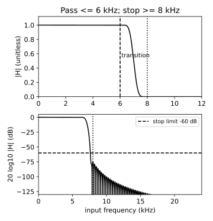

# FIR滤波设计与频率规格

读者问题：48 kHz 音频准备交给 16 kHz 算法时，怎样阻止原有 10 kHz 成分伪装成 6 kHz？先写预测：保留每三个样本中的第一个，会保留多少低频、产生什么新频率？本课限定为已获得的数字列表；模拟前端已发生的混叠仍由 [[信号与系统/10-连续与离散系统/05-同一波形的采样误认#固定对象与四点手算|U2 的同列表反例]]说明，回来先确认自己究竟在哪次采样前放滤波器。

**基础入口**：从四抽头核 $h=[1,2,3,4]$ 与输入 $x=[1,2,3,4]$ 手算 $v[0],v[3],v[6]$；先不讨论它是否能作低通。**快进入口**：以有限实向量 $h\in\mathbb R^{193}$、零延拓输入、频率规格和线性相位读起。两入口在下面的卷积对象汇合。停点：能说明“有限核”不自动意味着“满足抗混叠规格”后，再运行实验。

## 先把输入、单位与合同固定

$$x[n]=0.6\cos(2\pi1000n/48000)+0.3\cos(2\pi10000n/48000)\quad\mathrm V,
\quad n=0,\ldots,11999.$$

无噪声、无量化的教学输入峰值不超过 0.9 V，采样间隔 $1/48000$ s。它含 1 kHz 目标音和 10 kHz 带外音；本实验只承诺保留 0–6 kHz，允许 6–8 kHz 过渡，对输入 8–24 kHz 要求抑制。有限数据计算采用前后零延拓，不能把全线稳态频响当作边缘样本的精确幅度。

| 对象 | 规格与单位 | 本课选择 |
| --- | --- | --- |
| 核 $h[k]$ | 无量纲；$k=0,\ldots,L-1$ | $L=193$，实、对称、因果 |
| $v[n]=\sum_kh[k]x[n-k]$ | V；原 48 kHz 栅格 | 全卷积，非循环卷积 |
| 频率 $f$ / $\omega$ | Hz / rad/input-sample | $\omega=2\pi f/48000$ |
| 通带误差 | $\sup_{0\le f\le6000}\left\lvert \lvert H\rvert-1\right\rvert$ | ≤0.01，线性幅度误差 |
| 阻带上界 | $\sup_{8000\le f\le24000}\lvert H\rvert$ | ≤0.001，即至少 60 dB 幅度衰减 |
| 过渡带 | 6–8 kHz | 不给幅度平坦承诺 |

通带 1% 不是“1 dB”；幅度衰减用 $20\log_{10}|H|$。输入带外音幅度 0.3 V，若规格成立，单音稳态残留至多 $0.3\times0.001=0.0003$ V；这一预算尚未包含宽带噪声积分、系数量化、饱和或边缘暂态。

## 从理想频响到有限核

采用 [[信号与系统/10-连续与离散系统/04-频率响应与采样重建#从卷积推出频率响应|S04 的 DT 频响定义]] $H(e^{j\omega})=\sum_kh[k]e^{-j\omega k}$。理想矩形低通以 $f_c=7000$ Hz 为中点，$\omega_c=2\pi f_c/f_s$，逆 DTFT 得

$$h_\infty[r]=\frac1{2\pi}\int_{-\omega_c}^{\omega_c}e^{j\omega r}d\omega
=\begin{cases}\sin(\omega_cr)/(\pi r),&r\ne0,\\ \omega_c/\pi,&r=0.\end{cases}$$

它双向无限长；截取 $r=k-d$、$d=(L-1)/2=96$，乘对称 Blackman 窗并归一化：

$$w[k]=0.42-0.5\cos\frac{2\pi k}{L-1}+0.08\cos\frac{4\pi k}{L-1},$$
$$g[k]=\frac{2f_c}{f_s}\operatorname{sinc}\!\left(\frac{2f_c}{f_s}(k-d)\right)w[k],
\qquad h[k]=g[k]/\sum_{i=0}^{L-1}g[i].$$

这里 sinc$(u)=\sin(\pi u)/(\pi u)$，sinc(0)=1。时间乘窗在频域形成周期卷积，窗主瓣把跳变摊开，旁瓣带来通阻带误差；增加长度通常缩窄过渡，选择更小旁瓣的窗通常需要更宽过渡。把“截止7 kHz”误读成“7 kHz以内全平、7 kHz以外全零”会把过渡带藏掉。窗的经验衰减只能用来选初值，最后须检查具体归一化核、边缘与有限字长版本。

更强的边界：有限 FIR 的 $H(z)=\sum_{k=0}^{L-1}h[k]z^{-k}$ 是有限多项式。若在一个连续频率区间严格为零，就有无限多个单位圆根，迫使它恒零；因此非零有限 FIR 不能同时有理想零阻带和非零通带。阶数、误差、过渡宽度与延迟须共同谈判。

上图不是理想方框；两条竖线分别是 6 kHz 通带终点、8 kHz 阻带起点。下图以无量纲幅比的 dB 表示实核频响；虚线为 −60 dB 限额。425 px 图保留同样文字与线型，数据和绘图源见实验。

## 数值网格之外的检查责任

只在几个频率画图不能保证带内最坏误差。令 $A(\omega)=e^{j\omega d}H(e^{j\omega})$，则

$$|A'(\omega)|\le K=\sum_k|k-d|\,|h[k]|,
\quad \big||H(\omega_1)|-|H(\omega_2)|\big|\le K|\omega_1-\omega_2|.$$

实验用 524288 点 FFT 的正频率栅格，另直接计算 6000、8000 Hz 边界。每个频带内任一点到最近已测点距离至多 $\Delta\omega/2=\pi/524288$，故网格最大误差加 $K\pi/524288$ 给连续区间上界。当前浮点核：通带网格误差 0.000170516，阻带最大 0.000171959，余量 0.000097778，得到上界 0.000268294 与 0.000269738，均满足合同。该上界使用精确公式配合浮点计算，未做区间算术包围浮点舍入；不能称机器认证证明。即使只报告网格也要标出这一层差别。

对称性给

$$H(e^{j\omega})=e^{-j\omega d}\left(h[d]+2\sum_{r=1}^{d}h[d-r]\cos(\omega r)\right).$$

括号为实数，因此非零区间相位除可能的 π 翻转外为 $-\omega d$，群延迟为 96 个输入样本，即 2 ms。在零点群延迟不定义；线性相位也不保证无振铃、无过冲。转成输出时间戳的责任交给 [[信号与系统/20-数字信号处理/02-多速率与流式重采样#输出时间、尾部与启动暂态|下一课的时间约定]]。

## 手算核与迁移验收

四抽头算例按零延拓：$v[0]=1$；$v[3]=1\cdot4+2\cdot3+3\cdot2+4\cdot1=20$；$v[6]=4\cdot4=16$。完整 $v=[1,4,10,20,25,24,16]$。它没有归一化、没有对称或给定带限规格，用它验证索引和尾部，不能以这三点验证抗混叠。生产核通过另一组频响/幅度测试。

撤去方法提示：现在只需交付 0–5 kHz，8 kHz以上残留不得超过输入的 0.002，截止位置与长度可选。有人取 $L=33,f_c=6500$ 并称“FIR稳定，所以合格”。写出你会接受的证据、延迟预算，并说明怎样判定结论，不要求某一种设计法。

> [!question]- 答案与接受标准
> 有限核绝对可和只给BIBO稳定，不给频响规格。应明示通带误差限额（题目未给，可要求补规格），核、窗或其他设计方式、全带最坏响应检查与数值误差层；对称33抽头的延迟16/48000=0.333333 ms，193抽头为2 ms，二者须与时延预算一起评估。阻带幅比≤0.002相当于至少约53.9794 dB。接受等波纹、优化、窗设计及严谨区间验证等方法；仅检查8 kHz单点或仅观察一条10 kHz音的输出不足。缺通带规格应报“无法完整验收”，而非替题目虚构。

再把手算迁移到 [[计算机知识/10-编程语言/03-C语言/10-系统课程/12-测量流工具的完整工程#流式滤波：分批不能改变时间对象|C 测量流工具的流式滤波]]：无量纲核 `h=[1/2,1/2]`、输入 `x=[2,4,6,8] mV` 采用前后零延拓时，完整卷积是 `[1,3,5,7,4] mV`。工具约定每个真实输入只输出一项，EOF 不补零排空，所以只交付前四项 `[1,3,5,7] mV`；末项 4 mV 属于另一份尾部合同。返回工程时把同一初始化状态和不变标定跨批保留，例如分成 `[2]`、`[4,6]`、`[8]` 后仍得到同一四项；每批重置会把批界误当记录起点。初始前物理样本是 `x[-1]=0 mV`，若标定 `x=sq+b` 且 `b!=0`，码零对应 b mV，不能代替这一物理零。此工具的 1 s 合成采样间隔只固定教学记录的时间对象，两抽头算例用于核对索引、状态和尾部；它不认证本课 48 kHz 抗混叠规格，也不认证设备的真实采样时序或模拟前端。

来源定位：[Smith《DSP Guide》第16章](https://www.analog.com/media/en/technical-documentation/dsp-book/dsp_book_Ch16.pdf)，印刷页285–289，核对 sinc 截断、Blackman公式、窗的过渡与误差关系。本课193抽头规格、连续网格余量推导和数值是独立构造，没有沿用教材的典型阻带数字作保证。下一步到 [[信号与系统/80-实践/02-流式音频重采样/README|U3 实验]]带着通带/阻带限额重跑，并解释失败谱为什么出现6 kHz。

带同一48kHz、0–6kHz通带1%、8–24kHz阻带.001、≤.9V输入去 [[信号与系统/20-数字信号处理/04-IIR设计二阶节与幅相取舍#两个带边同时预扭曲|IIR带边与原型]]，再经同页 [[信号与系统/20-数字信号处理/04-IIR设计二阶节与幅相取舍#阶数 群延迟与实时资源|阶数、群延迟与资源]] 返回比较：本页193tap及连续网格余量保持原结果，IIR另负责极点／SOS／字长／启动。选择递归须兑现同一全带合同，不能拿一个正弦或不同输出速率声称更省。
