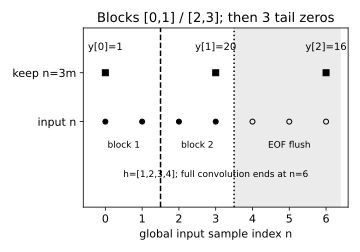
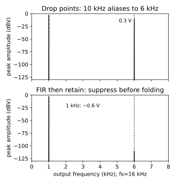

# 多速率与流式重采样

读者问题：整段文件转得正确，为什么换成任意音频块就多一个点、漏尾音或产生点击？**基础入口**先把四样本卷积结果 $[1,4,10,20,25,24,16]$ 中的第0、3、6点圈出，再把输入切成长度2与2，检查第二块是否仍保留全局第3点。**快进入口**从 $y[m]=\sum_kh[k]x[3m-k]$ 及其多相重排进入。同一正文回答样本、状态、相位与时间。停点：能手算第二块首个保留点引用的历史后再读代码。

先去 [[信号与系统/20-数字信号处理/01-FIR滤波设计与频率规格#先把输入、单位与合同固定|FIR课的输入与合同]]带回 $f_s=48000,L=193$、6–8 kHz过渡与零延拓；这里不复制设计证明。

## 直接丢点为何制造6 kHz

定义抽取因子 $M=3$、相位 $p=0$：直接抽取得 $x[3m]$，输出采样率16000 Hz。带外项相位为 $2\pi10000m/16000$，而

$$\cos(2\pi10000m/16000)=\cos(2\pi(16000-10000)m/16000)=\cos(2\pi6000m/16000).$$

这是全体整数 $m$ 的恒等式，不是 FFT 误差；两条不同输入在输出列表上无法区分。降采样前数字 FIR 在较高采样率上尚可区分它们。降采样后再低通去掉6 kHz也会删掉原本真实的6 kHz；前后顺序不能互换。

对绝对可和序列（纯音另用广义线谱）定义 $V(e^{j\omega})$，利用选择掩码 $c[n]=\frac1M\sum_{r=0}^{M-1}e^{j2\pi rn/M}$，它恰在 $n\equiv0\pmod M$ 时为1，得

$$Y(e^{j\Omega})=\frac1M\sum_{r=0}^{M-1}V\!\left(e^{j(\Omega+2\pi r)/M}\right),\qquad V=HX.$$

$\omega$ 是 rad/input-sample，$\Omega$ 是 rad/output-sample；不能把横轴都标“Hz”而忘记改变采样率。三个频谱副本相加形成混叠，若目标输入频带在 $|\omega|<\pi/M$ 且其他副本可忽略，输出保留目标信息；有限滤波残留按上课预算处理。$1/M$ 是 DTFT重标定系数，不意味着稳态余弦幅度变成原来的1/3。

## 共同数组的时间与空间单位

把上面的 $M=3$ 换为两倍抽取 $D_2x[m]=x[2m]$、相位 $p=0$。共同输入 $x_L[n]=\cos(\pi n/4)$ 与 $x_H[n]=\cos(3\pi n/4)$ 在 $n=1$ 分别为 $\sqrt2/2$ 与 $-\sqrt2/2$，输出却同为 $\cos(\pi m/2)$。输入 $f_s=8$ Hz 时是 1 Hz 与 3 Hz；输出 $f_s'=4$ Hz 时都表现为 1 Hz。它们在原 4 Hz Nyquist 内，新上限却是 2 Hz，因此先前采对了也不能直接继续丢点。

若把同一数组逐行重复成空间特征图，输入沿列是 $1/8$、$3/8$ cycles/input-pixel；保留偶数列后是同一个 $1/4$ cycles/output-pixel，输出一格对应两输入像素。指数中的 $\omega,\Omega$ 仍分别表示每输入/输出样本弧度，但样本现在是空间像素，不能使用 Hz。恒等式与两点均值的 $0.923880/0.382683$ 增益在 [[AI/15-卷积神经网络/05-采样混叠感受野与平移鲁棒性#同一数组怎样把时间频率折到空间频率|CNN 同数组主解释]]；接着读该页“非线性之后为什么要重新检查带宽”，带回“即将被抽取的信号”这个对象。仅滤原输入不能阻止后续非线性产生新带外成分。

返回 [[数学/70-信号处理与多模态数学/01-空间几何Patch卷积与频域#共同数组怎样落到像素轴|空间坐标]] 时，说明隔列抽取与无损 Patch 重排的差别。本例只保留一支路，不能恢复两个不同原输入；保留全部互补子带的滤波器组可能抵消分支混叠。本页既有有限 FIR、流式相位、历史状态和延迟合同仍负责实际 48→16 kHz 实现；上述小数组没有替代全带规格。

## 多相是同一和式的索引重排

零延拓 $x$ 到所有整数，有限 $h[k]$ 也在 $0\le k<L$ 外为零。每个 $k$ 唯一写成 $k=qM+r$、$0\le r<M$，所以

$$y[m]=\sum_{r=0}^{M-1}\sum_{q\ge0}h[qM+r]x[(m-q)M-r].$$

定义 $e_r[q]=h[qM+r]$、$a_r[m]=x[mM-r]$，则 $y[m]=\sum_r(e_r*a_r)[m]$。$a_1[m]=x[3m-1]$，$a_2[m]=x[3m-2]$：这条定义带着支路延迟，不能随意改成 $x[3m+r]$ 后保留原式。Z域相同重排给 $H(z)=\sum_{r=0}^{M-1}z^{-r}E_r(z^M)$。相位 $p\ne0$ 时把输入项换为 $x[p+(m-q)M-r]$，保留的索引、时间戳和尾点必须一起改变。

手算四抽头 $e_0=[1,4],e_1=[2],e_2=[3]$，$m=1$时三支路贡献 $1x[3]+4x[0]=8$、$2x[2]=6$、$3x[1]=6$，共20；$m=2$只剩 $4x[3]=16$。没有用“低通直觉”替代索引检查。

朴素“全卷积再删点”约每输入样本计算L次乘加；只在保留的点求和约每输出L次，总量约输入L/M。多相将抽头组和低速状态组织起来可节约高速重复计算，但193抽头没有凭分3支路变成每输出64次总乘加：64、64、65仍合计193。教学 `polyphase` 是独立重排参考，`Stream` 每三个输入只算一次完整点积，环状态依旧逐输入更新；Python循环性能不代表设备上的最优多相实现。

## 任意分块等价的状态不变量

令处理前已消费 $n$ 个输入，下一样本编号也为 $n$。状态保留最近 $L-1$ 个历史输入及零起始填充，全局计数 $n$决定 $n\bmod M$。实现为L槽环：先将 $x[n]$ 写入 $n\bmod L$，此时位置 $(n-k)\bmod L$ 给 $x[n-k]$，$k=0,\ldots,L-1$，过去不存在的点仍为0。仅当 $n\bmod3=p$输出；最后计数加1。

证明按消费样本归纳。初始零环与 $x[j]=0,j<0$ 一致。写入新点只覆盖 $x[n-L]$，它已不属于当前点积所需区间；其余槽保留历史，因此输出等于同一个卷积和。块边界没有额外状态转移，只重复此步骤，任意切分包括空块均保持同一不变量。实数算术下与整段完全相等；浮点求和顺序可能有舍入差，所以验收用绝对容差并报告最大差，不要求所有算法字节相等。测试穷举7样本的64种切分并覆盖三种相位，再用多种L/N及确定种子补充。

实心圆点为四个实际输入n=0..3，空心圆点为三次尾零n=4..6，方点仅在n=0、3、6标出本记录输出。竖虚线分隔两块输入，竖点线标EOF，浅底覆盖EOF后的三次flush；全卷积在n=6结束。图采用四抽头索引教学，生产193抽头有192个尾部零。

## 输出时间、尾部与启动暂态

N>0 的有限输入与L抽头全卷积长度 $N+L-1$，有效输出索引 $p+Mm\le N+L-2$。所以

$$N_y=\max\!\left(0,\left\lfloor\frac{N+L-2-p}{M}\right\rfloor+1\right).$$

N=0按本实验合同给空输出，不为不存在的记录制造L−1个零。N=12000、L=193、p=0得到4064点；直接丢点只有4000点，二者不能无声明截成相同长度。

`process` 只消费实际数据；到明确 EOF 时 `flush` 输入恰L−1个零，按全局相位释放尾部；第二次 `flush` 给空，之后 `process` 拒绝直到 `reset`。不能在每块结束flush，也不能把“暂时无新数据”当EOF。启动段过去为零，终止段未来为零；稳态幅度证据只选完整支持的 $192\le3m\le11999$。

输出计算栅格时间 $t_\mathrm{grid}[m]=(p+3m)/48000$ s；对称核的内容参考时间 $t_\mathrm{content}[m]=(p+3m-96)/48000$ s。初始参考时间可为负，那是零延拓边界的标记；不会真的在负时间交付数据。输出需收到全局第 $p+3m$ 样本后才能计算，内容延迟2 ms；设备排队、块收集、计算和播放再增加交付时延。EOF尾部虽可立即用零计算，也须按播放栅格排程。对滤波器做内容时间戳补偿会改变标签，不能消除因果等待。

## 频谱证据的完整定义

取输出m=64起的3840点（240 ms），矩形窗、均匀16 kHz，恰含1k与6k整数周期。单边峰值谱定义内部正频率 $2|\mathrm{DFT}(y)[k]|/N$，DC和偶N的Nyquist为 $|\mathrm{DFT}|/N$，单位V；图用20log10(幅值/1 V)即dBV，对数计算截底−140 dBV，图纵轴显示到−130 dBV。它不是PSD；泄漏、窗增益和噪声密度是另一个问题。当前直接抽取6k为0.3 V，前滤波后为约 $3.028\times10^{-6}$ V，1k约0.600000126 V。这是指定两纯音的稳态结果，不是全带衰减证明；全带证据在FIR课。

## 撤方法提示的迁移

新的记录N=11，核 $h=[1/4,1/2,1/4]$，保留 $n\equiv1\pmod3$；输入 $x[n]=n+1$，分块长度4、0、3、4。只要求给完整输出、输出数量、最后点对应的输入栅格时间（采样率48k），以及如何证明切分无影响。能否每块独立调用“same卷积”后拼接？

> [!question]- 答案与接受标准
> 全卷积在n=0为0.25、n=1为1；n=2..10为n；n=11为8、n=12为2.75。保留n=1,4,7,10，输出[1,4,7,10]，数量floor((11+3−2−1)/3)+1=4；最后栅格时间10/48000 s，内容时间(10−1)/48000 s。尾n=11,12未命中此相位，flush不一定产生新点。允许直接卷积、支路重排或逐样本归纳，只要零延拓/相位/历史一致。独立same通常裁掉边缘、缺历史并重置相位，不能保证。若提出额外历史、全局索引和明确裁剪，也可组成合法块算法。

[Smith《Spectral Audio Signal Processing》的抽取定理](https://www.dsprelated.com/freebooks/sasp/Downsampling_Aliasing.html)“Proof of Aliasing Theorem”和[多相分解](https://www.dsprelated.com/freebooks/sasp/Polyphase_Decomposition.html)“N-Channel Polyphase Decomposition”核对频谱副本与索引分组。环状态不变量、EOF及时间戳为本实验显式合同。去 [[信号与系统/20-数字信号处理/03-有限字长块状态与实时合同|下一课]]带回计数/环/尾部，检查丢块和饱和会在哪一步打断等价。
