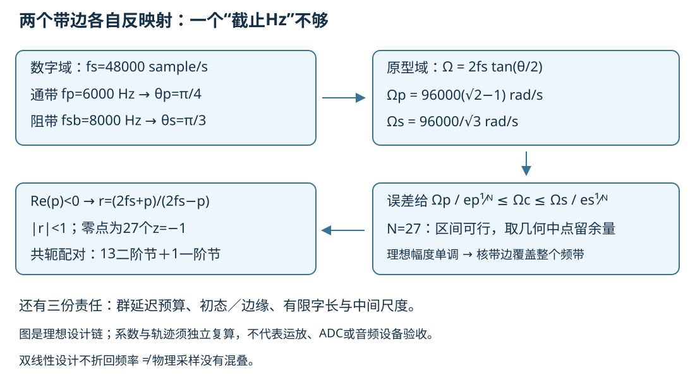
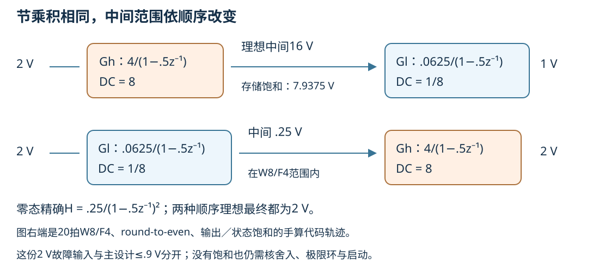

# IIR设计、二阶节与幅相取舍

已有193抽头FIR以2ms群延迟换线性相位与有限记忆。递归利用旧状态，可能以更少乘法达到相同幅度规格，但新的责任是极点、启动、状态尺度和舍入反馈。设计要给出一份从数字规格到完整系数和实际递推的合同；知道一阶RC会衰减，还不能决定一般滤波器怎样实现。

第一次读先手算两个一阶节：高增益节 $G_h(z)=4/(1-.5z^{-1})$，低增益节 $G_l(z)=.0625/(1-.5z^{-1})$。二者DC分别8、1/8，乘积DC为1；调换先后在精确零态下不改变输出，却把中间DC幅度改变64倍。快进入口从带边的tan映射与Butterworth阶数不等式进入，最后两入口汇到同一结构与误差问题。

## 按要交出的结果选路线

首次设计时走 [首读路线](#首读路线)，要核查证书时走 [复核路线](#复核路线)。两条路线都用本页同一规格、同一组SOS与原有完整推导；路线中的跳转只改变阅读顺序。读到某节末的“返路线”即可回来继续，原有标题与外部入链仍可直接使用。

### 首读路线

读完交出一份实现选择说明：写清接受的幅度与时间合同、为何需要这个阶数、选用的结构与节次序，以及内部量程仍须怎样核查。可以选择FIR或IIR，但理由须落到同一输入、输出速率与预算。

| 顺序与目的入口 | 读后写下什么 |
| --- | --- |
| 1. [固定幅度与时间规格](#同一规格有幅度也有时间合同) | 带边、误差、输入峰界、初态和2ms预算；区分稳态幅度与启动边缘。 |
| 2. [预扭曲](#两个带边同时预扭曲) → [阶数、极点与SOS构造](#从两个误差不等式推阶数与系数) | 两个带边为何都要映射，N=27为何可行，13个二阶节与1个一阶节怎样组成同一传函。沿原文读完这里的证明；首次连读可从“生成系数的连续频带如何查”跳到下一步，之后按复核路线查机器系数。 |
| 3. [同一SOS的状态递推](#直接型与节级联的代数责任) → [次序与内部尺度](#二阶节次序-状态尺度与舍入) | 同拍旧状态怎样使用；用开头两节说明精确零态输出相同为何仍会有不同的中间幅度与饱和。 |
| 4. [幅相与资源取舍](#阶数-群延迟与实时资源) → [同系数延迟与实现比较表](#固定sos的延迟也用同一份系数) | 用比较表选择实现，并注明延迟变化、乘法、初态与尾部责任。相位观测与物理全通两个支线可按问题进入后返回；机器延迟的完整证明留在原处。 |
| 5. [迁移题](#撤去提示的迁移题) → [实验与已有证据](#实验与证据边界) | 在看答案前写重设计条件；把自己的预测与已有结果区分，列出选择实现还缺的证据。 |

回看本表时，若还不能解释“同一H为何不能直接决定寄存器量程”，回到第3步；若需要判定已生成系数是否兑现全带合同，转入下一条复核路线。

### 复核路线

读完交出一份证据说明：分别写出下表对象、所用前提、已有保证和未验部分，并能从原始结果定位支持它的系数或记录。每一步都先回答“这里固定了什么”；不要让上一层的通过替下一层签字。

| 对象与目的入口 | 核查结果及保证边界 |
| --- | --- |
| 1. 理想原型及其双线性映射：[带边映射](#两个带边同时预扭曲) → [阶数与极点证明](#从两个误差不等式推阶数与系数) | 用单调幅度式和映射证明理想全带幅度与因果零态稳定；说明这是理想构造，尚未替生成的机器系数作证。理想群延迟的极点公式与适用前提见[幅相段](#阶数-群延迟与实时资源)。 |
| 2. 生成的binary64固定SOS系数：[连续频带包含性证明](#生成系数的连续频带如何查) → [同系数延迟与精确稳定检验](#固定sos的延迟也用同一份系数) | 固定完整二进制系数，把它们视为精确dyadic数形成线性有理函数；核逐cell外包围、闭带无缝覆盖、Q正下界和稳定条件。Decimal精确转换保存这份系数，不补证此前三角函数的超越舍入。 |
| 3. 从binary64转换的binary32固定SOS系数：仍读[同一连续带算法](#生成系数的连续频带如何查)和[同系数延迟](#固定sos的延迟也用同一份系数) | 另固定这一份系数，重新核分子恒等式、稳定性、幅度与延迟；在结果中分别定位两个模型的证书，不能复用binary64的结论替binary32通过。 |
| 4. 实际逐运算递推：[状态更新与每步舍入合同](#直接型与节级联的代数责任) → [内部峰值、饱和及极限环](#二阶节次序-状态尺度与舍入) | 对声明的输入、初态、次序、位宽与非FMA运算顺序核有限轨迹；固定有理函数的证书不覆盖所有舍入／饱和行为。主例两次SOS的12000拍完成与直接型425拍前缀失败按原记录保留，W8/F4的2V故障另看。 |
| 5. 原始证据与未验边界：[证据总入口](#实验与证据边界) → [完整JSON、运行回执、失败与独审](../80-实践/06-IIR规格与实现/results/2026-10-10/README.md) | 分清新执行的R1测试、同字节源码明确复用的CLI／oracle和旧ERROR。完整闭带结论依赖包含性与覆盖；网格点只是补充。逐步舍入的全局保证、Obsidian、硬件和真人试读仍未验。 |

返回本表逐项核对后，把仍缺证据的对象写明，再回[首读路线](#首读路线)更新实现选择。这两条阅读顺序是否降低负担，要由真人试读另行判断。

## 同一规格有幅度也有时间合同

沿 [[信号与系统/20-数字信号处理/01-FIR滤波设计与频率规格#先把输入、单位与合同固定|FIR的同一输入与单位]]：fs=48000Hz，T=1/fs秒，输入 $x[n]=.6\cos(2\pi1000n/fs)+.3\cos(2\pi10000n/fs)$ V，n=0..11999，峰值≤.9V。它是已采集的数字记录，前后零延拓、初始状态0；本课返回同拍48kHz输出，不直接抽到16kHz。

| 项 | FIR与IIR共同接受范围 |
| --- | --- |
| 频率 | f为Hz；θ=2πf/fs为rad/input-sample；原型Ω为rad/s |
| 通带0..6000Hz | $||H|-1|\le.01$，线性幅度误差 |
| 阻带8000..24000Hz | $|H|\le.001$，至少60dB幅度衰减 |
| 过渡6000..8000Hz | 无幅度平坦承诺 |
| 稳态输入幅值 | ≤.9V；不代替有限边缘／状态峰值界 |
| 本次附加延迟预算 | 通带群延迟≤96输入样点=2ms，另报告频率变化；块等待／驱动另计 |

选择单调DC=1的Butterworth，则通带只需0.99≤|H|≤1。dB参数 $R_p=-20\log_{10}.99$，$R_s=60$，不能把“1%”设成“1dB”。选择该原型便于证明整个频带；不是宣称它在所有相位或最低阶数目标上最优。Chebyshev I以通带纹波换过渡，II在阻带等波纹，椭圆允许两带等波纹；Bessel关注低频延迟平坦。去 [[电子电路/28-运放比较器与滤波/06-滤波原型与有源实现#三个二阶原型的定义与公平比较|模拟原型的公平归一化]] 核DC、−3dB及纹波边缘后返回，不能把那张相同−3dB表当成任意纹波的数字规格。

返路线：[首读第1步](#首读路线)记录完合同后继续预扭曲；[复核第1步](#复核路线)也以这份合同为判据。

## 两个带边同时预扭曲

双线性代换 $s=2fs(1-z^{-1})/(1+z^{-1})$ 在单位圆给 $\Omega=2fs\tan(\theta/2)$。本例

$$\theta_p=\pi/4,\quad\theta_s=\pi/3,\qquad
\Omega_p=96000(\sqrt2-1),\quad\Omega_s=96000/\sqrt3\quad\mathrm{rad/s}.$$

不能用2πfp与2πfsb直接代替这两个Ω。tan单调将两个带边和各自整个区间映到原型坐标；不是只对一个“截止”做线性缩放。沿 [[电子电路/12-交流与变换域/18-采样混叠与双线性预扭曲#RC角点为何偏移，预扭曲改的是设计原型|RC预扭曲的设计变量]] 返回时保留真实RC参数：新Ω是设计原型，不是测得电容变了。

最短单位自检：T=.00025s、θ=π/2给Ω=(2/T)tan(π/4)=8000rad/s，而θ/T≈6283.185rad/s。双线性虚轴一一映到主频段不折回，描述设计坐标；真实ADC采样仍可能混叠，同列表的信息不会由数字IIR恢复。

## 从两个误差不等式推阶数与系数

N阶Butterworth原型的幅度平方为 $1/[1+(\Omega/\Omega_c)^{2N}]$。定义 $e_p^2=.99^{-2}-1$、$e_s^2=.001^{-2}-1$，两个带边需

$$\Omega_c\ge L_c=\Omega_p/e_p^{1/N},\qquad
\Omega_c\le U_c=\Omega_s/e_s^{1/N}.$$

可行区间非空恰要求 $(\Omega_s/\Omega_p)^{2N}\ge e_s^2/e_p^2$，所以

$$N=\left\lceil\frac{\log(e_s^2/e_p^2)}{2\log(\Omega_s/\Omega_p)}\right\rceil=27.$$

N=26不可行，27可行。选 $\Omega_c=\sqrt{L_cU_c}$ 留两边余量，而非紧贴0.99边界；Ωc是相对DC的−3.0103dB角点，不是6kHz通带边缘。θc=2atan(Ωc/(2fs))，数字fc=θc fs/(2π)。由于tan与该幅度均单调，通带最小在6kHz、阻带最大在8kHz，解析端点及DC便证明**理想原型映射**的整个幅度合同；稀疏网格不能取代这条单调论证。

构造左半平面极点 $p_k=\Omega_c\exp[j(\pi/2+(2k+1)\pi/(2N))]$，k=0..N−1，以正实常数归一Ha(0)=1。双线性数字极点

$$r_k=(2fs+p_k)/(2fs-p_k),\quad |r_k|<1.$$

因为 $|2fs-p|^2-|2fs+p|^2=-8fs\operatorname{Re}p>0$，稳定映射有明确证明。N个无穷远零点映到z=−1，故数字分子为 $g(1+z^{-1})^{27}$；不是无零点的纯全极点数字滤波器。

对每个共轭数字极点对r、r*取

$$a_1=-2\operatorname{Re}r,\quad a_2=|r|^2,\quad
b_0=(1+a_1+a_2)/4,\quad(b_1,b_2)=(2b_0,b_0),$$
$$H_i(z)=\frac{b_0+b_1z^{-1}+b_2z^{-2}}{1+a_1z^{-1}+a_2z^{-2}}.$$

唯一实极点r0=(2fs−Ωc)/(2fs+Ωc)取 $a_1=-r_0,a_2=0,b_0=b_1=(1-r_0)/2,b_2=0$。每节DC=1，13个二阶节及1个一阶节乘成同一H；完整极点／节系数及展开的27阶分母按实验接口输出JSON；2026-10-10完整JSON已由独立执行者实际生成并接受，见[固定系数与实际轨迹结果](../80-实践/06-IIR规格与实现/results/2026-10-10/README.md)。精确等式的归一化与符号以本式为准，截成几位的小表不能直接替规范系数运行。

为什么这组极点确实实现所用的幅度平方？写 $H_a(s)=\prod_k(-p_k)/\prod_k(s-p_k)$。分母两组根 $p_k$ 与 $-p_k$ 合在一起，恰给多项式 $1+(-1)^N(s/\Omega_c)^{2N}$ 的全部2N个根；再以s=0归一化固定常数，故

$$H_a(s)H_a(-s)=\frac1{1+(-1)^N(s/\Omega_c)^{2N}}.$$

系数实，在 $s=j\Omega$ 取共轭并用 $j^{2N}=(-1)^N$ 就得到前述幅度平方。共轭配对后每个数字节的两个分母根是r、r*，分子是对应两个 $(1+z^{-1})$ 因子；DC归一化把常数乘积固定，因此SOS与原型映射是同一有理函数。因果解释的ROC取所有极点之外，单位圆包含在其中；有限阶、极点严格在圆内的冲激响应是指数乘多项式的和，绝对可和，故零态BIBO稳定。相同有理式若换ROC，不能原封不动复用这个因果结论。

返路线：阶数、极点与SOS证明到此完整。[首读第2步](#首读路线)可继续[状态实现](#直接型与节级联的代数责任)；[复核第1步](#复核路线)确认理想对象后，再进入下面两份固定系数的证明。

### 生成系数的连续频带如何查

理想单调公式已覆盖整个理想频带；实际生成的binary64／binary32系数须验证它们各自的固定有理函数，不能把另一次极点计算或密集抽点直接当证书。读者先问：如果把整个频带分成有限个闭区间，且每一段的**所有**频率都被包在达标范围内，是否还可能漏掉一个坏点？不会。关键是每段给整个区间的外包围，覆盖无缝；“测中心点”没有这个性质。

本主例用 $c=\cos\theta$，无需计算三角函数就能认证所选带。通带 $0\le\theta\le\pi/4$ 对应 $\sqrt2/2\le c\le1$；阻带 $\pi/3\le\theta\le\pi$ 对应 $-1\le c\le1/2$。用正文源码中的有限小数 $c_{lo}=0.707106781186547524400844362104849039284835937688474036588339868$ 略扩大通带为 $[c_{lo},1]$。该小数是精确有理数，以整数分数验证 $c_{lo}>0$、$c_{lo}^2\le1/2$，就证明覆盖真实带边；没有调用浮点sqrt后把它当准确端点。

对实系数节，令 $q=e^{-j\theta}$，有

$$P(c)=|b_0+b_1q+b_2q^2|^2
=b_0^2+b_1^2+b_2^2+2b_1(b_0+b_2)c+2b_0b_2(2c^2-1),$$
$$Q(c)=|1+a_1q+a_2q^2|^2
=(1-a_2)^2+a_1^2+2a_1(1+a_2)c+4a_2c^2.$$

本构造每个分子精确满足二阶 $b_1=2b_0,b_2=b_0$ 或一阶 $b_1=b_0,b_2=a_2=0$，所以 $P(c)=b_0^2(2+2c)^d$，d为2或1。从binary64系数分别转binary32后须以精确分数再次核这两个恒等式，不能凭显示小数相等判断；这组正常量程下的乘2缩放保持恒等式。因式形式在c=−1保留真正的零，避免普通浮点多项式抵消后冒出负“幅度平方”。整个幅度平方是 $\prod_iP_i/Q_i$。

源码的 `Outward` 以私有Decimal上下文分别用 `ROUND_FLOOR`、`ROUND_CEILING`。每项输入系数由 `Decimal.from_float` **精确转换**其二进制数值，保存同一dyadic分数；没有使用 `Decimal(str(value))` 把短显示改成另一模型。对闭区间 $[l,u]$，加法取下端之和向负无穷舍入、上端之和向正无穷舍入；乘法取四个端点乘积的最小向下值与最大向上值；平方在跨零时下界取0。除法只在分母区间不含零时取四端比值的外包围。Horner有限递推用这些操作，逐步包含精确多项式的所有值；各节**Q下界必须严格大于0**后，才允许除法和乘积。

对每个通带cell，把整机平方幅度包围 $[L,U]$ 与精确有理限额 $0.9801\le L\le U\le1.0201$ 比较；阻带需 $U\le0.000001$。这分别是0.99／1.01和0.001的平方，不把1%换成1dB，也无需开平方。若包围太宽，用精确中点二分，父闭区间等于两个子闭区间的并。最终验收所有接收cell的首尾和相邻端点精确相等；没有未决cell才返回 `certified=True`。逐cell保存c端点、Q下界、幅度平方和下节的延迟界，因此可复查“有限cells ⇒ 全频带”的量词。

默认80位Decimal、最大深度24、每带最多131072次cell求值。中点另用200位、`Inexact`触发异常的上下文；深度上限28以内可保证有限小数的中点精确。算术范围异常、Q包围跨零、细分耗尽或资源耗尽都不能冒签；保留未决区间，返回 `not_certified` 或退出失败。认证接口只支持这里的48kHz／6kHz／8kHz主规格，迁移设计须另建立正确c域后认证，不偷用原带边。

正确舍入与精确转换的合同见 [Python Decimal官方文档](https://docs.python.org/3/library/decimal.html) 中构造、`from_float`、`Context`运算及舍入方向。旧复数抽点／局部导数浮点实现保留为 `amplitude_estimate`，只供观察，不能产生严格认证；它与向外包围各有用途。固定系数的线性传函达标也不保证每一步舍入后的实际非线性轨迹达标，后者继续用下文的精度／饱和实验核查。

返路线：[复核第2、3步](#复核路线)先带回幅度包含性与覆盖，再去[同系数延迟和稳定检验](#固定sos的延迟也用同一份系数)补全证书；有限轨迹须另读下面的实现合同。

## 直接型与节级联的代数责任

展开 $H(z)=\sum_{k=0}^Nb_kz^{-k}/(1+\sum_{k=1}^Na_kz^{-k})$ 给

$$y[n]=\sum_{k=0}^Nb_kx[n-k]-\sum_{k=1}^Na_ky[n-k].$$

直接I型保存输入和输出历史；直接II型共享延迟线，用 $w[n]=x[n]-\sum_{k=1}^Na_kw[n-k]$，再 $y[n]=\sum_{k=0}^Nb_kw[n-k]$，内部w可远大于y。转置直接II型可保存N个部分累加状态：$y=b_0x+s_0$，$s_i^{new}=s_{i+1}+b_{i+1}x-a_{i+1}y$，末状态无下一项。所有状态都是调用前旧状态，同时提交新向量；把新状态提前用于本拍会改变H。

对二阶节即 $y=b_0u+s_1$、$s_1^{new}=b_1u-a_1y+s_2$、$s_2^{new}=b_2u-a_2y$。实节也可把无用第二状态省去。级联把上一节本拍输出作为下一节输入。零态精确代数下乘积可交换，也等于展开直接型；非零初态只有在给出对应状态变换后才谈相同轨迹，不能把每个实现随便塞同一数字初态。

本实验理想等价先用80位Decimal按原始float64节系数的精确二进制值展开并核脉冲／给定记录；精度比较另声明binary32系数、每个乘积／相加／存储分别舍入，非FMA。Decimal参照仅覆盖这份有限系数模型，不把float64三角函数结果升级成任意精度原型证明。

## 二阶节次序 状态尺度与舍入

极点的长期保证，不负责替中间寄存器保住饭碗。极点在圆内给出所声明因果线性模型的渐近衰减与零态BIBO结论；它没有给出某个实现各内部节点在指定输入和初态下的峰值。判断溢出须先声明节点的可表示范围和乘加／存储规则，再把内部幅度与该范围比较；下面的两节反例把这份差别具体化。

每节增益可乘κi，只要∏κi=1则整体H不变；次序和增益分配会改变中间状态，不能从“输出≤.9V”推每节状态≤.9V。单位DC归一化常有助于尺度，却未约束高Q节的谐振峰。对输入实际轨迹记录各节输出、s1、s2的峰值，再与声明范围比较；这不是所有输入的L∞状态界。需要后者须求每个内部节点的冲激绝对和或用可证明的状态界。

先把开头两个一阶节放入二阶节容器，用W=8、F=4、Δ=.0625V、round-to-even、精确24位有符号乘加、每次输出和状态存储都饱和；系数也按F4无量纲编码。输入代码32（2V）连续20拍、全部初态0，两次试验唯一改变先后：

| 顺序 | 第一节的精确稳态目标 | 声明整数轨迹 |
| --- | --- | --- |
| 高增益→低增益 | 16V，超存储上界7.9375V | 第一拍输出128代码被饱和为127；最终总输出16代码=1V |
| 低增益→高增益 | .25V，在范围内 | 第一节最终4代码；总输出最终32代码=2V |

这两节的理想整体 $H=.25/(1-.5z^{-1})^2$ 相同、极点都.5；饱和造成的幅度差不是白噪声。这里2V用于有意触发小合同失败，与主设计≤.9V的输入分别标明。一般27阶设计另在同一≤.9V记录上比较升／降极点半径节次序与binary32内部峰值；某次输入没饱和不认证所有输入安全。

一个纯系数扰动反例也可手算：分母 $(1-.99z^{-1})^2=1-1.98z^{-1}+.9801z^{-2}$ 的极点均.99。只把a1改成−1.9802，z多项式在z=1为−.0001、在大正z为正，因此有实根>1。极小绝对系数误差可越稳定边界，根对多项式系数的敏感性不能由直流增益排除。二阶节减轻全局根耦合，却不无条件免疫近单位圆极点与舍入。

原一阶W8/F4、a=.75、q0=1、零输入的q=1不动点继续保留在 [[电子电路/45-混合信号与采集/05-数字滤波字长与极限环#极点在圆内，有限字长却不趋零|极限环原例]]；去同页 [[电子电路/45-混合信号与采集/05-数字滤波字长与极限环#饱和与回绕不是两种同等小误差|饱和与回绕合同]] 核累加器位置后返回本节。线性极点稳定、有限状态循环和限幅非线性三种判断分别做；不默认确定性舍入独立均匀。

返路线：[首读第3步](#首读路线)带着结构、次序和内部范围问题进入幅相比较；[复核第4步](#复核路线)带着指定输入与逐运算合同去[原始轨迹](#实验与证据边界)。

## 阶数 群延迟与实时资源

本设计分子零点在−1，严格“因果稳定逆也存在”的最小相位定义不满足；不可因稳定便叫最小相位。以 $H_m(z)=(1-.25z^{-1})/(1-.5z^{-1})$ 为严格最小相位小例，极点／零点均在单位圆内，逆也因果稳定。乘稳定全通

$$A_r(z)=\frac{z^{-1}-r}{1-rz^{-1}},\quad0<r<1,\quad |A_r(e^{j\theta})|=1,$$
$$\tau_A(\theta)=\frac{1-r^2}{1+r^2-2r\cos\theta}\quad\mathrm{sample}.$$

从分子分母幅度平方相同可证全通；相位微分给群延迟。r=.99时τA(0)=199样点=4.145833ms。把它乘到任一已达幅度规格的H上，幅度原封不动，DC延迟却已超过2ms预算；幅度合格不是相位合格。最小相位在相同幅度的相应因果稳定类中减少额外全通延迟，不承诺严格线性相位或对任意设计最优。原典定义见本页来源Lecture3第1–2、6页。

理想Butterworth在非零频响区的群延迟可以直接从理想数字极点得到

$$\tau_H(\theta)=\frac12\sum_{k=0}^{26}
\frac{1-|r_k|^2}{|1-r_ke^{-j\theta}|^2}.$$

它不恒定，须对0..π/4核最大值及变化量；θ=π处传函为0，群延迟不定义。每个 $(1+e^{-j\theta})$ 的相位在 $-\pi<\theta<\pi$ 为 $-\theta/2$；每个分母因子 $1-r_ke^{-j\theta}$ 的相位导数为 $\operatorname{Re}[r_ke^{-j\theta}/(1-r_ke^{-j\theta})]$。利用 $1+2\operatorname{Re}[v/(1-v)]=(1-|v|^2)/|1-v|^2$，N个零因子的N/2与极点贡献合并为上式。这说明零点位置和相位前提已参与，不能把它当任意IIR的群延迟公式。旧 `ideal_pole_delay_estimate` 用相位差分交叉观察这一极点模型，再估计网格余量；它没有向外舍入，也不认证另一份固定SOS系数。对每个极点令 $d_k=\min_{0\le\theta\le\theta_p}|1-r_ke^{-j\theta}|$，可以把极角投影到该弧后算最小距离；有 $|\tau'_H|\le\sum_k(1-|r_k|^2)|r_k|/d_k^4$。网格最大加此K乘最大最近点距离给整个通带延迟上界，浮点计算层不冒充区间算术认证。固定SOS的严格通带延迟须改用下面同系数的表达式。

### 有限复频响样点能确定群延迟吗

这里把独立变量写成 $\omega$，单位rad/输入样点，相位 $\phi$ 用rad，群延迟 $\tau=-d\phi/d\omega$ 的单位为**输入样点**。对已知整数纯延迟 $H_d(e^{i\omega})=e^{-id\omega}$，连续提升 $\phi_d=-d\omega$ 直接给 $\tau_d=d$；若采样率为 $f_s$ 输入样点/s，物理时间延迟才是 $d/f_s$ s。

只观测 $\omega_k=k\pi/2$，$k=0,\ldots,4$ 时，$H_5/H_1=e^{-4i\omega_k}=1$，故两种延迟的完整复频响样本同为 $(1,-i,-1,i,1)$。连续相位除以 $\pi$ 分别是 $(0,-0.5,-1,-1.5,-2)$ 与 $(0,-2.5,-5,-7.5,-10)$；群延迟却是1与5。主值展开按短增量会选第一条，不能从这份有限观测排除第二条。更密网格 $\Delta\omega=\pi/8$ 上相邻真变化分别 $-\pi/8$、$-5\pi/8$，两者的绝对值都小于 $\pi$ 且样本已不同；新采样在这两模型间提供了额外信息。

去 [[数学/45-复变函数/03-指数对数复幂与分支#完整路径唯一，有限样点还欠什么|样点提升的一般证明]]，把时间步换成频率步；再核 [[数学/45-复变函数/03-指数对数复幂与分支#带噪余量恢复哪一层|噪声余量]] 是否有依据。返回时回答：输入是已知传函系数、完整连续频响，还是有限带噪复数样点？有限相位差分给的是所选历史的斜率估计。下一节已有的严格证书以**已知同一份SOS系数**计算整个通带，不依赖由有限观测辨识未知传函，故本反例不使那份证书失效。前面的全通幅度例只给相同幅度；此处给相同的有限**复数**样本，观测合同不同。复频响为零处相位和群延迟仍不定义。

### 相同白输出能识别物理全通吗

本节 $A_r$ 复用 [[信号与系统/30-随机信号与推断/03-Wiener滤波线性预测与创新#创新表示不等于物理输入的恢复|唯一共同参数与信息表]]，以表中的 $a=r=1/2$ 与直通 $G_1=1$ 比较：全通物理极点1/2、零点2，因果稳定但逆不因果稳定。对全整数、已平稳的单位白 Gaussian 激励，两路不仅输出谱相同，完整有限维输出律也相同；规范输出 outer 因子都1，并未识别物理 $u$。去 Wiener 带回“Gaussian为何不可省、输出过去与物理输入为何不同”，再沿 [[信号与系统/40-状态控制与辨识/03-动态回归持续激励与LMS-RLS#同一全通例增加同步输入后识别什么|同步输入辨识]] → [[电子电路/38-随机噪声与测量/05-互谱FFT与噪声测量#同一全通例的共轭核查与返回|复互谱共轭核查]] 返回本节。新增输入后在 $\theta=\pi/2$ 的 $S_{xu}/S_{uu}$ 才区分 $1$ 与 $-4/5-(3/5)i$，相干模均1；$a=1/3$ 的迁移值及解答共用主表。这里观察完整输出 PSD，与上节有限完整复频响样点的 H₁/H₅ 歧义不同；增加频率样点不能替代输入观测。

### 固定SOS的延迟也用同一份系数

群延迟按 $\tau=-d\arg H/d\theta$，单位为输入sample。这里每节分子是 $b_0(1+q)^d$；在通带不为零，其相位斜率贡献d/2。分母 $D=1+a_1q+a_2q^2$ 给

$$\tau_i=\frac d2-\operatorname{Re}\frac{a_1q+2a_2q^2}{D}.$$

把右侧乘 $\overline D/\overline D$，实部的分子为 $a_1^2+2a_2^2+a_1(1+3a_2)c+2a_2(2c^2-1)$。用上一节**同一Q**化简，二阶节与一阶节分别得到

$$\tau_i(c)=\frac{(1-a_2^2)+a_1(1-a_2)c}{Q(c)}\quad(d=2),\qquad
\tau_i(c)=\frac{1-a_1^2}{2Q(c)}\quad(d=1,a_2=0).$$

级联延迟相加。`strict_machine_certificate`在每个通带cell用同一向外多项式／除法包围这些式，要求整机延迟下界≥0、上界≤96sample；幅度和延迟均合格才接收该cell。因此binary64与binary32的认证分别绑定其完整固定系数，没有借用 `design()['poles']` 或有限相位差分替代。通带分子无零点，Q逐节正；Nyquist零点处延迟不定义，本认证也没有给阻带延迟目标。

固定系数的稳定性另以精确分数核查。一阶须 $|a_1|<1$；二阶须 $-1<a_2<1$、$1+a_1+a_2>0$、$1-a_1+a_2>0$。一个可检查证明是以 $w=(z-1)/(z+1)$ 把单位圆内映到左半平面；$z^2+a_1z+a_2$ 变为

$$(1-a_1+a_2)w^2+2(1-a_2)w+(1+a_1+a_2).$$

三个系数严格正时，两实根的和为负、积为正，故都负；共轭根的实部由根和给为负。$z=-1$被最后一个严格条件排除，因而映回的两个根都在圆内。该精确检验与每cell的Q正包围分别保存；稳定极点不替代实际整数递推的归零/饱和责任。

| 同一48kHz全速率输出 | 193tap FIR | 本Butterworth IIR |
| --- | --- | --- |
| 理想幅度 | 现有连续区间上界已报；保留原证据 | N27；两带边与单调式认证理想原型，另核生成系数 |
| 阶数／理想状态 | 192阶，192输入历史 | 27阶；13二阶+1一阶，共27有效状态 |
| 群延迟 | 非零区间96sample=2ms | 频率相关；固定binary64/32 SOS分别核闭带最大≤96，不能只看DC |
| 每输入样点乘法预算 | 直接193；对称配对可97，另96对加 | 未省结构零项的直接型55；SOS各二阶5、一阶3，共68 |
| 输出速率 | 此表均48kHz | 此表均48kHz |
| EOF／初态 | 全卷积尾192点，输入历史可清空 | 响应一般无限；须声明截尾容差／状态持有，不能有限拍自动flush全尾 |

若改成48→16k抽取，FIR多相可省未发布样点，不能把上表193乘/输入与IIR乘/输出交叉比较。CPU墙钟、缓存、块长和驱动调度另测。启动状态0的短记录会有暂态，不能把每个边缘样点套稳态单音幅比。

返路线：[首读第4步](#首读路线)用上表形成实现选择后做迁移；[复核第2、3步](#复核路线)带回同系数幅度、延迟与稳定保证，继续[核原始证据](#实验与证据边界)。

## 撤去提示的迁移题

只把采样率改为96000Hz，物理通带仍6000Hz、阻带仍8000Hz，误差仍.01／.001，时间预算仍2ms。旧27阶系数能直接沿用吗？写两个预扭曲带边、最小Butterworth阶数与允许Ωc区间，再说明群延迟样点预算怎样变。允许改原型，但要给同一合同的独立证据。

> [!question]- 答案与接受范围
> θp=π/8、θs=π/6；Ωp=192000tan(π/16)、Ωs=192000tan(π/12)rad/s。用同一ep/es不等式重算N，结果30；Ωc仍在Ωp/ep^(1/N)..Ωs/es^(1/N)。2ms对应192输入样点，而非96。旧系数在96kHz下把物理频响横轴成倍移动，不能照搬。接受其他满足同一幅相／范围／实现合同的原型、明确重设计／核查方案；单个测试正弦不能验收整个带。

另一题只改通带到5000Hz、fs仍48kHz。应重新用Ωp=96000tan(5π/48)、Ωs不变得N=17，再选择Ωc；保留旧Ωp会浪费或误述取舍。本题数字由执行者独立复算，读者也可用对数表达式与整数上下界核对。

## 实验与证据边界

[[信号与系统/80-实践/06-IIR规格与实现/README|规格、系数与结构实验]]提供真源、独立参照、全系数JSON、位级饱和反例与固定输入轨迹。2026-10-10最终V2R1的12项测试已新执行通过；V2同字节生产源码的完整CLI与独立Fraction oracle明确复用，两个固定系数模型均certified，共7490个accepted cells，原11项测试中的一次ERROR另行保留。binary64／binary32通带平方增益包络分别约[0.980107456,1.020089322]／[0.980107296,1.020089636]，同系数延迟约[19.2591371,41.6032341]sample，阻带平方增益上界均约9.695854e−7；严格比较使用完整原始Decimal串。两个SOS完成指定12000拍，直接型只完成425拍前缀后失败。实际输出与独审见[结果入口](../80-实践/06-IIR规格与实现/results/2026-10-10/README.md)；证书只覆盖固定系数线性传函，逐步舍入全局保证、Obsidian、硬件与真人未验。FIR已有结果复用，未由此重跑。

返路线：[首读第5步](#首读路线)带回实现选择及其未决项；[复核第5步](#复核路线)带回逐对象的证据说明。查原文来源时可继续读下列页码定位。

[MIT6.341 Lecture8，PDF第1–5页](https://ocw.mit.edu/courses/6-341-discrete-time-signal-processing-fall-2005/51e3beff8c8ce2289ba292fcdb0040f4_lec08.pdf)定位误差、Butterworth、双线性与零点／系数量化；[Lecture7，PDF第1–3页](https://ocw.mit.edu/courses/6-341-discrete-time-signal-processing-fall-2005/2c6fe95a4d44834ccf0c0d9017118703_lec07.pdf)定位直接／转置／级联的同传函与有限精度差异；[Lecture3，PDF第1–2、6页](https://ocw.mit.edu/courses/6-341-discrete-time-signal-processing-fall-2005/aa0fbb84ec39521a7a44e481c7ce0d7c_lec03.pdf)定位最小相位和全通。本文具体48kHz阶数、系数构造、微扰、状态轨迹和迁移题为独立设计，逐项核数，非教材图的实测搬用。

模拟Sallen-Key/MFB的有限GBW、加载及电源余量仍由模拟主课验；SOS数字极点不替代真实运放检查。静态镜像、数值、显示、硬件实时性及真人迁移分别记录；本课不新增个人掌握声明。返回 [[信号与系统/10-连续与离散系统/00-连续与离散系统-MOC#从共同基础选择下一组|共同基础的设计路线]]，带回完整频带、相位预算与有限字长合同；不要只带回阶数。
