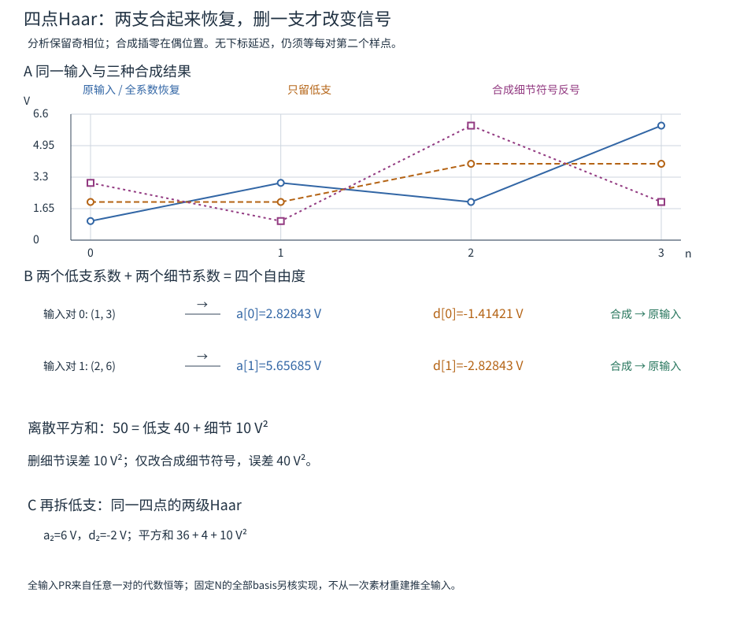
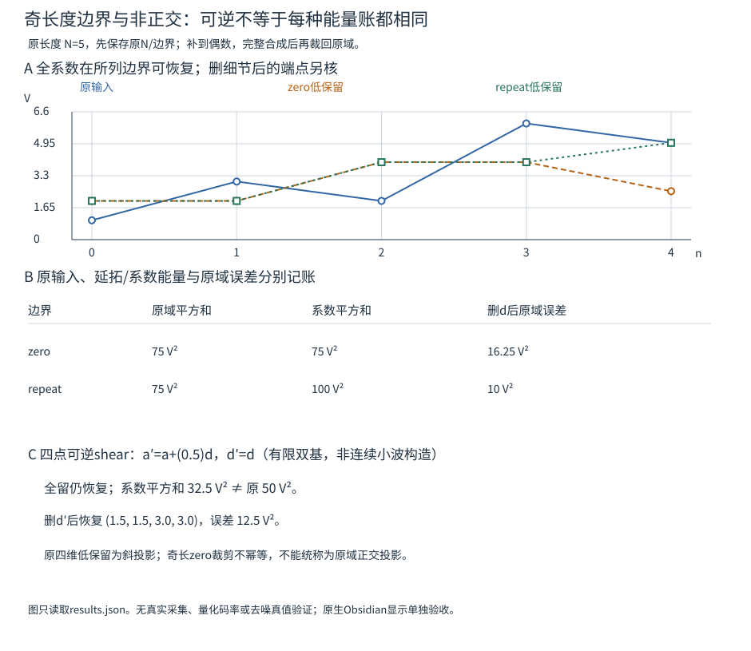

# 完美重建滤波器组与小波：每支都少一半，合起来为什么还能恢复

一支抽取会把不同输入折成同一个数组，为什么小波还能先降采样、再恢复原记录？因为接收的不是单支列表，而是带着相位和边界信息的**互补子带向量**。完美重建（PR）是整个分析—合成算子对声明输入域的性质，不是“一张图看起来恢复得不错”。

先走完四点Haar，再把同一计算接到因果滤波器、抽取相位、一般混叠/失真条件、多相矩阵和奇长度边界。最后用一个可逆非正交反例拆开“可逆”“能量守恒”“正交投影”。本页交付第一条完整PR单元和Haar多尺度入口；接着到[[信号与系统/20-数字信号处理/06-多分辨率分析尺度空间与小波基|MRA与小波基]]完成Haar闭尺度空间、稠密/交集及全函数空间ONB，核消失矩和PR不推出连续存在的反例。同信号表示/阈值/有限编码由[[信号与系统/20-数字信号处理/07-同信号时频多尺度表示阈值去噪与编码|应用页]]接续，[[信号与系统/20-数字信号处理/08-db2连续构造双正交稳定性与长边界|连续db2、真实双基与长边界]]进一步证明具体连续构造与稳定界，并重核四tap有限边界；不把四点矩阵当完整学科。

## 先把四点算完：平均与差保留了什么

固定 $x=(1,3,2,6)$，下标从0开始，按相邻偶/奇 $(x[2m],x[2m+1])$ 配对。令 $\kappa=1/\sqrt2$：

$$a[m]=\frac{x[2m]+x[2m+1]}{\sqrt2},\qquad
d[m]=\frac{x[2m]-x[2m+1]}{\sqrt2}.$$

低支 $a$ 表示局部共同量，细节 $d$ 表示局部差。这里用 $1/\sqrt2$，不是通常算术平均的 $1/2$；这个选择使变换正交。直接计算得

$$a=(2\sqrt2,4\sqrt2),\qquad d=(-\sqrt2,-2\sqrt2).$$

将两个数重新合成：

$$x[2m]=\frac{a[m]+d[m]}{\sqrt2},\qquad
x[2m+1]=\frac{a[m]-d[m]}{\sqrt2}.$$

代入每一对即得原数组。这是任意一对实数 $(e,o)$ 的恒等式，不依赖四个特定数：

$$\begin{bmatrix}a\\d\end{bmatrix}
=E_H\begin{bmatrix}e\\o\end{bmatrix},\qquad
E_H=\frac1{\sqrt2}\begin{bmatrix}1&1\\1&-1\end{bmatrix},\quad
E_H^TE_H=I.$$

每对用同一个可逆块，所以**任意偶数长度的实向量**都能按此配对完全恢复；不仅是2的幂长度。奇长度要先声明最后一个点配谁，稍后处理。实数精确算术的全长度证明来自这个块恒等式，数值实验另检查实现及有限误差。

本例输入离散平方和为 $1^2+3^2+2^2+6^2=50$，低支为40，细节为10，故 $50=40+10$。若样本单位V，三者都是 V²；这里没有采样间隔或负载阻抗，不能直接称50 J。每支只剩两个系数，合起来仍有四个自由度；全系数PR没有自动压缩数据。[MIT 18.327 Handout 3，PDF页1–5的Haar与逆矩阵](https://ocw.mit.edu/courses/18-327-wavelets-filter-banks-and-applications-spring-2003/9ae8fd2b4313aea9cb1d828e3d431301_Handout3.pdf#page=1)核对分析/合成对象，下面显式采用本页的配对与因果相位。

## 同一对样本怎样落成分析、抽取、插值与合成

沿用[[信号与系统/20-数字信号处理/02-多速率与流式重采样#多相是同一和式的索引重排|旧多速率的卷积定义]] $v[n]=\sum_kh[k]x[n-k]$，有限记录外零延拓，取以下因果两抽头：

| 分支 | 分析 $h_i[0],h_i[1]$ | 分析保留索引 | 合成 $f_i[0],f_i[1]$ |
| --- | --- | --- | --- |
| 低支 | $(\kappa,\kappa)$ | $n=2m+1$ | $(\kappa,\kappa)$ |
| 细节 | $(-\kappa,\kappa)$ | $n=2m+1$ | $(\kappa,-\kappa)$ |

因此 $(h_0*x)[2m+1]=(x[2m]+x[2m+1])/\sqrt2$，$(h_1*x)[2m+1]=(x[2m]-x[2m+1])/\sqrt2$，正好兑现上一节，而不是偷偷换成 $(x[2m-1],x[2m])$。合成先在**偶位置插入系数**：$u_0[2m]=a[m],u_1[2m]=d[m]$，奇位置为0，再完整卷积 $\widehat x=f_0*u_0+f_1*u_1$。于是偶/奇位置分别得到上面的逆变换。

对于偶长度 $N=2M$，分析完整卷积长 $N+1$，奇相位保留 $1,3,\ldots,N-1$，各支恰 $M$ 个系数；插零数组长 $2M-1$，与两抽头完整卷积后长 $2M=N$。不能每支只做“same卷积”再凭图对齐。代码直接复用已有 `resample_lab.py` 的 `offline(...,factor=2,phase=1)`，合成仍用其 `offline(...,factor=1,phase=0)`；没有另写一套抽取/完整卷积算法。

**下标延时与交付时刻不同。** 此配对在数学上给 $\widehat x[n]=x[n]$，没有整体下标偏移；但 $x[2m]$ 的恢复要等 $x[2m+1]$ 到达。若 $f_s=8$ sample/s，首对在 $t=1/8$ s以后才可交付，不能因为输出贴回下标0就宣称零等待。块传输/计算/缓冲还会增加时延；此页不模拟设备实时性。

## 分析合成的混叠抵消：两个条件都要满足

先给一般实FIR两通道、**分析偶相位0、合成偶插零**的标准推导，之后再换回本页奇相位。定义双边 $Z$ 变换 $X(z)=\sum_nx[n]z^{-n}$，$H_i,F_i$ 同理；在单位圆 $z=e^{j\omega}$，$\omega$ 用 rad/input-sample。有限支持序列可直接按Laurent多项式操作；一般无限序列须声明相应收敛/信号空间。

对 $v_i=h_i*x$，保留偶点再插零，$u_i[n]=\tfrac12(1+(-1)^n)v_i[n]$，所以

$$U_i(z)=\frac12[H_i(z)X(z)+H_i(-z)X(-z)].$$

合成相加得到

$$\widehat X(z)=T(z)X(z)+C(z)X(-z),$$

$$T(z)=\frac12\sum_{i=0}^1F_i(z)H_i(z),\qquad
C(z)=\frac12\sum_{i=0}^1F_i(z)H_i(-z).$$

$X(-z)$ 在单位圆相当于输入谱平移 $\pi$ 后折入，是混叠项；$T$ 是原谱的失真传递。要对**所有输入**恢复至已知非零增益 $c$ 和整数延时 $d$，需同时有

$$C(z)=0,\qquad T(z)=c z^{-d}.$$

仅消混叠仍可留下频率相关幅相失真，仅让某频率增益为1也不够。两支内各自有混叠不违反PR：它们在保留关系以后合成抵消。单支删掉另一支则一般没有这种抵消能力。[Handout 3，PDF页7–8的两个条件](https://ocw.mit.edu/courses/18-327-wavelets-filter-banks-and-applications-spring-2003/9ae8fd2b4313aea9cb1d828e3d431301_Handout3.pdf#page=7)使用的也是完整联合算子。

换回本页**分析奇相位1**时，$u_i[2m]=v_i[2m+1]$，变换为

$$U_i(z)=\frac z2[H_i(z)X(z)-H_i(-z)X(-z)],\qquad
\widehat X(z)=z[T(z)X(z)-C(z)X(-z)].$$

相位改变不仅换几个数组下标，还同时带来前因子 $z$ 和混叠项的负号。将本页四个滤波器代入，

$$H_0=F_0=\kappa(1+z^{-1}),\quad H_1=\kappa(-1+z^{-1}),\quad
F_1=\kappa(1-z^{-1}),$$

$$T(z)=z^{-1},\qquad C(z)=0.$$

所以偶分析相位给 $\widehat X=z^{-1}X$，奇分析相位给 $\widehat X=X$。同一滤波器从phase1换phase0以后若仍裁前 $N$ 点，会把延迟当丢样；对四点输入错误得到 $(0,1,3,2)$，正确裁去首延迟后才能取回 $(1,3,2,6)$。完整phase0输出尾部也保留，不能只调整标签却漏掉最后一位。

**故意破坏一个符号。** 把合成细节滤波器 $F_1$ 整体反号，其他都不改，得到 $T_{\rm bad}=(1+z^{-2})/2$、$C_{\rm bad}=(1-z^{-2})/2$。逐对看就是 $(e,o)\mapsto(o,e)$，本例输出 $(3,1,6,2)$、误差平方和40。常数输入的每一对相等，交换后还“恢复成功”，因此一次常数测试完全可能漏掉这个错误。完美重建不是对测试素材的赞美。

## 多相矩阵要连同奇偶约定一起写

用低采样率变量 $\zeta$ 区别高采样率的 $z$。令

$$x_e[m]=x[2m],\quad x_o[m]=x[2m+1],\qquad
H_{i,e}(\zeta)=\sum_lh_i[2l]\zeta^{-l},\quad H_{i,o}(\zeta)=\sum_lh_i[2l+1]\zeta^{-l}.$$

有 $H_i(z)=H_{i,e}(z^2)+z^{-1}H_{i,o}(z^2)$。本页奇分析相位给

$$\begin{bmatrix}A\\D\end{bmatrix}=E_1(\zeta)\begin{bmatrix}X_e\\X_o\end{bmatrix},\qquad
E_1=\begin{bmatrix}H_{0,o}&H_{0,e}\\H_{1,o}&H_{1,e}\end{bmatrix},$$

因为奇输出分别取到偶抽头乘奇输入、奇抽头乘偶输入。若换偶分析相位，矩阵改为

$$E_0=\begin{bmatrix}H_{0,e}&\zeta^{-1}H_{0,o}\\H_{1,e}&\zeta^{-1}H_{1,o}\end{bmatrix};$$

其中的低速延迟不可悄悄删掉。合成偶插零给

$$\begin{bmatrix}\widehat X_e\\\widehat X_o\end{bmatrix}
=R(\zeta)\begin{bmatrix}A\\D\end{bmatrix},\qquad
R=\begin{bmatrix}F_{0,e}&F_{1,e}\\F_{0,o}&F_{1,o}\end{bmatrix}.$$

本页Haar的 $E_1=R=E_H$，所以 $RE_1=I$，是对两相位任意输入序列的恒等式。一般PR为 $RE_p=cD_d$，其中全速偶延时 $d=2r$ 对应 $D_d=\zeta^{-r}I$；全速奇延时 $d=2r+1$ 对应

$$D_d=\zeta^{-r}\begin{bmatrix}0&\zeta^{-1}\\1&0\end{bmatrix}.$$

不能把任意全速一拍延时都写成低速矩阵 $\zeta^{-1}I$，后者是全速两拍。[Handout 5，PDF页6–8](https://ocw.mit.edu/courses/18-327-wavelets-filter-banks-and-applications-spring-2003/48b610fc0f1cc941fb7d1677d48b7a1f_Handout5.pdf#page=6)提供多相及合成矩阵转置约定；本页将输入奇支明确写为 $x[2m+1]$，因而保留自己所需的相位排列。

“可逆”还要交付哪种实现。某个固定频点上 $\det E\ne0$ 不认证整个频带；单位圆上处处可逆也不自动给有限、因果的逆。对方阵FIR多相矩阵，若要求逆也为FIR（允许整体延时/缩放），行列式须是非零单项式 $c\zeta^{-r}$：它才在Laurent多项式环中有多项式逆，随后可加足够延时使各项因果。例如 $E=\operatorname{diag}(2+\zeta^{-1},1)$ 在单位圆无零点，第一支逆却要用 $1/(2+\zeta^{-1})$ 的IIR，而非有限tap。Haar常矩阵不遇这个困难。本页不凭一组有限矩阵测试宣称任意滤波器都可因果稳定地反演。

## Haar低频保留是哪个子空间的投影

细节全置0，四点恢复为 $(2,2,4,4)$。它位于

$$V=\{(c,c,d,d):c,d\in\mathbb R\},\quad
q_0=(1,1,0,0)/\sqrt2,\quad q_1=(0,0,1,1)/\sqrt2.$$

两个低支系数正是 $\langle x,q_i\rangle$，故低支恢复为正交投影 $P_Vx$。残差 $(-1,1,-2,2)$ 与 $V$ 正交，平方和10，等于被删细节的能量；$\|x\|^2=\|P_Vx\|^2+\|x-P_Vx\|^2=40+10$。回[[数学/20-线性代数与几何/05-正交投影子空间与方向消除#严谨轨二：正交投影|线性代数投影]]核空间/度量，再返回本页看系数操作。

这个结论不直接推广到任意可逆双基。构造有限非正交分析：先做Haar，再令 $a'=a+\lambda d,d'=d$，$\lambda=1/2$；逆变换先还原 $a=a'-\lambda d'$，全留仍精确恢复。它是离散分析/合成的成对双基例子，不单凭它宣称构造了连续双正交小波或MRA。

本例 $\|a'\|^2+\|d'\|^2=22.5+10=32.5\ne50$；若把 $d'$ 置0，恢复 $(1.5,1.5,3,3)$，误差12.5。每对的低保留矩阵为

$$P_{\rm oblique}=\frac12\begin{bmatrix}1+\lambda&1-\lambda\\1+\lambda&1-\lambda\end{bmatrix}
=\begin{bmatrix}.75&.25\\.75&.25\end{bmatrix}.$$

它幂等却不对称，是斜投影；不能用被删系数的平方和10替代原坐标误差12.5。一般正交滤波器组的能量关系还需paraunitary/正交条件，PR本身不够，[Handout 7，PDF页1–3](https://ocw.mit.edu/courses/18-327-wavelets-filter-banks-and-applications-spring-2003/f95f7897eb0d62fc82ab88c3ae3937e6_Handout7.pdf#page=1)区分了这层额外要求。

## 奇长度：边界不仅改变最后一个系数

取 $x=(1,3,2,6,5)$，原平方和75。约定只在右侧补到偶数长度、分析/合成后按保存的原长度 $N=5$ 裁剪；不凭系数长度猜原记录。下面两种延拓都是线性的，全系数都能按本合同恢复原五点，却给出不同能量与低保留算子：

| 合同 | 最后一对 | 最后低/细节 | 全系数平方和 | 丢细节后裁到5点 | 原5维误差平方和 |
| --- | --- | --- | --- | --- | --- |
| `zero`补0 | $(5,0)$ | $(5/\sqrt2,5/\sqrt2)$ | 75 | $(2,2,4,4,2.5)$ | 16.25 |
| `repeat`重复末点 | $(5,5)$ | $(5\sqrt2,0)$ | 100 | $(2,2,4,4,5)$ | 10 |

`repeat`是本两抽头算例所需的一个右端重复，不是声称实现了所有长滤波器的对称边界算法。它相当于延拓域多记一次末点能量：系数Parseval对6维延拓域成立，不能误报原5维输入能量100。

`zero`的细节平方和22.5，在完整6维延拓域，丢细节误差也为22.5；裁掉第6个重建点后，只算原5维误差则是16.25。最后一个原坐标变成 $x_4/2$，再做一次低保留会变 $x_4/4$，所以这个裁剪算子在原5维**不幂等，不是正交投影**。完整PR并不保证每个删系数/裁剪组合仍是原域的正交投影。

一般有限滤波器组还涉及左/右延拓、奇偶相位、有效系数数量、边界滤波器和恢复裁剪区间，不能仅说“symmetric”就跳过索引。[Handout 15，PDF页1–5](https://ocw.mit.edu/courses/18-327-wavelets-filter-banks-and-applications-spring-2003/d22d96dea13c0396474b1d87439fc4d0_Handout15.pdf#page=1)展示零补边缘、周期及对称延拓的区别；本页只对上表的明确合同负责。

## 从两级Haar进入多分辨率，而非把“高频”当魔法

继续把四点例的低支 $a$ 再做一次同样变换：$a_2=6,d_2=-2$；保留 $d_1=(-\sqrt2,-2\sqrt2)$。总能量 $36+4+10=50$。四维全空间分成两两差异、两对之间的差异和全局共同量；依次丢掉细节，对应嵌套的分段常数子空间。多级实现还须保存每一级原长度和边界，不能从此例推出任意奇长递归都不需元数据。

连续Haar的起点也可直接看：$\phi(t)=1_{[0,1)}(t)$，$\psi(t)=1_{[0,1/2)}(t)-1_{[1/2,1)}(t)$，有 $\phi(t)=\phi(2t)+\phi(2t-1)$。将 $\phi$ 平移、按 $2^{j/2}\phi(2^jt-k)$ 缩放，得到逐渐细化的分段常数尺度空间，细节空间补足相邻尺度的差异；这给出Haar的多分辨率直觉。Haar的稠密性、交集与全尺度ONB现在由[[信号与系统/20-数字信号处理/06-多分辨率分析尺度空间与小波基#为什么没有遗漏：细网格稠密，粗网格交集为零|连续MRA后续页]]完整证明；该页同时区分抽象条件定理与任意新滤波器的存在问题，具体db2的连续存在/正则与一对全尺度Riesz双基现在由[[信号与系统/20-数字信号处理/08-db2连续构造双正交稳定性与长边界|连续db2、真实双基与长边界]]另证，不从本页PR直接推出。[Handout 9 的Haar缩放/小波与嵌套空间](https://ocw.mit.edu/courses/18-327-wavelets-filter-banks-and-applications-spring-2003/ecc72430047edfe3b4121d333958cc13_Handout9.pdf#page=1)提供进入口，不以目录替代这些后续证明。

Haar恰有一个消失矩：$\int\psi(t)dt=1/2-1/2=0$，但 $\int t\psi(t)dt=1/8-3/8=-1/4\ne0$。所以它消掉常数，不消掉一般线性趋势；离散地，常数输入 $d=0$，斜坡 $x[n]=n$ 的 $d[m]=-1/\sqrt2$。系数小、视觉“平滑”、消失矩数和PR是不同断言，不能互相充证明。边界延拓还可能给常数记录制造边缘细节。

## 全系数、删系数与汇总：到底少了哪个自由度

| 表示/操作 | 在声明域能否恢复 | 需要保留什么，何处可能丢失 |
| --- | --- | --- |
| 本页全Haar | 可以 | 两支符号/顺序、抽取/插值相位、滤波器、原长度/边界；联合系数数目并未自动减少 |
| 完整复STFT | 满足覆盖合同处可以 | 完整复相位、窗、hop、FFT长度、有限帧起点及非零覆盖分母；已有主解释负责边界 |
| Haar只留低支 | 一般不能 | 两点差方向落在核里；原偶维正交误差等于被删细节能量，奇长/非正交须重查 |
| STFT幅度/功率或Mel功率 | 一般不能唯一恢复原波形 | 相位及频率汇总丢自由度；精确正数对数本身有逆，实际下限/量化另算 |

STFT不必换成小波才“有逆”：去[[数学/70-信号处理与多模态数学/02-采样定理波形STFT与Mel频谱#加窗帧可逆与整条记录可恢复|既有覆盖主解释]]带回有限帧分母，再到同页[[数学/70-信号处理与多模态数学/02-采样定理波形STFT与Mel频谱#5. Mel 频谱：按听觉尺度汇总频率|Mel汇总]]核丢失对象。CNN的[[AI/15-卷积神经网络/05-采样混叠感受野与平移鲁棒性#多子带、纹理与模拟前端的不同出口|单支不可区分反例]]保留原输入与单位；本页通过增加互补通道改变信息集，没有推翻它。少数非零系数只有配合量化、位置编码、文件开销和失真指标才构成压缩结果，PR不等于已有较低码率。

## 撤去Haar名字，再交完整的恢复承诺

1. 只知道一个分析/合成对在常数输入恢复正确，能否证明所有输入PR？用本页故意错误分支反驳，并给一个适合固定 $N$ 线性算子的完整有限检查。
2. 用当前四个滤波器，把分析phase1改phase0，原四点输入应怎样恢复？给下标延时与等待时刻的区别。
3. 对奇五点用zero补边，删细节后为什么误差不是22.5？它在原五维还是正交投影吗？
4. 对另一条向量 $(2,4,1,1)$，先用本页约定算两支，再删细节，报误差平方和。若只将低支乘2并在合成除2，全留是否可逆、能量是否仍Parseval？
5. 一段记录同时有缓变背景和短边缘，目标若为可逆保存、去噪或音色特征，怎样选Haar/复STFT/Mel？至少分别说明元数据、丢失自由度和验证指标，不把阈值去噪当无损。

> [!answer]- 可接受的推理
> 1. 不能，错误细节合成符号导致每对交换，常数恰好不变。已知整个流程为同一 $N$ 维线性算子时，检查全部 $N$ 个基向量恢复可确定其矩阵是否为I；这只管该 $N$、该边界。所有长度的Haar结论来自任意一对的代数恒等式。含取整、阈值或饱和的流程不再线性，不能拿basis结果充全输入证明。
> 2. 完整输出相对输入延迟1点，裁 $\widehat x[1:5]$ 得原四点。phase1的内容下标无偏移，却仍要收到每对奇样点；标签对齐不抹去因果等待。
> 3. 22.5是延拓六维的误差，最后一个被裁掉的误差平方为6.25，原五维剩16.25。最后点被乘1/2，再作用又乘1/2，不幂等，故不是原五维投影。
> 4. $a=(3\sqrt2,\sqrt2)$、$d=(-\sqrt2,0)$，低保留 $(3,3,1,1)$，误差2；低支缩放/反缩放全留仍逆，但系数平方和从输入22变成 $4\times20+2=82$，不能沿用原欧氏Parseval。
> 5. 可逆保存需全系数及完整边界/相位合同，比较文件码率还须实际编码；去噪可以考虑多尺度细节阈值或STFT时频处理，但须声明噪声模型、边缘偏差及独立真值误差；Mel适合某些有意压缩的音色/语音特征，通常不承诺唯一波形恢复。仅报“系数变少”或“听起来好”不足以认证PR或去噪改善。

[[信号与系统/80-实践/13-Haar分析合成与边界/README|Haar固定输入与全basis实验]]保存实际代码复用、有限矩阵检查、事先预期、命令与失效例。理论的任意长度、有限代码、原生显示、真实采集与真人理解分别验收；[[信号与系统/20-数字信号处理/06-多分辨率分析尺度空间与小波基#从MRA到小波基：把无限两端的账结清|Haar与抽象MRA的完备链]]已经接续，[[信号与系统/20-数字信号处理/07-同信号时频多尺度表示阈值去噪与编码|同信号应用]]接续STFT/Haar/Mel、阈值真值和实际编码字节；[[信号与系统/20-数字信号处理/08-db2连续构造双正交稳定性与长边界|连续db2、真实双基与长边界]]接续恰二矩db2的存在/正则、具体连续双基和长滤波边界；真实采集、生产codec与更广家族另按目标核验。
