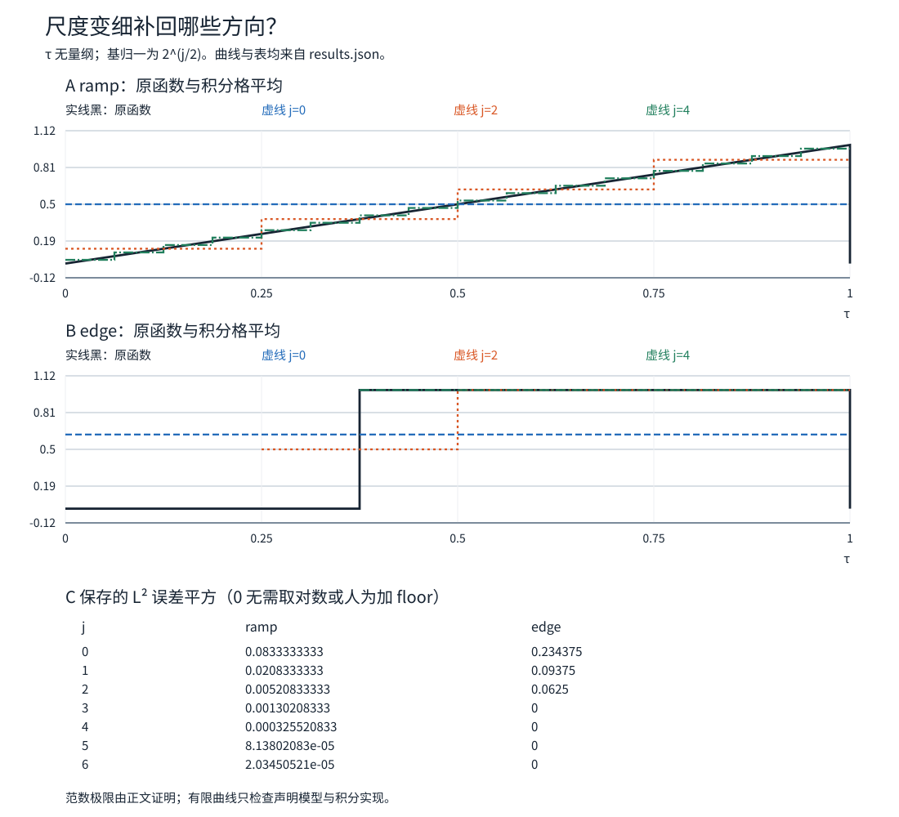
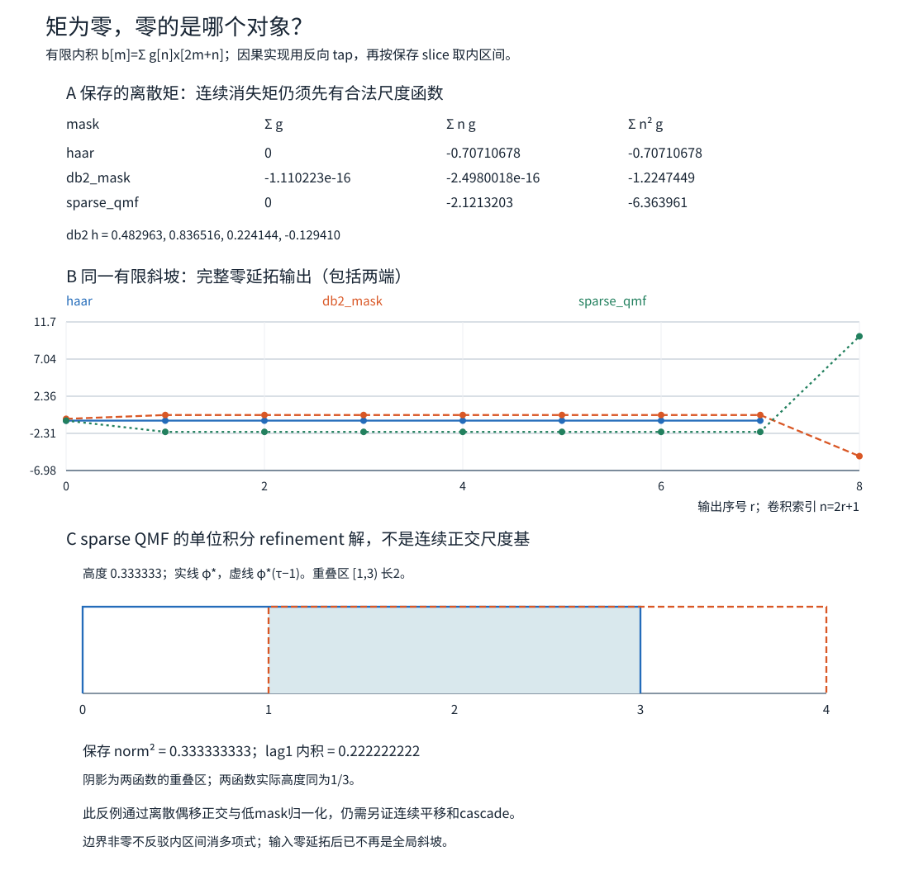

# 多分辨率分析：为什么平均与细节能成为整个函数空间的基

四个数可以由四个Haar系数恢复，是否就能把任意连续波形拆成同一套小波？还差一个无限维问题：我们找到的方向有没有漏掉一整片函数？上一课的[[信号与系统/20-数字信号处理/05-完美重建滤波器组与小波#分析合成的混叠抵消：两个条件都要满足|离散PR]]回答联合数组算子能否反演；本课回答尺度空间怎样铺满 $L^2(\mathbb R)$。这两份证明各有自己的输入域。

先完整构造Haar的多分辨率分析（MRA），再把它提炼成带明确前提的抽象结论。消失矩说明细节为什么不响应局部多项式；四tap db2在本页只作为**有限滤波的二矩模型**，连续db2的cascade存在、正交平移和正则性不由几条tap或一张图认证。同信号STFT/Haar/Mel、阈值真值和实际有限编码现在由[[信号与系统/20-数字信号处理/07-同信号时频多尺度表示阈值去噪与编码|应用后续页]]兑现；[[信号与系统/20-数字信号处理/08-db2连续构造双正交稳定性与长边界|连续db2、真实双基与长边界]]现将同一四tap接到连续存在/正则、全尺度稳定双基与有限长边界；更广家族按实际目标另选，不由本页tap自动推出。

## 对象与尺度：先决定在什么意义下恢复

本页令 $\tau\in\mathbb R$ 为无量纲坐标，$H=L^2(\mathbb R;\mathbb C)$，内积第一变量线性：

$$\langle f,g\rangle=\int_{\mathbb R}f(\tau)\overline{g(\tau)}\,d\tau.$$

元素按几乎处处相等识别；积分系数不依赖某个端点选0还是1。一般 $L^2$ 元素没有确定的单点样值，也不要求连续。范数完备性复用[[数学/16-数学分析/17-函数空间范数完备性与紧性#完备性的一个可追踪证明|函数空间页]]，闭空间投影复用[[数学/16-数学分析/19-Hilbert投影与Riesz表示的证明#闭线性子空间：从最近点得到正交条件|Hilbert投影定理]]；下面补的是这些定理在尺度空间中的具体对象。

若实际时间 $t=T\tau$，归一基应写成 $T^{-1/2}\phi_{j,k}(t/T)$，使 $\int|T^{-1/2}\phi_{j,k}(t/T)|^2dt=1$。电压波形的系数单位为 V·√s，系数平方和为 V²·s；还需负载模型才能换成J。本页数值只算无量纲坐标下的 $L^2$ 平方范数，不把上一课离散50 V²原样搬成连续能量。

定义单位伸缩 $Df(\tau)=\sqrt2 f(2\tau)$，令 $j$ 增大表示网格**变细**，宽度 $\Delta_j=2^{-j}$。有的教材相反编号，比较公式前先核这一点。

## 把Haar尺度空间真正造出来

取 $\phi=1_{[0,1)}$，令

$$I_{j,k}=[k2^{-j},(k+1)2^{-j}),\qquad
\phi_{j,k}(\tau)=2^{j/2}\phi(2^j\tau-k),\qquad j,k\in\mathbb Z.$$

同一尺度的这些函数支撑互不重叠，$\|\phi_{j,k}\|_2^2=2^j2^{-j}=1$，故正交归一。定义

$$V_j=\left\{\sum_{k\in\mathbb Z}c_k\phi_{j,k}: (c_k)\in\ell^2(\mathbb Z)\right\}.$$

这恰是每个 $I_{j,k}$ 上几乎处处常值、且平方可积的函数类。无穷和按 $L^2$ 解释，正交性给 $\|\sum c_k\phi_{j,k}\|_2^2=\sum|c_k|^2$。因 $\ell^2$ 完备，这个等距映射的像闭，故 $V_j$ 是**闭**子空间；不能只写有限span，再假装它已经收下所有极限。

每个粗格由两个细格组成，因此

$$\phi_{j,k}=\frac{\phi_{j+1,2k}+\phi_{j+1,2k+1}}{\sqrt2},\qquad V_j\subset V_{j+1}.$$

$DV_j=V_{j+1}$，并且平移 $k2^{-j}$ 保持 $V_j$。当 $j=0$，便是常说的整数平移。尺度为 $j$ 时不应把“整数格”误当成始终长1的格。

投影 $P_j:H\to V_j$ 有完全具体的公式：

$$c_{j,k}=\langle f,\phi_{j,k}\rangle=2^{j/2}\int_{I_{j,k}}f(\tau)d\tau,\qquad
(P_jf)|_{I_{j,k}}=2^j\int_{I_{j,k}}f(\tau)d\tau.$$

也就是每格的积分平均。Cauchy–Schwarz给 $\sum|c_{j,k}|^2\le\|f\|_2^2$，因此这个和对全部 $L^2$ 输入存在，且 $\|P_j\|\le1$。它不是任意点抽样：例如 $f(\tau)=\tau^2$ 在 $[0,1)$ 的平均是 $1/3$，中点值却是 $1/4$。

## 正交补：细节不是第二遍模糊

在每个粗格内定义

$$\psi_{j,k}=\frac{\phi_{j+1,2k}-\phi_{j+1,2k+1}}{\sqrt2}
=2^{j/2}\psi(2^j\tau-k),\quad
\psi=1_{[0,1/2)}-1_{[1/2,1)}.$$

两子格上，一对细系数 $(e,o)$ 被正交块变成 $(e+o,e-o)/\sqrt2$。这是上一课任意一对数的恒等式，现在作用于**函数的积分系数**。逐对等距作用于 $\ell^2$，所以不仅有限线性组合，而是整个空间满足

$$V_{j+1}=V_j\mathbin{\oplus^\perp}W_j,\qquad
W_j=V_{j+1}\cap V_j^\perp
=\overline{\operatorname{span}}\{\psi_{j,k}:k\in\mathbb Z\}.$$

同尺度的 $\psi_{j,k}$ 支撑不交且单位范数，因此是 $W_j$ 的ONB。若 $j<\ell$，则 $W_j\subset V_{j+1}\subset V_\ell$，而 $W_\ell\perp V_\ell$，所以不同尺度的细节也正交。这一步给**正交性**；它还没有给完备性。

令 $Q_j=P_{j+1}-P_j$，则它是到 $W_j$ 的正交投影：

$$d_{j,k}=\langle f,\psi_{j,k}\rangle
=2^{j/2}\left(\int_{I_{j+1,2k}}f-\int_{I_{j+1,2k+1}}f\right),$$

$$c_{j,k}=\frac{c_{j+1,2k}+c_{j+1,2k+1}}{\sqrt2},\qquad
d_{j,k}=\frac{c_{j+1,2k}-c_{j+1,2k+1}}{\sqrt2}.$$

后两式正是旧代码接本课的接口：先算细尺度积分系数，再调用原Haar分析；不是把任意波形点值当成这些系数。[MIT 18.327 Handout 9，PDF页7–10](https://ocw.mit.edu/courses/18-327-wavelets-filter-banks-and-applications-spring-2003/ecc72430047edfe3b4121d333958cc13_Handout9.pdf#page=7)将尺度空间、补空间与refinement放在同一条链上；本页把闭性与下一节的极限补齐。

## 为什么没有遗漏：细网格稠密，粗网格交集为零

**细端：$\overline{\bigcup_jV_j}=L^2(\mathbb R)$。** 给任意 $f\in L^2$ 和 $\varepsilon>0$，先同时截断位置和幅值，使得到的有界有限支撑函数与 $f$ 的 $L^2$ 距离很小；可积的 $|f|^2$ 尾部趋零保证这步。再对实部和虚部按高度量化成有限简单函数，因支撑测度有限，量化网格趋零使 $L^2$ 误差趋零。

还须把任意可测集合变成网格集合。对有限测度可测集 $E$，Lebesgue外逼近给开集 $O\supset E$ 且 $m(O\setminus E)<\eta$：由接近外测度的区间覆盖稍微放宽端点即可。$O$ 是可数互不相交开区间之并且总长度有限，选有限个使剩余总长度小于 $\eta$，所得有限区间并 $U$ 满足 $m(E\triangle U)<2\eta$。将有限个端点移到共同的足够细dyadic网格，新增对称差测度也任意小。因为 $\|1_E-1_U\|_2^2=m(E\triangle U)$，每个有限简单函数都可由**某一共同尺度的有限Haar格函数**逼近。三步误差用三角不等式控制，稠密性成立；不是“画得越来越细，所以显然完备”。

若 $q\in V_J$ 已近似 $f$，则对所有 $j\ge J$，最近点性质给 $\|f-P_jf\|_2\le\|f-q\|_2$，因此 $P_jf\to f$ **按范数**。不自动承诺每个指定点收敛，更不承诺一致收敛。

**粗端：$\bigcap_jV_j=\{0\}$，并且 $P_jf\to0$ 当 $j\to-\infty$。** 先对 $q\in L^1\cap L^2$：

$$\|P_jq\|_2^2=2^j\sum_k\left|\int_{I_{j,k}}q\right|^2
\le2^j\left(\sum_k\int_{I_{j,k}}|q|\right)^2
=2^j\|q\|_1^2\longrightarrow0.$$

有限支撑有界函数在 $L^2$ 稠密，且 $P_j$ 收缩。给一般 $f$ 选这样的 $q$，有 $\|P_jf\|_2\le\|f-q\|_2+\|P_jq\|_2$，先令 $j\to-\infty$，再让近似误差趋零，得到结论。若 $f$ 属于每个 $V_j$，则 $P_jf=f$，故只能为0。

这个证明避免一个常见陷阱：0始终是dyadic格的边界，粗格不会把正负半轴自动合成同一格；不能直接说交集里的函数在全直线上是“同一个常数”。即使分别得到两个半轴常数，$L^2(\mathbb R)$ 仍会迫使两者都是0。

## 从MRA到小波基：把无限两端的账结清

对整数 $A<B$，有限望远镜恒等式为

$$P_Bf=P_Af+\sum_{j=A}^{B-1}Q_jf,$$

$$\|P_Bf\|_2^2=\|P_Af\|_2^2+\sum_{j=A}^{B-1}\sum_k|d_{j,k}|^2.$$

先让细端 $B\to+\infty$，再让粗端 $A\to-\infty$，上一节的两端范数极限给

$$f=\sum_{j\in\mathbb Z}\sum_{k\in\mathbb Z}d_{j,k}\psi_{j,k}\quad(L^2),\qquad
\|f\|_2^2=\sum_{j,k}|d_{j,k}|^2.$$

也可固定一个粗尺度 $J_0$，保留其全部 $c_{J_0,k}$，只加 $j\ge J_0$ 的细节：

$$f=P_{J_0}f+\sum_{j\ge J_0}Q_jf.$$

同尺度及跨尺度正交，加上这条完备性，才称 $\{\psi_{j,k}\}_{j,k\in\mathbb Z}$ 为ONB。正交级数平方尾和控制范数尾项，所以展开按 $L^2$ 收敛；不能在这里悄悄升级为任意代表函数的逐点等号。其能量与极限要求也强于“每个固定读数收敛”的[[数学/16-数学分析/20-泛函分析/08-弱拓扑弱星拓扑与收敛#回到正弦振荡和 Green 求解：哪些量可以穿过弱极限|弱收敛]]，不应用有限观测替代范数误差。

**抽象正交MRA的同一结论。** 若一族闭子空间满足 $V_j\subset V_{j+1}$、$DV_j=V_{j+1}$、并集稠密、交集为0，并有 $\{\phi(\cdot-k)\}$ 为 $V_0$ 的ONB，这给出单生成正交MRA的尺度框架。令 $W_j=V_{j+1}\cap V_j^\perp$。若进一步已构造 $\psi$，使其整数平移是 $W_0$ 的ONB，则单位伸缩给每个 $W_j$ 的ONB，且上面的望远镜论证给全空间小波ONB。

一般MRA中细端极限仍由稠密性和投影最优性推出。粗端也不需要图像直觉：当 $k<j$，嵌套投影给 $\|P_jf-P_kf\|^2=\|P_jf\|^2-\|P_kf\|^2$。范数平方沿 $j\to-\infty$ 单调趋于某非负极限，故投影列Cauchy；其极限在每个闭 $V_j$ 中，交集为0迫极限0。这样，ONB结论的每个极限都兑现了。

这是一条**带前提的构造定理**：Haar已逐项交出 $\phi,\psi$ 与全部前提；任意新滤波器的连续解、平移稳定性及补空间生成仍需另证。[Handout 11，PDF页6](https://ocw.mit.edu/courses/18-327-wavelets-filter-banks-and-applications-spring-2003/1bb693efeb7d2ea97f12ae72812f7522_Handout11.pdf#page=6)在从离散正交滤波通向连续正交时也明确要处理cascade收敛。

## 同一个输入的投影、细节与误差

固定 $f(\tau)=\tau1_{[0,1)}(\tau)$。对 $j\ge0$ 和 $0\le k<2^j$，逐格积分得

$$c_{j,k}=(k+\tfrac12)2^{-3j/2},\qquad d_{j,k}=-\tfrac14\,2^{-3j/2}.$$

每格投影是中点高度，但这是对**线性函数**的积分结果。格内误差为 $\Delta_j^3/12$，共 $2^j$ 格，故

$$\|f-P_jf\|_2^2=\frac1{12}4^{-j},\qquad
\|Q_jf\|_2^2=\frac1{16}4^{-j}.$$

例如 $c_{0,0}=1/2,d_{0,0}=-1/4$；总范数平方 $1/3=1/4+\sum_{j\ge0}(1/16)4^{-j}=1/4+1/12$。格变细一倍，Haar对这条斜坡的误差**平方**缩到1/4，误差范数缩到1/2，不能混说。

换成 $f_e=1_{[3/8,1)}$，则 $j=0,1,2$ 的误差平方分别为 $15/64,3/32,1/16$，$j\ge3$ 时为0，因为断点终于落在网格边界。不是所有边缘都有这种有限尺度精确性：非dyadic断点在任何有限网格都可能落在格内。

旧四点也能精确接过来：令 $f_x$ 在四个四分之一区间上依次为 $1,3,2,6$。它的 $c_2=(1,3,2,6)/2$，不是原样本数组；连续平方范数为 $50/4=12.5$。调用同一Haar分析得到 $c_1=(\sqrt2,2\sqrt2)$、$d_1=(-1/\sqrt2,-\sqrt2)$，再得 $c_0=3,d_0=-1$，账本 $12.5=9+1+2.5$。旧[[信号与系统/80-实践/13-Haar分析合成与边界/README|有限记录实验]]的50与本页12.5各自在自己的度量下正确。

**归一化失效例。** 若把基改成未归一的 $b_{j,k}=\phi(2^j\tau-k)$，却仍用“内积系数后原基相加”，重建成 $2^{-j}P_jf$，因为 $\|b_{j,k}\|^2=2^{-j}$。在 $j=2$，上面四格的3被重建成 $3/4$。未归一基本身并非不可用；正确投影应除以基范数平方，或使用相应对偶。把 $2^{j/2}$ 省掉以后还沿用Parseval，才是归一化把戏。

## 消失矩：为什么多项式背景不进入细节

若紧支撑小波 $\psi$ 满足

$$\int u^r\psi(u)du=0,\qquad r=0,\ldots,p-1,$$

称至少有 $p$ 个消失矩；若第 $p$ 阶非零，则恰有 $p$ 个。Haar的0阶矩为0、1阶矩为 $-1/4$，故恰一个。对任何次数小于 $p$ 的多项式，变量替换和二项式展开给 $\langle P,\psi_{j,k}\rangle=0$。这里是紧支撑上的局部积分：非零全直线多项式通常不在 $L^2(\mathbb R)$，不能因此宣称它已经有一个合法的全直线有限能量展开。

更有用的是近似量级。令 $J_{j,k}=\operatorname{conv}(\{2^{-j}k\}\cup\operatorname{supp}\psi_{j,k})$，即包含展开中心 $2^{-j}k$ 与 $\operatorname{supp}\psi_{j,k}$ 的最小闭区间。若 $f$ 在该区间的邻域是 $C^p$，Taylor减去次数 $p-1$ 的局部多项式后，积分只剩余项：

$$|d_{j,k}|\le\frac{\sup_{J_{j,k}}|f^{(p)}|}{p!}
\,2^{-j(p+1/2)}\int |u|^p|\psi(u)|du.$$

导数上界必须覆盖整条Taylor路径，不能只在可能有洞的支撑上取上确界。更多矩让**足够光滑的局部背景**在细尺度衰减更快。跨跳变边缘时导数条件失效，不能把同一界硬套过去，也不能断言阈值一定改善真实信号。稳定基、全局逼近阶和噪声风险还要各自的条件。[Handout 13，PDF页2–3](https://ocw.mit.edu/courses/18-327-wavelets-filter-banks-and-applications-spring-2003/99231bc0f90b87508c01a2e7f5a960e7_Handout13.pdf#page=2)连接连续矩与滤波器的多项式消去；本页的斜坡与有限mask计算分别直接验证这两种对象。

### 四tap db2先兑现哪一层

用refinement约定 $\phi(\tau)=\sqrt2\sum_nh_n\phi(2\tau-n)$。Haar的 $h=(1,1)/\sqrt2$；常用db2低mask为

$$h=\frac1{4\sqrt2}(1+\sqrt3,\ 3+\sqrt3,\ 3-\sqrt3,\ 1-\sqrt3),\qquad
g_n=(-1)^nh_{3-n}.$$

直接展开得 $\sum h_n=\sqrt2$、$\sum h_n^2=1$、$h_0h_2+h_1h_3=0$，而

$$\sum_ng_n=0,\qquad\sum_nng_n=0,\qquad
\sum_nn^2g_n=-\sqrt{3/2}\ne0.$$

因此离散内积 $b[m]=\sum_{n=0}^3g_nx[2m+n]$ 对常数与斜坡为0，对 $x[n]=n^2$ 则恒为 $-\sqrt{3/2}$，在滤波支持完整的内区间成立。它恰有**两个离散矩**；对应低mask多项式

$$H(z)=\frac{(1+z^{-1})^2[(1+\sqrt3)+(1-\sqrt3)z^{-1}]}{4\sqrt2}$$

在 $z=-1$ 有二重零点。Haar细mask则只消常数，对斜坡为 $-1/\sqrt2$。代码将内积改写为反向tap的旧 `offline` 完整卷积，并保存完整零延拓输出与内区间裁片，明确区分相关和因果卷积相位。

若已经另证可积、适当支撑的连续 $\phi$ 存在，构造 $\psi=\sqrt2\sum g_n\phi(2\tau-n)$ 后有

$$\int \tau^r\psi(\tau)d\tau
=2^{-r-1/2}\sum_ng_n\int (u+n)^r\phi(u)du.$$

二项式展开才把离散0/1矩传到连续0/1矩。这个条件式没有证明 $\phi$ 存在，也不证明它的整数平移是ONB；下一节就给相反警示。

多两个tap的收益是额外的局部多项式消去；代价是每个细节覆盖四个而非两个样点、更多邻域跨边界、算术和状态增多，并且这组db2 tap不对称，不能照搬Haar的逐对中心解释。若输入只在有限记录里是常数/斜坡，零延拓会在端点制造跳变，边缘输出一般非零。现在到[[信号与系统/20-数字信号处理/08-db2连续构造双正交稳定性与长边界#有限长滤波：同一组tap，三种端点行为|四tap长边界后续]]，带同一h/g核periodic、完整零延拓及漏系数的零空间；相位、有效区间和裁剪均重新声明。

消失矩、函数光滑性、紧支撑和对称性不是一个指标。双正交通常以不同分析/合成函数换取设计自由，但必须证明双基稳定性、连续生成与边界；原页有限shear只能说明能量不再自动Parseval。[Handout 14 的cascade/正则性问题](https://ocw.mit.edu/courses/18-327-wavelets-filter-banks-and-applications-spring-2003/b681a52dd1ffc62eef7e1eb27222f94e_Handout14.pdf#page=1)把光滑性另作条件，不由“两个消失矩”替代。本文不从一条tap列表给db2光滑阶或宣称已构造一般连续双正交小波。[[信号与系统/20-数字信号处理/08-db2连续构造双正交稳定性与长边界|连续db2、真实双基与长边界]]另以Fourier积和连续自相关补足db2，并在已证补空间内构造一对真实双基；那是新增证明，非本页离散输出的别名。

## PR甚至QMF为什么还不是连续MRA的存在证明

**第一道反例：系数拆开原样放回，不保证refinement有非零解。** 离散向量可以做lazy split $a[m]=x[2m],d[m]=x[2m+1]$ 再交织，系数域分析/合成矩阵均为I，PR显然成立。这是直接的两相位坐标定义，不是沿用上一课phase1因果tap后仍把其矩阵误写I。若把低refinement mask取成 $h=[1]$，对应

$$\phi(\tau)=\sqrt2\phi(2\tau).$$

设 $A_m=[2^m,2^{m+1})$。变量替换给 $\int_{A_m}|\phi|^2=\int_{A_{m+1}}|\phi|^2$，所有正半轴dyadic壳层有同一质量；有限总质量迫其都为0。负半轴同理，单点0测度为0，所以唯一 $L^2$ 解是0。离散PR并没有自动送来非零尺度函数。

**更强的低mask警示：连归一化与离散QMF都可能通过。** 取

$$h=(1,0,0,1)/\sqrt2.$$

它满足 $\sum h=\sqrt2$ 和偶移正交 $\sum_nh_nh_{n-2m}=\delta_{m0}$，可配成正交离散滤波器组；但其refinement为 $\phi(\tau)=\phi(2\tau)+\phi(2\tau-3)$。单位积分的可积解是

$$\phi_*(\tau)=\tfrac13 1_{[0,3)}(\tau),\quad
\|\phi_*\|_2^2=\tfrac13,\quad
\langle\phi_*,\phi_*(\cdot-1)\rangle=\tfrac29.$$

整数平移重叠，不是正交尺度基。把函数乘 $\sqrt3$ 修成单位范数仍不能消掉非零交叠。

还可排除“另找一个单位积分 $L^1$ 解”的退路。用 $\widehat\phi(\omega)=\int\phi(\tau)e^{-i\omega\tau}d\tau$，迭代refinement给

$$\widehat\phi(\omega)=\prod_{r=1}^M\frac{1+e^{-i3\omega/2^r}}2\ \widehat\phi(\omega/2^M).$$

$L^1$ 保证在0连续、单位积分给 $\widehat\phi(0)=1$。有限乘积利用反复二分恒等式收敛为

$$e^{-i3\omega/2}\frac{\sin(3\omega/2)}{3\omega/2},$$

0点按极限1；这正是 $\phi_*$ 的Fourier变换，$L^1$ Fourier唯一性使该类解唯一。这个推论明确限定为单位积分 $L^1$ 解，包含紧支撑且单位积分的 $L^2$ 候选；它没有宣称所有无积分假设的 $L^2$ refinement解都不存在。

若从 $1_{[0,1)}$ 开始cascade，第 $M$ 次迭代恰为 $\sum_{k=0}^{2^M-1}1_{[3k2^{-M},(3k+1)2^{-M})}$：这些格不交，积分与平方范数始终都是1，支撑始终在 $[0,3]$。若它在 $L^2$ 强收敛，有限共同支撑使它也在 $L^1$ 收敛；refinement算子有界，极限将是单位积分的 $\phi_*$。但极限应保持范数1，而 $\|\phi_*\|_2^2=1/3$，矛盾。所以这一起点的cascade不能在 $L^2$ 强收敛；迭代次数多不是存在证明。

[Handout 10，PDF页1–2与5的refinement、cascade和乘积](https://ocw.mit.edu/courses/18-327-wavelets-filter-banks-and-applications-spring-2003/9ff64f06305331f35d46753341de2346_Handout10.pdf#page=1)提示为什么连续极限必须单独检查；这里的两个失败例均可直接复算。

## 撤去提示：判断你究竟证明了哪件事

1. 只证明 $\langle\psi_{j,k},\psi_{\ell,m}\rangle=\delta_{j\ell}\delta_{km}$，为何还不能宣布它们是小波基？补哪两个尺度极限，才能完成本页证明？
2. 在 $L^2(0,1)$ 而非全直线工作，能否直接把所有整数 $j,k$ 的全直线Haar都限制进来？给一个不重复、不遗漏的区间ONB。
3. 对 $f=\tau1_{[0,1)}$，不给图，求 $P_2f$ 四格高度、误差平方及 $j=2$ 细节总平方和。若把基的 $2^{j/2}$ 省掉却保留原分析/合成公式，四格会怎样？
4. 对 $1_{[3/8,1)}$，为什么 $j=3$ 后无细节，而将断点改为 $1/3$ 后通常不可能有限尺度终止？这能推出所有边缘都适合固定阈值吗？
5. 某四tap有 $\sum g_n=\sum ng_n=0$，对内区间斜坡输出0。它是否已经证明连续小波有两个消失矩、全空间完备、有限零边界也全为0？怎样补各层条件？
6. 若任务是保留平滑趋势旁的尖锐边缘，增加消失矩会改善什么，又可能损伤什么？在交付去噪结果前还缺什么证据？

> [!answer]- 可核对的答案
> 1. 正交族可能遗漏闭正交补，例如只取一半编号。要有细端 $P_jf\to f$（并集稠密）和粗端 $P_jf\to0$（闭嵌套空间交集零），再用望远镜分解；有限矩阵秩不能替代这两个全函数空间极限。
> 2. 不能机械照搬：限制会产生零函数、重复或改变范数。在本页网格与端点约定下，$1_{[0,1)}$ 与 $\psi_{j,k}$（$j\ge0,0\le k<2^j$）构成 $L^2(0,1)$ 的ONB。固定粗尺度0、在该区间细化的同一稠密证明与投影展开即可，常数方向须保留。
> 3. 高度 $(1/8,3/8,5/8,7/8)$；误差平方 $1/192$，该层细节总平方和 $1/256$。未归一基却用同一内积分析/原基合成，变成这些高度的1/4；若同步使用正确对偶，则可修复，不能把未归一本身误叫不可逆。
> 4. $3/8$ 是 $2^{-3}$ 的整数倍，$f\in V_3$；$1/3$ 不是任何有限dyadic网格点，跨断点格仍有非零方差。更多消失矩的Taylor界要求支撑内光滑，过边缘即可能失效，固定阈值还会改变真实边缘系数。
> 5. 只证了该离散内积的两矩。连续结论还需存在适当 $\phi,\psi$ 和合法积分，完备性需闭尺度空间、稠密/交集与补空间基；零边界把原多项式换成带跳变的有限记录，必须另检查支持完整的内区间与两端输出。sparse QMF反例说明离散偶移正交也不够。
> 6. 对足够光滑背景，局部细节随尺度衰减更快；更长支持跨更多邻域，边缘定位、对称性、延时、状态和边界都会付代价。需明确噪声模型、独立真值、保边缘指标、边界合同及量化/编码条件，实际测误差与风险；本页没有去噪有效性或码率承诺。

[[信号与系统/80-实践/14-Haar函数空间与消失矩/README|解析积分与旧Haar代码的可复算接口]]保存固定输入、两种误差计算、独立预期与失败判据。连续MRA的证明在正文，有限输出检验实现；有限滤波矩、连续函数存在、客户端显示和真人理解不混作同一层验收。
