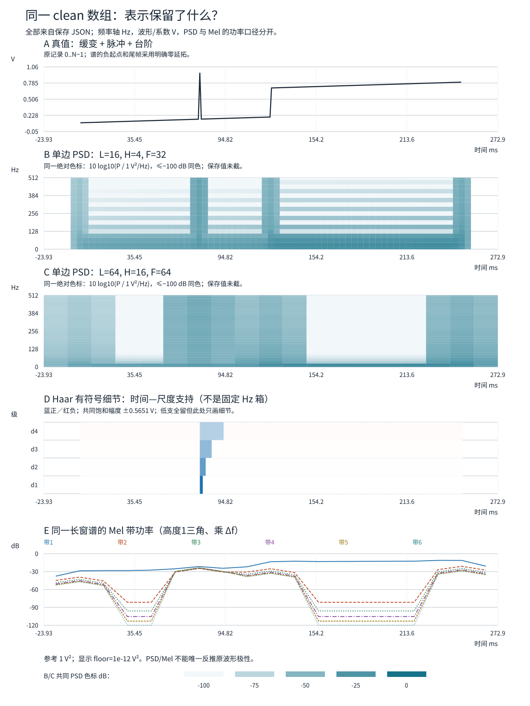
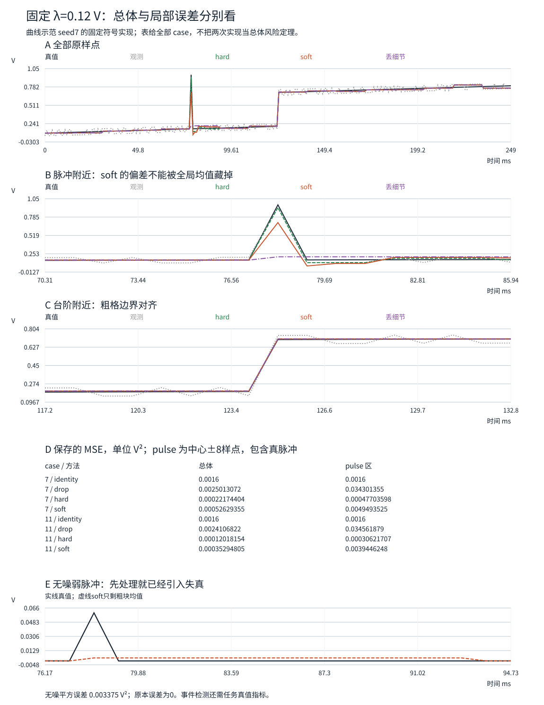

# 同一条信号：时频图、小波细节、去噪结果和编码文件分别证明什么

一张时频图显示脉冲，一组小波系数很稀疏，一条处理后的曲线更平滑，一个文件更小：这些现象能否组成“信号处理得更好”的证明？先把目标拆清：**保留原记录、辨认结构、估计无噪真值、降低存储字节**是不同任务，但必须能在同一数据上对账。

本页固定一条包含缓变、脉冲与边缘的电压序列，用既有完整复STFT和Haar源码做表示，再以同一真值检查阈值与实际编码。不重讲[[信号与系统/20-数字信号处理/05-完美重建滤波器组与小波#分析合成的混叠抵消：两个条件都要满足|联合PR]]、[[信号与系统/20-数字信号处理/06-多分辨率分析尺度空间与小波基#从MRA到小波基：把无限两端的账结清|连续Haar基的完备性]]或[[数学/70-信号处理与多模态数学/03-STFT窗覆盖与可逆重建#2. 从帧回到记录：逐点分母的推导|STFT覆盖证明]]，而是把它们兑现成同输入的应用合同。后续[[信号与系统/20-数字信号处理/08-db2连续构造双正交稳定性与长边界|连续db2、真实双基与长边界]]补具体连续构造/稳定性和四tap长边界，保持本页独立真值与实际文件合同。

## 先冻结同一条物理口径的数组

单通道、幅值V、$N=256$、$f_s=1024$ sample/s，$t_n=n/f_s$。记录时长按 $N/f_s=0.25$ s算，最后一个样点的时刻是 $255/1024$ s，两者不要混用。真值为

$$s[n]=\underbrace{0.1+0.2\frac n{255}}_{\text{缓变背景}}
+\underbrace{0.5\,1_{n\ge128}}_{\text{台阶}}
+\underbrace{0.8\,1_{n=80}}_{\text{单样点脉冲}}\quad\mathrm V.$$

这是明确生成的**数字测试真值**，不是麦克风或模拟电路的已测波形。单样点脉冲和理想台阶不满足某个有限模拟带宽，不能把这里的0.25 s记录冒称对任意连续前端的物理复现。

观测 $y[n]=s[n]+\varepsilon[n]$，两个固定实现的噪声每点为 $\pm0.04$ V，完整符号串随输入保存，标签为seed7/11。若把生成过程建模成独立Rademacher符号，则总体均值0、方差 $\sigma^2=0.0016$ V²；每个固定实现相对零的均方恰好是 $\sigma^2$，但其去均值样本方差未必等于 $\sigma^2$。符号串是执行时的实际输入，seed仅是生成来源标签；只改seed而不改符号串不会改变噪声。两次实现不等于已经估计完整风险分布，也不是Gaussian噪声试验。

统一采用

$$\operatorname{MSE}(\widehat s,s)=\frac1N\sum_{n=0}^{N-1}(\widehat s[n]-s[n])^2\quad[\mathrm V^2],$$

$$E_{\rm err}=\frac1{f_s}\sum_n(\widehat s[n]-s[n])^2\quad[\mathrm V^2\,s].$$

后式是按当前采样格的平方误差积分近似，不是J；换成电能还需负载。脉冲和台阶各报告中心±8样点的MSE，端点报告首/尾各8样点，共16点；局部观察区可能重叠，且分母不同、并未覆盖全域；即使默认这些区互不重叠，也不能直接把局部MSE相加成总体MSE。保留全256点，不把困难边缘裁掉以后换分母。

## 同一记录的三种表示，坐标和单位不混用

### STFT：共同频率轴下的局部谱

两组参数都用周期Hann $w_L[r]=(1-\cos(2\pi r/L))/2$、未缩放DFT和逆变换 $1/F$：

| 配置 | $L,H,F$ | 窗时长 | hop时长 | bin间隔 |
| --- | --- | --- | --- | --- |
| 短窗 | 16,4,32 | 15.625 ms | 3.90625 ms | 32 Hz |
| 长窗 | 64,16,64 | 62.5 ms | 15.625 ms | 16 Hz |

这里同时改变了窗和DFT长度，所以bin也变了；不能把bin变化全归给窗。短窗的32点DFT有16点右侧零填充，只使同一加窗片段的谱网格加密，没有增加观察时长。长窗覆盖更多时间，跨脉冲或台阶的更多帧会混合两侧信息，事件时间会按窗响应展开；它不是原事件持续了62.5 ms。

对有限记录采用零延拓，帧起点为 $S=\{-L+H,-L+2H,\ldots,N-H\}$，即代码 `range(-L+H,N,H)`。两组分别有67和19帧，连负起点与尾帧都实际计算。用同窗合成的实际平方分母 $D[n]=\sum_{s\in S}w[n-s]^2$ 在全部原256点约为1.5，未修改完整复谱恢复误差分别约 $1.26\times10^{-15}$ V和 $7.49\times10^{-15}$ V。只取完整窗时首点分母为0，原 $s[0]=0.1$ V没进入观测，结果必须标未知；更多零填充不会补回它。

为了比较两窗的功率密度，定义 $U=\sum_rw[r]^2$，实输入的单边PSD为

$$P_s[k]=\frac{\alpha_k|X_s[k]|^2}{f_sU},\quad
\alpha_k=\begin{cases}1,&k=0\text{ 或 }k=F/2,\\2,&0<k<F/2,\end{cases}
\quad [\mathrm V^2/\mathrm{Hz}].$$

偶数 $F$ 时DC与Nyquist不成正负频率对，不能全部乘2。由完整DFT的Parseval，$\Delta f=f_s/F$ 给

$$\sum_{k=0}^{F/2}P_s[k]\Delta f
=\frac{\sum_r\widetilde s[s+r]^2w[r]^2}{U}\quad[\mathrm V^2].$$

边界帧仍用同一整个窗的 $U$，不偷偷按有效样点重归一；所以零延拓帧的局部功率有自己的边界效应。重叠帧的功率不能不加权地相加成整条记录能量，那会重复计算样点。完整谱 $X$ 的数值单位是V，PSD和幅度图是另一个对象。

### Haar：时间—尺度方向不是固定频率箱

复用旧代码做四级正交Haar，系数按 $c=(a_4,d_4,d_3,d_2,d_1)$ 排列，低支16项，细节240项，总共仍256个自由度。$d_\ell[k]$ 对应长度 $2^\ell$ 个样点的左右半段之差；支持宽度分别为1.953125、3.90625、7.8125、15.625 ms。图上横坐标画该支持的真实时间区间，不能把第几级直接贴成一个无重叠矩形Hz频带：Haar的实际频率响应宽而重叠。

这些是离散欧氏归一系数，单位V，平方和单位V²；若要接前课连续积分系数，必须带上 $\sqrt{\Delta t}$ 等归一。全留的正交恒等式是 $\|s\|_2^2=\|c\|_2^2$，且任意处理后系数 $\widehat c$ 都有

$$\|W^T\widehat c-s\|_2^2=\|\widehat c-Ws\|_2^2.$$

这里只因同一有限正交 $W$、同一完整原域成立；不是所有边界延拓、双正交、STFT冗余系数都能照搬。此前奇长补边/裁剪为何会破坏原域投影，继续看[[信号与系统/20-数字信号处理/05-完美重建滤波器组与小波#奇长度：边界不仅改变最后一个系数|边界主解释]]。

本例台阶恰在16样点粗块边界128，低支就能保留它。若只把台阶移至129，在 $n=128,129$ 的一对中，新增台阶分量的细节变为 $-0.5/\sqrt2$ V，其他层也要补偿；这说明移位会改变临界抽样Haar的稀疏性。默认台阶表现好有格对齐这个条件，不是“阈值天然保住每条边”。

### Mel：对同一PSD积分，而非把相位重新编码

在 $[0,f_s/2]$ 上，用 $m(f)=2595\log_{10}(1+f/700)$ 等间距放8个节点，构造6个高度为1的三角滤波器 $B_b[k]$，不做面积归一化。本页定义

$$M_s[b]=\sum_kB_b[k]P_s[k]\Delta f\quad[\mathrm V^2].$$

这与只写 $\sum B|X|^2$ 的未经PSD标定结果数值不同；若换成面积归一或去掉 $\Delta f$，必须同时改单位和解释。各三角不在所有端点构成完整单位分解，不能从本例6带和自动推出总功率。Mel标度和信息损失的主解释继续复用[[数学/70-信号处理与多模态数学/02-采样定理波形STFT与Mel频谱#5. Mel 频谱：按听觉尺度汇总频率|原Mel页]]。

对所有帧将 $s$ 整体取负，STFT只变号，PSD和全部Mel带功率完全相同。因此就算Mel曲线很好看，也不能据它唯一确定原电压极性。完整复STFT/Haar可以恢复；PSD/Mel已改变信息对象。显示若再用 $10\log_{10}(\max(M,10^{-12}\mathrm V^2)/(1\mathrm V^2))$，下限只是画图选择，低于下限的区别又被压掉；它没有参与这里的逆变换或真值误差。

## 阈值为什么可能去噪，也可能删掉真信号

设 $y=s+\varepsilon$，$z=Wy=\theta+\eta$，$\theta=Ws$。若噪声均值0、协方差 $\sigma^2I$，正交性给 $\operatorname{Cov}(\eta)=\sigma^2I$。但独立Rademacher变量的正交组合一般不独立；只有额外的联合Gaussian等条件才能由这种协方差推出独立，别把“白”偷换成“每项独立”。

如果**事先固定**保留集合 $K$、其余置0，期望平方误差为

$$\mathbb E\|\widehat s-s\|_2^2=|K|\sigma^2+\sum_{i\notin K}\theta_i^2.$$

留下的方向付噪声方差，丢掉的方向付真实系数的平方。这是偏差—方差账本；它不直接适用于由观测幅值选择的随机集合 $K(y)$，否则等于把被挑选的噪声当成没经过选择。理想按 $\theta_i^2$ 判断的oracle需要未知真值，不能拿来当可部署调参器。

本次在看结果前固定 $\lambda=3\sigma=0.12$ V，**仅处理全部细节**、保留低支16项；三种操作为

$$\operatorname{drop}(z)=0,\qquad
H_\lambda(z)=z1_{|z|>\lambda},\qquad
S_\lambda(z)=\operatorname{sgn}(z)(|z|-\lambda)_+.$$

hard留下大细节不改数值，soft同时将留下的数向0拉；等于阈值时两者均置0。$\lambda$ 必须和当前系数有同一单位，不能把连续单位能量系数的阈值直接照搬到未归一数组。

对单个系数，原观测误差为 $\eta_i^2$，若删掉则为 $\theta_i^2$，所以一旦删到重要信号，误差会变大。soft在未置0处的误差为 $(\eta_i-\lambda\operatorname{sgn}z_i)^2$，也可能引入偏差。[Donoho 1995 原论文，§I与§II–IV](https://www.fceia.unr.edu.ar/~jcgomez/wavelets/Donoho_1995.pdf#page=1)讨论的是带Gaussian/函数类/基及风险条件的收缩理论，§III式(14)给soft定义；本页的两条固定Rademacher实现不继承那里的渐近最优或概率保证。

| 方法 | seed7总体MSE V² | seed11总体MSE V² | seed7脉冲区MSE V² |
| --- | ---: | ---: | ---: |
| 原观测／全留 | .00160000 | .00160000 | .00160000 |
| 全部细节丢弃 | .00250131 | .00241068 | .03430135 |
| hard，.12V | .000221744 | .000120182 | .000477036 |
| soft，.12V | .000526294 | .000352948 | .00494935 |

hard和soft在这两次总体误差都下降；soft却让seed7的脉冲区误差升至原观测的约3.09倍。真值脉冲所在样点为约 .962745 V，soft恢复约 .705466 V；总体改善与局部损伤可以同时成立。全部丢细节更糟，它把单点脉冲摊到粗块里，却因台阶对齐仍能在台阶处看似表现不错。完整区域指标见保存CSV，不能只挑最好的一列。

**一个不靠随机抽样的失败例。** 无噪声输入只有一个幅值 $A=\lambda/2=.06$ V的单点脉冲，仍做四级Haar并soft处理细节。所有细节都小于阈值被删；其所在16点粗块被恢复成每点 $A/16=.00375$ V。原来零误差变成

$$A^2(1-1/16)=.003375\ \mathrm V^2.$$

保留能量为 $A^2/16=.000225$ V²。曲线更平不表示估计更真；阈值若连无噪小脉冲都删掉，就不能用“滤掉的都是噪声”解释。

## 非零数少了，文件究竟小多少

变换全留、系数置零、量化和序列化分开计。本实验构造一个很小的教学格式，实际写文件、重新读字节、仅从该字节解码；不把它叫作WAV、FLAC或标准小波codec。

- 共同24 byte little-endian头：`magic[4] / N:uint16 / levels:uint16 / fs:uint32 / q:float64 / K:uint32`，无原生对齐padding。magic `WSP1` 指本版Haar稀疏格式，`PCM1` 指本版逐样点稠密格式。
- `PCM1` 后面恰 $N$ 个little-endian int16，levels=0、K=N，共 $24+2N$ byte。
- `WSP1` 按 $(a_4,d_4,d_3,d_2,d_1)$ 次序给系数编号，只保存量化后非0项；每项 `index:uint16 / code:int16`，索引严格递增，共 $24+4K$ byte。Haar符号/配对约定由版本规定，N/levels保存重建尺度。

量化 $k_i=\operatorname{round}(c_i/q)$、$\widehat c_i=qk_i$，本例 $q=.01$ V，中点取偶；超int16拒绝，不饱和、不自动改scale。量化合同复用[[数学/60-数值计算与量化/02-量化Scale-Zero-Point-Group与误差#1. 仿射整数量化的基本公式|已有量化主解释]]。未溢出时 $|\widehat c_i-c_i|\le q/2$，有限正交逆给

$$\|\widehat x-x_{\rm target}\|_2^2\le Nq^2/4,\qquad
\operatorname{MSE}(\widehat x,x_{\rm target})\le q^2/4.$$

这里 target 是**送进编码器的那条曲线**。若先soft再编码，编码目标是soft输出，真值仍是原 $s$；两种误差分开存。soft误差与量化误差可能有交叉项，不能简单把两个MSE相加。容器不保存真值或原浮点系数，解码器不能从旁路补回已丢细节。

| 实际文件 | 非零量化项K | 完整byte | bit/原样点（含头） | 对clean真值MSE V² |
| --- | ---: | ---: | ---: | ---: |
| clean逐点PCM1 | 256 | 536 | 16.75 | $8.29759\times10^{-6}$ |
| clean Haar WSP1 | 35 | 164 | 5.125 | $4.78343\times10^{-6}$ |
| seed7原观测PCM1 | 256 | 536 | 16.75 | .00161173 |
| seed7原观测Haar WSP1 | 156 | 648 | 20.25 | .00169664 |
| seed7 soft后WSP1 | 20 | 104 | 3.25 | .000523415 |
| seed11原观测PCM1 | 256 | 536 | 16.75 | .00161369 |
| seed11原观测Haar WSP1 | 157 | 652 | 20.375 | .00168665 |
| seed11 soft后WSP1 | 20 | 104 | 3.25 | .000342695 |

对本256点块，稀疏容器比同头PCM1小的充要字节条件是 $4K<2N$，即 $K<N/2$；非零数量减少本身还不够。噪声把很多细节填满，seed7/11的稀疏文件反而比536 byte的PCM1大。clean的稀疏性与噪声观测的稀疏性不是同一承诺。

码率按原记录时长 $N/f_s$：完整byte数乘8再除0.25 s。clean Haar为5248 bit/s，536 byte PCM1为17152 bit/s；纯PCM载荷仍是 $16f_s=16384$ bit/s，差别是块头。要比较真实音频格式，再去[[计算机知识/60-数据编码与媒体系统/06-数字音频采样量化PCM与响度#4. sample、sample frame、声道与时长|PCM字节/时长]]和[[计算机知识/60-数据编码与媒体系统/01-表示编码序列化压缩与容器的边界|表示与容器边界]]，不要拿本toy文件扩展名当生产格式支持。

这几项是固定输入、固定量化步长/规则下的实际操作点，不是一般[[数学/50-信息论/10-信源信道与率失真/04-率失真与信源信道分离#把“允许多差”写成模型|率失真函数]]，没有熵编码优化或感知听感结论。[Python struct的标准大小与字节序](https://docs.python.org/3.14/library/struct.html#byte-order-size-and-alignment)支撑具体字节格式；不是只凭非零个数估算文件。

## 撤去提示：为你的目标选择表示与证据

1. 同一16点窗，把DFT从16零填充到32，脉冲定位是否真的多了一倍时间信息？若64点窗的图看起来更平滑，它是否证明原脉冲更宽？
2. PSD、Mel带功率和Haar细节系数平方分别是什么单位？单边DC为什么不乘2？若把Mel公式的 $\Delta f$ 删掉，原数值/单位还能沿用吗？
3. seed7 soft的总体MSE下降，但脉冲区变差。你要检测微弱事件时，会接受“去噪成功”这个结论吗？该保留哪些局部指标？
4. 将台阶从128移至129，先预测哪一对最细细节被激活；它是否推翻Haar的PR？若要测移位稳健性，你应固定什么？
5. $N=256,K=150$，本WSP1是否比PCM1小？如果换成熵编码，能否直接沿用这个判据？
6. soft后量化的文件对soft目标MSE很小，能否说明已接近无噪真值？给出本页足以反驳的例子。
7. 你接到同一记录的三个任务：逐样保存供审计、定位微弱瞬态、提取允许丢波形极性的音色特征。分别自主选择STFT/Haar/Mel中的表示，说明保留元数据、允许的信息损失与验收指标；答案不要求某种表示通吃。

> [!answer]- 可检查的答案
> 1. 不增加原观察时长或样点，bin从64变32Hz但信息来自同一16点；长窗展开事件响应，不能把窗卷出来的宽度当真持续时间。时频分辨任务须按实际窗与信号判据重查。
> 2. PSD V²/Hz，Mel在本积分合同下V²，离散Haar系数平方V²。DC和Nyquist各自不成共轭双边对；删 $\Delta f$ 后成为PSD权重和的V²/Hz对象，不再是本带功率，不能沿用原单位或跨F数值。
> 3. 不能只按整体指标签事件检测。保留脉冲幅值/定位、中心区域误差与漏检/误报任务指标；本页已显示soft脉冲样点偏低及区域MSE增加。若没有独立真值，不能把被抹的小峰自动归为噪声。
> 4. $(128,129)$ 的新增台阶细节为 $-.5/\sqrt2$ V；其他较粗细节也可能变化。全系数仍可逆，稀疏性/阈值才因对齐变化。固定幅值、采样率、噪声实现、阈值、评价区间和延时，只移动已声明事件，避免同时改数据分母。
> 5. WSP1为624 byte，PCM1为536 byte，虽只剩150项仍更大。熵编码有新语法、码表、位置编码与开销，必须实际编码/解码再计总byte，不能继续套4K。
> 6. 不能。无噪弱脉冲的soft曲线就是有偏目标，精确保存它也保留该偏差。需要同时报告对编码目标与对clean真值的失真；量化误差小不等于前置阈值无损。
> 7. 审计可选全Haar或完整复STFT，保留尺度/相位、边界、长度、采样率及量化规则，验收逐样误差与完整decode；纯Mel不合适。瞬态可选短窗STFT或Haar多尺度，保留物理时间与支持，按独立事件真值核定位/幅值/漏检误报，不能只看总体MSE；本页soft弱脉冲反例提示先评估阈值。允许丢极性的音色特征可选Mel，仍须固定窗/hop/PSD/频率节点/下限并以任务数据评测，不能因本数字脉冲图就声称已验证音色识别。其他选择若交清任务、条件、损失与指标也可接受。

完整输入、三份旧source的复用路径、7项回归、真实文件、两seed所有区域误差和图源在[[信号与系统/80-实践/15-同信号表示阈值与编码/README|同信号实践]]。本单元交付同真值的表示/边界/阈值/有限编码应用链；真实采集、生产codec与真人感知另验，连续构造与稳定性另到[[信号与系统/20-数字信号处理/08-db2连续构造双正交稳定性与长边界|连续db2、真实双基与长边界]]，带回“PR不等于Parseval、长边界须重核”的条件，不把本应用结果推广到所有小波。
