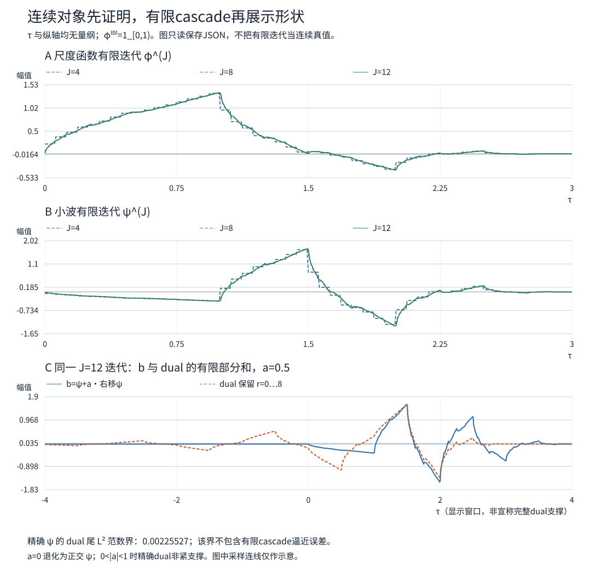
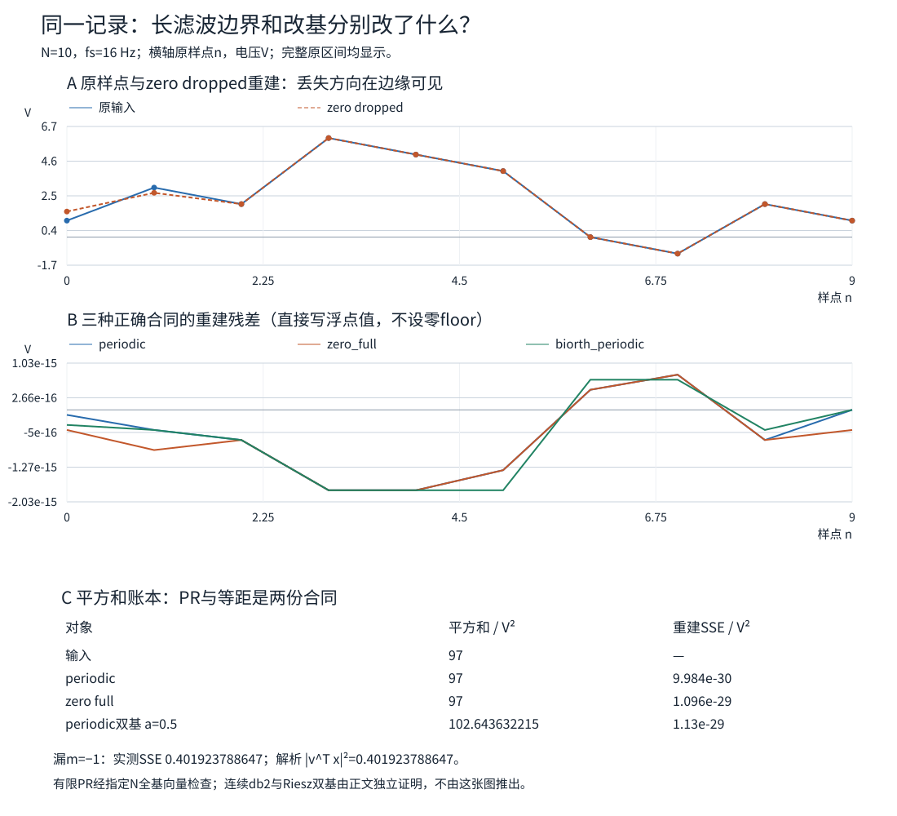

# 从四个db2系数到连续小波：存在、稳定与边界各要什么证明

四个tap能逆转一个数组，还欠连续函数一笔账：refinement有没有极限？整数平移会不会重合？全部尺度是否漏方向？上一课的[[信号与系统/20-数字信号处理/06-多分辨率分析尺度空间与小波基#四tap db2先兑现哪一层|有限db2二矩模型]]只付清了离散部分。本页用同一组系数实际造出连续db2，再造一对稳定的连续双基，最后返回长滤波器碰到有限记录两端时的行为。

这里的“高阶”具体指**恰两个消失矩**，不指任意阶。双正交具体指下文从db2正交补空间构造的两套连续小波基，不将它冒充全部CDF族或一套新的双refinement尺度函数。我们会确证存在、支撑、保守Hölder正则性和全尺度稳定性；有限42个基向量的重建检查负责四个指定长度，不能替无限维证明签字。

## 同一个对象，三种不同的合同

沿用06的无量纲坐标 $\tau$、$L^2(\mathbb R;\mathbb C)$ 与第一变量线性内积。尺度增大表示变细，$f_{j,k}(\tau)=2^{j/2}f(2^j\tau-k)$。实际时间 $t=T\tau$ 要再乘 $T^{-1/2}$ 才保持连续单位范数；电压的连续系数单位是 V·√s。本页有限数组 $x[n]$ 的单位V，平方和是V²，绝不因名字叫“能量”就自动变J。

| 层 | 输入、输出 | 本页如何证明或检查 |
|---|---|---|
| 连续构造 | $L^2$ 函数与积分系数 | Fourier积、连续自相关、MRA两端极限 |
| 稳定双基 | 全部尺度的 $\ell^2$ 系数与 $L^2$ 函数 | 有界可逆算子和与尺度无关的上下界 |
| 有限实现 | 偶长V数组及边界协议 | 固定相位的卷积、全基向量、解析失效方向 |

连续函数可以投影成尺度系数，再进入滤波器组；任意点值数组不自动等于那些积分系数。下文有限试验是独立的数字模型，不靠“采样了连续图”取得PR资格。

## 固定db2约定：先让所有根号在同一边

复用已发布实验14的 $h,g$：

$$h=\frac1{4\sqrt2}(1+\sqrt3,\ 3+\sqrt3,\ 3-\sqrt3,\ 1-\sqrt3),\qquad g_n=(-1)^nh_{3-n}.$$

因此 $g=(h_3,-h_2,h_1,-h_0)$，与某些软件的整体负号或反序约定不同；两矩结论不变，具体曲线方向会变。令 $c_n=\sqrt2h_n$。目标为

$$\phi(\tau)=\sum_{n=0}^3c_n\phi(2\tau-n),\qquad
\psi(\tau)=\sqrt2\sum_{n=0}^3g_n\phi(2\tau-n).$$

变换约定是 $\widehat f(\omega)=\int f(\tau)e^{-i\omega\tau}d\tau$、逆变换因子 $1/(2\pi)$；$\omega$ 是每单位 $\tau$ 的弧度。定义

$$m_0(\omega)=\frac1{\sqrt2}\sum_nh_ne^{-in\omega}
=\left(\frac{1+z}{2}\right)^2Q(z),\quad z=e^{-i\omega},$$
$$Q(z)=\frac{(1+\sqrt3)+(1-\sqrt3)z}{2}.$$

直接展开核得 $m_0(0)=1$、$Q(1)=1$、$\max_{|z|=1}|Q(z)|=\sqrt3$。$m_0$ 在 $\pi$ 有恰二阶零点，且

$$\sum_nh_nh_{n-2k}=\delta_{k0},\qquad |m_0(\omega)|^2+|m_0(\omega+\pi)|^2=1.$$

这些QMF恒等式在06已核；06的稀疏mask反例也说明，**QMF本身不能代替下面的存在与正交证明**。[MIT Handout 11，PDF页6–9](https://ocw.mit.edu/courses/18-327-wavelets-filter-banks-and-applications-spring-2003/1bb693efeb7d2ea97f12ae72812f7522_Handout11.pdf#page=6)在把滤波器正交传给函数时明确保留cascade收敛前提。本页从这个具体因式分解补足它。

## 先造函数：Fourier积给存在和保守光滑度

refinement要求 $\widehat\phi(\omega)=m_0(\omega/2)\widehat\phi(\omega/2)$。若再要求 $\int\phi=1$，唯一可能的候选是

$$F(\omega)=\prod_{r=1}^{\infty}m_0(\omega/2^r).$$

**第一步，积确实有意义。** 在任意有界 $\omega$ 区间，$|m_0(\omega/2^r)-1|\le C|\omega|2^{-r}$，误差和有限，故乘积局部一致收敛，$F$ 连续、$F(0)=1$。若某一因子为零，就从该处取零；不需对零点取对数。

**第二步，尾部足够小。** 两个Haar因子可精确相乘：

$$\prod_{r\ge1}\left(\frac{1+e^{-i\omega/2^r}}2\right)^2
=e^{-i\omega}\left(\frac{\sin(\omega/2)}{\omega/2}\right)^2.$$

对 $Q$ 积取 $R=\lceil\log_2(1+|\omega|)\rceil$。前 $R$ 项至多 $(\sqrt3)^R$；后面用 $|Q(e^{-i\theta})-1|\le C|\theta|$，几何尾和有统一界，因而尾积有统一上界。合起来

$$|F(\omega)|\le C(1+|\omega|)^{-\gamma},\qquad
\gamma=2-\log_2\sqrt3\approx1.207519>1.$$

所以 $F\in L^1\cap L^2$。逆Fourier积分定义一个真实、连续、平方可积的实函数 $\phi$（$F(-\omega)=\overline{F(\omega)}$）。积公式还给refinement；Fourier唯一性把它传回函数。这里不是先假设一个好看的极限，再给它起名。

对任意 $0<\alpha<\gamma-1=1-\log_2\sqrt3\approx0.207519$，有 $\int|\omega|^\alpha|F(\omega)|d\omega<\infty$。利用 $|e^{i\omega\delta}-1|\le C_\alpha|\omega\delta|^\alpha$，得到

$$|\phi(\tau+\delta)-\phi(\tau)|\le C_\alpha|\delta|^\alpha.$$

这是一条**保守的** $C^\alpha$ 保证；不声称它是最佳指数，不声称 $C^1$。$\psi$ 是有限个缩放平移之和，因此保有同一Hölder保证。

### 支撑和归一：不能从频域衰减猜长度

从 $\phi^{(0)}=1_{[0,1)}$ 开始迭代 $\phi^{(J+1)}(\tau)=\sum_nc_n\phi^{(J)}(2\tau-n)$。每一层支撑都在 $[0,3]$ 内，更精确的右端是 $3-2^{1-J}$；每层积分1。初层整数平移正交，QMF使下一层整数平移继续正交，故 $\|\phi^{(J)}\|_2=1$。这只是对**有限迭代**的归纳，未先声称极限正交。

其变换为

$$\widehat{\phi^{(J)}}(\omega)=\prod_{r=1}^Jm_0(\omega/2^r)\widehat{\phi^{(0)}}(\omega/2^J)\longrightarrow F(\omega).$$

共同支撑及Cauchy–Schwarz给 $\|\phi^{(J)}\|_1\le\sqrt3$，因此变换统一有界。对任意Schwartz测试函数，以其可积Fourier变换作控制即可交换极限，得到 $\phi^{(J)}\to\phi$ 的分布收敛。所有迭代在 $[0,3]$ 外为零，极限也如此；连续性使 $\phi$ 在该区间外及两端为零。于是 $\phi\in L^1$，且 $\int\phi=F(0)=1$。

上述Fourier积还证明归一化 $L^1$ refinement解唯一：把方程迭代 $J$ 次，用 $\widehat\phi(\omega/2^J)\to\widehat\phi(0)=1$ 即可。支持端点确为0和3：若非零支撑最左/右端缩入内部，最左的 $c_0\ne0$、最右的 $c_3\ne0$ 项在各自最外侧无人抵消，端点方程分别只能给0、3。

图画的是 $J=4,8,12$ 的**分格常值有限迭代**，不是对连续极限作精确点值采样；双基面板也使用同一迭代。近似画得像，不等于证明里可以少一行。

## 再证平移正交：只需求五个真实积分

令 $r(k)=\int\phi(\tau)\phi(\tau-k)d\tau$。实函数给 $r(-k)=r(k)$，支撑给 $r(k)=0$ 当 $|k|\ge3$。归一后的mask自相关为

$$a_\ell=\sum_nh_nh_{n+\ell},\quad a_0=1,\quad a_{\pm1}=9/16,\quad a_{\pm2}=0,\quad a_{\pm3}=-1/16.$$

把refinement代进**连续积分**并换元，得到 $r(k)=\sum_\ell a_\ell r(2k+\ell)$。$k=2,1$ 两式分别为

$$r(2)=-r(1)/16,\qquad r(1)=r(1)/2+r(2).$$

故 $r(1)=r(2)=0$，还差 $r(0)$。对任何非零整数 $q$，将 $q=2^sv$、$v$ 奇数，积中的第 $s+1$ 项在 $\pi v$ 为零，所以 $F(2\pi q)=0$。局部有限和 $S(\tau)=\sum_k\phi(\tau-k)$ 是连续1周期函数；它的Fourier系数是 $F(2\pi q)=\delta_{q0}$。由[[数学/16-数学分析/13-Fourier级数正交展开与收敛|Fourier完备性与唯一性]]，$S=1$。于是

$$\sum_kr(k)=\int\phi(\tau)S(\tau)d\tau=1,\qquad r(0)=1.$$

现在才有 $\langle\phi(\cdot-k),\phi(\cdot-\ell)\rangle=\delta_{k\ell}$，包括单位范数。这个次序避开“拿QMF推正交、拿正交推收敛、拿收敛再推QMF”的循环。

有限迭代范数始终1，前述分布收敛与统一 $L^2$ 界通过稠密测试函数给弱 $L^2$ 收敛；极限范数也是1。展开 $\|\phi^{(J)}-\phi\|^2=\|\phi^{(J)}\|^2+\|\phi\|^2-2\operatorname{Re}\langle\phi^{(J)},\phi\rangle$，这才得到强 $L^2$ 收敛。弱收敛与范数的区别可回看[[数学/16-数学分析/20-泛函分析/08-弱拓扑弱星拓扑与收敛#有界性与下半连续性：弱极限能丢能量|弱极限能丢能量]]。

## MRA与恰两个消失矩：把剩下的方向收齐

令 $V_j=\overline{\operatorname{span}}\{\phi_{j,k}\}$。平移正交给闭空间内ONB，refinement给 $V_j\subset V_{j+1}$，单位伸缩给 $DV_j=V_{j+1}$。为了接上06的抽象小波结论，还须核两端。

**细端稠密。** 正交投影的核为

$$K_j(\tau,u)=2^j\sum_k\phi(2^j\tau-k)\phi(2^ju-k).$$

partition unity与 $\int\phi=1$ 给 $\int K_j(\tau,u)du=1$；非零项要求 $|\tau-u|\le3\cdot2^{-j}$。每点最多4个整数平移重叠，故 $\int|K_j(\tau,u)|du\le4\|\phi\|_\infty\|\phi\|_1$。对 $f\in C_c$，$|P_jf-f|$ 受这个常数乘以 $f$ 在距离 $3\cdot2^{-j}$ 内的连续模控制，趋于零；输出支撑也在一个共同有界区间，故 $L^2$ 误差趋零。$C_c$ 在 $L^2$ 稠密（06的有限区间简单函数再把跳边换成任意窄的连续斜坡），投影收缩将结论推广到全部 $L^2$。

**粗端消失。** 记 $M=\|\phi\|_\infty$。对 $f\in L^1\cap L^2$，令 $A_k=\int|f(u)||\phi(2^ju-k)|du$，则 $\max A_k\le M\|f\|_1$、$\sum A_k\le4M\|f\|_1$。所以

$$\|P_jf\|_2^2\le2^j\sum_k A_k^2\le4M^2 2^j\|f\|_1^2\longrightarrow0\quad(j\to-\infty).$$

再用稠密性与投影收缩扩展到全部 $L^2$。因此 $\overline{\bigcup V_j}=L^2$、$\bigcap V_j=\{0\}$。

最后令 $m_1(\omega)=\sum g_ne^{-in\omega}/\sqrt2=-e^{-3i\omega}\overline{m_0(\omega+\pi)}$。QMF使由 $m_0,m_1$ 及其 $\pi$ 平移组成的两行矩阵酉；用它对全部 $\ell^2$ 细尺度系数分解，低通的平移和高通的平移共同成为 $V_{j+1}$ 的ONB。这一步等价于05中已推的无限序列paraunitary分析/合成，输入现在是**已证正交的 $\phi_{j+1,k}$ 系数**。故 $V_{j+1}=V_j\oplus^\perp W_j$，$\{\psi_{j,k}\}_k$ 是 $W_j$ 的ONB。两端极限与[[信号与系统/20-数字信号处理/06-多分辨率分析尺度空间与小波基#从MRA到小波基：把无限两端的账结清|06的望远镜分解]]给全部 $\{\psi_{j,k}:j,k\in\mathbb Z\}$ 是整个 $L^2$ 的ONB。

消失矩也要从连续对象算一遍。对 $r\ge0$，

$$\int\tau^r\psi(\tau)d\tau
=2^{-r-1/2}\sum_ng_n\int(u+n)^r\phi(u)du.$$

旧有限模型的 $\sum g_n=\sum ng_n=0$、$\sum n^2g_n=-\sqrt{3/2}$ 加上 $\int\phi=1$，给

$$\int\psi=\int\tau\psi=0,\qquad \int\tau^2\psi=-\sqrt3/8\ne0.$$

所以是**恰二矩**。对局部一次趋势的抵消、二阶余项及 $2^{-j(p+1/2)}$ 上界，复用[[信号与系统/20-数字信号处理/06-多分辨率分析尺度空间与小波基#消失矩：为什么多项式背景不进入细节|06的Taylor论证]]；多项式配对因本小波紧支撑而存在，不意味着全实轴多项式属于 $L^2$。

## 真实连续双基：放弃等距，保住可控的反演

正交分析与合成用同一基，但设计余地少。现在保持已经证明完备的正交小波 $\psi$，取实数 $|a|<1$，定义

$$b(\tau)=\psi(\tau)+a\psi(\tau-1),\qquad
\widetilde b(\tau)=\sum_{r=0}^{\infty}(-a)^r\psi(\tau+r).$$

这都是实际连续函数，不是有限tap的绰号。级数在 $L^2$ 收敛；$\psi$ 有界且 $\sum|a|^r<\infty$，也一致收敛，保有前面的 $C^\alpha$ 保证。$b$ 支撑在 $[0,4]$，$a\ne0$ 时 $\widetilde b$ **不紧支撑**：它与任意远的 $\psi(\cdot+r)$ 内积是 $(-a)^r\ne0$，而两个紧支撑函数平移足够远后内积必为零。

令 $b_{j,k}=2^{j/2}b(2^j\tau-k)$，dual同样伸缩。相同尺度用 $\psi_{j,k}$ 的正交性，几何项逐个抵消，得到

$$\langle b_{j,k},\widetilde b_{j,\ell}\rangle=\delta_{k\ell};$$

不同尺度各在互相正交的 $W_j$ 中，内积也为零。分析必须取

$$q_{j,k}=\langle f,\widetilde b_{j,k}\rangle,\qquad f=\sum_{j,k}q_{j,k}b_{j,k}.$$

把dual换成 $b$ 自己，通常就不是逆操作。

更关键的是稳定性。定义 $(Sq)_k=q_{k-1}$，则 $\sum_kq_kb_{j,k}$ 的正交 $\psi$ 系数是 $(I+aS)q$。由于 $S$ 酉，

$$(1-|a|)\|q\|_{\ell^2}\le\|(I+aS)q\|_{\ell^2}\le(1+|a|)\|q\|_{\ell^2},$$

逆为算子范数收敛的 $\sum_{r\ge0}(-aS)^r$。因此每个 $W_j$ 都被铺满；**同一对常数对所有尺度都成立**，再利用各 $W_j$ 正交，得到全尺度Riesz基：

$$(1-|a|)^2\sum_{j,k}|q_{j,k}|^2\le\left\|\sum_{j,k}q_{j,k}b_{j,k}\right\|_2^2
\le(1+|a|)^2\sum_{j,k}|q_{j,k}|^2.$$

dual的界是 $1/(1+|a|)^2$ 与 $1/(1-|a|)^2$。[Cohen–Daubechies–Feauveau 1992，原文页506（PDF页22）](https://sites.math.duke.edu/~ingrid/publications/CPAM_1992_p485.pdf#page=22)把闭span和这类统一上下界列为Riesz基的合同。本页逐条件证明的是一个具体连续双基；没有调用其一般双mask构造定理，亦不声称这是CDF紧支撑双正交族。原来的正交尺度函数 $\phi$ 和空间 $V_j$ 仍可保留；改变的是每个补空间内分析/合成的基。

### 可手算的非Parseval例与失稳例

取 $a=1/2$、$f=\psi_{0,0}$。分析系数 $q_{0,k}=(-a)^k$（$k\ge0$，其余0），故 $\|f\|^2=1$，但 $\sum|q|^2=1/(1-a^2)=4/3$。全保留时相邻项相消，恢复 $f$；只保 $q_{0,0}=1$ 时恢复 $b=\psi_0+a\psi_1$，误差平方 $a^2=1/4$，而丢弃系数平方和是 $1/3$。这既不是计算坏了，也不是去噪保证；正交版“丢多少系数能量就损失多少信号能量”在此不成立。

$\widetilde b$ 的尾部有精确可控界：只保 $r\le R$，$L^2$ 尾范数为 $|a|^{R+1}/\sqrt{1-a^2}$。当 $a=0$ 时双基退化回正交 $\psi$，不再具有非紧支撑或非Parseval的差异。两套函数均恰二矩，因为平移不改零阶/一阶零矩，二阶矩分别变为 $(1+a)(-\sqrt3/8)$ 与 $(-\sqrt3/8)/(1+a)$；指数衰减保证dual的矩积分绝对收敛。

不能把 $a=1$ 也收进同一稳定结论。令 $q_k=(-1)^k/\sqrt M$，$0\le k<M$，其余0，则 $\|q\|=1$，$(I+S)q$ 仅剩两个端点，平方范数 $2/M\to0$。下界不存在。对有限偶长圆周，交替向量更直接落入精确零空间。这是可用任意长输入击穿的机制，几个随机输入恢复成功挡不住它。

## 有限长滤波：同一组tap，三种端点行为

固定连续小波后，数字实现还须另写边界合同。此处采用**相关形式**

$$A[m]=\sum_{n=0}^3h_nx[2m+n],\qquad D[m]=\sum_{n=0}^3g_nx[2m+n].$$

旧源码 `offline(x,h,factor,phase)` 是full卷积；所以分析喂反序 $h,g$，保留卷积奇相位 $2m+3$。这与05的逐对约定相容于各自索引，却不能省掉长度4带来的三个样本前视：在线计算 $m$ 必须等 $x[2m+3]$（已知延拓项另论）。合成在坐标 $2m+n$ 累加 $h_nA[m]+g_nD[m]$，先写坐标，再谈“去延时”。

| 协议（$N$ 偶且 $N\ge4$） | 分析保留的 $m$ | 系数总数 | 合成与裁剪 |
|---|---|---:|---|
| periodic | $0,\ldots,N/2-1$，$x[n]=x[n\bmod N]$ | $N$ | full合成后将坐标模 $N$ 折叠 |
| zero full | $-1,\ldots,N/2-1$，区间外全0 | $N+2$ | 合成坐标 $-2,\ldots,N+1$，取原坐标 $0,\ldots,N-1$ |
| zero dropped（故意错误） | 删除zero full的 $m=-1$ | $N$ | 同坐标合成再取原区间；左边信息已丢失 |

periodic由QMF的偶移相关在圆周上折叠，得方阵 $E_N^*E_N=I$，合成为 $E_N^*$；$N\ge4$ 保证本tap约定没有额外短圈退化。zero full是无限正交分析作用于零延拓输入，所有可能非零的分析系数都保留，因此 $E_{\rm full}^*E_{\rm full}=I_N$。它是 $(N+2)\times N$ 等距嵌入，**不是**在任意 $N+2$ 系数上均可无损逆回的方阵。冗余系数本身有相容约束。

漏 $m=-1$ 为何危险？被删的两行只读 $x[0],x[1]$，它们的平方外积和恰为 $vv^*$，其中

$$v=(\sqrt3/2,-1/2,0,\ldots,0)^T,\quad\|v\|=1.$$

直接用四tap相乘可核，于是 $E_{\rm keep}^*E_{\rm keep}=I-vv^*$。错误重建 $\widehat x=(I-vv^*)x$，且

$$\|x-\widehat x\|^2=|v^*x|^2.$$

特别是输入 $v$ 的所有保留系数都为0，重建变0。这比“某张曲线边上有一点歪”更强：丢失方向根本不可辨识，换一个逆算法也救不回来。

固定记录 $x=(1,3,2,6,5,4,0,-1,2,1)$ V，$f_s=16$ Hz，离散平方和97 V²：

| 方案 | 系数平方和/V² | 重建平方误差/V² |
|---|---:|---:|
| db2 periodic | 97（浮点96.99999999999997） | $9.98\times10^{-30}$ |
| db2 zero full | 同上 | $1.10\times10^{-29}$ |
| zero dropped | 不具有上述等距合同 | $0.401923788646684$ |
| 下述周期双基，$a=1/2$ | $102.6436322151508$ | $1.13\times10^{-29}$ |

错误方案只改坏前两点，约为 $(1.5490381,2.6830127)$；解析误差正是 $(\sqrt3/2-3/2)^2$。若按所有样点持有 $1/f_s$ 秒的独立ZOH电压模型积分，97还须除16才是V²·s，且这仍不是连续db2尺度系数的解释。

### 周期双基的有限对应：逆必须尊重圆周

先取上述周期正交子带 $A,D$，令 $M=N/2$，$S_M$ 为循环右移。在细节子带上设

$$D=(I+aS_M)q,\qquad
q=\frac{\sum_{r=0}^{M-1}(-a)^rS_M^rD}{1-(-a)^M}.$$

因为 $S_M^M=I$，分母来自有限几何和；不能把无限线上的逆随手截到 $M$ 项而漏分母。分析输出 $(A,q)$，合成先算回 $D$ 再用正交合成；所以PR成立，通常不Parseval。$|a|<1$ 给与长度无关的上下界，$a=1$ 且 $M$ 偶时不可逆。

这个数组模型与连续 $I+aS$ 有同一“在已知正交方向内改基”的机制，但圆周会绕回，连续dual延至负无穷，**二者不是逐点同一个函数**。有限实验不拿它来证明连续存在。

## 长一点、光滑一点：得到什么，付出什么

| 具体对象 | 得到的性质 | 本例代价与边界 |
|---|---|---|
| Haar | 紧支撑、正交、对齐端点易解释 | 不连续，恰一矩 |
| 本页db2 | 紧支撑 $[0,3]$、ONB、恰二矩、已证 $C^\alpha$（$\alpha<0.207519$） | tap不对称；滤波跨边界更远，端点协议更重要 |
| 本页 $b,\widetilde b$ | 真正连续双基，恰二矩、同一保守正则性、可控Riesz界 | 当 $0<|a|<1$ 时分析与合成不同，不Parseval，$b$ 支撑扩至 $[0,4]$ 且dual不紧支撑；$|a|\to1$ 稳定界恶化 |

更多消失矩能抵消更高阶局部趋势，但不会自动保护突变/短脉冲；实际去噪的全域与局部真值检查在[[信号与系统/20-数字信号处理/07-同信号时频多尺度表示阈值去噪与编码|07应用页]]。db2也没有由连续性变成线性相位。对称性需核具体对象：$h$ 显然不等于反序；若还要判断 $\psi$，由同一矩递推有 $\int\tau^3\psi=(3-9\sqrt3)/16$，支撑中心 $3/2$ 的三阶中心矩为 $3/16\ne0$，排除对称；二阶中心矩仍为 $-\sqrt3/8\ne0$，排除反对称。[MIT Handout 8，PDF页5](https://ocw.mit.edu/courses/18-327-wavelets-filter-banks-and-applications-spring-2003/29303d64110d5953075d8f3781ce61fe_Handout8.pdf#page=5)用谱因子分根解释了正交设计中对称性受到的约束；本页只对实际db2作上述判定，不把这几行升级成所有小波的分类定理。

CDF论文给了包含紧支撑、对称双正交设计的一般框架；本页非紧支撑dual是**这项构造的代价**，并非“所有双正交都只能如此”。若工程要求两侧都有限tap且对称，应另选具体CDF对并逐核其条件，不能拿本页的 $b$ 换标签。原课程以一个正交高阶构造和一个真实稳定双基说明这组取舍，不以列举全部家族为掌握标准。

## 撤去提示后的迁移题

1. 保持同一四tap，只知道 $|m_0|^2+|m_0(\cdot+\pi)|^2=1$。能否立刻写“连续正交小波存在”？本页哪两步真正排除了06的稀疏反例？
2. 若只算出 Fourier衰减 $|F(\omega)|\lesssim(1+|\omega|)^{-0.9}$，本页的连续性/Hölder证明还能原样使用吗？
3. 把连续双基参数从 $a=1/2$ 改成 $a=0.9$，给出一组有效的全尺度Riesz上下界；哪些常数会变坏？仍可把丢弃系数平方和当精确失真吗？
4. 同一N10输入在zero full中保留12个系数，认为“过完备，因此可以任意改这12个系数再无损回来”。这句话错在哪里？
5. 用输入 $v$ 比较zero full与zero dropped。为什么将错误方案改用更精确浮点或换合成延时，都不能恢复被删方向？
6. 有人把周期双基逆直接写成 $\sum_{r=0}^{M-1}(-a)^rS_M^r$。给一个 $M=2,a=1/2$ 的反证，并说明无限连续dual为何没有相同分母。
7. 若要在真实16Hz传感器流上使用本页滤波器，首次实验必须保存什么，才能区分时标错误、边界失配和小波去噪损伤？不要用“图很平滑”作为验收。

## 迁移题答案与自检路径

1. 不能。Fourier因子分解给 $\gamma>1$，先造出归一连续 $L^1\cap L^2$ refinement解及其紧支撑；再用该函数的五lag连续自相关和partition unity证整数平移正交。稀疏mask有QMF却不能通过相同的稳定正交极限条件，06已给其矛盾。
2. 不能原样用：$0.9\le1$ 不给 $F\in L^1$，也不给 $\int|\omega|^\alpha|F|<\infty$。这只说明此充分判据失效，不证明连续解必不存在；可能需要更强估计或另一证明。
3. 有效界为 $0.01$ 与 $3.61$，逆算子范数上界10，dual上界100；相较 $a=.5$ 的 $[.25,2.25]$ 更易放大系数/反演扰动。仍非Parseval，只有界，不是相等。$a=1$ 的单位范数交替输入给输出平方范数 $2/M$，无法保持正下界。
4. 原输入空间是N维，合法全系数落在一个N维子空间。$E^*E=I_N$，但 $EE^*$ 是到相容系数空间的投影，非 $I_{N+2}$。分析→合成→再分析会丢掉不相容分量。
5. full全部保留时恢复单位向量v；dropped全部系数为0。零输入也产生同一全零记录，故映射不单射；数值精度与延时只能改计算误差/坐标，不能补回不存在的信息。
6. $(I+aS)(I-aS)=I-a^2S^2=(3/4)I$，遗漏的分母是 $3/4$，会把每个D缩成四分之三。无限线上 $S^M\ne I$，几何尾随 $|a|^M\to0$；完整无穷和本身就是逆，不是有限圆周的截断。
7. 保存实际时间戳、校准V单位/采样率、原始有序样点、N、tap版本、相关/卷积及相位、延拓mode、保留的m、流起止/flush规则、处理前后对齐样点；若去噪还须独立参考真值或受控注入、阈值与被阈值化子带、全域/局部各自分母及误差。预期periodic与零边界只在各自假设下重建，失配看端点/可用时刻；真实丢包、抖动、模拟带宽与同步另验。本包没有连接设备，也没有真人学习验收。

## 实验与课程出口

[[信号与系统/80-实践/16-db2连续与长边界/README|实验16]]保存固定输入、规范源码、旧源引用、实际结果、绘图源和验证边界。连续存在/正则/完备、Riesz界及边界零空间都是高重要性断言，分别由本页推导和独立核对承担；有限全基向量只证指定N的实现。原生Obsidian渲染与真实传感器流不是本机数组结果的一部分。

读完应能把05的离散PR、06的完整Haar MRA、07的同信号应用，与本页连续db2和真实双基/长边界连成一条可检算链。这是原课程代表性主线的收尾；更高阶家族分类、特定CDF有限滤波器设计、非均匀采样/硬件部署不是本页额外承诺。
