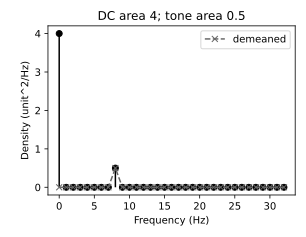

# 随机过程、相关与功率谱

为什么噪声每次都不同，工程师仍能用一条谱设计滤波器？因为设计依赖的对象常是**一族可能记录的统计规律**。本课从四点记录开始，把有限观察、总体相关和每 Hz 的谱密度接在一起；下一课把它用于判断噪声中有没有脉冲。

## 两个入口，同一个问题

**基础入口（15 分钟首步）**：取记录 $x=[1,3,1,3]$。算均值 2、平均平方 5，去均值后 $v=[-1,1,-1,1]$ 的平均平方为 1。矩形窗、$f_s=4$ Hz 时，DFT 只有 $X[0]=8,X[2]=-4$ 非零。暂不读随机过程定义，先到“每 Hz 的密度”核验 DC 面积 4 加 Nyquist 面积 1。能说明为什么去均值后总面积只剩 1，就可以停下。

**快进入口**：对象是实离散随机过程 $X[n]$，有限二阶矩；区分 $R_X[\ell]$ 与 $C_X[\ell]$，在一个 Nyquist 区间采用 Hz 双边谱。检查常均值、平移不变二阶矩是否足够推出单条记录的时间平均一致，再进入同一节“有限记录不是总体”。

## 有限记录不是总体

随机过程 $X[n]$ 在每个整数 $n$ 给一个随机变量。一次实验取得一条 realization，例如 $[1,3,1,3]$；下一次可能取得别的数组。$E[X[n]]$ 跨实验求平均，$N^{-1}\sum_n x[n]$ 在一条数组里跨时间求平均；二者的关系需要条件。

总体自相关取实值约定

$$R_X[n,m]=E[X[n]X[m]],\qquad C_X[n,m]=E[(X[n]-\mu_n)(X[m]-\mu_m)].$$

相关包含均值贡献，协方差才专门描述围绕均值的联动。四点记录上的未去均值、除以 $N=4$ 的 lag-1 估计是 $(1\cdot3+3\cdot1+1\cdot3)/4=9/4$；去均值后对应值为 $(-1-1-1)/4=-3/4$。除以有效对数 3 则分别为 3 和 $-1$。这些是有限记录估计，**不能仅从这四点断言总体 lag-1 相关等于某一个数**。

若真实均值已知，$\widehat C_b[\ell]=N^{-1}\sum_{n=0}^{N-1-\ell}(x[n+\ell]-\mu)(x[n]-\mu)$ 对 WSS 总体的期望为 $(1-\ell/N)C[\ell]$。除以 $N-\ell$ 可消除这个边缘配对偏差，但所得整组 lag 不保证正半定；其傅里叶变换可能负。未知均值换成样本均值后还引入另一层偏差，不能沿用“unbiased”承诺。零延迟的 i.i.d. 方差有精确校正：$s^2=(N-1)^{-1}\sum(x[n]-\bar x)^2$；这个 $N-1$ 结论不自动适用于相关样本。

## 平稳与遍历分别回答什么

**严格平稳**：任意有限索引组的联合分布在共同平移后不变。**宽平稳（WSS）**：均值是常数 $\mu$、二阶矩有限，且 $R_X[n+\ell,n]=R_X[\ell]$ 只依赖 lag。严格平稳加有限二阶矩推出 WSS；反向一般不成立。对于联合 Gaussian 过程，均值与协方差决定所有有限维分布，因此 WSS 推出严格平稳。

可检查的 WSS 非严格例：偶数位置独立取 $\pm1$ 等概率，奇数位置独立取 $0,\pm\sqrt2$，概率分别为 $1/2,1/4,1/4$。所有位置均值 0、方差 1，非零 lag 相关 0，但一维分布随奇偶改变。

**均值遍历**要说明时间平均收敛到总体均值，本课采用均方收敛。对 WSS，

$$E[(\bar X_N-\mu)^2]=\frac1{N^2}\sum_{i,j=0}^{N-1}C_X[i-j].$$

右边趋于 0 才得到这类均值遍历；若 $\sum_\ell|C_X[\ell]|<\infty$，其上界不超过 $N^{-1}\sum_\ell|C_X[\ell]|$，是一个足够条件。估计相关还涉及四阶统计，均值遍历不等于“所有统计量都遍历”。

反例 $X[n]=Z$，$Z=\pm1$ 等概率：严格平稳、WSS，却每条记录的时间均值永远是 $Z$，而总体均值为 0；均方误差为 1。因此“平稳”不能授权用一条记录替代多次实验。[MIT Chapter 10 §10.2.2 的遍历讨论](https://ocw.mit.edu/courses/6-011-introduction-to-communication-control-and-signal-processing-spring-2010/8075041184d566103ce7c3f69afc5e75_MIT6_011S10_chap10.pdf)提供总体/时间平均的区分；这里选定均方模式并展示有限和式，避免隐藏收敛含义。

## 相关的谱、协方差的谱与 DC

采样率 $f_s$ Hz，采用基本频率区间 $[-f_s/2,f_s/2)$。在相关绝对可和时定义

$$S_X^{\rm Hz}(f)=\frac1{f_s}\sum_{\ell\in\mathbb Z}R_X[\ell]e^{-i2\pi f\ell/f_s},\quad R_X[\ell]=\int_{-f_s/2}^{f_s/2}S_X^{\rm Hz}(f)e^{i2\pi f\ell/f_s}\,df.$$

$S$ 的单位为信号幅度单位平方/Hz，例如 V²/Hz；$R[0]=E[X^2]$ 为 V²。只有额外给出阻抗与测量约定才能把它换算成 W 或 W/Hz。离散角频率谱 $S^{\Omega}(\Omega)=\sum R[\ell]e^{-i\Omega\ell}$ 不含 $1/f_s$；其积分是 $(2\pi)^{-1}\int_{-\pi}^{\pi}S^{\Omega}d\Omega$。二者不能漏掉尺度换算。

非零均值时 $R_X[\ell]=C_X[\ell]+\mu^2$，常项不绝对可和，需把谱理解成包含线谱的非负测度：

$$S_X^{\rm Hz}=S_C^{\rm Hz}+\mu^2\delta(f),\qquad\int S_X\,df=C_X[0]+\mu^2.$$

$\delta$ 不是有限高度的普通函数，它的面积为 1（单位 1/Hz）。在基本区间内 DC 线面积为 $\mu^2$。去掉**总体均值**留下协方差谱，积分为方差；用**样本均值**去均值只是一种有限样本处理，会移除本次记录的 DC，未证明总体均值已准确估计。[MIT Chapter 10 §10.1–10.2](https://ocw.mit.edu/courses/6-011-introduction-to-communication-control-and-signal-processing-spring-2010/8075041184d566103ce7c3f69afc5e75_MIT6_011S10_chap10.pdf)以自相关与 PSD 的 Fourier 配对为起点，并说明广义谱的必要性。

零均值离散白噪声只要求 $C[\ell]=\sigma^2\delta_{\ell0}$，所以双边 Hz 密度为 $\sigma^2/f_s$，积分回 $\sigma^2$。**白**是二阶不相关，**Gaussian**是分布条件；联合 Gaussian 白噪声样本独立，一般白噪声不必独立。理想连续时间白噪声在全实频轴平坦，不能当成有限方差的普通点值过程；采样实验必须说明带宽/采样约定，不能把离散 $\sigma^2$ 随意写成连续 $N_0/2$。

## 每 Hz 的密度怎样从数组算出来

矩形窗实记录长度 $N$，沿用 [[数学/70-信号处理与多模态数学/02-采样定理波形STFT与Mel频谱#3. 完整复数 DFT 与全局频谱显示|数学谱课的 DFT]]，先核验 DFT 尺度后回到这里完成归一化：

$$P_2[k]=\frac{|X[k]|^2}{f_sN},\quad\Delta f=f_s/N,\quad\sum_{k=0}^{N-1}P_2[k]\Delta f=\frac1N\sum_nx[n]^2.$$

实信号单边保留 rFFT，内部正频率乘 2；DC 与偶数 $N$ 的 Nyquist 不加倍，奇数 $N$ 的末 bin 仍成对须加倍。这里的积分是**bin 面积求和**，不能换成梯形积分后仍声称精确 Parseval。一般窗密度常归一为 $|FFT(wx)|^2/(f_s\sum w^2)$；面积为窗加权平方比，不自动等于未加窗均方。

图中 $x[n]=2+\sin(2\pi8n/64)$，$N=f_s=64$，bin 宽 1 Hz。黑圆含 DC，灰叉去样本均值。柱高是密度，面积才是均方：4+0.5=4.5。无颜色也可通过圆与叉、实线与虚线识别。有限确定性记录的 periodogram 是可复算图，不是“已测得总体 PSD”的证明。

对平稳 i.i.d. 噪声，单次 periodogram 的各频点起伏不会仅靠增长 $N$ 自动消失；分段平均可减小方差，却牺牲分辨率并引入窗平滑偏差。非平稳脉冲/漂移要转向分段或时频模型。该图没有重叠分段、Welch 或置信区间承诺。

## 迁移题与评分

1. 把基础记录采样率改成 8 Hz，数值不改。DC 与 Nyquist 的密度、bin宽、总面积怎样变？
2. 一个严格平稳但非遍历的常量随机过程为何会让长时间均值失效？写一个模型，不必局限于 $\pm1$。
3. 要估计传感器噪声方差，记录里存在缓慢漂移。直接套 $N-1$ 是否足够？还缺什么信息？
4. 若只提供某条去均值记录的谱，能否恢复总体 $\mu$ 和严格平稳性？

**可核验答案**：第1题 $\Delta f=2$ Hz，原 DC 密度4变2、Nyquist密度1变0.5，面积保持5；用双边谱并清楚处理共轭同样正确。第2题任何有限方差非退化 $Z$、$X[n]=Z$ 都可，说明时间均值随机而非总体均值。第3题相关性、趋势/漂移模型、测量带宽与目标总体尚不清楚，回答“未知，需独立重复或合适模型”是合法结论；$N-1$ 只修复 i.i.d. 样本均值造成的偏差。第4题不可，有限去均值操作丢掉本次均值，二阶谱也不确定全部联合分布。

每题2分：结论1分、条件/单位/反例1分；等价的谱约定需明确尺度即可满分。明确不足的信息比编造总体参数更准确。

## 返回检测问题

去 [[信号与系统/30-随机信号与推断/02-匹配滤波检测与未知到达时间#从短向量到检测统计量|下一课的短向量]]，带着“白噪声使内积输出方差怎样相加？”这一问题；推导完成后回到本页检查噪声方差与每 Hz 密度是否混用。运行 [[信号与系统/80-实践/03-噪声中的脉冲检测/README|U6 实验]]可验证面积、阈值与多个搜索位置；它不会替代平稳/遍历的证明。

## 电子电路往返：端口、谱面积与相关噪声

把本页的 $X[n]$ 换成某节点相对参考地的电压样本，单位V；采样率 $f_s$ 单位Hz。去 [[电子电路/38-随机噪声与测量/01-RMS方差相关与谱密度#每Hz的面积与每弧度的面积|连续端口密度]]，比较单边 $S_1$（V²/Hz）、ASD $e=\sqrt{S_1}$（V/√Hz）与本页离散基本频率区间；再返回本页“每 Hz 的密度怎样从数组算出来”，解释为什么要积 $e^2df$ 或求 bin 面积，而不能把幅度直接相加。一个反相放大器输入信号增益和噪声增益还可能不同，去 [[电子电路/38-随机噪声与测量/03-噪声端口传递与输入等效#从原KCL得到七条传递|实际噪声注入端口]] 找各个 $H_i$，再把它们带回谱合成。

令噪声频率分量为列 $N$、$S_{ij}=E[N_iN_j^*]$、输出 $Y=HN$（H为行）。直接展开 $YY^*$ 得 $S_o=HSH^{\rm H}$。各项 $H_iS_{ij}H_j^*$ 必须最后统一为V²/Hz；电流源的 $H_i$ 单位Ω。非对角项是 $2\operatorname{Re}(H_iS_{ij}H_j^*)$，只有零互谱才可删去。[[电子电路/38-随机噪声与测量/03-噪声端口传递与输入等效#互谱的矩阵次序不能靠实数例掩盖|共轭次序的主解释]] 已给完整端口例，这里不重复七条KCL。半正定约束来自 $E[|a^{\rm H}N|^2]\ge0$，故 $|S_{12}|^2\le S_{11}S_{22}$；两个正对角本身不够。相关不等于确定性同相，PSD积分也不自动证明记录遍历。[MIT 6.011 Chapter 10 §10.1、§10.2.2](https://ocw.mit.edu/courses/6-011-introduction-to-communication-control-and-signal-processing-spring-2010/8075041184d566103ce7c3f69afc5e75_MIT6_011S10_chap10.pdf) 对照谱面积与总体/时间统计条件；端口与下题为自足教学构造。

**迁移1。** 两个同单位端口在0–100 Hz各有单边ASD 10 nV/√Hz，实互谱 $S_{12}=0.5\times10^{-16}$ V²/Hz，输出为两电压之和。求RMS；互谱变负是否仍可行？**答案：** 输出PSD为 $3\times10^{-16}$ V²/Hz，RMS $\sqrt{3\times10^{-14}}=0.173205$ μV；RSS会给0.141421 μV并漏交叉项。负0.5倍互谱仍半正定，输出RMS0.1 μV；若互谱取2倍对角就不合法，不能用它制造负方差。

**迁移2。** 将同一0.2 μV RMS电压实际加在100 Ω和1 kΩ理想电阻上，功率一样吗？**答案：** 分别为 $v_{rms}^2/R=4\times10^{-16}$ W和 $4\times10^{-17}$ W。须确是负载两端电压且电阻实数恒定；PSD的V²/Hz并未自行指定W/Hz。计算功率后返回电子页核对测量端口与阻抗，没有负载条件时只报告电压均方。

## 从总体相关走到可用信息的估计

带本页的rxx、Sxx及均值假设去 [[信号与系统/30-随机信号与推断/03-Wiener滤波线性预测与创新#两样本电压为何胜过只取当前读数|Wiener两样本]]，先把允许的时刻写成X，再由正交条件Rw=p求权重；回本页说明为什么有限记录估的R不等于总体R。需要谱估计深度时去 [[信号与系统/30-随机信号与推断/03-Wiener滤波线性预测与创新#谱和相关要从哪段记录估|窗偏差与独立段方差]]，带回单位、自由度与重叠协方差；总体谱的非负性不自动认证某次谱比是实时因果滤波器。
